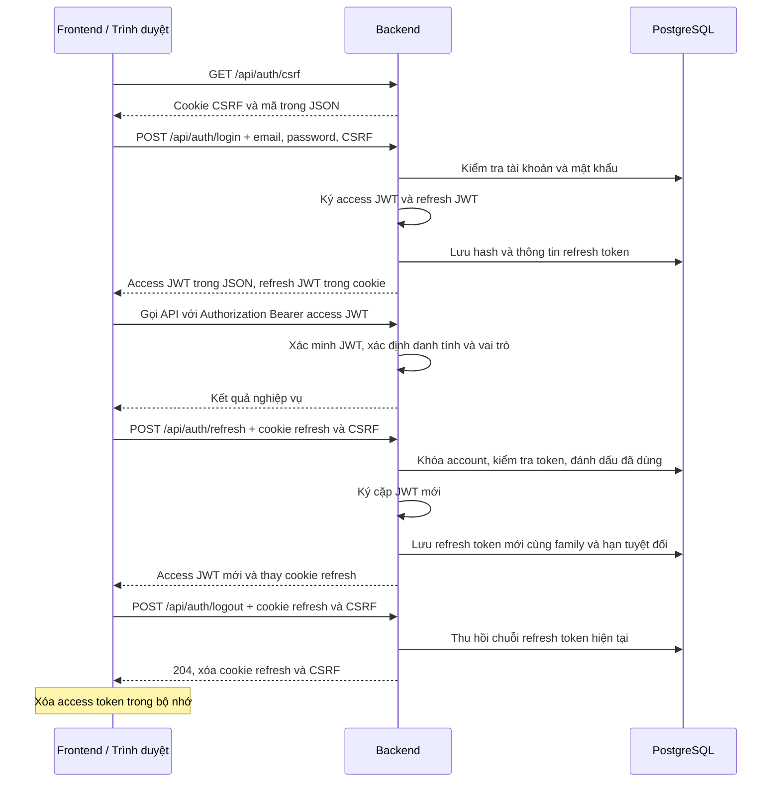

# Nestify — Xác thực khách hàng bằng JWT

**Cập nhật:** 27/10/2026. Tài liệu mô tả backend hiện có và hợp đồng để frontend tích hợp.

Đã triển khai: đăng ký khách hàng, gửi/gửi lại OTP, xác thực email, đăng nhập, làm mới token, xem tài khoản hiện tại và đăng xuất. Access token và refresh token đều là JWT. DTO API dùng class thông thường với constructor, getter/setter.

Chưa triển khai: đăng nhập NCC/admin, luồng NCC đổi mật khẩu lần đầu, quên/đổi mật khẩu, API quản trị khóa tài khoản và chỉnh sửa hồ sơ. Frontend cần nối các API theo tài liệu này; mô tả dưới đây không có nghĩa các màn hình đã tích hợp xong.

Tài liệu liên quan: [Cấu hình backend](backend-config.md), [Quy ước API](api-conventions.md), [Use case final](usecase-final.md), [Database final](database-design-final.md).

## 1. Hai loại token và dữ liệu phía server

| Nội dung | Access token | Refresh token |
| --- | --- | --- |
| Định dạng | JWT ký bằng HS256. | JWT ký bằng HS256, dùng khóa khác access token. |
| Mục đích | Xác thực request gọi API được bảo vệ. | Xin cặp access/refresh token mới. |
| Thời hạn mặc định | 15 phút kể từ lúc cấp. | 14 ngày tính từ lần login; không kéo dài mốc khi refresh. |
| Trả về frontend | Trường `accessToken` trong JSON. | Cookie `NESTIFY_REFRESH`, không trả trong JSON. |
| Frontend giữ/gửi | Giữ trong bộ nhớ; gửi `Authorization: Bearer <accessToken>`. | Trình duyệt giữ cookie HttpOnly; gửi với `credentials: 'include'`. |
| Xác minh ở backend | Kiểm tra chữ ký và claim bằng Spring Security; không tra bảng phiên. | Kiểm tra JWT, rồi kiểm tra account và bản ghi trong `refresh_tokens`. |
| Lưu database | Không lưu access token. | Chỉ lưu hash SHA-256 và thông tin quản lý token. |

JWT được ký, không mã hóa payload. Các claim không chứa mật khẩu, OTP hoặc khóa ký:

| Claim | Access JWT | Refresh JWT |
| --- | --- | --- |
| `sub` | ID tài khoản dưới dạng chuỗi. | ID tài khoản dưới dạng chuỗi. |
| `jti` | UUID riêng của access token. | UUID riêng của refresh token, bằng `refresh_tokens.id`. |
| `iss` | `JWT_ISSUER`, mặc định `nestify`. | Cùng issuer đã cấu hình. |
| `aud` | `nestify-api`. | `nestify-refresh`. |
| `iat`, `exp` | Thời điểm cấp/hết hạn, dạng NumericDate trong JWT. | Thời điểm cấp và hạn tuyệt đối của chuỗi refresh. |
| `token_use` | `access`. | `refresh`. |
| `role` | `CUSTOMER` trong luồng đang triển khai. | Không có claim này. |

Không có claim `sid`, không tạo `HttpSession`/`JSESSIONID`. `CurrentAccount` chỉ biểu diễn người dùng đã xác thực trong request hiện tại. Việc xác thực bằng access token không cần trạng thái phiên; việc quản lý refresh token vẫn có trạng thái trong database.

`family_id` chỉ nằm trong database, gom các refresh token từ cùng một lần login để thu hồi cả chuỗi khi phát hiện dùng lại token. API nghiệp vụ không tra `family_id`. Truy vấn dữ liệu nghiệp vụ vẫn thực hiện bình thường: ví dụ `/me` đọc account để trả thông tin mới nhất.

## 2. Luồng đăng nhập, gọi API, refresh và logout



### 2.1. Đăng nhập

`CustomerAuthController.login()` nhận DTO và gọi `CustomerAuthService.login()`. Backend chuẩn hóa email, kiểm tra mật khẩu bằng PasswordEncoder, loại account CUSTOMER, trạng thái ACTIVE, email đã xác thực và `mustChangePassword=false`.

Trước khi gọi service kiểm tra mật khẩu, login áp dụng rate limit mặc định 5 yêu cầu cho mỗi cặp email–IP và 30 yêu cầu cho mỗi IP trong một cửa sổ 1 phút. Mọi yêu cầu login có body hợp lệ và qua CSRF đều được tính, kể cả login thành công hoặc bị từ chối do trạng thái tài khoản. Vượt giới hạn trả `429 / LOGIN_RATE_LIMITED` cùng header `Retry-After` (số giây cần chờ); frontend có thể đọc header này qua CORS. Đổi email không bỏ qua giới hạn tổng theo IP. Rate limit tự hết hạn và không đổi trạng thái account sang `SUSPENDED`.

Bộ đếm nằm trong bộ nhớ từng backend instance, có giới hạn số IP được lưu và được dọn khi hết hạn; restart xóa bộ đếm. Nếu chạy nhiều instance, cần chuyển sang bộ đếm dùng chung hoặc giới hạn tại gateway. IP lấy từ `request.getRemoteAddr()`, không trực tiếp tin header `X-Forwarded-For` do client gửi. Khi triển khai sau reverse proxy, cần cấu hình proxy tin cậy để servlet nhận đúng IP client.

Khi hợp lệ, `RefreshTokenService.issueOnLogin()` gọi `JwtTokenService` để tạo cặp token, lưu bản ghi refresh và cập nhật `lastLoginAt`. Controller đặt cookie refresh và trả `LoginResponse`. Login thành công cũng xóa cookie CSRF cũ; frontend lấy lại CSRF trước POST xác thực tiếp theo.

Nếu cookie refresh cũ thuộc cùng account và hợp lệ, login thu hồi chuỗi cũ trước khi cấp chuỗi mới. Trình duyệt khác có chuỗi riêng. Nếu chuyển sang account khác, cookie bị thay nhưng token account cũ không tự bị thu hồi; frontend gọi logout trước khi đổi account nếu muốn kết thúc đăng nhập cũ.

### 2.2. Gọi API cần xác thực

Frontend gửi access JWT trong `Authorization`. Spring Security xử lý trước controller, sử dụng decoder trong `JwtConfig` để kiểm tra HS256, chữ ký, issuer, audience, `token_use`, thời hạn và các claim bắt buộc. Backend không chấp nhận refresh JWT ở vị trí access JWT.

Từ `sub` và `role`, `SecurityConfig` tạo `CurrentAccount` cùng authority `ROLE_CUSTOMER`. Controller nhận principal bằng `@AuthenticationPrincipal`. Token không hợp lệ trả 401; không đủ vai trò trả 403. Các service nghiệp vụ vẫn phải kiểm tra quyền sở hữu đơn, hồ sơ hoặc tài nguyên; chỉ có role chưa đủ.

### 2.3. Làm mới token và phát hiện dùng lại

1. Frontend gọi `POST /api/auth/refresh` với cookie refresh và mã CSRF; không cần access token còn hạn.
2. Backend xác minh refresh JWT rồi khóa account trong transaction để điều phối refresh/logout đồng thời.
3. Tìm bản ghi theo `jti` và account, so sánh hash và hạn. Token phải chưa dùng, chưa thu hồi, còn hạn; account vẫn phải CUSTOMER, ACTIVE, đã xác thực và không yêu cầu đổi mật khẩu.
4. Đặt `used_at` cho token cũ, cấp token mới có `jti` khác nhưng giữ `family_id` và hạn tuyệt đối của chuỗi. Cấp access JWT mới theo thông tin account tại thời điểm này.
5. Nếu token đã dùng xuất hiện lại, thu hồi toàn bộ family và trả `401 / REFRESH_TOKEN_REUSED`. Việc thu hồi vẫn commit dù request kết thúc bằng lỗi.

Ví dụ `R1 → R2 → R3`: cả ba có cùng family nhưng khác `jti`. Dùng lại R1 làm R3 cũng không thể refresh. Lịch sử token chỉ được dọn sau hạn tuyệt đối; chưa có job dọn tự động trong phạm vi hiện tại.

Hai refresh đồng thời với cùng token được xử lý như reuse: một request có thể nhận cặp mới, request còn lại thu hồi chuỗi đó. Frontend cần điều phối refresh giữa cả các tab dùng chung cookie. Nếu mất response sau khi server đã đổi token, gửi lại token cũ có thể bị từ chối và phải đăng nhập lại.

### 2.4. Đăng xuất và giới hạn thu hồi

Logout thu hồi family của refresh cookie hiện tại, xóa cookie refresh và CSRF, trả 204. Gọi lại khi không có refresh token hợp lệ vẫn trả 204 nếu CSRF hợp lệ. Frontend xóa access token trong bộ nhớ.

Access JWT đã cấp vẫn được chấp nhận đến `exp`, tối đa 15 phút từ lúc cấp, kể cả sau logout. Xác thực hiện tại không tra danh sách thu hồi access token hoặc trạng thái account trên mỗi request. Thay đổi vai trò/khóa account cũng có độ trễ tương tự đối với access token cũ.

Login và refresh kiểm tra trạng thái account ở database. Khi triển khai API khóa hoặc đặt lại mật khẩu, cần thu hồi tất cả refresh token của account trong transaction có cùng khóa account; đó là công việc tiếp theo, chưa phải chức năng đã hoàn thành. Sau mở khóa, token cũ đã thu hồi vẫn không được làm mới.

## 3. API và DTO

Các endpoint hiện tại dùng **`/api/auth`**, chưa dùng `/api/v1/auth`. Mọi POST trong bảng cần cookie/header CSRF hợp lệ. Các endpoint công khai dưới đây bỏ qua Bearer header, nên access token hết hạn không cản login/refresh/logout; riêng `/me` cần access JWT.

| Phương thức | Endpoint | Body JSON | Kết quả |
| --- | --- | --- | --- |
| GET | `/api/auth/csrf` | Không. | 200: `{headerName, token}` và cookie CSRF. |
| POST | `/api/auth/register/customer` | `email`, `password`, `displayName`, `phone` tùy chọn. | 201: tạo hoặc cập nhật khách PENDING_EMAIL, gửi OTP và token đăng ký mới. |
| POST | `/api/auth/resend-verification` | `email`, `registrationToken`. | 200: gửi OTP mới cho đúng lần đăng ký, giữ nguyên token. |
| POST | `/api/auth/verify-email` | `email`, `code`, `registrationToken`. | 200: chuyển sang ACTIVE, trả `AccountResponse`; chưa tự cấp JWT. |
| POST | `/api/auth/login` | `email`, `password`. | 200: `LoginResponse` và cookie refresh. |
| POST | `/api/auth/refresh` | Không cần body. | 200: `LoginResponse` và cookie refresh mới. |
| GET | `/api/auth/me` | Không. | 200: `AccountResponse` của principal hiện tại. |
| POST | `/api/auth/logout` | Không cần body. | 204: không có body, xóa cookie. |

Đăng ký:

```json
{
  "email": "lam@example.com",
  "password": "Your-password-123!",
  "displayName": "Lâm",
  "phone": "0901234567"
}
```

Email được trim/lowercase; tên và điện thoại được trim; điện thoại trắng trở thành null. Mật khẩu giữ nguyên ký tự, tối thiểu 8 ký tự khi đăng ký và tối đa 72 byte UTF-8 do dùng BCrypt. Tên tối đa 150 ký tự, email 254, điện thoại 32. Backend tự gán CUSTOMER, trạng thái và thời điểm xác thực; request không tự cấp vai trò.

`RegistrationResponse` dùng chung cho đăng ký và gửi lại OTP:

```json
{
  "email": "lam@example.com",
  "registrationToken": "<token ngẫu nhiên 43 ký tự do backend trả>",
  "expiresAt": "2026-10-24T03:10:00Z",
  "resendAvailableAt": "2026-10-24T03:01:00Z"
}
```

`registrationToken` là chuỗi ngẫu nhiên 32 byte (Base64URL không padding, 43 ký tự), không phải JWT và không dùng để đăng nhập. Database chỉ lưu SHA-256 trong `email_challenges.registration_token_hash`. Frontend giữ token của đúng form đăng ký trong bộ nhớ; không gửi token qua URL, email hoặc log. Mất token thì đăng ký lại từ đầu.

Xác thực dùng:

```json
{
  "email": "lam@example.com",
  "code": "123456",
  "registrationToken": "<token nhận từ response đăng ký>"
}
```

Gửi lại OTP dùng `{"email":"lam@example.com","registrationToken":"<token hiện tại>"}`. Gửi lại chỉ đổi OTP, giữ nguyên mật khẩu và token; OTP cũ bị vô hiệu. Token hiện tại vẫn có thể dùng để yêu cầu OTP mới sau khi mã hết hạn hoặc hết số lần thử, nếu tài khoản còn pending và đã qua thời gian chờ. Khi verify, OTP và token phải cùng thuộc challenge mới nhất, OTP còn hạn và chưa được dùng/vô hiệu. Token sai/cũ không làm tăng số lần thử của OTP hiện tại.

Login dùng `{"email":"lam@example.com","password":"Your-password-123!"}`. Login và refresh trả cùng cấu trúc; JWT dưới đây chỉ là chỗ điền minh họa:

```json
{
  "account": {
    "id": 42,
    "email": "lam@example.com",
    "accountType": "CUSTOMER",
    "displayName": "Lâm",
    "phone": "0901234567",
    "status": "ACTIVE",
    "emailVerifiedAt": "2026-10-24T03:00:00Z",
    "mustChangePassword": false
  },
  "accessToken": "<access JWT>",
  "tokenType": "Bearer",
  "expiresAt": "2026-10-24T03:15:00Z"
}
```

`expiresAt` của `LoginResponse` là hạn **access token**. `/me` và verify-email trả trực tiếp đối tượng bên trong `account`. Không trả entity JPA, password hash, token hash hoặc refresh token trong JSON. Các DTO API dùng class với constructor/getter/setter, giữ nguyên tên trường JSON; `TokenPair` chỉ là kiểu nội bộ của service và không được trả trực tiếp ra HTTP.

## 4. Cookie, CSRF và tích hợp frontend

| Cookie | Thuộc tính | Cách frontend dùng |
| --- | --- | --- |
| `NESTIFY_REFRESH` | HttpOnly, SameSite=Lax, Path=/api/auth, Secure theo `COOKIE_SECURE`; Max-Age bằng thời gian còn lại tới hạn refresh. | Trình duyệt gửi tự động; JavaScript không đọc token. |
| `XSRF-TOKEN` | HttpOnly, SameSite=Lax, Path=/, Secure theo `COOKIE_SECURE`. | Lấy mã gửi header từ JSON của `/api/auth/csrf`, không đọc giá trị cookie. |

Mã CSRF trong JSON đã được che bằng cơ chế XOR của Spring. Header và cookie không cần giống nhau về chuỗi; Spring kiểm tra quan hệ hợp lệ giữa chúng. Các POST đăng ký/OTP/login/refresh/logout luôn kiểm tra CSRF, kể cả khi có `Authorization`. Request nghiệp vụ xác thực bằng Bearer header không cần mã CSRF.

Frontend thực hiện:

1. Mở ứng dụng hoặc reload: lấy CSRF, gọi refresh với `credentials: 'include'` để khôi phục access token trong bộ nhớ nếu cookie còn hợp lệ. Refresh trả 401 thì hiển thị trạng thái chưa đăng nhập.
2. Login thành công: giữ `accessToken`/account trong auth store ở bộ nhớ; lấy lại CSRF do login đã xóa cookie CSRF cũ. Không cần lưu token trong localStorage/sessionStorage.
3. Gọi API được bảo vệ bằng `Authorization: Bearer ...`; frontend không gửi role/account ID để tự quyết định danh tính.
4. Access token hết hạn: chỉ cho một refresh diễn ra tại một thời điểm, kể cả giữa các tab. Cập nhật token rồi thử lại request bị 401 đúng một lần. Không tự refresh khi 403 hoặc khi chính API refresh thất bại; không tự gửi lại thao tác ghi khi kết quả trước đó chưa rõ do lỗi mạng.
5. Logout: gửi cookie và CSRF, xóa access token/account ở bộ nhớ khi thành công, lấy lại CSRF nếu tiếp tục POST xác thực. Nếu request logout lỗi mạng, frontend có thể xóa trạng thái local nhưng không được coi việc thu hồi trên server đã thành công.

CORS cho phép origin cụ thể từ `FRONTEND_ORIGINS`, header `Authorization`, `Content-Type`, `Accept`, `X-XSRF-TOKEN` và credential. `SameSite=Lax` hiện phục vụ FE–BE cùng site, như `localhost:5173` và `localhost:8080`; thống nhất hostname khi phát triển. Cấu hình khi deploy xem [backend-config.md](backend-config.md). Response tài khoản/CSRF dùng `Cache-Control: no-store`.

## 5. Quy tắc đăng ký và OTP

- Một email giữ đúng một loại tài khoản qua `email_identities`; account liên kết bằng cặp `(email, account_type)`. Chỉ CUSTOMER đang PENDING_EMAIL được đăng ký lại: cập nhật mật khẩu/tên/điện thoại trên cùng account, vô hiệu OTP trước và cấp OTP cùng token mới. ACTIVE, SUSPENDED, account khác loại hoặc identity đã được giữ cho NCC đều trả `409 / EMAIL_ALREADY_USED` và không bị thay đổi.
- Đăng ký lại pending cũng tuân theo thời gian chờ gửi OTP (mặc định 60 giây). OTP và token trước đó không được dùng để xác thực lần đăng ký mới. Nếu người khác đăng ký sau khi form hiện tại được tạo, ngay cả OTP mới nhất trong hộp thư cũng không thể kích hoạt account từ form mang token cũ; người dùng phải bắt đầu đăng ký lại.
- OTP sáu chữ số sinh bằng SecureRandom, lưu hash có salt. Mã phải đúng account/email/purpose REGISTER_CUSTOMER, đã gửi, chưa dùng/vô hiệu và còn hạn.
- Mặc định OTP 10 phút, tối đa 5 lần sai, gửi lại sau ít nhất 60 giây và vô hiệu mã cũ. Đăng ký lại/verify/resend cùng khóa account trong transaction để tránh trộn mật khẩu, OTP và token giữa các request đồng thời. Nhập sai vẫn lưu bộ đếm; gửi mail thất bại rollback cả thông tin account, token và OTP.
- Không trả OTP qua API hoặc ghi OTP vào log. SMTP gửi đồng bộ trong transaction: nếu mail đã được SMTP nhận nhưng database commit thất bại, mã đó không dùng được; outbox chưa triển khai.

## 6. Chạy local và chuyển từ session sang JWT

Giữ thông tin Neon trong `backend/.env`. Xem [mẫu biến môi trường](../backend/.env.example). Hai biến `JWT_ACCESS_SECRET`, `JWT_REFRESH_SECRET` bắt buộc là hai giá trị Base64 khác nhau, mỗi giá trị từ ít nhất 32 byte ngẫu nhiên. Sinh riêng từng khóa bằng `openssl rand -base64 32`; không đưa khóa thật vào tài liệu/Git.

Mặc định `JWT_ISSUER=nestify`, `JWT_ACCESS_TTL=15m`, `JWT_REFRESH_TTL=14d`. Access TTL được giới hạn từ 1 giây đến 15 phút; refresh TTL phải lớn hơn access TTL và không quá 14 ngày, cả hai dùng số nguyên giây. Giữ khóa ổn định qua restart và đồng nhất giữa các instance; backend không tự sinh khóa tạm. Đổi khóa làm token đã ký bằng khóa cũ không còn được chấp nhận bởi decoder tương ứng.

Đăng ký cần SMTP. Có thể chạy hộp thư thử nghiệm Mailpit:

```bash
docker run --rm --name nestify-mailpit -p 127.0.0.1:1025:1025 -p 127.0.0.1:8025:8025 axllent/mailpit
```

Mặc định backend dùng `SMTP_HOST=localhost`, `SMTP_PORT=1025`; xem mail tại `http://localhost:8025`. Với SMTP thật, đặt `SMTP_HOST`, `SMTP_PORT`, `SMTP_USERNAME`, `SMTP_PASSWORD`, `SMTP_AUTH`, `SMTP_STARTTLS` và `MAIL_FROM` theo nhà cung cấp. Timeout kết nối/đọc/ghi là 5 giây. Lỗi gửi trả `503 / EMAIL_DELIVERY_FAILED`.

Chạy từ `backend` bằng `./mvnw spring-boot:run`. Hibernate mặc định `update`; Flyway đang tắt. Việc đổi tài liệu không tự chạy backend hoặc sửa database.

| Trước đây | Hiện tại |
| --- | --- |
| Cookie opaque `NESTIFY_SESSION` xác thực mỗi request. | Access JWT trong Bearer header; cookie `NESTIFY_REFRESH` chỉ dùng làm mới/đăng xuất. |
| `AccountSession`, bảng `account_sessions`. | `RefreshToken`, bảng `refresh_tokens`. |
| `SessionAuthenticationFilter`/`SessionService`. | Bộ lọc Resource Server của Spring Security, `JwtConfig`, `JwtTokenService`, `RefreshTokenService`. |
| `AUTH_SESSION_TTL`. | `JWT_ACCESS_TTL` và `JWT_REFRESH_TTL`. |
| Thu hồi phiên làm request tiếp theo mất quyền ngay. | Thu hồi refresh không vô hiệu ngay access JWT đã cấp; access hết hiệu lực tại `exp`. |

Người dùng cần login lại sau khi chuyển cơ chế. Cookie session cũ không xác thực được API. Hibernate `update` tạo bảng mới nhưng không tự đổi tên/xóa `account_sessions`; ứng dụng không còn đọc bảng cũ. Không tự drop dữ liệu cũ trên Neon; khi deploy, đối chiếu schema và chuẩn bị migration đã review trước khi dùng profile `prod` (`validate`). Các migration hiện có vẫn là placeholder.

Thay đổi token đăng ký thêm cột nullable `email_challenges.registration_token_hash VARCHAR(64)`. Môi trường `ddl-auto=update` tự thêm khi khởi động. Với schema PostgreSQL có sẵn chạy `validate`, áp dụng [SQL thêm cột](../backend/src/main/resources/db/manual/add_registration_token_hash.sql) trước khi chạy phiên bản mới; script này không tự chạy và không bật Flyway. Challenge cũ không có token sẽ bị từ chối verify/resend: người dùng pending đăng ký lại để nhận OTP và token mới. Không backfill token hoặc bỏ qua kiểm tra token cho dữ liệu cũ.

## 7. Các file cần đọc

Các đường dẫn dưới đây tính từ `backend/src/main/java/com/homeservice`.

| File | Trách nhiệm |
| --- | --- |
| [CustomerAuthController](../backend/src/main/java/com/homeservice/auth/controller/CustomerAuthController.java) | Nhận request, gọi service, đặt/xóa cookie và trả DTO. |
| [CustomerAuthService](../backend/src/main/java/com/homeservice/auth/service/CustomerAuthService.java) | Đăng ký, OTP, kiểm tra thông tin/trạng thái khi login và đọc tài khoản hiện tại. |
| [JwtTokenService](../backend/src/main/java/com/homeservice/auth/service/JwtTokenService.java) | Tạo claim, ký hai loại JWT, xác minh refresh JWT qua decoder; không truy vấn DB. |
| [RefreshTokenService](../backend/src/main/java/com/homeservice/auth/service/RefreshTokenService.java) | Cấp/đổi/thu hồi refresh, transaction và phát hiện reuse. |
| [JwtConfig](../backend/src/main/java/com/homeservice/config/JwtConfig.java) | Hai encoder, hai decoder, khóa HS256 và quy tắc kiểm tra JWT. |
| [JwtProperties](../backend/src/main/java/com/homeservice/config/properties/JwtProperties.java) | Đọc issuer/khóa/TTL và kiểm tra cấu hình. |
| [SecurityConfig](../backend/src/main/java/com/homeservice/config/SecurityConfig.java) | Cấu hình Bearer authentication, principal, quyền URL, CSRF và PasswordEncoder. |
| [CurrentAccount](../backend/src/main/java/com/homeservice/security/CurrentAccount.java) | Principal của request. Hiện email là null vì JWT chỉ mang ID/role, `/me` đọc thông tin từ account. |
| [RefreshToken](../backend/src/main/java/com/homeservice/auth/entity/RefreshToken.java), [RefreshTokenRepository](../backend/src/main/java/com/homeservice/auth/repository/RefreshTokenRepository.java) | Mapping bảng, tìm token và thu hồi cả family. |
| [AccountRepository](../backend/src/main/java/com/homeservice/account/repository/AccountRepository.java) | Đọc/khóa account để login, OTP và refresh/logout cùng tài khoản được điều phối. |
| [RefreshTokenCookieService](../backend/src/main/java/com/homeservice/security/RefreshTokenCookieService.java) | Đọc, ghi và xóa cookie refresh HttpOnly. |
| [TokenService](../backend/src/main/java/com/homeservice/auth/service/TokenService.java) | Sinh OTP/giá trị ngẫu nhiên và hash SHA-256; không ký JWT. |
| [CsrfController](../backend/src/main/java/com/homeservice/auth/controller/CsrfController.java), [CorsConfig](../backend/src/main/java/com/homeservice/config/CorsConfig.java) | Cấp mã CSRF và cho phép frontend từ origin đã cấu hình. |
| [AuthConfig](../backend/src/main/java/com/homeservice/config/AuthConfig.java) | Clock UTC dùng chung, hỗ trợ giả lập thời gian trong test; nạp cấu hình OTP. |
| [SecurityErrorHandler](../backend/src/main/java/com/homeservice/security/SecurityErrorHandler.java), [GlobalExceptionHandler](../backend/src/main/java/com/homeservice/common/exception/GlobalExceptionHandler.java) | Lỗi từ filter bảo mật và lỗi từ controller/service đều về dạng JSON chung. |

Request DTO: `RegisterCustomerRequest`, `ResendVerificationRequest` (kế thừa email chuẩn hóa từ `EmailRequest`), `VerifyEmailRequest`, `LoginRequest`. Response DTO: `RegistrationResponse`, `AccountResponse`, `LoginResponse`, `CsrfResponse`, `ApiError`. Đây là class thường; các record cấu hình và `RefreshTokenService.TokenPair` nội bộ chưa được chuyển trong đợt đổi DTO.

## 8. Lỗi và kiểm thử

Lỗi chung có dạng `{code, message, fieldErrors}`. Mã lỗi quyết định cách xử lý; không dựa vào chuỗi thông báo tiếng Việt.

| HTTP | Code | Cách xử lý |
| --- | --- | --- |
| 400 | VALIDATION_ERROR / PASSWORD_TOO_LONG | Sửa dữ liệu nhập. |
| 409 | EMAIL_ALREADY_USED | Email thuộc account không được đăng ký lại hoặc identity đã được giữ cho loại tài khoản khác. |
| 409 | DATA_CONFLICT | Xung đột dữ liệu, gồm đăng ký trùng đồng thời. |
| 400 | OTP_INVALID | Mã sai, hết hạn, chưa gửi hoặc không đúng mục đích. |
| 400 | REGISTRATION_INVALID | Token đăng ký sai/cũ hoặc challenge cũ chưa có token. Bắt đầu đăng ký lại, không tự lấy token của lượt khác. |
| 429 | OTP_ATTEMPTS_EXCEEDED / OTP_RESEND_TOO_SOON | Chờ đủ thời gian rồi yêu cầu mã mới. |
| 429 | LOGIN_RATE_LIMITED | Chờ theo số giây trong header `Retry-After` trước khi đăng nhập lại. |
| 400 | VERIFICATION_NOT_AVAILABLE | Không có khách đang chờ xác thực với email này. |
| 401 | INVALID_CREDENTIALS | Sai thông tin đăng nhập hoặc account không thuộc CUSTOMER. |
| 403 | EMAIL_NOT_VERIFIED / ACCOUNT_SUSPENDED / PASSWORD_CHANGE_REQUIRED | Tài khoản chưa đủ điều kiện login. |
| 401 | AUTHENTICATION_REQUIRED | Thiếu access JWT hợp lệ hoặc đã hết hạn. |
| 401 | REFRESH_TOKEN_INVALID / REFRESH_TOKEN_REUSED | Cookie refresh bị xóa; frontend xóa access token và yêu cầu login lại. |
| 403 | CSRF_INVALID / ACCESS_DENIED | Kiểm tra CSRF hoặc quyền, không tự refresh token để lặp lại. |
| 503 | EMAIL_DELIVERY_FAILED | Kiểm tra SMTP và thử lại. |

Chạy `./mvnw test` từ `backend`. Profile test dùng H2 trong bộ nhớ, khóa JWT dành riêng cho test và JavaMailSender giả; không kết nối Neon hoặc gửi email thật. Bộ test bao phủ đăng ký/OTP, ghi đè riêng CUSTOMER pending, token thiếu/sai/cũ/khác account, OTP mới với form cũ, lỗi SMTP rollback, đăng ký lại đồng thời và đua với verify, challenge legacy thiếu token, validation và JSON DTO, CSRF/CORS, quyền, JWT sai chữ ký/claim/hết hạn, phân biệt access/refresh, rotation/reuse, refresh đồng thời và giới hạn logout.

Có thể chạy cùng bộ test trên PostgreSQL **thử nghiệm riêng** bằng system property `spring.datasource.url`, `spring.datasource.username`, `spring.datasource.password`, `spring.datasource.driver-class-name=org.postgresql.Driver`. Profile test dùng `create-drop`; không trỏ vào database có dữ liệu cần giữ. Mockito được nạp bằng Java agent qua Surefire.

Tham khảo: [Spring Security JWT](https://docs.spring.io/spring-security/reference/7.0/servlet/oauth2/resource-server/jwt.html), [JWT best practices](https://www.rfc-editor.org/rfc/rfc8725.html), [refresh token rotation](https://www.rfc-editor.org/rfc/rfc9700.html#section-4.14.2).
