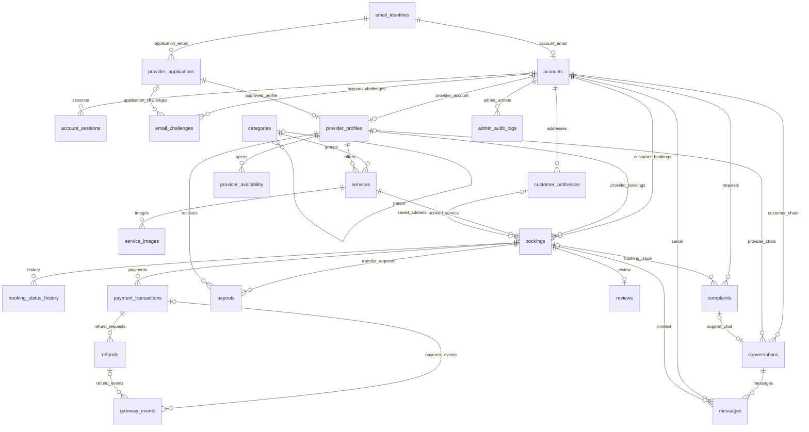

# Nestify — Thiết kế database final

**Phiên bản:** 1.1 — 21/10/2026. **Phạm vi hiện tại: 22 bảng, PostgreSQL, dùng ENUM cho trạng thái/phân loại cố định.**

Tài liệu này là đặc tả để các thành viên BE/FE cùng đọc và triển khai. Mỗi cột nằm trên một dòng, bao gồm cả PK/FK, thời gian tạo/cập nhật, kiểu dữ liệu, NULL và mặc định. Đây là tài liệu thiết kế; chưa chạy SQL hoặc tạo migration.

## 1. Nghiệp vụ và các thay đổi đã thống nhất

| Nội dung | Quy tắc áp dụng |
| --- | --- |
| Tài khoản | Một email một loại tài khoản. Khách xác thực email; hồ sơ NCC xác thực và được admin duyệt trước khi có account NCC. NCC được cấp mật khẩu tạm và phải đổi lần đầu. |
| Đặt dịch vụ | NCC nhận đơn trước, khách cọc sau. Phạm vi thiết kế bản đầu được đề xuất là một đơn một gói giá cố định, một NCC một công việc tại một thời điểm. |
| Thu tiền | Khách trả 30% cọc và phần 70% còn lại cho Nestify; Nestify chi phần NCC được hưởng. |
| Hủy bởi khách | Trước giờ hẹn từ 30 phút trở lên hoàn 50% cọc; trước giờ hẹn dưới 30 phút hoàn 0%. |
| Hủy/từ chối bởi NCC | Hoàn 100% tiền cọc hợp lệ đã thực thu. |
| Chia tiền | Nestify hưởng 20% **tiền còn giữ sau hoàn**, NCC hưởng phần còn lại. Hoàn đủ thì hai bên hưởng 0. |
| Ảnh dịch vụ | Giữ nhiều ảnh trong service_images. |
| Ngân hàng NCC | Một tài khoản nhận tiền hiện tại trong provider_profiles; mỗi payout chụp thông tin ngân hàng đã dùng. |
| Chat | Dùng PostgreSQL cho conversations/messages; hỗ trợ khách–NCC và khách–admin theo hồ sơ hỗ trợ. |
| Thông báo ứng dụng | Hoãn notifications và UC15/UC26. Email OTP/cấp tài khoản/khôi phục vẫn cần, không phụ thuộc bảng notifications. |
| Trạng thái/phân loại | Dùng PostgreSQL ENUM có tên cụ thể; Java dùng enum tương ứng. Enum không tự kiểm soát quyền hoặc thứ tự chuyển trạng thái. |

### 1.1. Các bảng đã gộp/hoãn so với bản 29 bảng

| Bảng cũ | Vị trí dữ liệu trong bản này |
| --- | --- |
| provider_payout_accounts | Các cột bank_* trong provider_profiles; lịch sử nơi nhận ở payout snapshot. |
| booking_terminations | Các cột termination_* và refund_percent trong bookings. |
| booking_settlements | Các cột kết quả tiền/settlement_* trong bookings. |
| refund_attempts | Gộp vào refunds: mỗi dòng là một lần yêu cầu; nghĩa vụ tổng tại payment_transactions.refund_due_vnd. |
| payout_attempts | Gộp vào payouts: mỗi dòng là một lần chuyển đã duyệt; nghĩa vụ tổng tại bookings.provider_due_vnd. |
| complaint_updates | Nội dung trao đổi ở messages; lịch sử admin xử lý ở admin_audit_logs. |
| notifications | Hoãn sang giai đoạn sau. |

### 1.2. Các mặc định còn mang tính đề xuất

Các dòng sau giúp đặc tả luồng hoàn chỉnh, **chưa phải quyết định chủ dự án xác nhận**: một đơn một gói giá cố định, một NCC một lịch công việc tại một thời điểm; đặt trước tối thiểu 60 phút; NCC phản hồi tối đa 30 phút; giữ cọc tối đa 15 phút; trả phần còn lại trong 24 giờ; OTP 10 phút/5 lần sai/gửi lại sau 60 giây; phiên tối đa 14 ngày; thu qua cổng được cấu hình; admin duyệt chi thủ công; Nestify chịu phí xử lý; giữ chi khi có khiếu nại; một review/đơn không sửa nội dung; không đổi email/loại account ở bản đầu.

Khách không tự hủy đúng/sau giờ hẹn; chuyển hỗ trợ. NCC không thể tiếp tục khi đang làm được admin xử lý với hoàn đủ cọc. Hoàn tùy ý sau COMPLETED hoặc sau khi đã chi, bù trừ/thu hồi nợ NCC, giỏ hàng, nhân viên nhiều lịch song song và báo giá phát sinh chưa thuộc luồng chuẩn bản đầu.

`usecase-final.md` là tài liệu đối chiếu chức năng nhưng chưa đồng bộ toàn bộ thay đổi rút gọn. Khi có khác biệt về số bảng, thông báo ứng dụng, ngân hàng một tài khoản hoặc chat hỗ trợ, dùng quyết định trong **bản DB 1.1 này**. Mã UC15/UC26 được giữ để tham khảo lịch sử và đang hoãn.

## 2. Cách đọc cột và quy ước triển khai

| Quy ước | Ý nghĩa |
| --- | --- |
| NULL? = Không | Bắt buộc có giá trị; NULL? = Có được phép trống hoặc chưa biết theo điều kiện nghiệp vụ. |
| PK, FK, UNIQUE | Khóa chính, khóa ngoại, giá trị/cặp giá trị không trùng. Điều kiện xuyên bảng được nêu dưới mỗi bảng và tại mục 7. |
| IDENTITY | id BIGINT tự tăng khi triển khai. Hai ngoại lệ: email_identities dùng email, provider_profiles dùng account_id; không thêm id dư. |
| Thời gian | TIMESTAMPTZ, mặc định giờ máy chủ; hiển thị ngày Việt Nam. Khoảng lịch dùng [bắt đầu, kết thúc). |
| created_at/updated_at | Được liệt kê trực tiếp trong từng bảng. DEFAULT chỉ gán lúc tạo; backend/trigger phải cập nhật updated_at khi sửa. |
| UUID request key | Sinh một lần cho một hành động, gửi lại cùng hành động dùng lại khóa. Không sinh khóa mới mỗi lần retry mạng. |
| Tiền | BIGINT theo đồng VND; yêu cầu thu/hoàn/chi > 0; phí >= 0 khi biết. NULL chưa rõ khác 0 đã xác minh không có tiền/phí. Không dùng FLOAT. |
| Tỷ lệ | SMALLINT 0..100: 30 nghĩa là 30%, thay cách basis point của bản cũ. Chụp tỷ lệ/chính sách trên đơn. |
| Làm tròn | ROUND_HALF_UP đến đồng: phần lẻ từ 0,5 đồng lên một đồng. Dùng decimal/số nguyên an toàn, tránh tràn phép nhân. |
| Chuỗi và tệp | Trim/chuẩn hóa trường cần thiết; nội dung bắt buộc không được rỗng. Ảnh/tài liệu/chứng từ lưu URL/object key, không lưu nhị phân. |
| Bí mật | Mật khẩu/OTP/token chỉ lưu hash; số tài khoản mã hóa, khóa mã hóa ở ngoài DB. |
| Xóa dữ liệu | Không cascade xóa account → đơn/tiền/chat/hồ sơ. Các FK lịch sử dùng RESTRICT/NO ACTION; khóa/ẩn/lưu trữ thay xóa cứng dữ liệu nghiệp vụ. |
| Default nghiệp vụ | Default tỷ lệ là giá trị cho đơn mới; không áp lại cấu hình mới vào đơn cũ. Deadline chụp theo từng đơn. |

Các giá trị `processor`, `bank_code`, `action`, `entity_type` và lý do sự kiện tổng quát được giữ VARCHAR vì phụ thuộc cấu hình/tích hợp hoặc có thể mở rộng; backend vẫn kiểm tra danh sách mã cho phép. Tên danh mục là dữ liệu trong categories do admin quản lý.

## 3. Định nghĩa ENUM

Các tên dưới đây là **kiểu PostgreSQL**, không phải bảng nghiệp vụ. Không dùng một status enum chung cho mọi bảng. Một enum dùng chung khi có cùng ý nghĩa, như account_type cho registry/account hoặc booking_status cho đơn/lịch sử.

| Kiểu ENUM | Giá trị hợp lệ |
| --- | --- |
| `account_type_enum` | `CUSTOMER`, `PROVIDER`, `ADMIN` |
| `account_status_enum` | `PENDING_EMAIL`, `ACTIVE`, `SUSPENDED` |
| `provider_application_status_enum` | `PENDING_EMAIL`, `PENDING_REVIEW`, `APPROVED`, `REJECTED` |
| `email_challenge_purpose_enum` | `REGISTER_CUSTOMER`, `VERIFY_PROVIDER_APPLICATION`, `RESET_PASSWORD` |
| `bank_verification_status_enum` | `NOT_PROVIDED`, `PENDING`, `VERIFIED` |
| `service_status_enum` | `DRAFT`, `PUBLISHED`, `ARCHIVED` |
| `availability_state_enum` | `AVAILABLE`, `BLOCKED` |
| `booking_status_enum` | `PENDING_PROVIDER`, `PENDING_DEPOSIT`, `CONFIRMED`, `IN_PROGRESS`, `COMPLETED`, `CANCELLED`, `REJECTED`, `EXPIRED` |
| `termination_kind_enum` | `CANCEL`, `REJECT`, `EXPIRE` |
| `actor_type_enum` | `CUSTOMER`, `PROVIDER`, `ADMIN`, `SYSTEM` |
| `termination_reason_enum` | `CUSTOMER_CANCEL`, `PROVIDER_REJECT`, `PROVIDER_CANCEL`, `PROVIDER_UNABLE_TO_CONTINUE`, `PROVIDER_RESPONSE_TIMEOUT`, `DEPOSIT_TIMEOUT`, `SYSTEM_CANCEL` |
| `settlement_status_enum` | `DRAFT`, `ON_HOLD`, `FINALIZED` |
| `payment_kind_enum` | `DEPOSIT`, `BALANCE` |
| `payment_status_enum` | `CREATED`, `PENDING`, `UNKNOWN`, `SUCCEEDED`, `FAILED`, `EXPIRED` |
| `payment_allocation_status_enum` | `UNRESOLVED`, `APPLIED`, `RETURN_REQUIRED` |
| `refund_reason_enum` | `CANCEL_POLICY`, `DUPLICATE`, `AMOUNT_MISMATCH`, `LATE_AFTER_EXPIRY`, `INVALID_PHASE` |
| `gateway_event_type_enum` | `PAYMENT`, `REFUND` |
| `gateway_event_processing_status_enum` | `RECEIVED`, `APPLIED`, `NEEDS_REVIEW` |
| `refund_status_enum` | `PENDING`, `UNKNOWN`, `SUCCEEDED`, `FAILED` |
| `payout_status_enum` | `PENDING`, `UNKNOWN`, `SUCCEEDED`, `FAILED` |
| `review_status_enum` | `VISIBLE`, `HIDDEN` |
| `conversation_type_enum` | `PROVIDER`, `SUPPORT` |
| `complaint_category_enum` | `PAYMENT`, `SERVICE`, `OTHER` |
| `complaint_status_enum` | `OPEN`, `IN_REVIEW`, `RESOLVED`, `REJECTED` |

Thêm giá trị enum phải có migration, đồng bộ BE/FE và kiểm tra chuyển trạng thái. PostgreSQL hỗ trợ thêm/đổi tên giá trị; xóa giá trị hoặc thay thứ tự cần xử lý kiểu dữ liệu cẩn thận. Không dùng thứ tự enum để tự suy ra bước nghiệp vụ. Java dùng enum ánh xạ theo nhãn, tránh ordinal; PostgreSQL native ENUM cần cấu hình ánh xạ ORM phù hợp.

## 4. Danh mục bảng

| Nhóm | Bảng |
| --- | --- |
| Tài khoản/NCC — 6 | email_identities, accounts, account_sessions, provider_applications, email_challenges, provider_profiles |
| Dịch vụ/lịch/địa chỉ — 5 | categories, services, service_images, provider_availability, customer_addresses |
| Đơn — 2 | bookings, booking_status_history |
| Thu/hoàn/chi — 4 | payment_transactions, gateway_events, refunds, payouts |
| Đánh giá/chat/hỗ trợ — 5 | reviews, conversations, messages, complaints, admin_audit_logs |

**Tổng 22 bảng.** booking_status_history và admin_audit_logs chỉ ghi thêm; messages chỉ cập nhật read_at. Ba bảng này không có updated_at. Các bảng còn lại liệt kê đủ created_at/updated_at. Gateway payload và dữ liệu request tiền đã gửi giữ nguyên, chỉ cập nhật kết quả/liên kết xử lý.

## 5. Từ điển đầy đủ từng cột

Trong bảng dưới, “—” ở cột mặc định nghĩa là **không có default DB**, backend phải cấp giá trị nếu cột bắt buộc. Mỗi cột nằm trên một dòng; không có cột dùng chung bị lược khỏi danh sách.

### 01. `email_identities`

Giữ quyền sử dụng email chung giữa account và hồ sơ NCC. Nhờ đó email đang nộp hồ sơ NCC vẫn được giữ dù chưa có account đăng nhập.

| Cột | Kiểu PostgreSQL | NULL? | Khóa / mặc định / kiểm tra | Mục đích |
| --- | --- | --- | --- | --- |
| `email` | `VARCHAR(254)` | Không | PK | Email đã trim và lowercase; dùng làm khóa của bảng. |
| `account_type` | `account_type_enum` | Không | — | Loại tài khoản đã đăng ký cho email. |
| `created_at` | `TIMESTAMPTZ` | Không | DEFAULT CURRENT_TIMESTAMP | Thời điểm tạo bản ghi. |
| `updated_at` | `TIMESTAMPTZ` | Không | DEFAULT CURRENT_TIMESTAMP | Thời điểm cập nhật gần nhất; backend/trigger cập nhật khi ghi. |

**Ràng buộc và cách dùng:**

- Không có cột `id` riêng; `email` là PK.
- Có `UNIQUE(email, account_type)` để account tham chiếu ghép đúng loại. PK email vẫn bảo đảm mỗi email chỉ có một loại.
- Bản đầu không đổi email/đổi loại tài khoản; đăng ký bỏ dở tiếp tục đúng email và loại. Hồ sơ NCC bị từ chối được nộp lại cùng loại PROVIDER.

### 02. `accounts`

Danh tính đăng nhập chung của khách, NCC đã duyệt và admin; lưu quyền và trạng thái sử dụng.

| Cột | Kiểu PostgreSQL | NULL? | Khóa / mặc định / kiểm tra | Mục đích |
| --- | --- | --- | --- | --- |
| `id` | `BIGINT` | Không | PK; IDENTITY | Mã định danh nội bộ của bản ghi. |
| `email` | `VARCHAR(254)` | Không | UNIQUE; FK → email_identities.email | Tên đăng nhập và email liên hệ. |
| `account_type` | `account_type_enum` | Không | — | Vai trò của account, phải khớp email registry. |
| `password_hash` | `TEXT` | Không | — | Hash mật khẩu; không lưu mật khẩu rõ. |
| `display_name` | `VARCHAR(150)` | Không | — | Tên hiển thị. |
| `phone` | `VARCHAR(32)` | Có | — | Điện thoại của chủ tài khoản. |
| `status` | `account_status_enum` | Không | — | Chờ xác thực, đang hoạt động hoặc bị khóa. |
| `email_verified_at` | `TIMESTAMPTZ` | Có | — | Thời điểm email đã được xác thực. |
| `must_change_password` | `BOOLEAN` | Không | DEFAULT FALSE | NCC nhận mật khẩu tạm phải đổi trước khi dùng nghiệp vụ. |
| `last_login_at` | `TIMESTAMPTZ` | Có | — | Thời điểm đăng nhập gần nhất. |
| `suspended_at` | `TIMESTAMPTZ` | Có | — | Thời điểm khóa tài khoản. |
| `suspension_reason` | `TEXT` | Có | — | Lý do khóa tài khoản. |
| `created_at` | `TIMESTAMPTZ` | Không | DEFAULT CURRENT_TIMESTAMP | Thời điểm tạo bản ghi. |
| `updated_at` | `TIMESTAMPTZ` | Không | DEFAULT CURRENT_TIMESTAMP | Thời điểm cập nhật gần nhất; backend/trigger cập nhật khi ghi. |

**Ràng buộc và cách dùng:**

- FK ghép `(email, account_type)` → `email_identities(email, account_type)`; không chỉ kiểm tra email tồn tại.
- Khách mới là PENDING_EMAIL; NCC chỉ tạo sau duyệt và nhận email đã xác thực từ hồ sơ; admin cấp nội bộ.
- ACTIVE bắt buộc đã xác thực email. SUSPENDED bắt buộc có thời điểm/lý do khóa. Khóa/đặt lại mật khẩu thu hồi phiên, không xóa lịch sử đơn hay nghĩa vụ tiền.

### 03. `account_sessions`

Mỗi dòng là một phiên đăng nhập có thể hết hạn hoặc bị thu hồi; một account có thể có nhiều phiên.

| Cột | Kiểu PostgreSQL | NULL? | Khóa / mặc định / kiểm tra | Mục đích |
| --- | --- | --- | --- | --- |
| `id` | `BIGINT` | Không | PK; IDENTITY | Mã định danh nội bộ của bản ghi. |
| `account_id` | `BIGINT` | Không | FK → accounts.id | Account sở hữu phiên. |
| `token_hash` | `TEXT` | Không | UNIQUE | Hash token phiên, server dùng kiểm tra phiên hợp lệ. |
| `expires_at` | `TIMESTAMPTZ` | Không | — | Hạn sử dụng phiên. |
| `last_seen_at` | `TIMESTAMPTZ` | Có | — | Lần hoạt động gần nhất. |
| `revoked_at` | `TIMESTAMPTZ` | Có | — | Đã thu hồi thì phiên không được dùng nữa. |
| `created_at` | `TIMESTAMPTZ` | Không | DEFAULT CURRENT_TIMESTAMP | Thời điểm tạo bản ghi. |
| `updated_at` | `TIMESTAMPTZ` | Không | DEFAULT CURRENT_TIMESTAMP | Thời điểm cập nhật gần nhất; backend/trigger cập nhật khi ghi. |

**Ràng buộc và cách dùng:**

- `expires_at > created_at`; token hết hạn/đã thu hồi hoặc account bị khóa không được truy cập nghiệp vụ.
- Bản này chọn phiên opaque kiểm tra phía server. Thời hạn 14 ngày là mặc định thiết kế, chưa phải lựa chọn chủ dự án xác nhận.
- Account `must_change_password=true` chỉ được đổi mật khẩu/đăng xuất dù phiên còn hạn.

### 04. `provider_applications`

Hồ sơ xét duyệt được giữ độc lập với account/profile; nộp lại sau từ chối tạo hồ sơ mới để bảo toàn lịch sử.

| Cột | Kiểu PostgreSQL | NULL? | Khóa / mặc định / kiểm tra | Mục đích |
| --- | --- | --- | --- | --- |
| `id` | `BIGINT` | Không | PK; IDENTITY | Mã định danh nội bộ của bản ghi. |
| `email` | `VARCHAR(254)` | Không | FK → email_identities.email | Email người nộp, phải thuộc loại PROVIDER. |
| `applicant_name` | `VARCHAR(150)` | Không | — | Người đăng ký/đại diện liên hệ. |
| `phone` | `VARCHAR(32)` | Không | — | Điện thoại liên hệ. |
| `business_name` | `VARCHAR(200)` | Không | — | Tên NCC/cơ sở được khai báo. |
| `city` | `VARCHAR(150)` | Không | — | Khu vực hoạt động chính. |
| `description` | `TEXT` | Không | — | Mô tả năng lực và dịch vụ. |
| `document_url` | `TEXT` | Không | — | URL/object key tài liệu xét duyệt. |
| `status` | `provider_application_status_enum` | Không | DEFAULT 'PENDING_EMAIL' | Trạng thái xét duyệt. |
| `email_verified_at` | `TIMESTAMPTZ` | Có | — | Mốc xác thực email của lần nộp này. |
| `decided_by_admin_id` | `BIGINT` | Có | FK → accounts.id | Admin đưa ra quyết định. |
| `decided_at` | `TIMESTAMPTZ` | Có | — | Thời điểm duyệt/từ chối. |
| `rejection_reason` | `TEXT` | Có | — | Lý do từ chối, gửi cho người nộp. |
| `created_at` | `TIMESTAMPTZ` | Không | DEFAULT CURRENT_TIMESTAMP | Thời điểm tạo bản ghi. |
| `updated_at` | `TIMESTAMPTZ` | Không | DEFAULT CURRENT_TIMESTAMP | Thời điểm cập nhật gần nhất; backend/trigger cập nhật khi ghi. |

**Ràng buộc và cách dùng:**

- Partial UNIQUE(email) cho PENDING_EMAIL/PENDING_REVIEW/APPROVED; REJECTED được giữ và cho phép nộp lại.
- PENDING_REVIEW/APPROVED/REJECTED phải có `email_verified_at`. APPROVED/REJECTED có admin và thời điểm quyết định; REJECTED có lý do.
- Duyệt hồ sơ, tạo account/profile và audit cùng transaction; duyệt lặp không tạo account thứ hai.

### 05. `email_challenges`

Mỗi mã xác thực có mục đích, đối tượng, hạn sử dụng và trạng thái riêng; tránh mã cũ xác thực nhầm hồ sơ mới.

| Cột | Kiểu PostgreSQL | NULL? | Khóa / mặc định / kiểm tra | Mục đích |
| --- | --- | --- | --- | --- |
| `id` | `BIGINT` | Không | PK; IDENTITY | Mã định danh nội bộ của bản ghi. |
| `email` | `VARCHAR(254)` | Không | FK → email_identities.email | Email nhận mã, phải khớp đối tượng. |
| `purpose` | `email_challenge_purpose_enum` | Không | — | Đăng ký khách, xác thực hồ sơ NCC hoặc đặt lại mật khẩu. |
| `account_id` | `BIGINT` | Có | FK → accounts.id | Đối tượng account cho đăng ký khách/reset mật khẩu. |
| `provider_application_id` | `BIGINT` | Có | FK → provider_applications.id | Đúng lần nộp hồ sơ NCC cần xác thực. |
| `code_hash` | `TEXT` | Không | — | Hash mã OTP. |
| `expires_at` | `TIMESTAMPTZ` | Không | — | Hạn sử dụng mã. |
| `sent_at` | `TIMESTAMPTZ` | Có | — | Thời điểm hệ thống gửi mã. |
| `consumed_at` | `TIMESTAMPTZ` | Có | — | Thời điểm dùng thành công, không dùng lại. |
| `invalidated_at` | `TIMESTAMPTZ` | Có | — | Thời điểm vô hiệu mã, ví dụ đã gửi mã mới. |
| `attempt_count` | `SMALLINT` | Không | DEFAULT 0; >= 0 | Số lần nhập sai. |
| `created_at` | `TIMESTAMPTZ` | Không | DEFAULT CURRENT_TIMESTAMP | Thời điểm tạo bản ghi. |
| `updated_at` | `TIMESTAMPTZ` | Không | DEFAULT CURRENT_TIMESTAMP | Thời điểm cập nhật gần nhất; backend/trigger cập nhật khi ghi. |

**Ràng buộc và cách dùng:**

- VERIFY_PROVIDER_APPLICATION: chỉ `provider_application_id` có giá trị. Hai purpose còn lại: chỉ `account_id` có giá trị; account/email/loại phải phù hợp.
- Mã chỉ dùng khi đã gửi, chưa tiêu thụ/vô hiệu và còn hạn. Kiểm tra/tiêu thụ mã trong transaction.
- Hạn 10 phút, tối đa 5 lần sai, gửi lại sau 60 giây là mặc định đề xuất. Gửi lại vô hiệu mã cũ của đúng đối tượng/purpose.

### 06. `provider_profiles`

Hồ sơ hoạt động của NCC đã duyệt; gộp ngân hàng vào cùng bảng vì mỗi NCC có một tài khoản nhận tiền hiện tại.

| Cột | Kiểu PostgreSQL | NULL? | Khóa / mặc định / kiểm tra | Mục đích |
| --- | --- | --- | --- | --- |
| `account_id` | `BIGINT` | Không | PK; FK → accounts.id | Mã NCC, đồng thời là account PROVIDER. |
| `application_id` | `BIGINT` | Không | FK → provider_applications.id; UNIQUE | Hồ sơ APPROVED tạo ra NCC này. |
| `business_name` | `VARCHAR(200)` | Không | — | Tên công khai hiện tại. |
| `bio` | `TEXT` | Có | — | Giới thiệu công khai. |
| `city` | `VARCHAR(150)` | Không | — | Khu vực phục vụ chính. |
| `address` | `TEXT` | Có | — | Địa chỉ cơ sở/liên hệ. |
| `logo_url` | `TEXT` | Có | — | Logo/ảnh đại diện NCC. |
| `is_visible` | `BOOLEAN` | Không | DEFAULT TRUE | Cho phép hiển thị hồ sơ công khai. |
| `bank_code` | `VARCHAR(50)` | Có | — | Ngân hàng nhận tiền hiện tại. |
| `bank_account_number_encrypted` | `TEXT` | Có | — | Số tài khoản nhận tiền đã mã hóa. |
| `bank_account_holder_name` | `VARCHAR(200)` | Có | — | Tên chủ tài khoản nhận tiền. |
| `bank_verification_status` | `bank_verification_status_enum` | Không | DEFAULT 'NOT_PROVIDED' | Chưa khai báo/chờ xác minh/đã xác minh. |
| `bank_verified_by_admin_id` | `BIGINT` | Có | FK → accounts.id | Admin xác minh ngân hàng. |
| `bank_verified_at` | `TIMESTAMPTZ` | Có | — | Thời điểm xác minh ngân hàng. |
| `created_at` | `TIMESTAMPTZ` | Không | DEFAULT CURRENT_TIMESTAMP | Thời điểm tạo bản ghi. |
| `updated_at` | `TIMESTAMPTZ` | Không | DEFAULT CURRENT_TIMESTAMP | Thời điểm cập nhật gần nhất; backend/trigger cập nhật khi ghi. |

**Ràng buộc và cách dùng:**

- Không có `id` riêng; các `provider_id` tham chiếu `account_id`. Account/profile/application phải cùng email, application APPROVED.
- NOT_PROVIDED: chưa có bộ thông tin ngân hàng. PENDING/VERIFIED: phải đủ ngân hàng/số tài khoản/chủ tài khoản. VERIFIED bắt buộc admin/thời điểm xác minh.
- Đổi ngân hàng đưa về PENDING, xóa hiệu lực xác minh cũ và ghi audit. Chứng từ payout cũ giữ bản chụp ngân hàng, không đọc lại profile để hiển thị lịch sử.
- Chỉ NCC đang hoạt động, đã đổi mật khẩu bắt buộc và hồ sơ được hiển thị mới nhận đơn mới.

### 07. `categories`

Danh mục do admin quản lý để phân loại/tìm kiếm dịch vụ; có thể thêm/sửa dữ liệu nên không dùng enum cho tên danh mục.

| Cột | Kiểu PostgreSQL | NULL? | Khóa / mặc định / kiểm tra | Mục đích |
| --- | --- | --- | --- | --- |
| `id` | `BIGINT` | Không | PK; IDENTITY | Mã định danh nội bộ của bản ghi. |
| `parent_id` | `BIGINT` | Có | FK → categories.id | Danh mục cha; trống nếu ở cấp gốc. |
| `name` | `VARCHAR(150)` | Không | — | Tên danh mục. |
| `slug` | `VARCHAR(180)` | Không | UNIQUE | Tên ổn định dùng trong đường dẫn/bộ lọc. |
| `description` | `TEXT` | Có | — | Mô tả danh mục. |
| `icon_name` | `VARCHAR(100)` | Có | — | Biểu tượng giao diện. |
| `sort_order` | `INTEGER` | Không | DEFAULT 0; >= 0 | Thứ tự hiển thị. |
| `is_active` | `BOOLEAN` | Không | DEFAULT TRUE | Danh mục còn được sử dụng cho đơn mới. |
| `created_at` | `TIMESTAMPTZ` | Không | DEFAULT CURRENT_TIMESTAMP | Thời điểm tạo bản ghi. |
| `updated_at` | `TIMESTAMPTZ` | Không | DEFAULT CURRENT_TIMESTAMP | Thời điểm cập nhật gần nhất; backend/trigger cập nhật khi ghi. |

**Ràng buộc và cách dùng:**

- Không tự trỏ hoặc tạo vòng cha–con. Danh mục/cha không hoạt động thì không nhận đơn mới từ dịch vụ trong nhánh đó.
- Không xóa danh mục còn được tham chiếu; dùng trạng thái để ẩn.

### 08. `services`

Mỗi dòng là một gói giá cố định của một NCC; giá/thời lượng hiện tại chỉ dùng tạo đơn mới.

| Cột | Kiểu PostgreSQL | NULL? | Khóa / mặc định / kiểm tra | Mục đích |
| --- | --- | --- | --- | --- |
| `id` | `BIGINT` | Không | PK; IDENTITY | Mã định danh nội bộ của bản ghi. |
| `provider_id` | `BIGINT` | Không | FK → provider_profiles.account_id | NCC sở hữu dịch vụ. |
| `category_id` | `BIGINT` | Không | FK → categories.id | Danh mục dịch vụ. |
| `title` | `VARCHAR(200)` | Không | — | Tên dịch vụ. |
| `description` | `TEXT` | Không | — | Nội dung, phạm vi công việc trong gói. |
| `base_price_vnd` | `BIGINT` | Không | > 0 | Giá gói hiện tại. |
| `duration_minutes` | `INTEGER` | Không | > 0 | Thời lượng dự kiến. |
| `status` | `service_status_enum` | Không | DEFAULT 'DRAFT' | Nháp/công khai/lưu trữ. |
| `created_at` | `TIMESTAMPTZ` | Không | DEFAULT CURRENT_TIMESTAMP | Thời điểm tạo bản ghi. |
| `updated_at` | `TIMESTAMPTZ` | Không | DEFAULT CURRENT_TIMESTAMP | Thời điểm cập nhật gần nhất; backend/trigger cập nhật khi ghi. |

**Ràng buộc và cách dùng:**

- `UNIQUE(id, provider_id)` hỗ trợ FK ghép từ bookings. Không đổi chủ dịch vụ đã có đơn.
- Giá phải tạo ra cọc và phần còn lại đều > 0 sau làm tròn. Chỉ PUBLISHED + NCC hợp lệ + danh mục hoạt động nhận đơn mới.
- Sửa tên/giá/thời lượng không cập nhật lại snapshot trên đơn cũ.

### 09. `service_images`

Lưu nhiều ảnh và thứ tự hiển thị của từng dịch vụ; ảnh đầu có thể dùng làm ảnh đại diện.

| Cột | Kiểu PostgreSQL | NULL? | Khóa / mặc định / kiểm tra | Mục đích |
| --- | --- | --- | --- | --- |
| `id` | `BIGINT` | Không | PK; IDENTITY | Mã định danh nội bộ của bản ghi. |
| `service_id` | `BIGINT` | Không | FK → services.id | Dịch vụ chứa ảnh. |
| `image_url` | `TEXT` | Không | — | URL/object key ảnh. |
| `alt_text` | `VARCHAR(250)` | Có | — | Mô tả nội dung ảnh. |
| `sort_order` | `INTEGER` | Không | >= 0 | Thứ tự trong bộ ảnh. |
| `created_at` | `TIMESTAMPTZ` | Không | DEFAULT CURRENT_TIMESTAMP | Thời điểm tạo bản ghi. |
| `updated_at` | `TIMESTAMPTZ` | Không | DEFAULT CURRENT_TIMESTAMP | Thời điểm cập nhật gần nhất; backend/trigger cập nhật khi ghi. |

**Ràng buộc và cách dùng:**

- `UNIQUE(service_id, sort_order)`. Đổi thứ tự nhiều ảnh cần transaction để không xung đột thứ tự.

### 10. `provider_availability`

Lưu khoảng NCC chủ động mở nhận việc/khóa lịch; lịch thực tế còn phải trừ các booking đang giữ chỗ.

| Cột | Kiểu PostgreSQL | NULL? | Khóa / mặc định / kiểm tra | Mục đích |
| --- | --- | --- | --- | --- |
| `id` | `BIGINT` | Không | PK; IDENTITY | Mã định danh nội bộ của bản ghi. |
| `provider_id` | `BIGINT` | Không | FK → provider_profiles.account_id | NCC sở hữu khoảng lịch. |
| `starts_at` | `TIMESTAMPTZ` | Không | — | Đầu khoảng thời gian. |
| `ends_at` | `TIMESTAMPTZ` | Không | — | Cuối khoảng thời gian. |
| `state` | `availability_state_enum` | Không | — | AVAILABLE hoặc BLOCKED. |
| `created_at` | `TIMESTAMPTZ` | Không | DEFAULT CURRENT_TIMESTAMP | Thời điểm tạo bản ghi. |
| `updated_at` | `TIMESTAMPTZ` | Không | DEFAULT CURRENT_TIMESTAMP | Thời điểm cập nhật gần nhất; backend/trigger cập nhật khi ghi. |

**Ràng buộc và cách dùng:**

- `starts_at < ends_at`; khoảng `[starts_at, ends_at)`. Không chồng khoảng của cùng NCC; nếu khóa một phần AVAILABLE thì tách khoảng.
- Không sửa lịch làm mất chỗ đang giữ/xác nhận/thực hiện. Chấp nhận đơn/sửa lịch khóa NCC và kiểm tra xung đột trong transaction.

### 11. `customer_addresses`

Sổ địa chỉ giúp khách dùng lại địa điểm; booking vẫn lưu bản chụp địa chỉ riêng.

| Cột | Kiểu PostgreSQL | NULL? | Khóa / mặc định / kiểm tra | Mục đích |
| --- | --- | --- | --- | --- |
| `id` | `BIGINT` | Không | PK; IDENTITY | Mã định danh nội bộ của bản ghi. |
| `customer_id` | `BIGINT` | Không | FK → accounts.id | Khách sở hữu địa chỉ. |
| `label` | `VARCHAR(100)` | Không | — | Tên gợi nhớ, ví dụ Nhà riêng. |
| `recipient_name` | `VARCHAR(150)` | Không | — | Người nhận dịch vụ. |
| `recipient_phone` | `VARCHAR(32)` | Không | — | Điện thoại người nhận. |
| `address_line` | `TEXT` | Không | — | Địa chỉ chi tiết. |
| `ward` | `VARCHAR(150)` | Có | — | Tên phường/xã nếu có. |
| `city` | `VARCHAR(150)` | Không | — | Tên tỉnh/thành phố. |
| `instructions` | `TEXT` | Có | — | Chỉ dẫn đến địa điểm. |
| `is_default` | `BOOLEAN` | Không | DEFAULT FALSE | Địa chỉ mặc định của khách. |
| `archived_at` | `TIMESTAMPTZ` | Có | — | Mốc ngừng sử dụng thay xóa cứng. |
| `created_at` | `TIMESTAMPTZ` | Không | DEFAULT CURRENT_TIMESTAMP | Thời điểm tạo bản ghi. |
| `updated_at` | `TIMESTAMPTZ` | Không | DEFAULT CURRENT_TIMESTAMP | Thời điểm cập nhật gần nhất; backend/trigger cập nhật khi ghi. |

**Ràng buộc và cách dùng:**

- Partial UNIQUE(customer_id) khi `is_default=true AND archived_at IS NULL`; địa chỉ lưu trữ phải bỏ mặc định.
- Customer phải là account CUSTOMER. Địa chỉ đã chọn cho booking phải thuộc đúng khách; thay sổ địa chỉ không sửa đơn cũ.

### 12. `bookings`

Đơn trung tâm: giữ thỏa thuận tại lúc đặt, trạng thái dịch vụ, kết thúc đơn và kết quả chốt tiền. Dữ liệu hủy/đối soát một-một được gộp vào đây.

| Cột | Kiểu PostgreSQL | NULL? | Khóa / mặc định / kiểm tra | Mục đích |
| --- | --- | --- | --- | --- |
| `id` | `BIGINT` | Không | PK; IDENTITY | Mã định danh nội bộ của bản ghi. |
| `booking_code` | `VARCHAR(40)` | Không | UNIQUE | Mã đơn hiển thị. |
| `client_request_key` | `UUID` | Không | — | Idempotency key của yêu cầu tạo đơn; client gửi lại phải dùng cùng khóa. |
| `customer_id` | `BIGINT` | Không | FK → accounts.id | Khách đặt dịch vụ. |
| `provider_id` | `BIGINT` | Không | FK → provider_profiles.account_id | NCC thực hiện. |
| `service_id` | `BIGINT` | Không | FK → services.id | Gói dịch vụ đã chọn. |
| `address_id` | `BIGINT` | Có | FK → customer_addresses.id | Địa chỉ được chọn trong sổ nếu có. |
| `service_title_snapshot` | `VARCHAR(200)` | Không | — | Tên dịch vụ tại lúc đặt. |
| `duration_minutes_snapshot` | `INTEGER` | Không | > 0 | Thời lượng tại lúc đặt. |
| `recipient_name` | `VARCHAR(150)` | Không | — | Người nhận của riêng đơn này. |
| `recipient_phone` | `VARCHAR(32)` | Không | — | Điện thoại nhận dịch vụ của đơn. |
| `address_line` | `TEXT` | Không | — | Địa chỉ thực hiện đã chụp. |
| `ward` | `VARCHAR(150)` | Có | — | Phường/xã tại lúc đặt. |
| `city` | `VARCHAR(150)` | Không | — | Tỉnh/thành phố tại lúc đặt. |
| `address_instructions` | `TEXT` | Có | — | Chỉ dẫn địa điểm của đơn. |
| `starts_at` | `TIMESTAMPTZ` | Không | — | Giờ bắt đầu dự kiến. |
| `ends_at` | `TIMESTAMPTZ` | Không | — | Giờ kết thúc dự kiến. |
| `status` | `booking_status_enum` | Không | DEFAULT 'PENDING_PROVIDER' | Trạng thái hiện tại của dịch vụ. |
| `request_expires_at` | `TIMESTAMPTZ` | Không | — | Hạn NCC phản hồi, chụp khi tạo. |
| `accepted_at` | `TIMESTAMPTZ` | Có | — | NCC chấp nhận lúc nào. |
| `deposit_due_at` | `TIMESTAMPTZ` | Có | — | Hạn giữ lịch chờ cọc, có từ lúc nhận. |
| `started_at` | `TIMESTAMPTZ` | Có | — | Thời điểm thực bắt đầu. |
| `completed_at` | `TIMESTAMPTZ` | Có | — | Thời điểm công việc hoàn thành. |
| `balance_due_at` | `TIMESTAMPTZ` | Có | — | Hạn trả phần còn lại sau hoàn thành. |
| `total_amount_vnd` | `BIGINT` | Không | > 0 | Tổng giá gói đã thống nhất. |
| `deposit_percent` | `SMALLINT` | Không | DEFAULT 30; 0..100 | Tỷ lệ cọc snapshot. |
| `deposit_amount_vnd` | `BIGINT` | Không | > 0 | Cọc cụ thể sau làm tròn. |
| `balance_amount_vnd` | `BIGINT` | Không | > 0 | Giá trị phần còn lại đã thỏa thuận; không phải số dư động. |
| `platform_fee_percent` | `SMALLINT` | Không | DEFAULT 20; 0..100 | Tỷ lệ Nestify hưởng snapshot. |
| `cancel_cutoff_minutes` | `INTEGER` | Không | DEFAULT 30; >= 0 | Mốc hủy sớm/sát giờ snapshot. |
| `early_refund_percent` | `SMALLINT` | Không | DEFAULT 50; 0..100 | Tỷ lệ hoàn cọc khi khách hủy sớm. |
| `late_refund_percent` | `SMALLINT` | Không | DEFAULT 0; 0..100 | Tỷ lệ hoàn cọc khi khách hủy sát giờ. |
| `provider_refund_percent` | `SMALLINT` | Không | DEFAULT 100; 0..100 | Tỷ lệ hoàn khi NCC hủy/từ chối. |
| `system_refund_percent` | `SMALLINT` | Không | DEFAULT 100; 0..100 | Tỷ lệ hoàn theo mặc định hết hạn/lỗi hệ thống. |
| `termination_kind` | `termination_kind_enum` | Có | — | Hủy, từ chối hoặc hết hạn. |
| `termination_actor_type` | `actor_type_enum` | Có | — | Khách/NCC/admin/hệ thống thực hiện kết thúc. |
| `terminated_by_account_id` | `BIGINT` | Có | FK → accounts.id | Tài khoản thực hiện; trống khi SYSTEM. |
| `termination_reason_code` | `termination_reason_enum` | Có | — | Nguyên nhân kết thúc có cấu trúc. |
| `termination_reason` | `TEXT` | Có | — | Diễn giải cụ thể nguyên nhân. |
| `terminated_at` | `TIMESTAMPTZ` | Có | — | Thời điểm quyết định kết thúc đơn. |
| `refund_percent` | `SMALLINT` | Có | 0..100 | Tỷ lệ hoàn đã chọn tại lúc kết thúc. |
| `gross_collected_vnd` | `BIGINT` | Có | >= 0 | Snapshot tổng tiền khách thực trả khi chốt. |
| `refunded_vnd` | `BIGINT` | Có | >= 0 | Snapshot tổng thực hoàn khi chốt. |
| `net_retained_vnd` | `BIGINT` | Có | >= 0 | Snapshot số còn giữ sau hoàn. |
| `platform_fee_vnd` | `BIGINT` | Có | >= 0 | Phần Nestify được hưởng tại đối soát. |
| `provider_due_vnd` | `BIGINT` | Có | >= 0 | Nghĩa vụ phải trả NCC đã chốt. |
| `settlement_status` | `settlement_status_enum` | Không | DEFAULT 'DRAFT' | Chưa chốt/đang giữ/đã chốt. |
| `settlement_note` | `TEXT` | Có | — | Lý do ON_HOLD hoặc ghi chú đối soát. |
| `settled_at` | `TIMESTAMPTZ` | Có | — | Mốc chốt; giữ lại nếu phát sinh giữ xử lý sau đó. |
| `settled_by_admin_id` | `BIGINT` | Có | FK → accounts.id | Admin chốt đối soát. |
| `customer_note` | `TEXT` | Có | — | Ghi chú khách cung cấp khi đặt. |
| `version` | `BIGINT` | Không | DEFAULT 0; >= 0 | Tăng khi cập nhật để phát hiện dữ liệu cũ. |
| `created_at` | `TIMESTAMPTZ` | Không | DEFAULT CURRENT_TIMESTAMP | Thời điểm tạo bản ghi. |
| `updated_at` | `TIMESTAMPTZ` | Không | DEFAULT CURRENT_TIMESTAMP | Thời điểm cập nhật gần nhất; backend/trigger cập nhật khi ghi. |

**Ràng buộc và cách dùng:**

- `UNIQUE(customer_id, client_request_key)`; FK ghép `(service_id, provider_id)` → `services(id, provider_id)`.
- `ends_at = starts_at + duration_minutes_snapshot`; giá, lịch, các bên, địa chỉ và tỷ lệ snapshot giữ nguyên sau tạo. Bản đầu sửa lịch/giá bằng hủy đúng quy trình rồi đặt lại.
- `deposit_amount_vnd = ROUND_HALF_UP(total_amount_vnd × deposit_percent / 100)`; `balance_amount_vnd = total_amount_vnd − deposit_amount_vnd`.
- PENDING_PROVIDER chưa giữ lịch/chưa thu cọc. PENDING_DEPOSIT/CONFIRMED/IN_PROGRESS giữ lịch độc quyền. Mốc accepted/started/completed chỉ có sau bước tương ứng và giữ nguyên nếu sau đó hủy.
- CANCELLED/REJECTED/EXPIRED bắt buộc đủ kind, actor type, reason code/text, terminated_at và refund_percent; actor account NULL chỉ khi SYSTEM. Đơn chưa kết thúc theo các nhánh này để trống nhóm termination.
- COMPLETED bắt buộc completed_at/balance_due_at; không đồng nghĩa đã thu đủ 70%.
- FINALIZED bắt buộc đủ 5 số tiền đối soát, settled_at và admin chốt; ON_HOLD bắt buộc note. Không gán NULL tiền chưa rõ thành 0. Chi tiết khóa/chốt lại và phát sinh sau chi ở mục 7.

### 13. `booking_status_history`

Giữ ai chuyển trạng thái đơn, chuyển gì và lúc nào; status trên booking chỉ giữ tình trạng hiện tại.

| Cột | Kiểu PostgreSQL | NULL? | Khóa / mặc định / kiểm tra | Mục đích |
| --- | --- | --- | --- | --- |
| `id` | `BIGINT` | Không | PK; IDENTITY | Mã định danh nội bộ của bản ghi. |
| `booking_id` | `BIGINT` | Không | FK → bookings.id | Đơn được ghi lịch sử. |
| `from_status` | `booking_status_enum` | Có | — | Trạng thái trước, NULL khi tạo mới. |
| `to_status` | `booking_status_enum` | Không | — | Trạng thái sau. |
| `actor_type` | `actor_type_enum` | Không | — | Loại tác nhân thực hiện. |
| `actor_account_id` | `BIGINT` | Có | FK → accounts.id | Tài khoản thực hiện; NULL khi SYSTEM. |
| `reason_code` | `VARCHAR(50)` | Có | — | Mã lý do; dùng VARCHAR vì còn có sự kiện ngoài termination. |
| `note` | `TEXT` | Có | — | Giải thích chuyển trạng thái. |
| `created_at` | `TIMESTAMPTZ` | Không | DEFAULT CURRENT_TIMESTAMP | Thời điểm tạo bản ghi. |

**Ràng buộc và cách dùng:**

- Chỉ thêm, không sửa/xóa. Đổi booking.status và thêm history cùng transaction.
- Hủy/từ chối/hết hạn/can thiệp admin bắt buộc lý do. Actor không phải SYSTEM phải có account và đúng quyền.

### 14. `payment_transactions`

Mỗi lượt khách thanh toán 30% hoặc phần còn lại. Giữ riêng số yêu cầu, tiền thực thu và nghĩa vụ hoàn của giao dịch gốc.

| Cột | Kiểu PostgreSQL | NULL? | Khóa / mặc định / kiểm tra | Mục đích |
| --- | --- | --- | --- | --- |
| `id` | `BIGINT` | Không | PK; IDENTITY | Mã định danh nội bộ của bản ghi. |
| `booking_id` | `BIGINT` | Không | FK → bookings.id | Đơn cần thanh toán. |
| `kind` | `payment_kind_enum` | Không | — | DEPOSIT hoặc BALANCE. |
| `processor` | `VARCHAR(30)` | Không | — | Mã cổng được cấu hình; có thể mở rộng kênh nên giữ VARCHAR. |
| `merchant_reference` | `VARCHAR(100)` | Không | UNIQUE | Mã yêu cầu thu phía Nestify. |
| `external_transaction_id` | `VARCHAR(150)` | Có | — | Mã giao dịch cổng xác minh. |
| `client_request_key` | `UUID` | Không | — | Khóa gửi lại cùng yêu cầu từ client. |
| `expected_amount_vnd` | `BIGINT` | Không | > 0 | Số yêu cầu đúng cọc/phần còn lại snapshot. |
| `received_amount_vnd` | `BIGINT` | Có | > 0 khi có | Tiền khách thực trả đã xác minh, trước phí cổng. |
| `processing_fee_vnd` | `BIGINT` | Có | >= 0 khi có | Phí thực tế đã biết, chưa biết dùng NULL. |
| `status` | `payment_status_enum` | Không | DEFAULT 'CREATED' | Trạng thái thu tiền. |
| `allocation_status` | `payment_allocation_status_enum` | Có | — | Phân loại khoản thực thu hợp lệ/ngoài nghĩa vụ/chờ kiểm tra. |
| `refund_due_vnd` | `BIGINT` | Có | >= 0 khi có | Tổng nghĩa vụ phải hoàn của giao dịch: NULL chưa rõ, 0 không cần hoàn. |
| `refund_reason` | `refund_reason_enum` | Có | — | Căn cứ hoàn nếu có nghĩa vụ hoàn. |
| `gateway_paid_at` | `TIMESTAMPTZ` | Có | — | Thời điểm cổng ghi nhận khách trả. |
| `succeeded_at` | `TIMESTAMPTZ` | Có | — | Thời điểm Nestify xác minh thực thu. |
| `expires_at` | `TIMESTAMPTZ` | Có | — | Hạn lượt thanh toán tại cổng nếu có. |
| `failure_reason` | `TEXT` | Có | — | Lỗi/chi tiết cần kiểm tra. |
| `created_at` | `TIMESTAMPTZ` | Không | DEFAULT CURRENT_TIMESTAMP | Thời điểm tạo bản ghi. |
| `updated_at` | `TIMESTAMPTZ` | Không | DEFAULT CURRENT_TIMESTAMP | Thời điểm cập nhật gần nhất; backend/trigger cập nhật khi ghi. |

**Ràng buộc và cách dùng:**

- `UNIQUE(booking_id, kind, client_request_key)`; `UNIQUE(processor, external_transaction_id)` khi external id không NULL. Bản đầu mỗi processor chỉ dùng một cấu hình merchant; nếu thêm nhiều merchant phải đưa merchant key vào phạm vi mã ngoài.
- Partial UNIQUE `(booking_id, kind)` khi SUCCEEDED + APPLIED. Thêm partial UNIQUE cùng cặp khi CREATED/PENDING/UNKNOWN để chặn nhiều lượt chưa rõ cùng lúc; tạo lượt mới phải khóa đơn và kiểm tra chưa trả đủ.
- SUCCEEDED có received_amount > 0, succeeded_at và allocation. APPLIED chỉ khi đúng số tiền/nghĩa vụ; khoản thực thu trùng/sai/ngoài thời hạn vẫn lưu SUCCEEDED + RETURN_REQUIRED, không bị bỏ vì unique của APPLIED.
- `refund_due_vnd <= received_amount_vnd` khi cả hai đã rõ. RETURN_REQUIRED phải hoàn toàn bộ thực thu, có reason tương ứng. Cọc APPLIED của đơn đã hủy có nghĩa vụ hoàn theo refund_percent của booking.
- Lượt thu chưa kết luận giữ nghĩa vụ hoàn NULL nếu có khả năng còn tiền về; chắc chắn không có tiền thì không tạo refund. Khoản SUCCEEDED hợp lệ chưa phát sinh hoàn có refund_due=0; khi đơn hủy cập nhật nghĩa vụ theo snapshot.
- FAILED/EXPIRED/UNKNOWN có thể chuyển SUCCEEDED nếu có bằng chứng thực thu đến muộn. Không hạ SUCCEEDED bởi thông báo cũ; không khôi phục booking đã kết thúc.

### 15. `gateway_events`

Bằng chứng thông báo thu/hoàn từ cổng và trạng thái áp dụng; hỗ trợ callback trùng, đến muộn hoặc chưa khớp tham chiếu.

| Cột | Kiểu PostgreSQL | NULL? | Khóa / mặc định / kiểm tra | Mục đích |
| --- | --- | --- | --- | --- |
| `id` | `BIGINT` | Không | PK; IDENTITY | Mã định danh nội bộ của bản ghi. |
| `processor` | `VARCHAR(30)` | Không | — | Cổng gửi thông báo. |
| `event_key` | `VARCHAR(200)` | Không | — | Định danh sự kiện hoặc khóa nội dung chuẩn hóa. |
| `event_type` | `gateway_event_type_enum` | Không | — | PAYMENT hoặc REFUND. |
| `payment_transaction_id` | `BIGINT` | Có | FK → payment_transactions.id | Payment đã khớp, có thể chưa xác định khi nhận. |
| `refund_id` | `BIGINT` | Có | FK → refunds.id | Lần yêu cầu hoàn đã khớp. |
| `merchant_reference` | `VARCHAR(150)` | Có | — | Tham chiếu yêu cầu phía Nestify. |
| `external_reference` | `VARCHAR(150)` | Có | — | Tham chiếu giao dịch phía cổng. |
| `verified_payload` | `JSONB` | Không | — | Dữ liệu đã xác thực và lọc bí mật/thông tin không cần. |
| `received_at` | `TIMESTAMPTZ` | Không | — | Lúc server nhận thông báo. |
| `processing_status` | `gateway_event_processing_status_enum` | Không | DEFAULT 'RECEIVED' | Đã nhận/đã áp/cần kiểm tra. |
| `processed_at` | `TIMESTAMPTZ` | Có | — | Mốc xử lý thành công. |
| `processing_error` | `TEXT` | Có | — | Nguyên nhân chưa xử lý được. |
| `created_at` | `TIMESTAMPTZ` | Không | DEFAULT CURRENT_TIMESTAMP | Thời điểm tạo bản ghi. |
| `updated_at` | `TIMESTAMPTZ` | Không | DEFAULT CURRENT_TIMESTAMP | Thời điểm cập nhật gần nhất; backend/trigger cập nhật khi ghi. |

**Ràng buộc và cách dùng:**

- `UNIQUE(processor, event_key)`. Chỉ lưu sự kiện đã xác thực nguồn/chữ ký; request không hợp lệ đi vào log bảo mật đã lọc.
- Nội dung nguồn không sửa; liên kết và kết quả xử lý có thể cập nhật. APPLIED và tác động tiền cùng transaction. RECEIVED/NEEDS_REVIEW được thử xử lý lại sau đối soát; không bỏ qua chỉ vì key tồn tại.
- PAYMENT khớp payment; REFUND khớp refund và kiểm tra cùng payment gốc/processor. URL trả về trình duyệt không phải bằng chứng thu thành công.

### 16. `refunds`

Mỗi dòng là một lần yêu cầu hoàn. Nghĩa vụ tổng nằm ở payment_transactions.refund_due_vnd; thử lại tạo dòng mới sau thất bại chắc chắn.

| Cột | Kiểu PostgreSQL | NULL? | Khóa / mặc định / kiểm tra | Mục đích |
| --- | --- | --- | --- | --- |
| `id` | `BIGINT` | Không | PK; IDENTITY | Mã định danh nội bộ của bản ghi. |
| `payment_transaction_id` | `BIGINT` | Không | FK → payment_transactions.id | Giao dịch thực thu được hoàn. |
| `processor` | `VARCHAR(30)` | Không | — | Cổng hoàn, phải khớp payment gốc; giúp đặt phạm vi mã ngoài. |
| `merchant_refund_reference` | `VARCHAR(100)` | Không | UNIQUE | Mã yêu cầu hoàn; gửi lại cùng request dùng lại mã. |
| `external_refund_id` | `VARCHAR(150)` | Có | — | Mã khoản hoàn được cổng xác minh. |
| `amount_vnd` | `BIGINT` | Không | > 0 | Số tiền yêu cầu hoàn trong lần này. |
| `settled_amount_vnd` | `BIGINT` | Có | > 0 khi có | Số tiền thực hoàn đã xác minh. |
| `status` | `refund_status_enum` | Không | DEFAULT 'PENDING' | Trạng thái lần yêu cầu hoàn. |
| `processing_fee_vnd` | `BIGINT` | Có | >= 0 khi có | Phí hoàn thực tế nếu đã biết. |
| `requested_at` | `TIMESTAMPTZ` | Không | — | Thời điểm lập yêu cầu gửi hoàn. |
| `settled_at` | `TIMESTAMPTZ` | Có | — | Mốc xác minh tiền đã hoàn. |
| `processed_by_admin_id` | `BIGINT` | Có | FK → accounts.id | Admin thao tác nếu thủ công; NULL khi hệ thống. |
| `failure_reason` | `TEXT` | Có | — | Lỗi hoặc sai lệch cần xử lý. |
| `created_at` | `TIMESTAMPTZ` | Không | DEFAULT CURRENT_TIMESTAMP | Thời điểm tạo bản ghi. |
| `updated_at` | `TIMESTAMPTZ` | Không | DEFAULT CURRENT_TIMESTAMP | Thời điểm cập nhật gần nhất; backend/trigger cập nhật khi ghi. |

**Ràng buộc và cách dùng:**

- `UNIQUE(processor, external_refund_id)` khi có; partial UNIQUE(payment_transaction_id) cho PENDING/UNKNOWN.
- Không UNIQUE trên payment_transaction_id nói chung: cần giữ các lần thất bại/thử lại. Số được yêu cầu phải bằng phần nghĩa vụ còn chưa hoàn trong phạm vi bản đầu; khóa payment và kiểm tra trước tạo request.
- SUCCEEDED bắt buộc settled_amount và settled_at. Số thực hoàn khác số yêu cầu hoặc vượt nghĩa vụ vẫn ghi nhận bằng chứng thật, giữ đối soát ON_HOLD; không tự gửi phần thiếu.
- Còn phải hoàn = refund_due của payment − tổng settled_amount của refunds SUCCEEDED; lần FAILED không xóa nghĩa vụ. Không gửi mới khi còn PENDING/UNKNOWN.

### 17. `payouts`

Mỗi dòng là một lần yêu cầu chuyển NCC đã được admin duyệt. Nghĩa vụ chưa chi nằm trên booking; chưa duyệt thì chưa tạo dòng chuyển.

| Cột | Kiểu PostgreSQL | NULL? | Khóa / mặc định / kiểm tra | Mục đích |
| --- | --- | --- | --- | --- |
| `id` | `BIGINT` | Không | PK; IDENTITY | Mã định danh nội bộ của bản ghi. |
| `booking_id` | `BIGINT` | Không | FK → bookings.id | Đơn tạo nghĩa vụ chi. |
| `provider_id` | `BIGINT` | Không | FK → provider_profiles.account_id | NCC nhận, phải khớp booking. |
| `merchant_transfer_reference` | `VARCHAR(100)` | Không | UNIQUE | Mã yêu cầu chuyển phía Nestify. |
| `transfer_channel_key` | `VARCHAR(64)` | Không | — | Định danh cấu hình ngân hàng/kênh Nestify chi, không lưu khóa bí mật. |
| `external_transfer_reference` | `VARCHAR(150)` | Có | — | Mã ngân hàng trả về. |
| `reconciliation_key` | `VARCHAR(200)` | Có | — | Định danh chứng từ/đầu mục đối soát đã xác minh. |
| `bank_code_snapshot` | `VARCHAR(50)` | Không | — | Ngân hàng nhận được chụp khi duyệt. |
| `bank_account_number_encrypted_snapshot` | `TEXT` | Không | — | Số tài khoản thực dùng đã mã hóa. |
| `bank_account_holder_name_snapshot` | `VARCHAR(200)` | Không | — | Tên chủ tài khoản thực dùng. |
| `amount_vnd` | `BIGINT` | Không | > 0 | Số yêu cầu chuyển từ phần chưa trả NCC. |
| `settled_amount_vnd` | `BIGINT` | Có | > 0 khi có | Số NCC thực nhận đã xác minh. |
| `processing_fee_vnd` | `BIGINT` | Có | >= 0 khi có | Phí chuyển thực tế đã biết. |
| `status` | `payout_status_enum` | Không | DEFAULT 'PENDING' | Trạng thái lần yêu cầu chuyển. |
| `approved_by_admin_id` | `BIGINT` | Không | FK → accounts.id | Admin duyệt lần chuyển. |
| `approved_at` | `TIMESTAMPTZ` | Không | — | Thời điểm duyệt. |
| `requested_at` | `TIMESTAMPTZ` | Không | — | Thời điểm lập yêu cầu chuyển đã duyệt. |
| `settled_at` | `TIMESTAMPTZ` | Có | — | Mốc xác minh chuyển thành công. |
| `verified_by_admin_id` | `BIGINT` | Có | FK → accounts.id | Admin xác minh thực chi. |
| `receipt_url` | `TEXT` | Có | — | Chứng từ chi; lưu URL/object key. |
| `failure_reason` | `TEXT` | Có | — | Lý do lỗi/sai lệch. |
| `created_at` | `TIMESTAMPTZ` | Không | DEFAULT CURRENT_TIMESTAMP | Thời điểm tạo bản ghi. |
| `updated_at` | `TIMESTAMPTZ` | Không | DEFAULT CURRENT_TIMESTAMP | Thời điểm cập nhật gần nhất; backend/trigger cập nhật khi ghi. |

**Ràng buộc và cách dùng:**

- Không UNIQUE booking_id: một đơn có thể có lần chuyển FAILED rồi thử lại. Partial UNIQUE(booking_id) cho PENDING/UNKNOWN chặn hai lần chưa rõ cùng lúc.
- `UNIQUE(transfer_channel_key, reconciliation_key)` khi có; không giả định mã external_transfer_reference tự nó duy nhất toàn hệ thống.
- Lập payout chỉ khi booking đã chốt đủ điều kiện, phần chưa trả > 0, ngân hàng VERIFIED và không có khiếu nại/ngoại lệ đang giữ. Khóa booking/NCC khi lấy snapshot ngân hàng và lập request.
- Một lần chuyển gửi đi dùng đúng snapshot đã duyệt, không đọc ngân hàng mới từ profile để thay âm thầm. Nếu đổi nơi nhận và đã xác minh chắc chắn request chưa được gửi, đóng request đó thành FAILED với failure_reason `ABORTED_BEFORE_SEND`, ghi audit rồi lập/duyệt request mới. Request đã gửi phải xác minh thất bại chắc chắn trước khi lập mới; không coi UNKNOWN là thất bại.
- SUCCEEDED phải có settled_amount, settled_at, người xác minh và reconciliation_key; lưu mã/chứng từ theo kênh. Sai số thực chi/chi trùng vẫn ghi bằng chứng, giữ xử lý và không tự chuyển thêm.
- Request có thể được tạo rồi tiến trình chết trước lúc gọi ngân hàng: giữ PENDING, dùng cùng merchant reference để xác minh/gửi idempotent; không tạo request mới để thay thế tùy ý.

### 18. `reviews`

Một đánh giá gắn với một đơn hoàn thành giúp xác định đúng khách đã sử dụng dịch vụ; admin có thể ẩn nhưng không sửa lời khách.

| Cột | Kiểu PostgreSQL | NULL? | Khóa / mặc định / kiểm tra | Mục đích |
| --- | --- | --- | --- | --- |
| `id` | `BIGINT` | Không | PK; IDENTITY | Mã định danh nội bộ của bản ghi. |
| `booking_id` | `BIGINT` | Không | FK → bookings.id; UNIQUE | Đơn được đánh giá. |
| `rating` | `SMALLINT` | Không | 1..5 | Số sao. |
| `comment` | `TEXT` | Có | — | Nội dung trải nghiệm. |
| `status` | `review_status_enum` | Không | DEFAULT 'VISIBLE' | Đang hiển thị hoặc bị ẩn. |
| `hidden_by_admin_id` | `BIGINT` | Có | FK → accounts.id | Admin ẩn nội dung. |
| `hidden_at` | `TIMESTAMPTZ` | Có | — | Thời điểm ẩn. |
| `hidden_reason` | `TEXT` | Có | — | Lý do kiểm duyệt. |
| `created_at` | `TIMESTAMPTZ` | Không | DEFAULT CURRENT_TIMESTAMP | Thời điểm tạo bản ghi. |
| `updated_at` | `TIMESTAMPTZ` | Không | DEFAULT CURRENT_TIMESTAMP | Thời điểm cập nhật gần nhất; backend/trigger cập nhật khi ghi. |

**Ràng buộc và cách dùng:**

- Người tạo phải là khách của đơn COMPLETED. Không lưu lặp customer/provider/service; suy ra qua booking.
- HIDDEN bắt buộc người/thời điểm/lý do ẩn. Ẩn/hiện có audit. Điểm trung bình tính từ các review VISIBLE.

### 19. `conversations`

Dùng chung một hệ thống chat: khách–NCC theo cặp, khách–admin theo từng yêu cầu hỗ trợ; chưa có chat nhóm nhiều người.

| Cột | Kiểu PostgreSQL | NULL? | Khóa / mặc định / kiểm tra | Mục đích |
| --- | --- | --- | --- | --- |
| `id` | `BIGINT` | Không | PK; IDENTITY | Mã định danh nội bộ của bản ghi. |
| `type` | `conversation_type_enum` | Không | — | PROVIDER hoặc SUPPORT. |
| `customer_id` | `BIGINT` | Không | FK → accounts.id | Khách tham gia cuộc trò chuyện. |
| `provider_id` | `BIGINT` | Có | FK → provider_profiles.account_id | NCC đối thoại khi type=PROVIDER. |
| `complaint_id` | `BIGINT` | Có | FK → complaints.id | Hồ sơ hỗ trợ khi type=SUPPORT. |
| `created_at` | `TIMESTAMPTZ` | Không | DEFAULT CURRENT_TIMESTAMP | Thời điểm tạo bản ghi. |
| `updated_at` | `TIMESTAMPTZ` | Không | DEFAULT CURRENT_TIMESTAMP | Thời điểm cập nhật gần nhất; backend/trigger cập nhật khi ghi. |

**Ràng buộc và cách dùng:**

- PROVIDER: có provider_id, không có complaint_id; partial UNIQUE(customer_id, provider_id) cho loại này.
- SUPPORT: có complaint_id, không có provider_id; partial UNIQUE(complaint_id) khi không NULL. Customer phải là chủ complaint.
- Admin phụ trách lấy từ complaints.assigned_admin_id; không thêm admin_id trùng nguồn trong conversations. Chuyển admin vẫn giữ cuộc chat/tin nhắn cũ.
- `updated_at` cập nhật khi thêm tin để sắp xếp danh sách; đây không phải nguồn chứng minh đã đọc.

### 20. `messages`

Mỗi dòng là một tin nhắn chữ. Lịch sử lưu PostgreSQL; WebSocket phục vụ truyền tin mới tới phía đang kết nối.

| Cột | Kiểu PostgreSQL | NULL? | Khóa / mặc định / kiểm tra | Mục đích |
| --- | --- | --- | --- | --- |
| `id` | `BIGINT` | Không | PK; IDENTITY | Mã định danh nội bộ của bản ghi. |
| `conversation_id` | `BIGINT` | Không | FK → conversations.id | Cuộc trò chuyện chứa tin. |
| `sender_id` | `BIGINT` | Không | FK → accounts.id | Tài khoản gửi có quyền tham gia. |
| `booking_id` | `BIGINT` | Có | FK → bookings.id | Đơn được nhắc tới nếu cần ngữ cảnh. |
| `body` | `TEXT` | Không | Không rỗng | Nội dung tin. |
| `read_at` | `TIMESTAMPTZ` | Có | — | Thời điểm phía nhận đã đọc. |
| `created_at` | `TIMESTAMPTZ` | Không | DEFAULT CURRENT_TIMESTAMP | Thời điểm tạo bản ghi. |

**Ràng buộc và cách dùng:**

- Không có updated_at; bản đầu không sửa nội dung/xóa cứng tin. Chỉ read_at được cập nhật và không trước created_at.
- Chat PROVIDER: sender là khách hoặc NCC của cặp; booking nếu có cũng thuộc cặp.
- Chat SUPPORT: sender là khách hoặc admin phụ trách/được cấp quyền xử lý; booking phải phù hợp hồ sơ hỗ trợ. Trước phân công, admin có quyền tiếp nhận phải nhận xử lý trước khi gửi phản hồi.
- read_at dành cho hai phía; chưa thiết kế biên nhận đọc riêng từng thành viên của nhóm. Không có bảng notifications để lưu thông báo tin nhắn.

### 21. `complaints`

Giữ vấn đề, đơn liên quan, người phụ trách và kết quả; trao đổi nhiều lượt dùng messages thay complaint_updates.

| Cột | Kiểu PostgreSQL | NULL? | Khóa / mặc định / kiểm tra | Mục đích |
| --- | --- | --- | --- | --- |
| `id` | `BIGINT` | Không | PK; IDENTITY | Mã định danh nội bộ của bản ghi. |
| `customer_id` | `BIGINT` | Không | FK → accounts.id | Khách gửi yêu cầu. |
| `booking_id` | `BIGINT` | Có | FK → bookings.id | Đơn liên quan; NULL nếu hỗ trợ chung. |
| `assigned_admin_id` | `BIGINT` | Có | FK → accounts.id | Admin đang chịu trách nhiệm. |
| `category` | `complaint_category_enum` | Không | — | Thanh toán/dịch vụ/khác. |
| `subject` | `VARCHAR(200)` | Không | — | Tiêu đề vấn đề. |
| `description` | `TEXT` | Không | — | Nội dung ban đầu; có thể lấy từ tin đầu khi bắt đầu hỗ trợ. |
| `status` | `complaint_status_enum` | Không | DEFAULT 'OPEN' | Tiến độ xử lý. |
| `resolution` | `TEXT` | Có | — | Kết quả cuối/lý do từ chối. |
| `resolved_at` | `TIMESTAMPTZ` | Có | — | Thời điểm kết thúc xử lý. |
| `created_at` | `TIMESTAMPTZ` | Không | DEFAULT CURRENT_TIMESTAMP | Thời điểm tạo bản ghi. |
| `updated_at` | `TIMESTAMPTZ` | Không | DEFAULT CURRENT_TIMESTAMP | Thời điểm cập nhật gần nhất; backend/trigger cập nhật khi ghi. |

**Ràng buộc và cách dùng:**

- Booking nếu có phải thuộc customer. RESOLVED/REJECTED có resolution và resolved_at; IN_REVIEW phải có admin phụ trách.
- Đổi trạng thái/phân công/kết quả đồng thời ghi admin_audit_logs. Chat SUPPORT tham chiếu complaint, không tạo thêm FK conversation_id ngược lại.
- Yêu cầu gắn đơn chưa kết thúc xử lý giữ khoản chưa chi theo mặc định vận hành. Đóng complaint không tự tạo chứng từ hoàn tiền.

### 22. `admin_audit_logs`

Truy vết hành động quản trị; thay phần lịch sử xử lý khiếu nại trước đây ở complaint_updates.

| Cột | Kiểu PostgreSQL | NULL? | Khóa / mặc định / kiểm tra | Mục đích |
| --- | --- | --- | --- | --- |
| `id` | `BIGINT` | Không | PK; IDENTITY | Mã định danh nội bộ của bản ghi. |
| `admin_id` | `BIGINT` | Không | FK → accounts.id | Admin thực hiện hành động. |
| `action` | `VARCHAR(80)` | Không | — | Mã hành động: duyệt NCC, khóa account, đổi trạng thái complaint, chốt/chi tiền... |
| `entity_type` | `VARCHAR(80)` | Không | — | Loại đối tượng bị tác động. |
| `entity_id` | `VARCHAR(100)` | Không | — | Mã đối tượng; tham chiếu đa loại, không phải FK đến một bảng duy nhất. |
| `reason` | `TEXT` | Có | — | Lý do xử lý nếu cần giải trình. |
| `changes` | `JSONB` | Có | — | Giá trị trước/sau cần truy vết, đã loại bí mật. |
| `created_at` | `TIMESTAMPTZ` | Không | DEFAULT CURRENT_TIMESTAMP | Thời điểm tạo bản ghi. |

**Ràng buộc và cách dùng:**

- Chỉ ghi thêm. Không lưu mật khẩu, OTP, token, số tài khoản đầy đủ hoặc khóa mã hóa trong changes/reason.
- Hành động đổi trạng thái hỗ trợ/chốt lại tiền phải có before/after đủ hiểu thay đổi. FK tài chính thực vẫn nằm tại bảng nghiệp vụ tương ứng.

## 6. Luồng trạng thái và dòng tiền

### 6.1. Đơn dịch vụ

| Trạng thái | Điều kiện/chuyển tiếp |
| --- | --- |
| PENDING_PROVIDER | Khách gửi yêu cầu; chưa giữ độc quyền/chưa cọc. NCC nhận → PENDING_DEPOSIT; từ chối → REJECTED; hủy → CANCELLED; hết hạn → EXPIRED. |
| PENDING_DEPOSIT | NCC đã nhận/giữ lịch. Xác minh cọc đúng trước hạn → CONFIRMED; hủy → CANCELLED; quá hạn cọc → EXPIRED. |
| CONFIRMED | Đã có cọc hợp lệ. NCC bắt đầu từ giờ hẹn → IN_PROGRESS; hủy đúng quyền → CANCELLED. |
| IN_PROGRESS | NCC hoàn thành → COMPLETED; không thể tiếp tục do NCC → admin xử lý CANCELLED với hoàn đủ cọc. |
| COMPLETED | Công việc xong, chưa chắc đã thu đủ phần còn lại. Không hủy thông thường sau bước này. |
| CANCELLED / REJECTED / EXPIRED | Kết thúc vòng đời dịch vụ; kết quả tiền đến muộn không tự khôi phục đơn. |

Theo mặc định đề xuất: request_expires_at = min(tạo + 30 phút, hẹn − 30 phút); deposit_due_at = min(NCC nhận + 15 phút, hẹn − 15 phút); balance_due_at = hoàn thành + 24 giờ. Chỉ dùng deadline đã lưu trên đơn khi xử lý sau đó. Đặt mới cách hiện tại tối thiểu 60 phút. Quá hạn 70% giữ còn phải thu, không tự hủy công việc hoàn thành; chặn đặt mới theo mặc định và để admin hỗ trợ.

### 6.2. Quy tắc hoàn theo kết thúc đơn

| Nguyên nhân | Kết quả đơn | Tỷ lệ hoàn cọc hợp lệ |
| --- | --- | ---: |
| CUSTOMER_CANCEL, còn ít nhất cutoff_minutes trước hẹn | CANCELLED | early_refund_percent (50) |
| CUSTOMER_CANCEL, còn dưới cutoff_minutes nhưng vẫn trước hẹn | CANCELLED | late_refund_percent (0) |
| PROVIDER_REJECT | REJECTED | provider_refund_percent (100) |
| PROVIDER_CANCEL | CANCELLED | provider_refund_percent (100) |
| PROVIDER_UNABLE_TO_CONTINUE, admin xử lý khi đang làm | CANCELLED | provider_refund_percent (100) |
| PROVIDER_RESPONSE_TIMEOUT / DEPOSIT_TIMEOUT | EXPIRED | system_refund_percent (100) nếu có tiền đến muộn |
| SYSTEM_CANCEL, admin/hệ thống xử lý | CANCELLED | system_refund_percent (100) |

refund_percent được khóa theo thời điểm máy chủ quyết định kết thúc. Nghĩa vụ tiền tại payment.refund_due_vnd được xác định/cập nhật khi đã biết số thực thu, không đóng thành 0 chỉ vì callback chưa về. Không thu 70% cho đơn hủy. Khoản trùng/sai/ngoài nghĩa vụ luôn hoàn toàn bộ, không bị tính phạt khách.

### 6.3. Các tổng tiền và nghĩa vụ

```text
deposit_amount_vnd = ROUND_HALF_UP(total_amount_vnd × deposit_percent / 100)
balance_amount_vnd = total_amount_vnd − deposit_amount_vnd

gross_collected_vnd = tổng received_amount_vnd của payment SUCCEEDED thuộc đơn
refunded_vnd        = tổng settled_amount_vnd của refund SUCCEEDED qua payment thuộc đơn
net_retained_vnd    = gross_collected_vnd − refunded_vnd
platform_fee_vnd    = ROUND_HALF_UP(net_retained_vnd × platform_fee_percent / 100)
provider_due_vnd    = net_retained_vnd − platform_fee_vnd

refund_outstanding  = payment.refund_due_vnd − tổng refund SUCCEEDED của payment
provider_paid       = tổng payout.settled_amount_vnd SUCCEEDED thuộc đơn
provider_outstanding = bookings.provider_due_vnd − provider_paid
```

Tập giao dịch thành công rỗng có tổng bằng 0; điều này không cho phép bỏ qua giao dịch UNKNOWN. Phí cổng/ngân hàng được ghi riêng, không thay số khách trả bằng khoản cổng chuyển ròng sau phí. Nestify chịu phí là mặc định đề xuất để không trừ thêm phần 80% NCC. Phí NULL thì chưa thể báo lợi nhuận sau phí đã xác minh.

FINALIZED chỉ khi: (1) đơn kết thúc, COMPLETED đã có đủ cọc/phần còn lại APPLIED; (2) không còn khoản thu chưa rõ, mọi khoản cần hoàn đã hoàn đủ; (3) không có khiếu nại chưa xử lý/sai lệch; (4) các tổng không âm và phần Nestify + NCC = ròng. Nghĩa vụ provider_due không đồng nghĩa NCC đã nhận tiền.

| Đơn 1.000.000đ | Thực thu | Thực hoàn | Ròng | Nestify | NCC phải nhận |
| --- | ---: | ---: | ---: | ---: | ---: |
| Hoàn thành, thu đủ | 1.000.000 | 0 | 1.000.000 | 200.000 | 800.000 |
| Khách hủy trước hẹn từ 30 phút | 300.000 | 150.000 | 150.000 | 30.000 | 120.000 |
| Khách hủy trước hẹn dưới 30 phút | 300.000 | 0 | 300.000 | 60.000 | 240.000 |
| NCC hủy/từ chối | 300.000 | 300.000 | 0 | 0 | 0 |
| Đơn kết thúc chưa có tiền | 0 | 0 | 0 | 0 | 0 |

Nếu thu trùng 300.000đ rồi hoàn đủ, gross/refunded cùng tăng 300.000đ, ròng và phần hai bên không tăng. Không tạo request tiền 0đ. Nếu thực hoàn/thực chi vượt nghĩa vụ, số outstanding có thể âm để phát hiện sai lệch; không tự ép về 0 hoặc tăng nghĩa vụ để che lỗi.

## 7. Ràng buộc nghiệp vụ, đồng thời và bảo toàn lịch sử

| Nhóm | Điều cần bảo đảm |
| --- | --- |
| Quyền/vai trò | customer_id là CUSTOMER; provider_id trỏ profile PROVIDER đã duyệt; các admin_id là ADMIN. FK đến account không tự bảo đảm vai trò: dùng transaction/service và trigger phù hợp, không viết CHECK giả định truy vấn bảng khác. |
| Cùng chủ | Dịch vụ–NCC, địa chỉ–khách, payment–booking, refund–payment/processor, payout–booking/NCC, chat–cặp hoặc complaint, complaint–khách/đơn phải khớp. |
| Email đồng thời | Registry là điểm tranh chấp UNIQUE; không chỉ SELECT account/application rời rạc rồi INSERT. OTP và trạng thái đối tượng cập nhật nguyên tử. |
| Lịch | Booking PENDING_DEPOSIT/CONFIRMED/IN_PROGRESS không chồng khoảng của cùng NCC; availability cũng không chồng. Dùng exclusion constraint provider + tstzrange (btree_gist khi triển khai) và khóa NCC khi đổi lịch/nhận đơn. |
| Giữ chỗ quá hạn | Xử lý trạng thái hết hạn dưới khóa trước xét request cạnh tranh; mọi endpoint kiểm tra deadline kể cả job chưa chạy. Không lấy gateway_paid_at để tự giành lại chỗ đã nhả. |
| Lượt đang chờ | Partial UNIQUE đã nêu chặn nhiều payment cùng kind, refund cùng payment, payout cùng booking ở trạng thái chưa rõ. Không ghi đè dòng FAILED để giả làm lần mới. |
| Giao dịch ngoài | Merchant reference UNIQUE; external id/chứng từ duy nhất đúng phạm vi cổng/kênh. Lặp thông báo không cộng tiền lần hai; nhận tiền ngoài dự kiến phải lưu. |
| Ngân hàng | Khi duyệt request chi khóa dữ liệu liên quan và lấy snapshot từ ngân hàng VERIFIED. Chứng từ đã lập/đã gửi không thay ngân hàng theo profile mới. |
| Khiếu nại | Trước chốt và trước lập/gửi request chi, kiểm tra lại complaint chưa kết thúc; khiếu nại mới không biến request đã gửi thành chưa gửi. |
| Tiền chưa rõ | UNKNOWN không phải FAILED. Thiếu phản hồi phải tra cứu/đối soát bằng mã cũ trước thử mới; trạng thái tiền thực tế không suy từ giao diện trình duyệt. |

### 7.1. Chốt lại và ngoại lệ sau khi chốt

- Trước khi có request chi được lập, có thể thu hồi trạng thái chốt, lưu đủ before/after vào audit, tính lại snapshot và chốt lại. `version` phát hiện ghi đè; không cần bảng revision riêng.
- Từ khi đã có request chi lập/được duyệt, giữ bản đối soát đã làm căn cứ. Không sửa provider_due để khớp tiền đã chi. Ngoại lệ chuyển settlement_status sang ON_HOLD, ghi note và giữ settled_at/người chốt/số tiền cũ để truy vết; FINALIZED luôn cần mốc chốt, nhưng ON_HOLD sau chốt vẫn có thể có mốc này.
- Request mới chỉ được lập nếu căn cứ chi và phần chưa trả vẫn hợp lệ, không có lỗi cần kiểm tra. Không có tự bù trừ/thu hồi tiền NCC ở bản đầu.
- Thu trùng đến sau khi đã chốt/chi vẫn ghi payment và hoàn đầy đủ. Nếu có request chi đang chưa gửi, phải giữ gửi đến khi kiểm tra xong; không tạo thêm thu nhập/payout cho khoản thu trùng. Nếu đã chi thì giữ snapshot gốc và đối soát thêm cặp thu/hoàn ròng 0 qua giao dịch nguồn.
- Số thực thu/hoàn/chi khác dự kiến luôn được ghi. Không dùng CHECK/UNIQUE để từ chối lưu bằng chứng tiền đã thực dịch chuyển; chặn yêu cầu mới và giữ xử lý.

### 7.2. Các thao tác dữ liệu cần nguyên tử

1. Đăng ký/OTP: registry + account/hồ sơ + challenge; tiêu thụ mã + kích hoạt đúng đối tượng.
2. Duyệt NCC: hồ sơ + account + profile + audit, khóa hồ sơ để không duyệt hai lần.
3. Nhận đơn: khóa NCC/đơn + xử lý giữ chỗ hết hạn + kiểm tra availability/xung đột + trạng thái/deadline/history.
4. Hủy: khóa booking + termination/tỷ lệ + history + refund_due của payment nếu đã biết tiền. Payment còn chưa rõ giữ trạng thái cần đối soát.
5. Callback thu/hoàn: khớp event + khóa payment/booking/refund + ghi số thực và phân loại + nghĩa vụ hoàn/trạng thái/history cần thiết + APPLIED event.
6. Chốt/duyệt chi: khóa booking/profile + kiểm tra nguồn tiền/khiếu nại/ngân hàng + snapshot/chốt hoặc payout request + audit.
7. Chat hỗ trợ: tạo complaint + conversation SUPPORT + tin đầu nếu dùng luồng khởi tạo hỗ trợ bằng chat. Chuyển trạng thái/đổi admin complaint + audit cùng transaction.

Lưu ý kiến trúc: lưu request tiền trước khi gọi cổng/ngân hàng; gọi dịch vụ ngoài ngoài transaction DB; cập nhật kết quả trong transaction riêng. Nếu lỗi giữa hai bước, xử lý lại cùng request/reference có đối soát.

### 7.3. Tình huống callback đến muộn

| Tình huống | Kết quả |
| --- | --- |
| Sự kiện lặp | Khớp key/mã ngoài, không tác động tiền lần hai; event chưa APPLIED được xử lý tiếp an toàn. |
| Cọc hợp lệ đã mở trước khách hủy, tiền về sau | Không hồi sinh đơn; khóa tỷ lệ ở lúc hủy và cập nhật refund_due từ số thực thu. |
| Cọc về sau NCC hủy | Ghi thực thu, hoàn đủ, không hồi sinh đơn. |
| Cọc về sau EXPIRED | RETURN_REQUIRED/LATE_AFTER_EXPIRY, hoàn đủ và không chiếm lịch của đơn khác. |
| Hai lượt cùng thu thành công | Một APPLIED nếu đúng nghĩa vụ; các khoản ngoài nghĩa vụ hoàn đủ. |
| Sai số tiền/giai đoạn thu | Ghi tiền thật, RETURN_REQUIRED, hoàn đủ; không đổi giá đơn để khớp tiền. |
| Hoàn/chuyển mất phản hồi | UNKNOWN, đối soát trước request mới. |

## 8. Quan hệ chính

Các FK đầy đủ được nêu tại từng cột. Sơ đồ dưới không vẽ tất cả FK admin/actor để giữ dễ đọc.



## 9. Index và truy vấn chính

Các PK/UNIQUE/partial UNIQUE/exclusion kể ở từng bảng là ràng buộc phải có. Thêm index cho FK/truy vấn thường dùng; PostgreSQL không tự index mọi FK phía con.

| Bảng | Index/truy vấn bổ sung |
| --- | --- |
| accounts / sessions | Email UNIQUE; sessions theo token_hash, `(account_id, revoked_at, expires_at)`. |
| applications / challenges | Hồ sơ `(status, created_at)`; challenge `(account_id, purpose, created_at)` và `(provider_application_id, purpose, created_at)`. |
| services / images | `(provider_id, status)`, `(category_id, status, base_price_vnd)`; images theo service/order UNIQUE. Full-text/trigram chỉ thêm khi nhu cầu tìm kiếm thực tế cần. |
| availability / addresses | Provider + khoảng lịch theo exclusion; addresses `(customer_id, archived_at)`, partial mặc định. |
| bookings | `(customer_id, created_at DESC)`, `(provider_id, starts_at)`, `(status, request_expires_at)`, `(status, deposit_due_at)`, `(status, balance_due_at)`, `(settlement_status, settled_at)`, completed_at. |
| history | `(booking_id, created_at, id)`. |
| payment_transactions | `(booking_id, kind, status)`, `(status, created_at)`; mã tham chiếu/partial UNIQUE đã nêu. Hàng chờ cần hoàn từ refund_due và tổng refunds. |
| gateway_events | `(processing_status, received_at)`, payment_transaction_id, refund_id. |
| refunds / payouts | `(payment_transaction_id, status)`, `(status, requested_at)`; payouts thêm `(booking_id, status)`, `(provider_id, settled_at)`. |
| reviews / conversations / messages | Review booking UNIQUE; chat theo customer/updated_at; provider chat theo provider/updated_at; message `(conversation_id, id)` để phân trang. |
| complaints / audit | `(assigned_admin_id, status, created_at)`, `(booking_id, status)`; audit `(entity_type, entity_id, created_at)` và `(admin_id, created_at)`. |

Không cần bảng thu nhập/dashboard riêng. Báo cáo thực thu/hoàn/chi lấy transaction nguồn; giá trị đơn hoàn thành lấy bookings; hoa hồng/phần NCC đã chốt lấy snapshot có mốc settled_at và phân biệt các trường hợp ON_HOLD cần kiểm tra. Các khoản phải hoàn/phải trả còn lại được tính từ nghĩa vụ trừ thực chuyển, không cộng số request thất bại/chờ.

## 10. Ánh xạ use case hiện tại

| Nhóm use case | Bảng chính |
| --- | --- |
| UC01–UC04, UC14, UC17, UC27, UC29, UC35, UC42 | email_identities, accounts, account_sessions, email_challenges, admin_audit_logs. |
| UC16, UC28, UC36 | provider_applications, email_challenges, accounts, provider_profiles, audit. |
| UC05–UC07, UC18–UC20, UC30, UC37–UC38 | categories, services, service_images, provider_availability, customer_addresses, provider_profiles; reviews để hiển thị đánh giá. |
| UC08, UC10–UC11, UC21–UC22, UC31, UC40–UC41, UC51 | bookings, booking_status_history; nghĩa vụ hoàn tại payment_transactions nếu có tiền. |
| UC09, UC43, UC45, UC49–UC50 | payment_transactions, gateway_events, refunds. |
| UC23, UC32, UC34, UC44, UC46–UC48 | provider_profiles, bookings, payment_transactions, refunds, payouts, audit. |
| UC12–UC13, UC24–UC25, UC52 | reviews, conversations, messages, audit khi kiểm duyệt. |
| UC33, UC39 và chat admin | complaints, conversations SUPPORT, messages, admin_audit_logs; kiểm tra giữ khoản chưa chi. |
| UC15, UC26 | **Hoãn** thông báo ứng dụng; không có bảng notifications trong phạm vi này. |

## 11. Hướng đọc cho nhóm triển khai và kiểm tra

1. BE thống nhất enum/kiểu/FK theo mục 3 và 5; BE/FE dùng nhãn enum trong API, hiển thị tiếng Việt ở giao diện. PostgreSQL enum không tự thay kiểm tra quyền hoặc chuyển trạng thái trong service.
2. Viết migration về sau theo phụ thuộc FK; complaints/conversations/messages tạo sau account và booking, gateway_events tạo sau refunds. Không có FK vòng complaint → conversation ngược lại.
3. Kiểm tra đăng ký/duyệt lặp, OTP hồ sơ cũ, account bị khóa và dữ liệu khác chủ; giữ lịch đồng thời; hết hạn khi job chưa chạy.
4. Kiểm tra đúng mốc 30 phút, năm ví dụ chia tiền; callback lặp/muộn; sai tiền/thu trùng; refund/payout UNKNOWN; lần FAILED giữ nguyên và chỉ tổng SUCCEEDED được tính.
5. Kiểm tra đổi ngân hàng không sửa lịch sử chi; thiếu 70% không chốt tiền; khiếu nại chặn request chưa chi; không tự sửa snapshot sau đã dùng để chi.
6. Chốt các thông số đề xuất ở mục 1.2 trước khi triển khai chính thức; thay thông số chỉ ảnh hưởng đơn mới hoặc có quy trình chuyển đổi rõ ràng.

Nguồn đối chiếu: [README](../README.md), [use case final](usecase-final.md), [use case v2](usecase_v2.md), [database v1](database-design-v1.md), [database v2](database-design-v2.md), [rà soát database](database-review.md). Các quyết định rút gọn mới nằm trong bản 1.1 này. Tham khảo kỹ thuật ENUM: [PostgreSQL](https://www.postgresql.org/docs/current/datatype-enum.html), [Jakarta Persistence](https://jakarta.ee/specifications/persistence/3.2/jakarta-persistence-spec-3.2.html).
