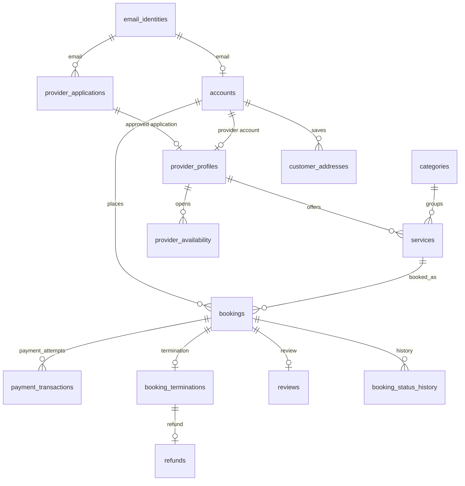

# Thiết kế database đề xuất — Nestify

**Trạng thái:** Bản thiết kế để review, chưa tạo bảng trong PostgreSQL.  
**Nguồn:** `README.md`, `docs/usecase.md`, `docs/usecase_v2.md`. Khi hai bản use case khác nhau, ưu tiên quy tắc đã thống nhất trong `usecase_v2.md`.

## 1. Quy ước chung

- PostgreSQL; khóa chính dùng `BIGINT` tự tăng. Khóa ngoại có cùng kiểu với khóa chính được tham chiếu.
- Thời điểm lưu bằng `TIMESTAMPTZ`; ứng dụng hiển thị theo múi giờ của người dùng. Tiền VND lưu bằng `BIGINT` theo đơn vị **đồng**, không dùng `FLOAT`.
- Email được chuẩn hóa thành chữ thường và bỏ khoảng trắng ở hai đầu trước khi lưu. Mật khẩu và OTP chỉ lưu **hash**.
- Các cột `created_at`, `updated_at` có ở những bảng được sửa thường xuyên. Không xóa cứng đơn hàng, thanh toán, hoàn tiền hay lịch sử xử lý.
- Các trạng thái dưới đây là giá trị đề xuất cho schema/API; khi triển khai nên quản lý bằng ràng buộc `CHECK` hoặc kiểu enum phù hợp.

## 2. Danh sách bảng

### 2.1. Tài khoản và xét duyệt nhà cung cấp

| Bảng | Cột chính | Mục đích |
| --- | --- | --- |
| `email_identities` | `email` **PK**, `account_type` (`CUSTOMER`, `PROVIDER`, `ADMIN`), `created_at` | Giữ quyền sở hữu email dùng chung cho tài khoản và hồ sơ NCC. Một email chỉ thuộc một loại tài khoản; hồ sơ NCC chờ duyệt vẫn chiếm email. |
| `accounts` | `id` **PK**, `email` **FK → email_identities**, `account_type`, `password_hash`, `display_name`, `phone`, `status`, `email_verified_at`, `must_change_password`, `last_login_at` | Tài khoản đăng nhập của khách hàng, NCC đã duyệt và admin. `email` là **UNIQUE**; `account_type` phải khớp với `email_identities`. |
| `provider_applications` | `id` **PK**, `email` **FK → email_identities**, `applicant_name`, `phone`, `business_name`, `description`, `city`, `document_url`, `status`, `email_verified_at`, `decided_by_admin_id` **FK → accounts**, `decided_at`, `rejection_reason` | Hồ sơ đăng ký NCC. Hồ sơ **không phải** tài khoản đăng nhập. Lưu lịch sử cả hồ sơ bị từ chối; mỗi email chỉ có tối đa một hồ sơ đang chờ hoặc đã duyệt. |
| `email_challenges` | `id` **PK**, `email` **FK → email_identities**, `purpose`, `code_hash`, `expires_at`, `consumed_at`, `attempt_count` | OTP xác thực email khách/NCC và mã đặt lại mật khẩu. Mỗi lần gửi lại tạo mã mới; ứng dụng vô hiệu hóa mã cũ. |
| `provider_profiles` | `account_id` **PK, FK → accounts**, `application_id` **UNIQUE, FK → provider_applications**, `business_name`, `bio`, `city`, `address`, `logo_url`, `is_visible` | Hồ sơ công khai của NCC. Chỉ được tạo khi hồ sơ đăng ký đã xác thực email và được admin duyệt. |

**Vòng đời tài khoản:** Khách đăng ký → tạo `email_identities` và `accounts(status=PENDING_EMAIL)` → xác thực OTP → `ACTIVE`. Người đăng ký NCC → tạo `email_identities` và `provider_applications(status=PENDING_EMAIL)` → xác thực OTP → `PENDING_REVIEW` → admin duyệt → tạo `accounts(account_type=PROVIDER)` và `provider_profiles`; tài khoản NCC phải đổi mật khẩu ở lần đăng nhập đầu. Admin được cấp tài khoản qua quy trình nội bộ.

### 2.2. Danh mục, dịch vụ và lịch

| Bảng | Cột chính | Mục đích |
| --- | --- | --- |
| `categories` | `id` **PK**, `parent_id` **FK → categories** (có thể rỗng), `name`, `slug` **UNIQUE**, `description`, `icon_name`, `sort_order`, `is_active` | Danh mục dịch vụ do admin quản lý; hỗ trợ danh mục cha/con. |
| `services` | `id` **PK**, `provider_id` **FK → provider_profiles**, `category_id` **FK → categories**, `title`, `description`, `base_price_vnd`, `duration_minutes`, `status` | Dịch vụ do NCC đăng, có trạng thái `DRAFT`, `PUBLISHED`, `ARCHIVED`. Giá phải dương. |
| `service_images` | `id` **PK**, `service_id` **FK → services**, `image_url`, `alt_text`, `sort_order` | Nhiều ảnh cho một dịch vụ; đường dẫn ảnh, không lưu tệp nhị phân trong DB. Có thể triển khai sau nếu giai đoạn đầu chỉ dùng một ảnh. |
| `provider_availability` | `id` **PK**, `provider_id` **FK → provider_profiles**, `starts_at`, `ends_at`, `state` (`AVAILABLE`, `BLOCKED`) | Các khoảng thời gian NCC có thể nhận việc hoặc chủ động khóa. `starts_at < ends_at`; không cho hai khoảng của cùng NCC chồng nhau. |
| `customer_addresses` | `id` **PK**, `customer_id` **FK → accounts**, `label`, `recipient_name`, `recipient_phone`, `address_line`, `ward`, `district`, `city`, `is_default` | Sổ địa chỉ cho **UC37 (đề xuất)**. Đơn hàng vẫn lưu bản chụp địa chỉ để lịch sử không đổi khi khách sửa/xóa địa chỉ. |

### 2.3. Đặt lịch, cọc và hoàn tiền

| Bảng | Cột chính | Mục đích |
| --- | --- | --- |
| `bookings` | `id` **PK**, `customer_id` **FK → accounts**, `provider_id` **FK → provider_profiles**, `service_id` **FK → services**, `address_id` **FK → customer_addresses** (có thể rỗng), `service_title_snapshot`, các cột địa chỉ/người nhận dạng **snapshot**, `starts_at`, `ends_at`, `total_amount_vnd`, `deposit_amount_vnd`, `status`, `accepted_at`, `completed_at`, `customer_note` | Đơn đặt dịch vụ. `provider_id` phải là chủ của `service_id`. `deposit_amount_vnd` = 30% `total_amount_vnd`, làm tròn tới đồng; không tính lại từ giá dịch vụ sau khi đặt. |
| `booking_status_history` | `id` **PK**, `booking_id` **FK → bookings**, `from_status`, `to_status`, `changed_by_account_id` **FK → accounts** (có thể rỗng nếu hệ thống tự đổi), `note`, `changed_at` | Nhật ký chuyển trạng thái để khách, NCC và admin tra cứu. |
| `payment_transactions` | `id` **PK**, `booking_id` **FK → bookings**, `kind`, `gateway`, `merchant_reference` **UNIQUE**, `gateway_transaction_id`, `amount_vnd`, `status`, `created_at`, `settled_at`, `failure_reason` | Mỗi lần thử thanh toán là một bản ghi, kể cả thất bại. Giai đoạn đầu dùng `kind=DEPOSIT`; giữ khả năng thêm `BALANCE` sau khi chốt cách thu 70% còn lại. Chỉ một giao dịch cọc được thành công cho mỗi đơn. |
| `booking_terminations` | `booking_id` **PK, FK → bookings**, `action` (`CANCEL`, `REJECT`), `initiated_by` (`CUSTOMER`, `PROVIDER`), `reason`, `occurred_at`, `deposit_payment_id` **FK → payment_transactions** (có thể rỗng), `paid_deposit_vnd`, `refund_percent`, `refund_due_vnd` | Ghi lại nguyên nhân kết thúc đơn và **quy tắc hoàn tiền tại thời điểm đó**. Nếu chưa thu cọc thì số tiền hoàn bằng 0. |
| `refunds` | `id` **PK**, `booking_id` **FK → booking_terminations**, `payment_transaction_id` **FK → payment_transactions**, `amount_vnd`, `status`, `gateway_refund_id`, `attempt_count`, `failure_reason`, `requested_at`, `settled_at` | Theo dõi yêu cầu hoàn tiền và kết quả từ cổng thanh toán; giữ bản ghi khi hoàn tiền thất bại để có thể xử lý lại. |

**Trạng thái đơn đề xuất:** `PENDING`, `CONFIRMED`, `IN_PROGRESS`, `COMPLETED`, `CANCELLED`, `REJECTED`. `PENDING` bao gồm thời gian chờ NCC chấp nhận và/hoặc chờ khách trả cọc, vì thứ tự hai bước này chưa được chốt. Chỉ chuyển sang `CONFIRMED` khi NCC đã chấp nhận **và** cọc đã thanh toán thành công. Trạng thái thanh toán lấy từ `payment_transactions`, không lưu lặp trên đơn.

**Quy tắc hoàn cọc đã thống nhất:**

| Tình huống | `refund_percent` trên cọc đã trả |
| --- | ---: |
| Khách hủy khi còn từ 30 phút trở lên trước giờ hẹn | 50% |
| Khách hủy trước giờ hẹn nhưng còn dưới 30 phút | 0% |
| NCC từ chối hoặc hủy đơn | 100% |

Ví dụ đơn 1.000.000 VND có cọc 300.000 VND; khách hủy đủ điều kiện nhận lại 150.000 VND. Nên lấy thời điểm từ máy chủ khi quyết định hủy và ghi `refund_percent`, `refund_due_vnd` ngay trong giao dịch cập nhật đơn, tránh tính lại theo thời gian hiện tại.

### 2.4. Đánh giá, trao đổi và vận hành

| Bảng | Cột chính | Mục đích |
| --- | --- | --- |
| `reviews` | `id` **PK**, `booking_id` **UNIQUE, FK → bookings**, `rating` (1–5), `comment`, `created_at`, `updated_at` | Mỗi đơn tối đa một đánh giá; chỉ cho đánh giá đơn `COMPLETED`. Khách/NCC/dịch vụ suy ra từ đơn. |
| `conversations` | `id` **PK**, `customer_id` **FK → accounts**, `provider_id` **FK → provider_profiles**, `booking_id` **FK → bookings** (có thể rỗng), `created_at`, `updated_at` | Cuộc chat giữa khách và NCC; có thể bắt đầu trước khi tạo đơn. |
| `messages` | `id` **PK**, `conversation_id` **FK → conversations**, `sender_id` **FK → accounts**, `body`, `sent_at`, `read_at` | Tin nhắn; người gửi phải là một trong hai bên của cuộc chat. |
| `notifications` | `id` **PK**, `recipient_id` **FK → accounts**, `type`, `title`, `body`, `booking_id` **FK → bookings** (có thể rỗng), `metadata`, `created_at`, `read_at` | Thông báo trong ứng dụng về đơn, thanh toán, đánh giá... Kết quả xét duyệt trước khi có tài khoản NCC được gửi qua email. |
| `complaints` | `id` **PK**, `customer_id` **FK → accounts**, `booking_id` **FK → bookings** (có thể rỗng), `assigned_admin_id` **FK → accounts**, `subject`, `description`, `status`, `resolution`, `created_at`, `resolved_at` | Yêu cầu hỗ trợ/khiếu nại: admin xử lý theo UC33; phía khách tạo yêu cầu là **UC39 (đề xuất)**. |
| `complaint_updates` | `id` **PK**, `complaint_id` **FK → complaints**, `author_id` **FK → accounts**, `body`, `created_at` | Dòng trao đổi và lịch sử xử lý khiếu nại. |
| `admin_audit_logs` | `id` **PK**, `admin_id` **FK → accounts**, `action`, `entity_type`, `entity_id`, `details`, `created_at` | Khuyến nghị kỹ thuật: truy vết duyệt NCC, khóa tài khoản, can thiệp đơn và xử lý khiếu nại. Chỉ ghi thêm, không sửa/xóa. |

## 3. Quan hệ và ràng buộc cần giữ

1. Chặn trùng email **giữa** đăng ký khách, hồ sơ NCC đang chờ và tài khoản NCC/admin; chỉ `UNIQUE(accounts.email)` sẽ không đủ vì hồ sơ NCC nằm ở bảng khác. `email_identities` là điểm giữ email chung.
2. Ràng buộc `bookings(service_id, provider_id)` phải trỏ đúng dịch vụ của NCC. `customer_addresses.customer_id` và `bookings.customer_id` phải khớp nếu đơn tham chiếu địa chỉ đã lưu; dữ liệu địa chỉ snapshot trên đơn vẫn là nguồn hiển thị lịch sử.
3. Khung giờ đã xác nhận/đang làm không được chồng nhau cho cùng NCC. Khi tạo và xác nhận đơn, kiểm tra lịch rảnh và khóa dữ liệu trong một transaction; có thể dùng exclusion constraint của PostgreSQL để chặn hai yêu cầu đồng thời.
4. Giao dịch cọc thành công phải đúng `bookings.deposit_amount_vnd`. Callback cổng thanh toán phải xử lý idempotent theo mã giao dịch/mã tham chiếu duy nhất. `refunds.amount_vnd` phải bằng `booking_terminations.refund_due_vnd` và gắn với đúng giao dịch cọc thành công.
5. Tạo review chỉ sau khi đơn hoàn tất; chat chỉ cho khách và NCC trong cuộc trò chuyện; thay đổi quan trọng của admin ghi vào `admin_audit_logs`.
6. Tạo index cho các truy vấn thường gặp: dịch vụ theo danh mục/trạng thái/giá, đơn theo khách hoặc NCC và thời gian, hồ sơ NCC chờ duyệt, thông báo chưa đọc, giao dịch hoàn tiền đang xử lý.

## 4. Các quyết định cần chốt trước khi triển khai API

Các mục này được `usecase_v2.md` để mở; schema trên cho phép lưu dữ liệu mà chưa tự áp đặt quy tắc:

1. NCC chấp nhận trước hay khách trả cọc trước; thời hạn cho mỗi bước và cách hết hạn đơn `PENDING`.
2. Cách thu 70% còn lại sau khi hoàn thành dịch vụ.
3. Cách xử lý khách hủy đúng/sau giờ hẹn, hoặc NCC hủy khi dịch vụ đã bắt đầu.
4. Thời hạn OTP, số lần nhập sai, thời gian chờ gửi lại.
5. Cách và số lần thử lại khi hoàn tiền thất bại.
6. Điều kiện chi tiết để đánh giá (ngoài yêu cầu đơn đã hoàn tất) và việc cho phép sửa đánh giá.
7. Người nộp hồ sơ NCC bị từ chối có được chuyển cùng email sang tài khoản khách hàng hay không; hiện thiết kế giữ email cho loại `PROVIDER` để tránh cấp hai loại tài khoản cùng lúc.

**Thứ tự triển khai gợi ý:** Tài khoản/xác thực/NCC → danh mục/dịch vụ/lịch → đơn/cọc/hoàn tiền → đánh giá → chat/thông báo/khiếu nại. Tạo migration theo từng nhóm sau khi các điểm nghiệp vụ tương ứng được chốt.
