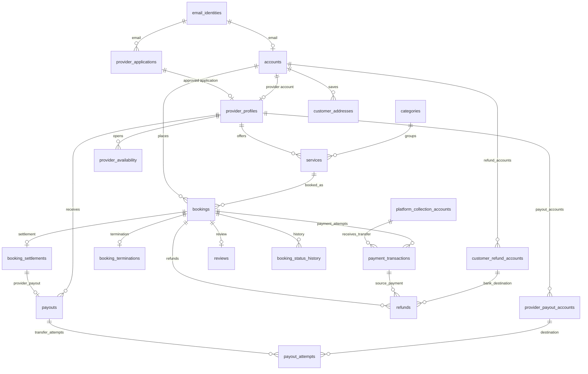

# Thiết kế database v2 — Nestify

> **Tài liệu lịch sử:** nội dung bên dưới giữ theo thời điểm soạn bản cũ. Khi triển khai hiện tại, dùng [usecase-final.md](usecase-final.md), [database-design-final.md](database-design-final.md) và [hợp đồng JWT khách hàng](customer-auth.md). Từ 24/10/2026, access và refresh đều là JWT; các mô tả phiên hoặc quyết định xác thực chưa chốt trong bản cũ không phải hợp đồng đang áp dụng.

**Trạng thái:** Bản thiết kế để review, chưa tạo bảng trong PostgreSQL.  
**Nguồn:** `README.md`, `docs/usecase.md`, `docs/usecase_v2.md` và quyết định của chủ dự án ngày 17/10/2026. Khi hai bản use case khác nhau, ưu tiên quy tắc đã thống nhất trong `usecase_v2.md`; quyết định mới về thu tiền và chia tiền được ghi tại mục 3.

**Thay đổi so với [v1](database-design-v1.md):** Khách thanh toán cả 30% cọc và 70% còn lại cho Nestify. Nestify hưởng 20% của **tiền thực giữ lại sau các khoản hoàn**, NCC hưởng 80%. Nestify cần ghi nghĩa vụ chuyển tiền và tài khoản nhận tiền của NCC.

## 1. Quy ước chung

- PostgreSQL; khóa chính dùng `BIGINT` tự tăng. Khóa ngoại có cùng kiểu với khóa chính được tham chiếu.
- Thời điểm lưu bằng `TIMESTAMPTZ`; ứng dụng hiển thị theo múi giờ của người dùng. Tiền VND lưu bằng `BIGINT` theo đơn vị **đồng**, không dùng `FLOAT`.
- Email được chuẩn hóa thành chữ thường và bỏ khoảng trắng ở hai đầu trước khi lưu. Mật khẩu và OTP chỉ lưu **hash**.
- Các cột `created_at`, `updated_at` có ở những bảng được sửa thường xuyên. Không xóa cứng đơn hàng, thanh toán, hoàn tiền hay lịch sử xử lý.
- Các trạng thái dưới đây là giá trị đề xuất cho schema/API; khi triển khai nên quản lý bằng ràng buộc `CHECK` hoặc kiểu enum phù hợp.

## 2. Danh sách bảng

### 2.1. Tài khoản và xét duyệt nhà cung cấp

| Bảng | Cột chính | Mục đích |
| --- | --- | --- |
| `email_identities` | `email` **PK**, `account_type` (`CUSTOMER`, `PROVIDER`, `ADMIN`), `created_at` | Giữ quyền sở hữu email dùng chung cho tài khoản và hồ sơ NCC. Một email chỉ thuộc một loại tài khoản; hồ sơ NCC chờ duyệt vẫn chiếm email. |
| `accounts` | `id` **PK**, `email` **FK → email_identities**, `account_type`, `password_hash`, `display_name`, `phone`, `status`, `email_verified_at`, `must_change_password`, `last_login_at` | Tài khoản đăng nhập của khách hàng, NCC đã duyệt và admin. `email` là **UNIQUE**; `account_type` phải khớp với `email_identities`. |
| `provider_applications` | `id` **PK**, `email` **FK → email_identities**, `applicant_name`, `phone`, `business_name`, `description`, `city`, `document_url`, `status`, `email_verified_at`, `decided_by_admin_id` **FK → accounts**, `decided_at`, `rejection_reason` | Hồ sơ đăng ký NCC. Hồ sơ **không phải** tài khoản đăng nhập. Lưu lịch sử cả hồ sơ bị từ chối; mỗi email chỉ có tối đa một hồ sơ đang chờ hoặc đã duyệt. |
| `email_challenges` | `id` **PK**, `email` **FK → email_identities**, `purpose`, `code_hash`, `expires_at`, `consumed_at`, `attempt_count` | OTP xác thực email khách/NCC và mã đặt lại mật khẩu. Mỗi lần gửi lại tạo mã mới; ứng dụng vô hiệu hóa mã cũ. |
| `provider_profiles` | `account_id` **PK, FK → accounts**, `application_id` **UNIQUE, FK → provider_applications**, `business_name`, `bio`, `city`, `address`, `logo_url`, `is_visible` | Hồ sơ công khai của NCC. Chỉ được tạo khi hồ sơ đăng ký đã xác thực email và được admin duyệt. |
| `provider_payout_accounts` | `id` **PK**, `provider_id` **FK → provider_profiles**, `bank_code`, `account_number_encrypted`, `account_holder_name`, `is_default`, `verified_at` | Tài khoản ngân hàng nhận tiền của NCC. Có thể lưu nhiều tài khoản, tối đa một tài khoản mặc định; giữ bản ghi cũ khi NCC đổi nơi nhận để đối soát khoản đã chuyển. |
| `customer_refund_accounts` | `id` **PK**, `customer_id` **FK → accounts**, `bank_code`, `account_number_encrypted`, `account_holder_name`, `verified_at` | Cần khi Nestify hoàn bằng chuyển khoản ngân hàng. Khách cung cấp tài khoản nhận hoàn; không suy đoán tài khoản từ thông tin giao dịch đến. |
| `platform_collection_accounts` | `id` **PK**, `bank_code`, `account_number_encrypted`, `account_holder_name`, `is_active` | Tài khoản ngân hàng của Nestify nhận tiền nếu cho khách chuyển khoản trực tiếp; giữ lại bản ghi cũ để đối soát giao dịch lịch sử. Không cần bảng này nếu chỉ thu qua cổng thanh toán. |

**Vòng đời tài khoản:** Khách đăng ký → tạo `email_identities` và `accounts(status=PENDING_EMAIL)` → xác thực OTP → `ACTIVE`. Người đăng ký NCC → tạo `email_identities` và `provider_applications(status=PENDING_EMAIL)` → xác thực OTP → `PENDING_REVIEW` → admin duyệt → tạo `accounts(account_type=PROVIDER)` và `provider_profiles`; tài khoản NCC phải đổi mật khẩu ở lần đăng nhập đầu. Admin được cấp tài khoản qua quy trình nội bộ.

### 2.2. Danh mục, dịch vụ và lịch

| Bảng | Cột chính | Mục đích |
| --- | --- | --- |
| `categories` | `id` **PK**, `parent_id` **FK → categories** (có thể rỗng), `name`, `slug` **UNIQUE**, `description`, `icon_name`, `sort_order`, `is_active` | Danh mục dịch vụ do admin quản lý; hỗ trợ danh mục cha/con. |
| `services` | `id` **PK**, `provider_id` **FK → provider_profiles**, `category_id` **FK → categories**, `title`, `description`, `base_price_vnd`, `duration_minutes`, `status` | Dịch vụ do NCC đăng, có trạng thái `DRAFT`, `PUBLISHED`, `ARCHIVED`. Giá phải dương. |
| `service_images` | `id` **PK**, `service_id` **FK → services**, `image_url`, `alt_text`, `sort_order` | Nhiều ảnh cho một dịch vụ; đường dẫn ảnh, không lưu tệp nhị phân trong DB. Có thể triển khai sau nếu giai đoạn đầu chỉ dùng một ảnh. |
| `provider_availability` | `id` **PK**, `provider_id` **FK → provider_profiles**, `starts_at`, `ends_at`, `state` (`AVAILABLE`, `BLOCKED`) | Các khoảng thời gian NCC có thể nhận việc hoặc chủ động khóa. `starts_at < ends_at`; không cho hai khoảng của cùng NCC chồng nhau. |
| `customer_addresses` | `id` **PK**, `customer_id` **FK → accounts**, `label`, `recipient_name`, `recipient_phone`, `address_line`, `ward`, `district`, `city`, `is_default` | Sổ địa chỉ cho **UC37 (đề xuất)**. Đơn hàng vẫn lưu bản chụp địa chỉ để lịch sử không đổi khi khách sửa/xóa địa chỉ. |

### 2.3. Đặt lịch, thanh toán và phân chia tiền

| Bảng | Cột chính | Mục đích |
| --- | --- | --- |
| `bookings` | `id` **PK**, `customer_id` **FK → accounts**, `provider_id` **FK → provider_profiles**, `service_id` **FK → services**, `address_id` **FK → customer_addresses** (có thể rỗng), `service_title_snapshot`, các cột địa chỉ/người nhận dạng **snapshot**, `starts_at`, `ends_at`, `total_amount_vnd`, `deposit_amount_vnd`, `balance_amount_vnd`, `status`, `accepted_at`, `completed_at`, `customer_note` | Đơn đặt dịch vụ. `provider_id` phải là chủ của `service_id`. Cọc = 30% tổng giá trị, làm tròn tới đồng; số còn lại = tổng giá trị − cọc. Cả hai khoản do Nestify thu, không tính lại từ giá dịch vụ sau khi đặt. |
| `booking_status_history` | `id` **PK**, `booking_id` **FK → bookings**, `from_status`, `to_status`, `changed_by_account_id` **FK → accounts** (có thể rỗng nếu hệ thống tự đổi), `note`, `changed_at` | Nhật ký chuyển trạng thái để khách, NCC và admin tra cứu. |
| `payment_transactions` | `id` **PK**, `booking_id` **FK → bookings**, `kind` (`DEPOSIT`, `BALANCE`), `method` (`GATEWAY`, `BANK_TRANSFER`), `processor` (có thể rỗng), `collection_account_id` **FK → platform_collection_accounts** (có thể rỗng), `merchant_reference` **UNIQUE**, `external_transaction_id`, `amount_vnd`, `status`, `allocation_status` (`UNRESOLVED`, `APPLIED`, `EXCESS`; có thể rỗng), `created_at`, `settled_at`, `failure_reason` | Mỗi lần thử thanh toán là một bản ghi, kể cả thất bại. `DEPOSIT` thu khi đặt, `BALANCE` thu sau khi hoàn thành dịch vụ. `processor` có thể là VNPay/MoMo khi tích hợp; chuyển khoản trực tiếp phải đối soát tiền vào tài khoản Nestify trước khi đánh dấu thành công. `allocation_status` chỉ dùng cho khoản thực thu thành công, phân biệt khoản thu hợp lệ với khoản thu trùng cần hoàn đầy đủ. |
| `booking_terminations` | `booking_id` **PK, FK → bookings**, `action` (`CANCEL`, `REJECT`), `initiated_by` (`CUSTOMER`, `PROVIDER`), `reason`, `occurred_at`, `deposit_payment_id` **FK → payment_transactions** (có thể rỗng), `paid_deposit_vnd` (có thể rỗng), `refund_percent`, `refund_due_vnd` (có thể rỗng) | Lưu thời điểm và **tỷ lệ hoàn tại lúc kết thúc đơn**. Nếu kết quả thu cọc chưa rõ, hai số tiền để `NULL` tới khi đối soát; khi tiền về muộn phải cập nhật nghĩa vụ hoàn theo tỷ lệ đã lưu. Nếu đã xác nhận không thu được cọc thì hai số tiền bằng 0. |
| `refunds` | `id` **PK**, `booking_id` **FK → bookings**, `payment_transaction_id` **FK → payment_transactions**, `reason` (`TERMINATION`, `DUPLICATE_CHARGE`), `destination_account_id` **FK → customer_refund_accounts** (có thể rỗng), `amount_vnd`, `status`, `merchant_refund_reference` **UNIQUE**, `external_refund_id`, `attempt_count`, `failure_reason`, `requested_at`, `settled_at` | Theo dõi hoàn theo chính sách hủy/từ chối và hoàn khoản thu trùng. Hoàn qua cổng dựa trên giao dịch gốc; hoàn chuyển khoản trực tiếp dùng tài khoản khách đã cung cấp/kiểm tra. Thử lại cùng yêu cầu dùng lại mã tham chiếu, không tạo khoản hoàn trùng. |
| `booking_settlements` | `booking_id` **PK, FK → bookings**, `gross_collected_vnd`, `refunded_vnd`, `net_retained_vnd`, `platform_fee_percent`, `platform_fee_vnd`, `provider_due_vnd`, `status`, `finalized_at` | Bản đối soát cuối cùng của một đơn: tiền khách thực trả trừ tiền đã hoàn, chia 20% Nestify và 80% NCC. Chỉ chốt khi các giao dịch thu/hoàn liên quan đã xác định kết quả. |
| `payouts` | `id` **PK**, `booking_id` **UNIQUE, FK → booking_settlements**, `provider_id` **FK → provider_profiles**, `amount_vnd`, `status`, `created_at`, `paid_at` | Nghĩa vụ Nestify trả phần NCC được hưởng. Mỗi đơn có tối đa một nghĩa vụ phải trả trong phạm vi bản đầu; trạng thái nghĩa vụ tách khỏi từng lần thử chuyển tiền. |
| `payout_attempts` | `id` **PK**, `payout_id` **FK → payouts**, `payout_account_id` **FK → provider_payout_accounts**, `merchant_transfer_reference` **UNIQUE**, `external_transfer_id`, `amount_vnd`, `status`, `requested_at`, `settled_at`, `failure_reason` | Mỗi lần yêu cầu chuyển tiền sang ngân hàng là một bản ghi để truy vết và chống chuyển trùng. Trước khi thử lại yêu cầu chưa rõ kết quả, phải đối soát với ngân hàng; mỗi lần thử lưu tài khoản nhận đã dùng. |

**Trạng thái đơn đề xuất:** `PENDING`, `CONFIRMED`, `IN_PROGRESS`, `COMPLETED`, `CANCELLED`, `REJECTED`. `PENDING` bao gồm thời gian chờ NCC chấp nhận và/hoặc chờ khách trả cọc, vì thứ tự hai bước này chưa được chốt. Chỉ chuyển sang `CONFIRMED` khi NCC đã chấp nhận **và** cọc đã thanh toán thành công. `COMPLETED` nói rằng dịch vụ đã xong; khoản 70% và khoản chuyển cho NCC có trạng thái riêng, không suy ra đã trả từ trạng thái đơn.

**Quy tắc hoàn cọc đã thống nhất:**

| Tình huống | `refund_percent` trên cọc đã trả |
| --- | ---: |
| Khách hủy khi còn từ 30 phút trở lên trước giờ hẹn | 50% |
| Khách hủy trước giờ hẹn nhưng còn dưới 30 phút | 0% |
| NCC từ chối hoặc hủy đơn | 100% |

Ví dụ đơn 1.000.000 VND có cọc 300.000 VND; khách hủy đủ điều kiện nhận lại 150.000 VND. Lấy thời điểm từ máy chủ khi quyết định hủy và ghi `refund_percent` ngay trong giao dịch cập nhật đơn. `refund_due_vnd` được xác định từ **số cọc thực thu**; nếu còn giao dịch chưa rõ kết quả, đối soát sau rồi mới chốt số tiền hoàn, không mặc định vĩnh viễn bằng 0.

### 2.4. Đánh giá, trao đổi và vận hành

| Bảng | Cột chính | Mục đích |
| --- | --- | --- |
| `reviews` | `id` **PK**, `booking_id` **UNIQUE, FK → bookings**, `rating` (1–5), `comment`, `created_at`, `updated_at` | Mỗi đơn tối đa một đánh giá; chỉ cho đánh giá đơn `COMPLETED`. Khách/NCC/dịch vụ suy ra từ đơn. |
| `conversations` | `id` **PK**, `customer_id` **FK → accounts**, `provider_id` **FK → provider_profiles**, `booking_id` **FK → bookings** (có thể rỗng), `created_at`, `updated_at` | Cuộc chat giữa khách và NCC; có thể bắt đầu trước khi tạo đơn. |
| `messages` | `id` **PK**, `conversation_id` **FK → conversations**, `sender_id` **FK → accounts**, `body`, `sent_at`, `read_at` | Tin nhắn; người gửi phải là một trong hai bên của cuộc chat. |
| `notifications` | `id` **PK**, `recipient_id` **FK → accounts**, `type`, `title`, `body`, `booking_id` **FK → bookings** (có thể rỗng), `metadata`, `created_at`, `read_at` | Thông báo trong ứng dụng về đơn, thanh toán, đánh giá... Kết quả xét duyệt trước khi có tài khoản NCC được gửi qua email. |
| `complaints` | `id` **PK**, `customer_id` **FK → accounts**, `booking_id` **FK → bookings** (có thể rỗng), `assigned_admin_id` **FK → accounts**, `subject`, `description`, `status`, `resolution`, `created_at`, `resolved_at` | Yêu cầu hỗ trợ/khiếu nại: admin xử lý theo UC33; phía khách tạo yêu cầu là **UC39 (đề xuất)**. |
| `complaint_updates` | `id` **PK**, `complaint_id` **FK → complaints**, `author_id` **FK → accounts**, `body`, `created_at` | Dòng trao đổi và lịch sử xử lý khiếu nại. |
| `admin_audit_logs` | `id` **PK**, `admin_id` **FK → accounts**, `action`, `entity_type`, `entity_id`, `details`, `created_at` | Khuyến nghị kỹ thuật: truy vết duyệt NCC, khóa tài khoản, can thiệp đơn và xử lý khiếu nại. Chỉ ghi thêm, không sửa/xóa. |

## 3. Dòng tiền đã chốt

1. Khách trả **30% tiền cọc cho Nestify** khi đặt lịch. Nestify giữ khoản này; NCC chưa nhận tiền tại thời điểm khách đặt cọc.
2. Sau khi dịch vụ hoàn thành, khách trả **70% còn lại cho Nestify**. Nestify đối soát các khoản đã thu/hoàn, sau đó chuyển số tiền NCC được hưởng vào tài khoản nhận tiền của NCC. `COMPLETED` chỉ là trạng thái dịch vụ; việc thu 70% hoặc chuyển cho NCC có thể vẫn đang chờ.
3. Nếu khách hủy, không thu 70% còn lại. Nestify hoàn 50% hoặc 0% cọc theo mốc thời gian ở mục 2.3, rồi chia **phần cọc thực còn giữ** theo tỷ lệ 20% Nestify, 80% NCC.
4. Nếu NCC từ chối/hủy, Nestify hoàn 100% cọc đã thu. Số tiền còn giữ bằng 0 nên Nestify và NCC đều nhận 0. Nếu chưa thu được cọc, cũng không có khoản nào để chia.

**Công thức đối soát cho một đơn:**

```text
gross_collected_vnd = tổng mọi payment_transactions đã thực thu thành công
refunded_vnd        = tổng mọi refunds đã hoàn thành công
net_retained_vnd    = gross_collected_vnd - refunded_vnd
platform_fee_vnd    = làm_tròn_đến_đồng(net_retained_vnd × 20%)
provider_due_vnd    = net_retained_vnd - platform_fee_vnd
```

Lưu `platform_fee_percent = 20` trong `booking_settlements` để giữ nguyên tỷ lệ áp dụng cho đơn nếu chính sách đổi sau này; áp dụng cùng quy tắc làm tròn tới đồng cho mọi đơn. `provider_due_vnd` là **nghĩa vụ phải trả NCC**, chưa phải số tiền đã chuyển thành công; số thực chuyển theo `payouts.status`. Chỉ chốt settlement khi khoản thu, hoàn và khoản thu trùng đã đối soát xong. Khoản thu `EXCESS` phải được hoàn đủ. Nếu khoản hoàn đang chờ hoặc thất bại, không lấy tiền đó làm doanh thu cuối cùng để chuyển trước cho NCC. Tỷ lệ 20% ở đây tính trước phí cổng/ngân hàng; cách gánh phí là quyết định vận hành riêng.

**Ví dụ đơn 1.000.000 VND, cọc 300.000 VND:**

| Kết quả đơn | Khách đã trả Nestify | Hoàn cho khách | Tiền thực còn giữ | Nestify 20% | Phải trả NCC |
| --- | ---: | ---: | ---: | ---: | ---: |
| Hoàn thành, đã thu đủ 70% còn lại | 1.000.000 | 0 | 1.000.000 | 200.000 | 800.000 |
| Khách hủy trước giờ hẹn từ 30 phút trở lên | 300.000 | 150.000 | 150.000 | 30.000 | 120.000 |
| Khách hủy trước giờ hẹn dưới 30 phút | 300.000 | 0 | 300.000 | 60.000 | 240.000 |
| NCC từ chối hoặc hủy | 300.000 | 300.000 | 0 | 0 | 0 |

NCC có thể dùng tài khoản ngân hàng để nhận tiền chuyển từ Nestify, không phụ thuộc khách đã thanh toán qua cổng hay chuyển khoản. Với hoàn tiền, giao dịch qua cổng có thể hoàn theo giao dịch gốc nếu kênh tích hợp hỗ trợ; nếu thu bằng chuyển khoản trực tiếp thì cần tài khoản nhận hoàn do khách cung cấp. Kênh cụ thể và phí xử lý cần được chốt trước khi tích hợp.

## 4. Quan hệ và ràng buộc cần giữ



1. Chặn trùng email **giữa** đăng ký khách, hồ sơ NCC đang chờ và tài khoản NCC/admin; chỉ `UNIQUE(accounts.email)` sẽ không đủ vì hồ sơ NCC nằm ở bảng khác. `email_identities` là điểm giữ email chung.
2. Ràng buộc `bookings(service_id, provider_id)` phải trỏ đúng dịch vụ của NCC. `customer_addresses.customer_id` và `bookings.customer_id` phải khớp nếu đơn tham chiếu địa chỉ đã lưu; dữ liệu địa chỉ snapshot trên đơn vẫn là nguồn hiển thị lịch sử.
3. Khung giờ đã xác nhận/đang làm không được chồng nhau cho cùng NCC. Khi tạo và xác nhận đơn, kiểm tra lịch rảnh và khóa dữ liệu trong một transaction; có thể dùng exclusion constraint của PostgreSQL để chặn hai yêu cầu đồng thời.
4. Khoản cọc được dùng để xác nhận đơn phải bằng `bookings.deposit_amount_vnd`; khoản thu 70% được dùng để thanh toán đơn phải bằng `bookings.balance_amount_vnd`. Một đơn có tối đa một giao dịch thành công `allocation_status=APPLIED` cho mỗi loại (`DEPOSIT`, `BALANCE`); có thể dùng partial unique index trên `(booking_id, kind)` khi `status=SUCCEEDED` và `allocation_status=APPLIED`. Nếu nhiều lần thanh toán cùng thực thu, ghi nhận tất cả và hoàn đầy đủ phần `EXCESS`. Callback và lệnh hoàn phải idempotent theo mã tham chiếu duy nhất.
5. `refunds.reason=TERMINATION` gắn với giao dịch cọc `APPLIED` của **cùng đơn**, và tổng số tiền hoàn theo chính sách bằng `booking_terminations.refund_due_vnd`; không tạo nhiều yêu cầu hoàn vượt nghĩa vụ này. `refunds.reason=DUPLICATE_CHARGE` gắn với giao dịch `EXCESS` và hoàn đúng khoản trùng. Tài khoản nhận hoàn, nếu có, phải thuộc khách của đơn. Khoản cọc hợp lệ đến sau khi hủy/từ chối không được khôi phục đơn về `CONFIRMED`; áp tỷ lệ hoàn đã chốt tại lúc kết thúc đơn. Mọi khoản đến trùng vẫn hoàn 100%.
6. `booking_settlements` chỉ chốt khi có thể đối soát các khoản thu/hoàn thực tế; số tiền phải tuân công thức ở mục 3. Đơn `COMPLETED` chưa thu đủ 70% không được xem là đã đối soát xong. `payouts.amount_vnd` bằng `provider_due_vnd`, chỉ tạo khi phần NCC lớn hơn 0; `payouts.provider_id` phải là NCC của chính đơn. Mỗi `payout_attempts.amount_vnd` bằng khoản chưa trả của nghĩa vụ; tài khoản nhận phải thuộc NCC đó. Chỉ một lần chuyển thành công cho mỗi payout. Không xóa/sửa bản ghi tài khoản đã dùng cho chuyển tiền lịch sử.
7. Tạo review chỉ sau khi đơn hoàn tất; chat chỉ cho khách và NCC trong cuộc trò chuyện; thay đổi quan trọng của admin ghi vào `admin_audit_logs`.
8. Tạo index cho các truy vấn thường gặp: dịch vụ theo danh mục/trạng thái/giá, đơn theo khách hoặc NCC và thời gian, hồ sơ NCC chờ duyệt, thông báo chưa đọc, giao dịch hoàn tiền/chuyển NCC đang xử lý.

## 5. Các quyết định cần chốt trước khi triển khai API

`usecase_v2.md` vẫn để mở một số quy tắc; ngoài ra, cách thu và chia tiền mới cần chốt thêm chi tiết vận hành:

1. NCC chấp nhận trước hay khách trả cọc trước; thời hạn cho mỗi bước và cách hết hạn đơn `PENDING`.
2. Thời hạn khách trả 70% sau khi hoàn thành dịch vụ và xử lý nếu khách không trả hoặc giao dịch thất bại.
3. Cách xử lý khách hủy đúng/sau giờ hẹn, hoặc NCC hủy khi dịch vụ đã bắt đầu.
4. Thời hạn OTP, số lần nhập sai, thời gian chờ gửi lại.
5. Kênh thanh toán/hoàn tiền được hỗ trợ, cách xác minh chuyển khoản trực tiếp, phí cổng thanh toán do bên nào chịu, thời hạn và số lần thử lại khi hoàn tiền thất bại.
6. Điều kiện chi tiết để đánh giá (ngoài yêu cầu đơn đã hoàn tất) và việc cho phép sửa đánh giá.
7. Người nộp hồ sơ NCC bị từ chối có được chuyển cùng email sang tài khoản khách hàng hay không; hiện thiết kế giữ email cho loại `PROVIDER` để tránh cấp hai loại tài khoản cùng lúc.
8. Thời điểm chuyển tiền cho NCC, cách xử lý chuyển khoản thất bại và việc đối soát phí/nghĩa vụ nếu có hoàn tiền sau khi đã chuyển cho NCC.

**Thứ tự triển khai gợi ý:** Tài khoản/xác thực/NCC → danh mục/dịch vụ/lịch → đơn/cọc/thu 70%/hoàn tiền/đối soát/chuyển NCC → đánh giá → chat/thông báo/khiếu nại. Tạo migration theo từng nhóm sau khi các điểm nghiệp vụ tương ứng được chốt.
