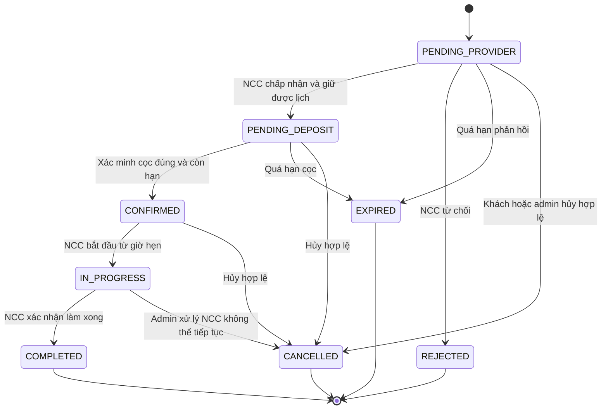

# Nestify — Use case và đặc tả nghiệp vụ final

**Phiên bản:** 1.0 — 21/10/2026.

**Tài liệu đi kèm:** [Thiết kế database final](database-design-final.md).

Tài liệu này hợp nhất `README.md`, `usecase.md`, `usecase_v2.md`, các bản thiết kế/rà soát database và quyết định trong trao đổi với chủ dự án. Các quy tắc thu tiền mới thay thế nội dung còn để mở về 70% trong tài liệu cũ. Đây là đặc tả để triển khai; README hiện vẫn mô tả phần mềm mới ở giai đoạn giao diện mẫu và API kiểm tra hoạt động.

## 1. Mục tiêu và phạm vi

Nestify kết nối khách hàng với nhà cung cấp dịch vụ tại nhà. Khách chọn dịch vụ, gửi yêu cầu đặt lịch, thanh toán cho Nestify và theo dõi quá trình thực hiện. NCC quản lý dịch vụ, lịch làm việc và nhận phần tiền được hưởng từ Nestify. Admin duyệt NCC, vận hành đơn, xử lý khiếu nại và đối soát tiền.

Phạm vi bản đầu: một đơn đặt **một gói dịch vụ giá cố định của một NCC**; mỗi NCC được coi là một nguồn lực chỉ thực hiện một đơn tại một thời điểm. Nếu NCC là công ty, bản đầu vẫn dùng lịch chung của công ty. Chưa có phân công nhân viên, giỏ hàng nhiều dịch vụ, báo giá phát sinh, đổi lịch/đổi giá đơn, ví nội bộ, mã giảm giá hay khách thanh toán trực tiếp cho NCC.

### 1.1. Các quy tắc chủ dự án đã chốt

| Mã | Quy tắc |
| --- | --- |
| C01 | Khách chưa đăng nhập không được tìm kiếm/xem dịch vụ và hồ sơ NCC trong khu vực dịch vụ. |
| C02 | Khách hàng xác thực email bằng OTP trước khi sử dụng tài khoản. |
| C03 | Người đăng ký NCC xác thực email, chờ admin duyệt; nộp hồ sơ chưa tạo tài khoản đăng nhập NCC. |
| C04 | Khi duyệt NCC, hệ thống tạo tài khoản với email làm tên đăng nhập, gửi mật khẩu ngẫu nhiên qua email; NCC phải đổi mật khẩu ở lần đăng nhập đầu. |
| C05 | Một email chỉ thuộc một loại tài khoản; phải kiểm tra cả account và hồ sơ NCC khi đăng ký. |
| C06 | Cọc bằng 30% giá trị đơn. Khách thanh toán cả cọc và 70% còn lại cho Nestify; Nestify trả phần NCC được hưởng. |
| C07 | Khách hủy trước giờ hẹn từ 30 phút trở lên: hoàn 50% cọc; trước giờ hẹn dưới 30 phút: hoàn 0% cọc. |
| C08 | NCC từ chối/hủy: hoàn 100% tiền cọc thực thu. |
| C09 | Nestify hưởng 20% **số tiền thực còn lại sau khi hoàn cho khách**; NCC hưởng phần 80% còn lại. Quy tắc này áp dụng cả phần cọc được giữ khi khách hủy. Hoàn đủ thì hai bên đều hưởng 0. |
| C10 | NCC chấp nhận đơn trước, khách thanh toán cọc sau. |

### 1.2. Mặc định thiết kế để hoàn thiện bản final

Các dòng dưới đây là lựa chọn thiết kế bổ sung cho những điểm tài liệu cũ chưa chốt, **không phải quyết định đã được chủ dự án xác nhận**. Bản final áp dụng thống nhất các mặc định này để có luồng hoàn chỉnh; có thể đổi thông số/quy tắc trước khi triển khai.

| Mã | Mặc định áp dụng |
| --- | --- |
| MD01 | Đặt trước ít nhất 60 phút. NCC có tối đa 30 phút phản hồi; sau khi chấp nhận, giữ lịch tối đa 15 phút cho khách cọc. Deadline được lưu theo từng đơn. |
| MD02 | Khách thanh toán qua cổng được Nestify tích hợp, có thể chọn VNPay hoặc MoMo nếu đã cấu hình kênh đó. Phương thức ngân hàng bên trong cổng phụ thuộc tích hợp thực tế. Chuyển khoản thủ công vào tài khoản Nestify chưa nằm trong luồng mặc định. |
| MD03 | Admin duyệt và thực hiện chuyển tiền vào tài khoản ngân hàng đã xác minh của NCC, sau khi đủ điều kiện đối soát. Chưa có chuyển tiền tự động định kỳ. |
| MD04 | OTP có hiệu lực 10 phút, tối đa 5 lần nhập sai, gửi lại sau ít nhất 60 giây; gửi lại vô hiệu mã trước của cùng mục đích/đối tượng. Phiên đăng nhập có thời hạn tối đa 14 ngày và có thể thu hồi. |
| MD05 | Khách chỉ tự hủy trước giờ hẹn và trước khi bắt đầu thực hiện. Đúng/sau giờ hẹn chuyển sang hỗ trợ. NCC hủy khi đang làm phải qua admin, vẫn hoàn đủ cọc theo C08; không có chức năng hủy thông thường sau `COMPLETED`. |
| MD06 | Một đánh giá cho mỗi đơn `COMPLETED`, không sửa/xóa bởi khách ở bản đầu. Admin có thể ẩn kèm lý do. Có sổ địa chỉ, xem lịch rảnh và gửi yêu cầu hỗ trợ (các UC37–UC39 từng được ghi là đề xuất). |
| MD07 | Không đổi email/đổi loại tài khoản ở bản đầu. Email đăng ký bỏ dở được tiếp tục bằng luồng gửi lại xác thực; hồ sơ NCC bị từ chối được nộp lại cùng email nhưng không chuyển thành khách hàng. |
| MD08 | Phí cổng/ngân hàng do Nestify chịu trong phần của mình; không trừ thêm vào 80% của NCC. Phí thực tế là chi phí riêng, chưa biết phí thì không coi là 0. |
| MD09 | Khách cần trả 70% trong 24 giờ sau khi hoàn tất dịch vụ. Quá hạn: ghi nhận còn phải thu, thông báo/admin xử lý và chặn đặt đơn mới; không tự coi đã thu, không tự hủy dịch vụ đã hoàn thành và chưa chi trả NCC. |
| MD10 | Khi có khiếu nại chưa xử lý gắn với đơn, tạm giữ khoản chi trả NCC chưa thực hiện. Bản đầu chỉ tự động hoàn theo hủy/từ chối/hết hạn và hoàn khoản thu ngoài nghĩa vụ; bồi thường/hoàn sau hoàn tất hoặc sau chi trả cần quy trình mở rộng riêng. |

## 2. Actor và quyền truy cập

| Actor | Quyền và giới hạn |
| --- | --- |
| Khách truy cập | Xem trang giới thiệu; đăng ký khách, nộp hồ sơ NCC, xác thực email, đăng nhập, đặt lại mật khẩu. Không truy cập danh sách/chi tiết dịch vụ. |
| Người nộp hồ sơ NCC | Xác thực hồ sơ và nhận email kết quả. Chưa có phiên đăng nhập/quyền NCC trước khi được duyệt. |
| Khách hàng | Xem dịch vụ, đặt lịch, trả tiền cho Nestify, hủy theo chính sách, đánh giá, chat và hỗ trợ. Chỉ truy cập đơn/địa chỉ/thanh toán của mình. |
| NCC | Quản lý dịch vụ, lịch, đơn được giao, tài khoản nhận tiền; xem thu nhập, chat và đánh giá liên quan. Không dùng tài khoản NCC để đặt đơn như khách. |
| Admin | Duyệt NCC, quản lý tài khoản/danh mục/đơn, xử lý khiếu nại và nghiệp vụ tiền. Can thiệp quan trọng phải ghi lịch sử; không sửa chứng từ tiền đã thành công. |
| Cổng thanh toán | Nhận yêu cầu thu/hoàn và gửi kết quả đã xác thực; không có quyền thay đổi tùy ý trạng thái nghiệp vụ. |
| Ngân hàng/kênh chuyển tiền | Xử lý khoản Nestify chuyển cho NCC và cung cấp mã/kết quả để đối soát. NCC không bắt buộc dùng cùng cổng thanh toán với khách. |
| Dịch vụ email | Gửi OTP, kết quả duyệt, thông tin đăng nhập ban đầu và email khôi phục. |
| Bộ xử lý tự động | Hết hạn yêu cầu/giữ lịch, tiếp nhận kết quả giao dịch, nhắc thanh toán và chuẩn bị đối soát. |

## 3. Danh sách use case

Giữ mã UC01–UC42 từ tài liệu cũ; UC43–UC52 bổ sung cho dòng tiền đã thống nhất và kiểm duyệt đánh giá. UC02/UC17/UC27 dùng chung cơ chế xác thực nhưng kiểm tra đúng loại tài khoản.

### 3.1. Đăng ký, xác thực và tài khoản

| Mã | Use case | Actor | Kết quả |
| --- | --- | --- | --- |
| UC01 | Đăng ký khách hàng | Khách truy cập | Giữ email và tạo account chờ xác thực. |
| UC02 | Đăng nhập khách hàng | Khách truy cập | Cấp phiên cho account khách hợp lệ. |
| UC03 | Đăng xuất | Khách/NCC/admin | Thu hồi phiên hiện tại. |
| UC04 | Quên/đặt lại mật khẩu | Người có account | Xác minh email, đổi mật khẩu và thu hồi các phiên cũ. |
| UC14 | Quản lý hồ sơ cá nhân | Khách | Sửa tên, điện thoại; không đổi email/loại tài khoản. |
| UC16 | Nộp hồ sơ NCC | Khách truy cập | Tạo hồ sơ chờ xác thực, chưa tạo account NCC. |
| UC17 | Đăng nhập NCC | NCC đã duyệt | Cấp phiên có giới hạn nếu chưa đổi mật khẩu lần đầu. |
| UC27 | Đăng nhập admin | Admin | Cấp phiên vận hành đúng quyền. |
| UC28 | Duyệt/từ chối hồ sơ NCC | Admin | Tạo account/profile đúng một lần hoặc ghi lý do từ chối. |
| UC29 | Quản lý người dùng | Admin | Xem/khoá/mở khoá tài khoản, ghi nhật ký. |
| UC35 | Xác thực email khách | Khách truy cập | Kích hoạt account sau OTP hợp lệ. |
| UC36 | Xác thực email hồ sơ NCC | Người nộp hồ sơ | Chuyển đúng hồ sơ sang chờ duyệt. |
| UC42 | Đổi mật khẩu lần đầu | NCC | Gỡ giới hạn của tài khoản NCC sau khi đổi thành công. |

### 3.2. Dịch vụ, lịch và đặt lịch

| Mã | Use case | Actor | Kết quả |
| --- | --- | --- | --- |
| UC05 | Tìm kiếm/lọc dịch vụ | Khách | Lọc theo từ khóa, danh mục, khu vực, giá; chỉ thấy dịch vụ đang công khai của NCC hoạt động. |
| UC06 | Xem chi tiết dịch vụ | Khách | Xem gói, giá, thời lượng, ảnh, đánh giá và NCC. |
| UC07 | Xem hồ sơ NCC | Khách | Xem hồ sơ công khai và dịch vụ được phép hiển thị. |
| UC08 | Đặt lịch | Khách | Tạo yêu cầu chứa giá, địa chỉ, thời gian tại lúc đặt. |
| UC10 | Xem đơn của mình | Khách | Xem tiến độ dịch vụ, khoản phải trả, hoàn tiền và lịch sử. |
| UC11 | Hủy đơn | Khách | Kết thúc đơn trước giờ hẹn, áp chính sách hoàn cọc. |
| UC18 | Quản lý hồ sơ NCC | NCC | Sửa thông tin công khai; không tự thay trạng thái xét duyệt. |
| UC19 | Quản lý dịch vụ | NCC | Tạo nháp, đăng công khai, sửa hoặc lưu trữ dịch vụ của mình. |
| UC20 | Quản lý lịch rảnh | NCC | Thêm/sửa khoảng thời gian không làm mất lịch đã giữ/xác nhận. |
| UC21 | Chấp nhận/từ chối đơn | NCC | Chấp nhận và giữ lịch chờ cọc, hoặc từ chối có lý do. |
| UC22 | Bắt đầu/hoàn thành dịch vụ | NCC | Chuyển đúng trạng thái; hoàn thành mở nghĩa vụ trả 70%. |
| UC30 | Quản lý danh mục | Admin | Quản lý cây danh mục và trạng thái hiển thị. |
| UC31 | Theo dõi/can thiệp đơn | Admin | Xem toàn hệ thống, xử lý ngoại lệ có lý do/lịch sử. |
| UC37 | Quản lý địa chỉ | Khách | Lưu địa chỉ mặc định; lịch sử đơn giữ nguyên khi địa chỉ thay đổi. |
| UC38 | Xem lịch rảnh và giá | Khách | Xem khoảng phù hợp thời lượng dịch vụ trước khi gửi yêu cầu. |
| UC40 | Xem đơn được giao | NCC | Chỉ xem đơn của mình và thông tin phục vụ công việc. |
| UC41 | Hủy đơn đã nhận | NCC/admin | Trước khi làm: NCC hủy; đang làm: admin xử lý yêu cầu NCC; hoàn đủ cọc. |
| UC51 | Hết hạn yêu cầu/giữ lịch | Hệ thống | Kết thúc đơn quá hạn và giải phóng chỗ; tiền đến sau được hoàn đủ. |

### 3.3. Thanh toán, hoàn tiền và chi trả

| Mã | Use case | Actor | Kết quả |
| --- | --- | --- | --- |
| UC09 | Trả cọc 30% | Khách/cổng | Nestify thu cọc cho đơn đã được NCC chấp nhận và còn hạn. |
| UC23 | Xem thu nhập | NCC | Xem phần dự kiến/phải trả/đang chuyển/đã thực nhận, gồm cả phần cọc được hưởng khi khách hủy. |
| UC32 | Xem dashboard | Admin | Theo dõi đơn, thu, hoàn, hoa hồng, nghĩa vụ NCC và thực chi theo chỉ số riêng. |
| UC34 | Xem/xuất báo cáo | Admin | Lọc kỳ, trạng thái và xuất số liệu có định nghĩa rõ ràng. |
| UC43 | Trả 70% còn lại | Khách/cổng | Nestify thu số còn lại của đơn `COMPLETED`. |
| UC44 | Quản lý tài khoản nhận tiền | NCC/admin | NCC khai báo ngân hàng; admin xác minh trước khi chi trả. |
| UC45 | Xem thanh toán/hoàn tiền | Khách | Xem từng khoản thực thu, nghĩa vụ hoàn và kết quả hoàn. |
| UC46 | Theo dõi/đối soát giao dịch | Admin | Xử lý khoản chờ, sai lệch, thu trùng; không tự xác nhận bằng kết quả hiển thị phía trình duyệt. |
| UC47 | Lập/chốt đối soát đơn | Hệ thống/admin | Tính đúng khoản giữ lại, 20% Nestify và phần NCC. |
| UC48 | Duyệt/chuyển tiền NCC | Admin/ngân hàng | Chi trả đúng nghĩa vụ; lưu từng lần thử và chứng từ/mã ngân hàng. |
| UC49 | Xử lý kết quả cổng | Hệ thống/cổng | Xác minh thông báo, ghi thực thu/hoàn và xử lý lặp an toàn. |
| UC50 | Thực hiện/theo dõi hoàn tiền | Hệ thống/admin/cổng | Tạo nghĩa vụ hoàn, gửi yêu cầu và xác minh kết quả; chưa rõ kết quả thì chưa gửi khoản mới. |

### 3.4. Đánh giá, trao đổi và hỗ trợ

| Mã | Use case | Actor | Kết quả |
| --- | --- | --- | --- |
| UC12 | Đánh giá dịch vụ | Khách | Một đánh giá 1–5 sao trên đơn đã hoàn thành của mình. |
| UC13 | Chat với NCC | Khách | Trao đổi với NCC, có thể bắt đầu trước khi đặt. |
| UC15 | Xem thông báo | Khách | Xem/đánh dấu đã đọc thông báo của mình. |
| UC24 | Chat với khách | NCC | Chỉ truy cập cuộc chat có mình tham gia. |
| UC25 | Xem đánh giá | NCC | Xem đánh giá thuộc dịch vụ/đơn của mình. |
| UC26 | Xem thông báo | NCC | Nhận đơn mới, thay đổi lịch, thu/hoàn và chi trả liên quan. |
| UC33 | Xử lý khiếu nại | Admin | Phân công, trao đổi, giải quyết/từ chối kèm kết quả; kiểm tra khoản chi trả đang giữ. |
| UC39 | Gửi/theo dõi hỗ trợ | Khách | Tạo yêu cầu chung hoặc gắn đơn của mình; theo dõi trao đổi. |
| UC52 | Ẩn/hiện đánh giá | Admin | Kiểm duyệt có lý do và audit, không sửa nội dung khách đã viết. |

## 4. Quy trình nghiệp vụ

### 4.1. Đăng ký khách, OTP và khôi phục — UC01–UC04, UC35

1. Khách nhập email, mật khẩu, tên và thông tin liên hệ. Hệ thống chuẩn hóa email, kiểm tra quyền sở hữu email và tạo account `PENDING_EMAIL`.
2. Gửi OTP gắn với **account, email và mục đích đăng ký**. Nhập đúng mã còn hạn thì chuyển account thành `ACTIVE` và đánh dấu email đã xác thực.
3. Mã sai/hết hạn/đã dùng không kích hoạt tài khoản. Gửi lại thay thế mã trước; đăng ký bỏ dở tiếp tục đúng account, không tạo account thứ hai.
4. Đăng nhập chỉ cấp quyền nghiệp vụ cho account đang hoạt động. Account bị khóa không được thao tác; admin khóa account phải thu hồi phiên.
5. Đặt lại mật khẩu dùng mã riêng cho account đã tồn tại; thành công thu hồi các phiên cũ. Không tạo account mới bằng luồng quên mật khẩu; hồ sơ NCC chưa duyệt chưa có mật khẩu đăng nhập.

### 4.2. Nộp và duyệt NCC — UC16, UC28, UC36, UC42

1. Người nộp cung cấp email, tên liên hệ, điện thoại, tên cơ sở/cá nhân, mô tả, khu vực và tài liệu xét duyệt.
2. OTP gắn với **đúng lần nộp hồ sơ**. Xác thực xong, hồ sơ vào `PENDING_REVIEW`; admin chưa được duyệt hồ sơ chưa xác thực.
3. Nếu từ chối, lưu người duyệt, thời điểm và lý do, gửi email. Cho phép nộp hồ sơ mới cùng email loại NCC sau khi hồ sơ trước đã bị từ chối.
4. Nếu duyệt, chuyển hồ sơ thành `APPROVED`, tạo account `PROVIDER` và profile trong cùng giao dịch dữ liệu. Gửi username/email và mật khẩu tạm; chỉ lưu hash mật khẩu.
5. Duyệt lặp hoặc thử gửi lại email không tạo thêm account/profile. Nếu gửi thông tin đăng nhập thất bại, admin có thể cấp lại mật khẩu tạm mới và gửi lại; không lưu mật khẩu rõ trong lịch sử.
6. Phiên đăng nhập đầu chỉ cho đổi mật khẩu/đăng xuất. Đổi thành công mới dùng được các chức năng NCC.

### 4.3. Dịch vụ và lịch — UC05–UC07, UC18–UC20, UC30, UC37–UC38

NCC tạo gói giá cố định và thời lượng dương, gắn danh mục còn hoạt động. Chỉ dịch vụ `PUBLISHED` của NCC hoạt động, hồ sơ được hiển thị và danh mục hợp lệ mới nhận đơn mới. Lưu trữ/sửa dịch vụ không thay đổi đơn đã tạo.

Lịch NCC gồm khoảng `AVAILABLE` hoặc `BLOCKED`, dùng khoảng **[bắt đầu, kết thúc)**: đơn kết thúc lúc 10:00 không xung đột đơn bắt đầu lúc 10:00. Một lịch đặt phải nằm trọn trong khoảng có thể phục vụ; bản đầu không tính thời gian di chuyển. Không sửa lịch làm mất chỗ của đơn đang giữ cọc, đã xác nhận hoặc đang thực hiện. Nếu cần ngừng phục vụ đơn đã nhận, dùng luồng hủy để bảo đảm hoàn tiền.

### 4.4. Gửi yêu cầu, chấp nhận và giữ lịch — UC08, UC21, UC40, UC51

**Điều kiện:** khách đang hoạt động, không còn khoản 70% quá hạn; dịch vụ/NCC hợp lệ, thời điểm bắt đầu cách hiện tại ít nhất 60 phút.

1. Khách chọn gói, thời gian, địa chỉ và người liên hệ. Hệ thống kiểm tra lịch, chụp lại tên gói/giá/thời lượng/địa chỉ/chính sách, tạo `PENDING_PROVIDER`.
2. `request_expires_at = min(thời điểm tạo + 30 phút, giờ hẹn − 30 phút)`. Yêu cầu này chưa giữ chỗ độc quyền và chưa được trả cọc.
3. NCC chấp nhận trước hạn: hệ thống kiểm tra lại/khóa lịch đồng thời, chuyển `PENDING_DEPOSIT`, ghi `accepted_at` và `deposit_due_at = min(thời điểm chấp nhận + 15 phút, giờ hẹn − 15 phút)`. Từ đây giữ chỗ độc quyền.
4. Nhiều yêu cầu trùng khung giờ có thể cùng chờ NCC; chỉ yêu cầu được chấp nhận thành công trước mới giữ được chỗ. Các yêu cầu còn lại không được thu cọc khi chưa giành được chỗ.
5. NCC từ chối: chuyển `REJECTED` có lý do. Quá hạn phản hồi/giữ cọc: chuyển `EXPIRED`, ghi nguyên nhân hệ thống và nhả lịch. Không gán hết hạn thành khách hủy.
6. Trước mọi thao tác, kiểm tra deadline theo giờ máy chủ, kể cả khi tác vụ tự hết hạn chưa chạy. Đơn đã kết thúc không được khôi phục chỉ vì tiền về muộn.

### 4.5. Thu cọc — UC09, UC49

1. Chỉ khách của đơn `PENDING_DEPOSIT` còn hạn được tạo lượt trả cọc, đúng số tiền cọc đã chụp.
2. Tạo mã tham chiếu riêng cho mỗi lượt thanh toán và chuyển khách sang cổng. Kết quả chuyển hướng về trình duyệt chỉ phục vụ hiển thị; Nestify phải kiểm tra kết quả qua thông báo/truy vấn đã xác thực.
3. Thu đúng số tiền và xác minh trước hạn giữ chỗ: ghi giao dịch thực thu, áp vào nghĩa vụ cọc, chuyển đơn `CONFIRMED`.
4. Thất bại: khách có thể thử lại khi còn hạn. Chưa rõ kết quả: hiển thị đang kiểm tra, đối soát giao dịch cũ trước khi cho tạo thêm lượt có nguy cơ thu trùng.
5. Nếu tiền thực đến sau `EXPIRED`, hoàn đủ và giữ đơn kết thúc. Nếu đến sau khách/NCC hủy, khoản cọc hợp lệ áp chính sách đã ghi tại lúc hủy; khoản trùng/không hợp lệ luôn hoàn đủ.

### 4.6. Thực hiện dịch vụ và thu 70% — UC22, UC43

1. NCC chỉ bắt đầu đơn của mình đã `CONFIRMED`, từ giờ hẹn trở đi và không có đơn khác còn đang thực hiện. Chuyển `IN_PROGRESS`, ghi thời điểm thực bắt đầu.
2. Làm xong: NCC xác nhận hoàn thành, hệ thống ghi `COMPLETED`, `completed_at` và hạn thu 70% sau 24 giờ; thông báo khách thanh toán. `COMPLETED` mô tả công việc, không chứng minh đã thu đủ tiền.
3. Khách trả đúng `balance_amount_vnd` cho Nestify. Cách xác minh, chống thu trùng và thử lại tương tự cọc; không mở lượt thu 70% ở đơn chưa hoàn tất/đã hủy.
4. Chưa thu đủ: giữ khoản phải thu, chưa chốt chi trả NCC. Quá hạn thực hiện MD09; khách vẫn được vào đơn để trả nợ hoặc yêu cầu hỗ trợ.
5. Không sửa khách/NCC/gói/giá/giờ hẹn của đơn đã tạo. Sai thông tin trước khi thực hiện thì hủy theo quy tắc rồi đặt đơn mới; không âm thầm thay dữ liệu đã dùng tính tiền.

### 4.7. Hủy, từ chối và hoàn — UC11, UC21, UC41, UC50–UC51

| Tình huống | Điều kiện/nguồn quyết định | Hoàn cọc hợp lệ thực thu | Thu 70%? |
| --- | --- | ---: | --- |
| Khách hủy sớm | Trước giờ hẹn ít nhất 30 phút và chưa bắt đầu | 50% | Không |
| Khách hủy sát giờ | Trước giờ hẹn dưới 30 phút và chưa bắt đầu | 0% | Không |
| Khách hủy đúng/sau giờ hẹn | Không cho tự hủy; chuyển hỗ trợ theo MD05 | Chưa tự phát sinh khoản hoàn | Không tự thay đổi nghĩa vụ |
| NCC từ chối/hủy trước khi làm | NCC thao tác, bắt buộc lý do | 100% | Không |
| NCC không thể tiếp tục khi đang làm | Admin xử lý yêu cầu hủy của NCC, có lý do/lịch sử | 100% | Không |
| Hết hạn phản hồi/giữ lịch | Hệ thống kết thúc, không tính lỗi khách hủy | 100% nếu tiền đến muộn | Không |
| Admin hủy do lỗi hệ thống/trước khi làm | Ghi rõ nguyên nhân hệ thống | 100% | Không |

Tại lúc kết thúc đơn, lưu actor, thời điểm, lý do và tỷ lệ hoàn. Khi chưa xác định giao dịch cọc có thực thu không, tiền đã trả/tiền cần hoàn còn **chưa xác định**, không chốt thành 0. Sau khi đối soát, tính số cần hoàn từ cọc hợp lệ thực thu và tỷ lệ đã lưu.

Một yêu cầu hoàn gắn với một giao dịch thu cụ thể. Hoàn qua cổng dùng giao dịch gốc, không yêu cầu mọi khách lưu tài khoản ngân hàng trong Nestify. Mỗi lần gọi hoàn có kết quả và mã riêng; chỉ gửi yêu cầu mới sau khi xác nhận lần trước thất bại chắc chắn. Cổng đang xử lý/mất phản hồi thì đối soát trước. Khoản phải hoàn không mất đi vì một lần thử thất bại.

Thu trùng, thu sai số tiền hoặc thu ở giai đoạn không hợp lệ phải ghi nhận tiền thật và hoàn đủ khoản ngoài nghĩa vụ. Không xóa giao dịch để làm báo cáo trông khớp; không đưa khoản đang phải hoàn vào số chia tiền cuối cùng.

### 4.8. Đối soát, hoa hồng và chi trả — UC23, UC44, UC46–UC48

```text
cọc              = ROUND_HALF_UP(tổng giá trị đơn × 30%)
70% còn lại      = tổng giá trị đơn − cọc
tiền còn giữ     = tổng tiền thực thu − tổng tiền thực hoàn
phần Nestify     = ROUND_HALF_UP(tiền còn giữ × 20%)
phần NCC         = tiền còn giữ − phần Nestify
```

Tiền VND là số nguyên đồng. `ROUND_HALF_UP` nghĩa là làm tròn tới đồng gần nhất, phần lẻ từ 0,5 đồng làm tròn lên. Chia tiền trên **tổng ròng của đơn**, không làm tròn hoa hồng độc lập cho từng lần thu 30%/70%. Snapshot tỷ lệ áp dụng được giữ trên đơn.

| Ví dụ đơn 1.000.000đ | Đã thu khách | Hoàn khách | Còn giữ | Nestify | NCC |
| --- | ---: | ---: | ---: | ---: | ---: |
| Hoàn thành, trả đủ cọc và phần còn lại | 1.000.000 | 0 | 1.000.000 | 200.000 | 800.000 |
| Khách hủy trước giờ hẹn ≥ 30 phút | 300.000 | 150.000 | 150.000 | 30.000 | 120.000 |
| Khách hủy trước giờ hẹn < 30 phút | 300.000 | 0 | 300.000 | 60.000 | 240.000 |
| NCC từ chối/hủy | 300.000 | 300.000 | 0 | 0 | 0 |
| Chưa thu khoản nào, đơn kết thúc | 0 | 0 | 0 | 0 | 0 |

**Điều kiện chốt đối soát:** đơn ở trạng thái kết thúc; đơn hoàn thành phải đã thu đủ cọc/70%; không còn giao dịch chưa rõ, khoản thu ngoài nghĩa vụ chưa hoàn đủ hay nghĩa vụ hoàn còn chờ; không có khiếu nại chưa xử lý liên quan. Số tiền chia phải khớp dữ liệu giao dịch thực tế.

NCC khai báo ngân hàng, số tài khoản và tên chủ tài khoản; admin xác minh. Đổi tài khoản nhận tiền tạo bản ghi mới, giữ dữ liệu tài khoản đã dùng cho lịch sử. Chưa có tài khoản hợp lệ vẫn ghi nhận khoản phải trả nhưng chưa chuyển tiền.

Khi phần NCC > 0, lập đúng một nghĩa vụ chi trả cho đơn. Admin kiểm tra đối soát/tài khoản, duyệt rồi chuyển qua ngân hàng và ghi mã/kết quả. Chỉ đánh dấu đã trả sau khi xác minh chuyển thành công; mỗi lần thử là một bản ghi. Mất phản hồi hoặc chưa rõ kết quả không chuyển lại ngay. Phần NCC = 0 thì không tạo lệnh chuyển 0đ.

Sau khi đã bắt đầu chi trả, không sửa bản đối soát/chứng từ cũ. Khoản thu trùng đến rất muộn vẫn được ghi và hoàn đủ, không tạo thêm thu nhập NCC. Nếu phát hiện thay đổi ròng ngoài luồng đã quy định, giữ các khoản chưa chi và mở xử lý ngoại lệ; bản đầu không tự bù trừ nợ NCC hay tự thu hồi tiền đã chi.

### 4.9. Đánh giá, chat, thông báo và khiếu nại — UC12–UC15, UC24–UC26, UC33, UC39, UC52

Khách sở hữu đơn `COMPLETED` được đánh giá một lần, 1–5 sao; việc trả 70% có trạng thái riêng và không dùng để sửa trạng thái hoàn thành. NCC chỉ đọc đánh giá, admin có thể ẩn nội dung vi phạm với lý do, không sửa lời khách.

Một cặp khách–NCC có một cuộc chat xuyên suốt; tin nhắn có thể gắn một đơn thuộc đúng cặp đó. Chỉ hai bên được gửi/đọc; phiên bản đầu là tin nhắn chữ. Thông báo trong ứng dụng thuộc người nhận; email xét duyệt gửi cho người chưa có account không cần giả tạo account để lưu thông báo.

Khách gửi hỗ trợ chung hoặc gắn đơn của mình. Admin phân công, ghi trao đổi và mọi lần chuyển trạng thái `OPEN → IN_REVIEW → RESOLVED/REJECTED`. Đơn liên quan có khoản chưa chi phải được kiểm tra giữ tiền theo MD10. Đóng khiếu nại không tự tạo hoàn tiền; khoản hoàn phải có căn cứ đúng luồng và chứng từ riêng.

### 4.10. Quản trị và báo cáo — UC29–UC34, UC46

Khóa NCC làm ẩn dịch vụ và chặn nhận đơn mới; các đơn đang tồn tại phải được admin xem xét giữ thực hiện hoặc hủy đúng quy trình, không tự xóa. Tiền còn phải trả NCC không bị xóa bởi việc khóa tài khoản. Khách bị khóa vẫn giữ lịch sử và nghĩa vụ tiền; admin hỗ trợ xử lý đơn chưa xong.

| Chỉ số | Định nghĩa |
| --- | --- |
| Giá trị đơn hoàn thành | Tổng giá trị snapshot của các đơn `COMPLETED`; không suy ra đã thu tiền. |
| Tiền khách thực trả | Tổng giao dịch thu thành công, kể cả khoản thu ngoài nghĩa vụ đang chờ hoàn. |
| Tiền đã hoàn | Tổng các lần hoàn thực sự thành công, không cộng yêu cầu còn chờ. |
| Hoa hồng Nestify | Phần 20% trên số ròng của đối soát đã chốt; chưa trừ chi phí cổng/ngân hàng. |
| Phần NCC được hưởng | Số phải trả theo đối soát, gồm cả phần cọc giữ do khách hủy. |
| NCC thực nhận | Tổng lần chuyển NCC đã thành công; không lấy tổng số phải trả thay thế. |
| Khách còn phải trả | 70% còn thiếu của đơn hoàn thành; phân biệt trong hạn/quá hạn. |
| Nestify còn phải trả NCC | Nghĩa vụ đã chốt trừ thực chi; phân biệt chưa duyệt/đang chuyển/cần kiểm tra. |

Báo cáo tiền dùng thời điểm giao dịch thu/hoàn/chuyển thành công; báo cáo hoàn thành dùng `completed_at`. Bộ lọc theo ngày Việt Nam được đổi sang khoảng thời gian phù hợp khi truy vấn. Không gộp hai định nghĩa này thành một chỉ số “doanh thu”.

## 5. Trạng thái đơn và điều kiện chuyển



Các trạng thái `PENDING_DEPOSIT`, `CONFIRMED`, `IN_PROGRESS` giữ lịch độc quyền. Với chỗ giữ cọc đã quá hạn, xử lý hết hạn trong giao dịch dữ liệu trước khi xét chấp nhận đơn cạnh tranh. Trạng thái thanh toán, hoàn, đối soát và chi trả được theo dõi riêng; không thêm trạng thái “đã thanh toán” vào vòng đời dịch vụ.

## 6. Tiêu chí nghiệm thu nghiệp vụ

1. Không đăng ký trùng email giữa khách, NCC và hồ sơ chưa duyệt, kể cả hai yêu cầu đồng thời.
2. Hồ sơ NCC chưa xác thực không được duyệt; duyệt lặp không tạo account thứ hai; OTP của hồ sơ cũ không xác thực hồ sơ mới.
3. Hai yêu cầu cùng giờ không thể cùng giữ lịch hoặc cùng xác nhận cho một NCC. Không thu cọc trước khi NCC chấp nhận theo C10; thời hạn giữ lịch áp dụng MD01.
4. Sai số tiền, giả thông báo cổng, callback lặp, thu trùng, tiền đến sau hết hạn/hủy đều không làm mất dấu tiền hay khôi phục đơn đã kết thúc.
5. Hủy trước giờ hẹn đúng 30 phút được hoàn 50% cọc; dưới 30 phút là 0%; NCC hủy là 100%; tỷ lệ dùng thời điểm máy chủ và chính sách snapshot.
6. Năm ví dụ tiền ở mục 4.8 khớp cả số khách được hoàn, phần Nestify và phần NCC. Phí xử lý không làm phần NCC thấp hơn tỷ lệ đã chốt.
7. Đơn đã hoàn thành nhưng thiếu 70% vẫn thể hiện còn phải thu; không được coi là đã đối soát xong/đã trả NCC.
8. Lệnh hoàn/chuyển chưa rõ kết quả không phát sinh lệnh mới thiếu kiểm tra; báo cáo thực thu/hoàn/chi dựa trên giao dịch thực sự thành công.
9. Sửa giá dịch vụ, địa chỉ hoặc tài khoản ngân hàng không làm thay đổi lịch sử đơn/chứng từ cũ.
10. Người dùng không đọc/sửa đơn, giao dịch, cuộc chat, địa chỉ hoặc khiếu nại của người khác; thao tác admin quan trọng có nhật ký.

## 7. Nguồn và cách dùng

- [README dự án](../README.md): phạm vi sản phẩm và PostgreSQL/Spring Boot/React.
- [Use case ban đầu](usecase.md), [use case v2](usecase_v2.md): giữ mã chức năng, quy tắc tài khoản và hoàn cọc.
- [Database v1](database-design-v1.md), [database v2](database-design-v2.md), [rà soát database](database-review.md): cấu trúc và các lỗ hổng đã được làm rõ trong bản final.
- [Quy định FE](FE-guideline-lite%20%281%29.md): cách trình bày giao diện; các trạng thái chờ nhận/chờ cọc/hết hạn mới cần được FE ánh xạ theo tài liệu final.

Các bản cũ là lịch sử tham khảo. Khi triển khai, đọc bản này cùng `database-design-final.md`; nếu thay MD01–MD10, cập nhật cả hai tài liệu và các tiêu chí nghiệm thu liên quan.
