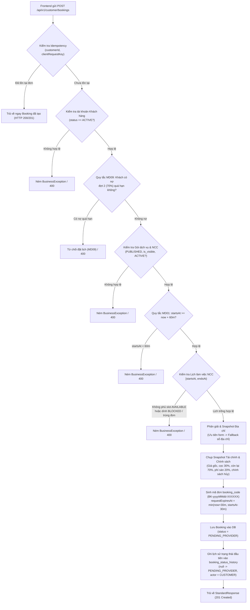
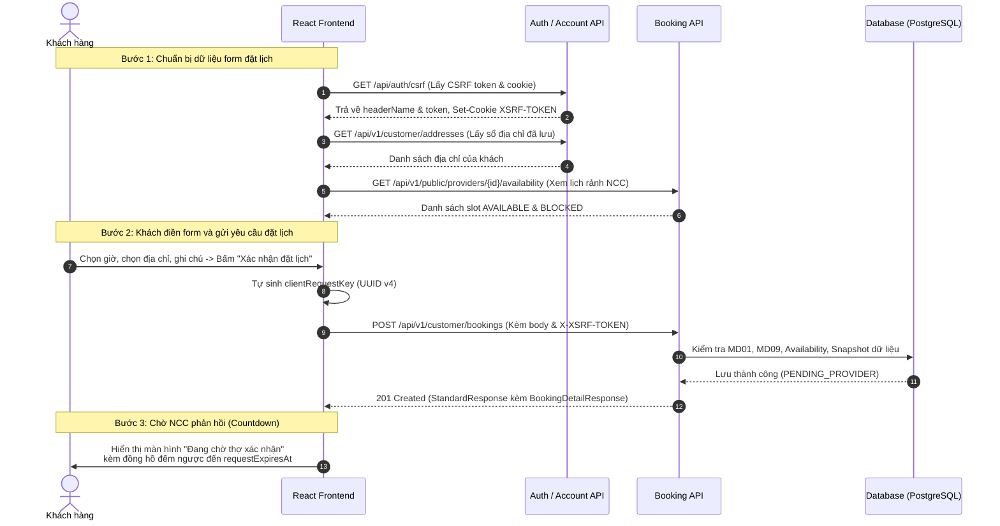

# Nestify — Tài Liệu Tích Hợp API (Handoff Frontend)
**Module:** Đặt lịch dịch vụ (Booking)  
**Use Case:** UC08 — Khách hàng tạo yêu cầu đặt lịch  
**Phiên bản:** 1.0.0  
**Ngày cập nhật:** 24/10/2026  
**Người phụ trách backend:** Nguyễn Đình Thủy  

---

## 1. Tổng Quan

Tài liệu này đặc tả chi tiết endpoint API cho chức năng **Khách hàng đặt lịch dịch vụ (UC08)** của hệ thống Nestify. Tài liệu cung cấp đầy đủ thông tin về phương thức gọi, cấu trúc request, response, các quy tắc nghiệp vụ (Business Rules), mã lỗi thực tế và luồng gọi API để đội ngũ Frontend (React/Vite) có thể tích hợp trực tiếp mà không cần hỏi lại Backend.

### 1.1. Base URL & Môi trường
- **Môi trường phát triển cục bộ (Local / Dev):** `http://localhost:8080`
- **Môi trường Production (dự kiến):** `https://api.nestify.vn` (hoặc cấu hình theo domain máy chủ triển khai)

### 1.2. Định dạng chung
- **Content-Type:** `application/json;charset=UTF-8`
- **Mã hóa ký tự:** UTF-8
- **Định dạng thời gian:** ISO-8601 UTC (`YYYY-MM-DDTHH:mm:ssZ`)
- **Đơn vị tiền tệ:** Số nguyên đồng Việt Nam (`BIGINT`, VND)

---

## 2. Xác Thực & Phân Quyền (Authentication & Authorization)

- **Cơ chế xác thực:** Stateless Session (phiên làm việc dựa trên cookie/header được cấp khi đăng nhập).
- **Yêu cầu bảo mật:**
  - Endpoint yêu cầu người dùng đã đăng nhập với vai trò **`ROLE_CUSTOMER`**.
  - **CSRF Protection:** Bắt buộc có cặp Cookie `XSRF-TOKEN` và Header `X-XSRF-TOKEN` cho mọi request `POST`.
- **Phân quyền truy cập:**
  - `CUSTOMER`: Có quyền tạo yêu cầu đặt lịch.
  - `PROVIDER`, `ADMIN`, `GUEST (chưa đăng nhập)`: Bị chặn (trả về lỗi HTTP 401 hoặc 403).

---

## 3. Quy Ước Chung (Common Conventions)

### 3.1. Cấu trúc Response thành công chuẩn (`StandardResponse<T>`)
Tất cả các API nghiệp vụ của hệ thống đều bọc dữ liệu trả về trong cấu trúc chuẩn:
```json
{
  "success": true,
  "message": "Thông điệp thông báo kết quả cho người dùng",
  "data": { ... },
  "timestamp": "2026-10-24T08:59:00Z"
}
```

### 3.2. Cấu trúc Response lỗi chuẩn (`ApiError`)
Khi có lỗi xảy ra (lỗi dữ liệu, lỗi nghiệp vụ hoặc bảo mật), hệ thống trả về HTTP Status code tương ứng cùng cấu trúc:
```json
{
  "code": "MÃ_LỖI_CHUẨN",
  "message": "Mô tả lỗi chi tiết bằng tiếng Việt để hiển thị lên UI",
  "fieldErrors": {
    "tênField": "Lý do trường này không hợp lệ"
  }
}
```

### 3.3. Bảng mã lỗi chung của hệ thống

| HTTP Status | Error Code | Ý nghĩa | Hành động khuyến nghị cho Frontend |
| :--- | :--- | :--- | :--- |
| **400 Bad Request** | `VALIDATION_ERROR` | Dữ liệu đầu vào vi phạm ràng buộc (`@NotNull`, `@Future`, format sai) | Hiển thị thông báo lỗi tương ứng dưới từng ô nhập liệu theo `fieldErrors`. |
| **400 Bad Request** | `BUSINESS_ERROR` | Vi phạm quy tắc nghiệp vụ (lead time < 60p, trùng lịch, nợ quá hạn...) | Hiển thị popup/modal hoặc Alert thông báo `message` cho khách hàng. |
| **401 Unauthorized** | `AUTHENTICATION_REQUIRED` | Chưa đăng nhập hoặc phiên làm việc đã hết hạn | Điều hướng người dùng sang trang Đăng nhập (`/login`). |
| **403 Forbidden** | `CSRF_INVALID` | Thiếu hoặc sai mã CSRF token | Tự động gọi lại `GET /api/auth/csrf` để lấy token mới rồi thử lại. |
| **403 Forbidden** | `ACCESS_DENIED` | Tài khoản đăng nhập không phải vai trò `CUSTOMER` | Hiển thị thông báo không có quyền thực hiện thao tác. |
| **404 Not Found** | `NOT_FOUND` | Không tìm thấy tài nguyên (gói dịch vụ, địa chỉ, khách hàng) | Thông báo tài nguyên không tồn tại hoặc chuyển hướng về trang danh sách. |

---

## 4. Chi Tiết API: Khách Hàng Đặt Lịch (UC08)

### 4.1. Thông tin Endpoint
- **Tên hành động:** Tạo yêu cầu đặt lịch dịch vụ mới
- **Method:** `POST`
- **URI Path:** `/api/v1/customer/bookings`  
  *(Hệ thống hỗ trợ cả alias `/api/customer/bookings`)*
- **Xác thực:** Bắt buộc đăng nhập (`ROLE_CUSTOMER`)
- **Nguồn Backend:** 
  - Controller: [`com.homeservice.booking.controller.CustomerBookingController`](file:///D:/20261/congngheweb/home-service/backend/src/main/java/com/homeservice/booking/controller/CustomerBookingController.java) → phương thức `createBooking(...)`
  - Service: [`com.homeservice.booking.service.BookingService`](file:///D:/20261/congngheweb/home-service/backend/src/main/java/com/homeservice/booking/service/BookingService.java) → phương thức `createBooking(...)`

---

### 4.2. Request Headers
| Header | Kiểu | Bắt buộc | Mô tả / Giá trị mẫu |
| :--- | :--- | :--- | :--- |
| `Content-Type` | String | **Có** | `application/json` |
| `X-XSRF-TOKEN` | String | **Có** | Giá trị CSRF token lấy từ endpoint `GET /api/auth/csrf` |
| `Cookie` | String | **Có** | Chứa cookie phiên đăng nhập và cookie `XSRF-TOKEN` |

---

### 4.3. Request Body (`application/json`)

#### Bảng chi tiết các trường trong Request Body:
| Field | Kiểu dữ liệu | Bắt buộc | Ràng buộc validate | Mô tả ý nghĩa |
| :--- | :--- | :---: | :--- | :--- |
| `clientRequestKey` | `UUID` (String) | **Bắt buộc** | `@NotNull`, định dạng UUID hợp lệ (v4) | Khóa định danh chống trùng lặp (Idempotency Key). FE tự sinh 1 UUID mới khi mở form đặt lịch. Nếu click submit nhiều lần do lag mạng, gửi cùng UUID này để tránh bị trừ tiền hoặc tạo 2 đơn trùng. |
| `providerId` | `Long` | **Bắt buộc** | `@NotNull`, số nguyên dương | ID tài khoản của Nhà cung cấp (chủ gói dịch vụ được chọn). |
| `serviceId` | `Long` | **Bắt buộc** | `@NotNull`, số nguyên dương | ID gói dịch vụ khách hàng lựa chọn đặt. |
| `startsAt` | `String` (ISO-8601) | **Bắt buộc** | `@NotNull`, `@Future`, format UTC: `YYYY-MM-DDTHH:mm:ssZ` | Thời điểm khách hẹn bắt đầu làm việc. **Phải ở tương lai và cách thời điểm hiện tại ít nhất 60 phút (Quy tắc MD01)**. |
| `addressId` | `Long` | Tùy chọn | ID địa chỉ hợp lệ trong sổ địa chỉ của khách | Nếu khách chọn từ danh sách địa chỉ đã lưu trong Sổ địa chỉ, truyền `addressId`. Backend sẽ tự động lấy các thông tin liên hệ và địa chỉ tương ứng. |
| `recipientName` | `String` | Tùy chọn* | Max 150 ký tự | Tên người nhận dịch vụ / liên hệ tại địa điểm làm việc. Bắt buộc nếu không truyền `addressId`. |
| `recipientPhone` | `String` | Tùy chọn* | Max 32 ký tự, định dạng SĐT | SĐT người liên hệ khi thợ đến làm việc. Bắt buộc nếu không truyền `addressId`. |
| `addressLine` | `String` | Tùy chọn* | Text | Số nhà, tên ngõ, tên đường chi tiết. Bắt buộc nếu không truyền `addressId`. |
| `ward` | `String` | Tùy chọn | Max 150 ký tự | Phường / Xã. |
| `city` | `String` | Tùy chọn* | Max 150 ký tự | Tỉnh / Thành phố. Bắt buộc nếu không truyền `addressId`. |
| `addressInstructions`| `String` | Tùy chọn | Text | Hướng dẫn tìm nhà / vào cổng vật lý (VD: *"Bấm chuông cửa số 2, gửi xe tầng hầm B1"*). |
| `customerNote` | `String` | Tùy chọn | Text | Ghi chú yêu cầu riêng về công việc cho thợ (VD: *"Nhà có trẻ nhỏ ngủ, xin gọi trước khi bấm chuông"*). |

> **Lưu ý nghiệp vụ địa chỉ:**
> - Nếu khách **chọn địa chỉ có sẵn**: Chỉ cần truyền `addressId`. Nếu khách có sửa đổi tên/SĐT trong form, FE có thể truyền đè `recipientName`, `recipientPhone` lên request, backend sẽ ưu tiên giá trị truyền lên.
> - Nếu khách **nhập địa chỉ mới hoàn toàn**: Bỏ trống `addressId`, truyền đầy đủ `recipientName`, `recipientPhone`, `addressLine`, `city`.

#### Ví dụ 1: Request chọn địa chỉ từ Sổ địa chỉ (`addressId = 1`)
```json
{
  "clientRequestKey": "3fa85f64-5717-4562-b3fc-2c963f66afa6",
  "providerId": 2,
  "serviceId": 1,
  "startsAt": "2026-10-25T09:00:00Z",
  "addressId": 1,
  "customerNote": "Nhà có trẻ nhỏ, xin gọi trước khi đến"
}
```

#### Ví dụ 2: Request nhập địa chỉ trực tiếp (không dùng sổ địa chỉ)
```json
{
  "clientRequestKey": "a1b2c3d4-e5f6-7890-abcd-ef1234567890",
  "providerId": 2,
  "serviceId": 1,
  "startsAt": "2026-10-25T14:00:00Z",
  "recipientName": "Lê Khách Mới",
  "recipientPhone": "0988776655",
  "addressLine": "Số 45 Cầu Giấy",
  "ward": "Dịch Vọng",
  "city": "Hà Nội",
  "addressInstructions": "Gửi xe ở tầng hầm B1",
  "customerNote": "Cần thợ mang theo thang gấp"
}
```

---

### 4.4. Response Thành Công — `201 Created`

Toàn bộ thông tin đơn đặt lịch được chụp lại bất biến (Snapshot) và trả về trong trường `data`:

#### Bảng chi tiết các trường trong `data` (`BookingDetailResponse`):
| Field | Kiểu dữ liệu | Nullable | Mô tả ý nghĩa & Gợi ý hiển thị Frontend |
| :--- | :--- | :---: | :--- |
| `id` | `Long` | Không | ID duy nhất của đơn đặt lịch trong cơ sở dữ liệu. |
| `version` | `Long` | Không | Phiên bản bản ghi phục vụ **Optimistic Locking**. FE lưu giá trị này để truyền lên trong các thao tác hủy/thay đổi trạng thái sau này nhằm chống xung đột dữ liệu đồng thời. |
| `bookingCode` | `String` | Không | Mã hiển thị của đơn dạng `BK-YYYYMMDD-XXXXXX` (VD: `BK-20261024-5F2A10`). Dùng để hiển thị cho người dùng tra cứu. |
| `clientRequestKey` | `UUID` | Không | Khóa định danh request do client gửi lên. |
| `customerId` | `Long` | Không | ID tài khoản của khách hàng đặt đơn. |
| `customerName` | `String` | Có | Tên hiển thị của khách hàng. |
| `providerId` | `Long` | Không | ID tài khoản của Nhà cung cấp. |
| `providerName` | `String` | Có | Tên doanh nghiệp / tên hiển thị của Nhà cung cấp. |
| `serviceId` | `Long` | Không | ID của gói dịch vụ. |
| `serviceTitle` | `String` | Không | Tên dịch vụ tại thời điểm đặt (Snapshot bất biến). |
| `durationMinutes` | `Integer` | Không | Thời lượng dự kiến thực hiện (phút) (Snapshot). |
| `startsAt` | `String` (ISO) | Không | Thời điểm bắt đầu dịch vụ dự kiến. |
| `endsAt` | `String` (ISO) | Không | Thời điểm kết thúc dự kiến (`startsAt + durationMinutes`). |
| `status` | `String` | Không | Trạng thái hiện tại của đơn. Khởi tạo luôn là **`PENDING_PROVIDER`** (Đang chờ NCC chấp nhận). |
| `requestExpiresAt` | `String` (ISO) | Không | Thời điểm hết hạn yêu cầu chờ NCC phản hồi (tính bằng `min(now + 30m, startsAt - 30m)` theo MD01). FE dùng để đếm ngược (countdown) cho khách biết. |
| `acceptedAt` | `String` (ISO) | **Có** | Thời điểm NCC chấp nhận đơn (ban đầu là `null`). |
| `depositDueAt` | `String` (ISO) | **Có** | Hạn chót thanh toán cọc 30 phút sau khi NCC nhận đơn (ban đầu là `null`). |
| `startedAt` | `String` (ISO) | **Có** | Thời điểm thợ bắt đầu làm việc thực tế (ban đầu là `null`). |
| `completedAt` | `String` (ISO) | **Có** | Thời điểm thợ bấm hoàn thành công việc (ban đầu là `null`). |
| `balanceDueAt` | `String` (ISO) | **Có** | Hạn chót thanh toán nốt 70% sau khi hoàn thành (ban đầu là `null`). |
| `totalAmountVnd` | `Long` | Không | Tổng giá trị đơn dịch vụ (VND) (Snapshot giá gốc). |
| `depositPercent` | `Integer` | Không | Tỷ lệ đặt cọc hệ thống quy định snapshot (luôn là `30`%). |
| `depositAmountVnd` | `Long` | Không | Số tiền cọc cần thanh toán (VND) (`totalAmountVnd * 30%`, làm tròn). |
| `balanceAmountVnd` | `Long` | Không | Số tiền còn lại phải thanh toán sau khi hoàn thành (VND) (70%). |
| `platformFeePercent` | `Integer` | Không | Tỷ lệ phí nền tảng Nestify snapshot (`20`%). |
| `cancelCutoffMinutes`| `Integer` | Không | Mốc thời gian phân định hủy sớm / sát giờ snapshot (`30` phút). |
| `earlyRefundPercent` | `Integer` | Không | Tỷ lệ hoàn cọc khi khách hủy sớm snapshot (`50`%). |
| `lateRefundPercent` | `Integer` | Không | Tỷ lệ hoàn cọc khi khách hủy sát giờ snapshot (`0`%). |
| `providerRefundPercent`| `Integer`| Không | Tỷ lệ hoàn tiền khi NCC hủy/từ chối snapshot (`100`%). |
| `systemRefundPercent` | `Integer` | Không | Tỷ lệ hoàn tiền khi hệ thống hủy/hết hạn snapshot (`100`%). |
| `settlementStatus` | `String` | Không | Trạng thái đối soát tài chính nội bộ (khởi tạo là `DRAFT`). |
| `addressId` | `Long` | Có | ID địa chỉ liên kết (nếu chọn từ sổ địa chỉ). |
| `recipientName` | `String` | Không | Tên người nhận dịch vụ snapshot. |
| `recipientPhone` | `String` | Không | SĐT người nhận dịch vụ snapshot. |
| `addressLine` | `String` | Không | Địa chỉ chi tiết snapshot. |
| `ward` | `String` | Có | Phường / Xã snapshot. |
| `city` | `String` | Không | Tỉnh / Thành phố snapshot. |
| `addressInstructions`| `String`| Có | Hướng dẫn tìm nhà / vào cổng snapshot. |
| `customerNote` | `String` | Có | Ghi chú của khách hàng gửi cho thợ. |
| `createdAt` | `String` (ISO) | Không | Thời điểm tạo yêu cầu đặt lịch trên hệ thống. |

#### Ví dụ JSON Response thành công đầy đủ:
```json
{
  "success": true,
  "message": "Đặt lịch thành công",
  "data": {
    "id": 1,
    "version": 0,
    "bookingCode": "BK-20261024-5F2A10",
    "clientRequestKey": "3fa85f64-5717-4562-b3fc-2c963f66afa6",
    "customerId": 1,
    "customerName": "Nguyễn Văn Khách",
    "providerId": 2,
    "providerName": "Trung Tâm Điện Lạnh Bách Khoa",
    "serviceId": 1,
    "serviceTitle": "Bảo dưỡng và vệ sinh điều hòa treo tường",
    "durationMinutes": 60,
    "startsAt": "2026-10-25T09:00:00Z",
    "endsAt": "2026-10-25T10:00:00Z",
    "status": "PENDING_PROVIDER",
    "requestExpiresAt": "2026-10-24T17:52:00Z",
    "acceptedAt": null,
    "depositDueAt": null,
    "startedAt": null,
    "completedAt": null,
    "balanceDueAt": null,
    "totalAmountVnd": 350000,
    "depositPercent": 30,
    "depositAmountVnd": 105000,
    "balanceAmountVnd": 245000,
    "platformFeePercent": 20,
    "cancelCutoffMinutes": 30,
    "earlyRefundPercent": 50,
    "lateRefundPercent": 0,
    "providerRefundPercent": 100,
    "systemRefundPercent": 100,
    "settlementStatus": "DRAFT",
    "addressId": 1,
    "recipientName": "Nguyễn Văn Khách",
    "recipientPhone": "0901234567",
    "addressLine": "123 Phố Huế",
    "ward": "Ngô Thì Nhậm",
    "city": "Hà Nội",
    "addressInstructions": "Bấm chuông cửa số 2, nhà cạnh quán cafe",
    "customerNote": "Nhà có trẻ nhỏ, xin gọi trước khi đến",
    "createdAt": "2026-10-24T17:22:00Z"
  },
  "timestamp": "2026-10-24T17:22:00.123Z"
}
```

---

### 4.5. Các Trường Hợp Lỗi Chi Tiết (Error Responses)

#### 1. Lỗi Validation đầu vào (`400 Bad Request` — `VALIDATION_ERROR`)
Xảy ra khi thiếu trường bắt buộc hoặc format sai:
```json
{
  "code": "VALIDATION_ERROR",
  "message": "Dữ liệu gửi lên không hợp lệ.",
  "fieldErrors": {
    "clientRequestKey": "clientRequestKey không được để trống",
    "providerId": "providerId không được để trống",
    "serviceId": "serviceId không được để trống",
    "startsAt": "Thời gian bắt đầu phải ở tương lai"
  }
}
```

#### 2. Lỗi Vi phạm Quy tắc Lead-time (`400 Bad Request` — `BUSINESS_ERROR`)
Xảy ra khi khách chọn giờ bắt đầu cách hiện tại dưới 60 phút (Quy tắc MD01):
```json
{
  "code": "BUSINESS_ERROR",
  "message": "Thời gian đặt lịch phải cách thời điểm hiện tại ít nhất 60 phút",
  "fieldErrors": {}
}
```
*Frontend xử lý:* Hiển thị cảnh báo trên DatePicker/TimePicker, không cho chọn các khung giờ trong vòng 60 phút tới.

#### 3. Lỗi Khách hàng còn nợ đợt 2 quá hạn (`400 Bad Request` — `BUSINESS_ERROR`)
Xảy ra theo quy tắc **MD09**: Khách có đơn trước đó đã `COMPLETED`, đã quá hạn thanh toán 70% (`balanceDueAt < now`) nhưng chưa trả:
```json
{
  "code": "BUSINESS_ERROR",
  "message": "Khách hàng có đơn hoàn thành quá hạn thanh toán 70%. Vui lòng hoàn tất thanh toán trước khi đặt đơn mới",
  "fieldErrors": {}
}
```
*Frontend xử lý:* Hiển thị Modal thông báo kèm nút *"Đến trang Đơn hàng"* để khách thanh toán nợ cũ.

#### 4. Lỗi Lịch làm việc của Nhà cung cấp (`400 Bad Request` — `BUSINESS_ERROR`)
- **NCC không mở lịch:**
  ```json
  {
    "code": "BUSINESS_ERROR",
    "message": "Nhà cung cấp không mở lịch làm việc trong khung giờ này",
    "fieldErrors": {}
  }
  ```
- **Khung giờ bị NCC khóa (BLOCKED):**
  ```json
  {
    "code": "BUSINESS_ERROR",
    "message": "Khung giờ này đã bị khóa trong lịch của Nhà cung cấp",
    "fieldErrors": {}
  }
  ```
- **NCC đã có đơn dịch vụ khác trong khung giờ:**
  ```json
  {
    "code": "BUSINESS_ERROR",
    "message": "Nhà cung cấp đã có đơn dịch vụ đã xác nhận trong khung giờ này",
    "fieldErrors": {}
  }
  ```
*Frontend xử lý:* Đánh dấu disabled các slot giờ này trên giao diện chọn giờ của thợ.

#### 5. Lỗi Trạng thái Dịch vụ / Nhà cung cấp (`400 Bad Request` — `BUSINESS_ERROR`)
- Dịch vụ bị gỡ: `"Dịch vụ này hiện không còn nhận đặt lịch"`
- Danh mục đóng: `"Danh mục dịch vụ này đang tạm ngưng hoạt động"`
- Dịch vụ không khớp NCC: `"Dịch vụ được chọn không thuộc về Nhà cung cấp này"`
- Hồ sơ NCC bị ẩn: `"Hồ sơ Nhà cung cấp hiện không hiển thị công khai"`
- Tài khoản NCC bị khóa: `"Tài khoản Nhà cung cấp hiện đang tạm ngưng hoạt động"`

#### 6. Lỗi Chưa Đăng Nhập (`401 Unauthorized` — `AUTHENTICATION_REQUIRED`)
```json
{
  "code": "AUTHENTICATION_REQUIRED",
  "message": "Bạn cần đăng nhập để thực hiện thao tác này.",
  "fieldErrors": {}
}
```

#### 7. Lỗi Thiếu / Sai CSRF Token (`403 Forbidden` — `CSRF_INVALID`)
```json
{
  "code": "CSRF_INVALID",
  "message": "Mã CSRF thiếu hoặc không hợp lệ. Hãy lấy mã mới và thử lại.",
  "fieldErrors": {}
}
```

---

### 4.6. Luồng Xử Lý Nghiệp Vụ Tại Backend (Business Logic Flow)



---

## 5. Luồng Nghiệp Vụ Liên API (End-to-End Workflow)

Để hoàn thiện trải nghiệm đặt lịch cho khách hàng, Frontend cần phối hợp các API theo trình tự:



---

## 6. Data Models & Bảng Enum

### 6.1. `BookingStatus` (Vòng đời đơn đặt dịch vụ)
| Giá trị Enum | Ý nghĩa | Xuất hiện khi nào |
| :--- | :--- | :--- |
| `PENDING_PROVIDER` | Chờ Nhà cung cấp nhận đơn | **Trạng thái ban đầu sau khi gọi API UC08 thành công**. Chưa thu cọc, chưa giữ lịch độc quyền. |
| `PENDING_DEPOSIT` | Chờ khách đặt cọc 30% | NCC đã nhận đơn. Lịch được giữ độc quyền, hẹn giờ cọc 30 phút (`depositDueAt`). |
| `CONFIRMED` | Đã xác nhận / Đã cọc thành công | Khách thanh toán cọc 30% thành công. Chờ đến giờ thợ đến làm. |
| `IN_PROGRESS` | Thợ đang thực hiện công việc | Thợ bấm bắt đầu làm dịch vụ (`startedAt`). |
| `COMPLETED` | Đã hoàn thành | Thợ hoàn thành công việc. Khách có thời hạn thanh toán nốt 70% (`balanceDueAt`). |
| `CANCELLED` | Đã hủy | Khách hoặc NCC hoặc Admin hủy đơn hợp lệ theo chính sách. |
| `REJECTED` | Bị từ chối | NCC chủ động từ chối yêu cầu đặt lịch của khách. |
| `EXPIRED` | Đã hết hạn | Quá hạn phản hồi của NCC (`requestExpiresAt`) hoặc quá hạn nộp cọc 30 phút của khách (`depositDueAt`). |

### 6.2. `SettlementStatus` (Trạng thái đối soát tài chính)
| Giá trị Enum | Ý nghĩa |
| :--- | :--- |
| `DRAFT` | Bản nháp đối soát, khởi tạo khi tạo đơn (đơn chưa hoàn thành). |
| `PENDING_REVIEW` | Đang chờ đối soát sau khi đơn hoàn tất hoặc hủy phát sinh hoàn tiền. |
| `FINALIZED` | Đã chốt số liệu đối soát thanh toán cuối cùng cho NCC. |

---

## 7. Hướng Dẫn Tích Hợp Chi Tiết Cho Frontend

### 7.1. Cấu hình Axios / Fetch chuẩn
Khi gọi API từ Frontend, bắt buộc phải bật cấu hình gửi Cookie (`withCredentials: true` với Axios hoặc `credentials: 'include'` với Fetch) để cookie phiên đăng nhập và cookie `XSRF-TOKEN` tự động đính kèm.

#### Ví dụ gọi bằng Axios:
```typescript
import axios from 'axios';
import { v4 as uuidv4 } from 'uuid';

// 1. Tạo instance cấu hình sẵn
const apiClient = axios.create({
  baseURL: 'http://localhost:8080',
  withCredentials: true, // Bắt buộc để gửi cookie
  headers: {
    'Content-Type': 'application/json',
  },
});

// 2. Hàm lấy CSRF Token
export async function fetchCsrfToken(): Promise<{ headerName: string; token: string }> {
  const response = await apiClient.get('/api/auth/csrf');
  return response.data;
}

// 3. Hàm gửi yêu cầu đặt lịch UC08
export async function createBooking(payload: {
  providerId: number;
  serviceId: number;
  startsAt: string; // ISO String: "2026-10-25T09:00:00Z"
  addressId?: number;
  recipientName?: string;
  recipientPhone?: string;
  addressLine?: string;
  ward?: string;
  city?: string;
  addressInstructions?: string;
  customerNote?: string;
}) {
  // Lấy CSRF token trước khi gọi POST
  const { headerName, token } = await fetchCsrfToken();

  // FE tự sinh Idempotency key cho mỗi lần mở form
  const clientRequestKey = uuidv4();

  const response = await apiClient.post(
    '/api/v1/customer/bookings',
    {
      ...payload,
      clientRequestKey,
    },
    {
      headers: {
        [headerName]: token,
      },
    }
  );

  return response.data; // Trả về StandardResponse<BookingDetailResponse>
}
```

### 7.2. Các lưu ý quan trọng cần tránh bẫy (Gotchas):
1. **Idempotency Key (`clientRequestKey`):**
   - Sinh UUID khi người dùng mở form đặt lịch.
   - Khi người dùng bấm nút *"Xác nhận đặt lịch"*, nếu mạng lag hoặc timeout, FE cho phép người dùng bấm thử lại nhưng **phải giữ nguyên `clientRequestKey` cũ**. Backend sẽ trả về đúng đơn đã tạo mà không tạo đơn trùng lặp.
2. **Quy tắc 60 phút (Lead-time MD01):**
   - Không cho phép người dùng chọn mốc thời gian `startsAt` trong vòng 60 phút tính từ hiện tại. Nếu cố tình chọn, backend sẽ chặn bằng mã lỗi `BUSINESS_ERROR`.
3. **Múi giờ ISO-8601:**
   - Luôn sử dụng `startsAt.toISOString()` (chuẩn UTC kết thúc bằng chữ `Z`, ví dụ `2026-10-25T09:00:00Z`). Không gửi chuỗi local không có múi giờ.
4. **Lưu trường `version`:**
   - Khi nhận kết quả đặt lịch thành công, lưu lại giá trị `version` trong state. Sau này khi làm màn hình Hủy lịch (UC09) hoặc Xem chi tiết, gửi kèm `version` này để đảm bảo dữ liệu không bị sửa đổi đồng thời.
5. **Hiển thị đếm ngược (Countdown):**
   - Giá trị `requestExpiresAt` trong response chính là mốc thời gian hết hạn phản hồi của NCC. Frontend nên thiết lập đồng hồ đếm ngược từ thời điểm hiện tại đến `requestExpiresAt`. Nếu hết giờ mà NCC chưa nhận, đơn sẽ tự chuyển sang `EXPIRED`.

---

## 8. Ví Dụ cURL Kiểm Thử

### Bước 1: Lấy CSRF Token
```bash
curl -i -X GET http://localhost:8080/api/auth/csrf
```

### Bước 2: Tạo yêu cầu đặt lịch
```bash
curl -i -X POST http://localhost:8080/api/v1/customer/bookings \
  -H "Content-Type: application/json" \
  -H "Cookie: XSRF-TOKEN=dcd6f439-d68f-4043-bf89-fc12e6ca1cc3" \
  -H "X-XSRF-TOKEN: tJeZW4Ddn1BNau9fANBbj6BHHFDuGvj-8T4ScXaoL_iVa9dL0PT9bebprGlgDtlnZv1vv5R0MTKIIsHTl10jQxOeTJmkCLR4" \
  -d '{
    "clientRequestKey": "3fa85f64-5717-4562-b3fc-2c963f66afa6",
    "providerId": 2,
    "serviceId": 1,
    "startsAt": "2026-10-25T09:00:00Z",
    "addressId": 1,
    "customerNote": "Nhà có người già, xin gọi trước khi đến"
  }'
```

---

## 9. Điểm Cần Xác Nhận & Theo Dõi (Follow-ups)

| Hạng mục | Hiện trạng | Hành động tiếp theo |
| :--- | :--- | :--- |
| **API Đăng nhập & Session Cookie** | Hiện tại phần Đăng nhập / Session Filter do bạn **Lâm** phụ trách chưa tích hợp vào nhánh này. | Chờ bạn Lâm hoàn thành module `auth` và merge vào `main` để FE kiểm thử đăng nhập end-to-end trên trình duyệt. |
| **Tỷ lệ chính sách Snapshot** | Đã cấu hình cố định trong file `application.yaml` (`depositPercent = 30%`, `platformFeePercent = 20%`, `cancelCutoffMinutes = 30p`,...). | FE chỉ hiển thị dữ liệu nhận được từ response, không tự tính toán lại các tỷ lệ cọc/phạt ở client. |

---

## 10. Changelog

| Phiên bản | Ngày | Tác giả | Nội dung thay đổi |
| :--- | :--- | :--- | :--- |
| `1.0.0` | 24/10/2026 | Nguyễn Đình Thủy (Backend) | Khởi tạo tài liệu API cho UC08 (Khách hàng tạo yêu cầu đặt lịch): bọc response trong `StandardResponse`, hỗ trợ snapshot địa chỉ & tài chính, native queries và validation đầy đủ. |
