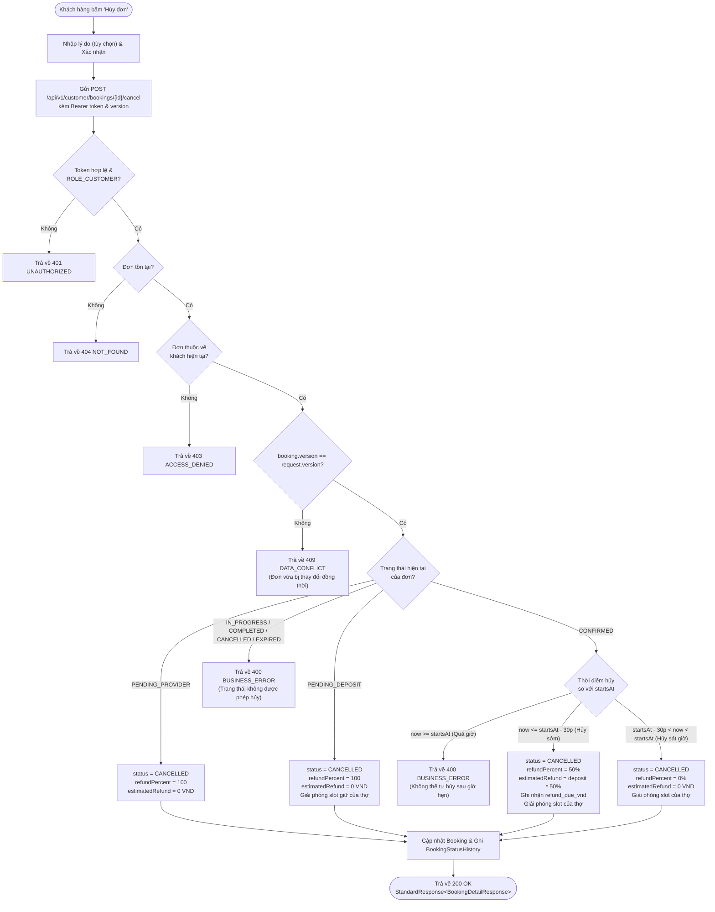
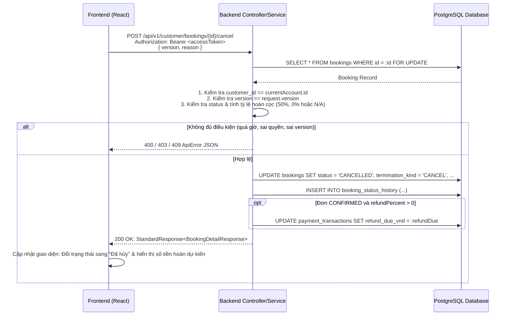

# Nestify — Tài Liệu Tích Hợp API (Handoff Frontend)
**Module:** Quản lý vòng đời đơn đặt dịch vụ (Booking Lifecycle)  
**Use Case:** UC11 — Khách hàng hủy đơn đặt lịch (Cancel Booking)  
**Phiên bản:** 1.0.0  
**Ngày cập nhật:** 25/10/2026  
**Người phụ trách backend:** Nguyễn Đình Thủy  

---

## 1. Tổng Quan

Tài liệu này đặc tả chi tiết endpoint API cho chức năng **Khách hàng hủy đơn đặt lịch (UC11)** của hệ thống Nestify. Tài liệu cung cấp đầy đủ thông tin về phương thức gọi, cấu trúc request, response, các quy tắc nghiệp vụ (Business Rules), ma trận hoàn cọc, mã lỗi thực tế và luồng gọi API để đội ngũ Frontend (React/Vite) có thể tích hợp trực tiếp mà không cần hỏi lại Backend.

### 1.1. Base URL & Môi trường
- **Môi trường phát triển cục bộ (Local / Dev):** `http://localhost:8080`
- **Môi trường Production (dự kiến):** `https://api.nestify.vn` (hoặc cấu hình theo domain máy chủ triển khai)

### 1.2. Định dạng chung
- **Content-Type:** `application/json;charset=UTF-8`
- **Mã hóa ký tự:** UTF-8
- **Định dạng thời gian:** ISO-8601 UTC (`YYYY-MM-DDTHH:mm:ssZ`)
- **Đơn vị tiền tệ:** Số nguyên đồng Việt Nam (`BIGINT`, VND)

---

## 2. Xác Thực & Phân Quyền (Authentication & Authorization)

- **Cơ chế xác thực:** JWT Bearer Token (Stateless).
- **Yêu cầu bảo mật:**
  - Header: `Authorization: Bearer <accessToken>`
  - Vai trò bắt buộc: **`ROLE_CUSTOMER`**.
  - **CSRF:** Request nghiệp vụ gửi qua Bearer Token **không cần mã CSRF**.
- **Phân quyền dữ liệu:**
  - Khách hàng chỉ có quyền hủy đơn **do chính mình tạo** (`booking.customerId == currentAccount.getId()`).
  - Cố tình hủy đơn của khách khác sẽ nhận lỗi `403 ACCESS_DENIED` hoặc `404 NOT_FOUND`.

---

## 3. Quy Ước Chung (Common Conventions)

### 3.1. Cấu trúc Response thành công chuẩn (`StandardResponse<T>`)
```json
{
  "success": true,
  "message": "Hủy đơn đặt lịch thành công",
  "data": { ... },
  "timestamp": "2026-10-25T14:45:00Z"
}
```

### 3.2. Cấu trúc Response lỗi chuẩn (`ApiError`)
```json
{
  "code": "MÃ_LỖI_CHUẨN",
  "message": "Mô tả lỗi chi tiết bằng tiếng Việt để hiển thị lên UI",
  "fieldErrors": {
    "tênField": "Lý do trường này không hợp lệ"
  }
}
```

### 3.3. Bảng mã lỗi của API Hủy Đơn

| HTTP Status | Error Code | Ý nghĩa | Hành động khuyến nghị cho Frontend |
| :--- | :--- | :--- | :--- |
| **400 Bad Request** | `VALIDATION_ERROR` | Dữ liệu đầu vào vi phạm ràng buộc (`version` bị null, `reason` quá 500 ký tự) | Hiển thị thông báo lỗi dưới ô nhập liệu tương ứng. |
| **400 Bad Request** | `BUSINESS_ERROR` | Vi phạm quy tắc nghiệp vụ (quá giờ hẹn không được hủy, đơn đang làm...) | Hiển thị Alert/Modal thông báo `message` cho khách hàng. |
| **401 Unauthorized** | `AUTHENTICATION_REQUIRED` | Chưa đăng nhập hoặc Access Token hết hạn | Kích hoạt refresh token hoặc điều hướng sang trang `/login`. |
| **403 Forbidden** | `ACCESS_DENIED` | Đơn không thuộc quyền sở hữu của khách hàng đang đăng nhập | Hiển thị thông báo không có quyền thao tác trên đơn này. |
| **404 Not Found** | `NOT_FOUND` | Không tìm thấy mã đơn đặt lịch với ID tương ứng | Thông báo đơn không tồn tại và chuyển về trang danh sách đơn. |
| **409 Conflict** | `DATA_CONFLICT` | Sai lệch `version` (đơn đã bị thay đổi đồng thời bởi thợ hoặc thao tác khác) | Load lại chi tiết đơn mới nhất và thông báo người dùng thao tác lại. |

---

## 4. Chi Tiết API: Khách Hàng Hủy Đơn (UC11)

### 4.1. Thông tin Endpoint
- **Tên hành động:** Hủy đơn đặt lịch dịch vụ
- **Method:** `POST`
- **URI Path:** `/api/v1/customer/bookings/{bookingId}/cancel`  
  *(Hỗ trợ alias: `/api/customer/bookings/{bookingId}/cancel`)*
- **Xác thực:** Bắt buộc đăng nhập (`ROLE_CUSTOMER`)
- **Nguồn Backend:**
  - Controller: [`com.homeservice.booking.controller.CustomerBookingController`](file:///D:/20261/congngheweb/home-service/backend/src/main/java/com/homeservice/booking/controller/CustomerBookingController.java) $\rightarrow$ `cancelBooking(...)`
  - Service: [`com.homeservice.booking.service.BookingService`](file:///D:/20261/congngheweb/home-service/backend/src/main/java/com/homeservice/booking/service/BookingService.java) $\rightarrow$ `cancelBookingByCustomer(...)`

### 4.2. Request Headers
| Header | Kiểu | Bắt buộc | Mô tả / Giá trị mẫu |
| :--- | :--- | :---: | :--- |
| `Authorization` | String | **Có** | `Bearer <accessToken>` |
| `Content-Type` | String | **Có** | `application/json` |

### 4.3. Path Parameters
| Tham số | Kiểu | Bắt buộc | Mô tả |
| :--- | :--- | :---: | :--- |
| `bookingId` | Long | **Có** | ID của đơn đặt dịch vụ cần hủy (ví dụ: `105`) |

### 4.4. Request Body (`application/json`)
DTO: [`com.homeservice.booking.dto.request.CancelBookingRequest`](file:///D:/20261/congngheweb/home-service/backend/src/main/java/com/homeservice/booking/dto/request/CancelBookingRequest.java)

```json
{
  "version": 1,
  "reason": "Tôi có việc đột xuất vào giờ hẹn này, muốn dời sang ngày khác"
}
```

**Bảng đặc tả trường dữ liệu:**

| Trường | Kiểu dữ liệu | Bắt buộc? | Ràng buộc / Validation | Ý nghĩa |
| :--- | :--- | :---: | :--- | :--- |
| `version` | Long | **Bắt buộc** | `@NotNull(message = "Version không được để trống")` | Phiên bản đơn đặt lịch hiện tại mà client đang giữ (Optimistic Lock). |
| `reason` | String | *Tùy chọn* | `@Size(max = 500, message = "Lý do hủy tối đa 500 ký tự")` | Lý do hủy của khách hàng. Trong DB là nullable nên cho phép để trống. |

---

### 4.5. Response Body (`application/json`)
DTO: `StandardResponse<BookingDetailResponse>`

```json
{
  "success": true,
  "message": "Hủy đơn đặt lịch thành công",
  "data": {
    "id": 105,
    "version": 2,
    "bookingCode": "BK-20261025-X8Y9Z1",
    "clientRequestKey": "3fa85f64-5717-4562-b3fc-2c963f66afa6",
    "customerId": 1,
    "customerName": "Nguyễn Văn Khách",
    "providerId": 2,
    "providerName": "Trần Văn Thợ",
    "serviceId": 1,
    "serviceTitle": "Sửa chữa điều hòa tại nhà",
    "durationMinutes": 90,
    "startsAt": "2026-10-25T16:00:00Z",
    "endsAt": "2026-10-25T17:30:00Z",
    "status": "CANCELLED",
    "totalAmountVnd": 1000000,
    "depositPercent": 30,
    "depositAmountVnd": 300000,
    "balanceAmountVnd": 700000,
    "platformFeePercent": 20,
    "cancelCutoffMinutes": 30,
    "earlyRefundPercent": 50,
    "lateRefundPercent": 0,
    "providerRefundPercent": 100,
    "systemRefundPercent": 100,
    "settlementStatus": "DRAFT",
    "terminationKind": "CANCEL",
    "terminationActorType": "CUSTOMER",
    "terminatedByAccountId": 1,
    "terminationReasonCode": "CUSTOMER_CANCEL",
    "terminationReason": "Tôi có việc đột xuất vào giờ hẹn này, muốn dời sang ngày khác",
    "terminatedAt": "2026-10-25T14:45:00Z",
    "refundPercent": 50,
    "estimatedRefundAmountVnd": 150000,
    "createdAt": "2026-10-25T10:00:00Z"
  },
  "timestamp": "2026-10-25T14:45:00Z"
}
```

---

## 5. Ma Trận Nghiệp Vụ & Quy Tắc Hoàn Cọc (Business Rules)

Hệ thống phân xử tính hợp lệ và tỷ lệ hoàn cọc theo bảng sau:

| Trạng thái hiện tại | Thời điểm hủy (`now`) so với `startsAt` | Được phép hủy? | Tỷ lệ hoàn cọc (`refundPercent`) | Số tiền cọc hoàn ước tính | Ghi chú & Giải phóng tài nguyên |
| :--- | :--- | :---: | :---: | :---: | :--- |
| **`PENDING_PROVIDER`** | Trước khi Thợ nhận đơn | **CÓ** | **100%** | **0 VND** | Chưa thu cọc. Chuyển `CANCELLED`, kết thúc đơn. |
| **`PENDING_DEPOSIT`** | Trước khi thanh toán cọc | **CÓ** | **100%** | **0 VND** | Chưa thu cọc. Chuyển `CANCELLED`, **giải phóng slot lịch đã giữ của thợ**. |
| **`CONFIRMED`** | $\ge 30$ phút trước giờ hẹn (`now <= startsAt - 30p`) | **CÓ (Hủy sớm)** | **50%** (`earlyRefundPercent`) | `ROUND_HALF_UP(depositAmount * 50%)` | Hoàn 50% cọc cho khách. Chuyển `CANCELLED`, giải phóng slot lịch của thợ. |
| **`CONFIRMED`** | $< 30$ phút trước giờ hẹn (`startsAt - 30p < now < startsAt`) | **CÓ (Hủy sát giờ)** | **0%** (`lateRefundPercent`) | **0 VND** | Khách mất 100% cọc do hủy muộn. Chuyển `CANCELLED`, giải phóng slot lịch của thợ. |
| **`CONFIRMED`** | $\ge$ giờ hẹn (`now >= startsAt`) | **KHÔNG** | N/A | N/A | **Chặn hủy**. Báo lỗi `400 BUSINESS_ERROR`: *"Đã đến hoặc quá giờ hẹn. Vui lòng liên hệ CSKH để được hỗ trợ."* (Quy tắc MD05). |
| **`IN_PROGRESS`** | Thợ đang làm dịch vụ | **KHÔNG** | N/A | N/A | **Chặn hủy**. Báo lỗi `400 BUSINESS_ERROR`: *"Không thể hủy khi dịch vụ đang được thực hiện."* |
| **`COMPLETED`** | Công việc đã hoàn tất | **KHÔNG** | N/A | N/A | **Chặn hủy**. Đơn đã hoàn thành. |
| **`CANCELLED` / `REJECTED` / `EXPIRED`** | Đơn đã ở trạng thái kết thúc | **KHÔNG** | N/A | N/A | **Chặn hủy**. Báo lỗi `400 BUSINESS_ERROR`: *"Đơn đã kết thúc trước đó."* |

---

## 6. Sơ Đồ Hoạt Động & Trình Tự (Activity & Sequence Diagrams)

### 6.1. Sơ đồ Activity (Activity Diagram)



### 6.2. Sơ đồ Sequence (Sequence Diagram)



---

## 7. Hướng Dẫn Tích Hợp Chi Tiết Cho Frontend

### 7.1. Mã nguồn tích hợp mẫu (TypeScript / Axios)

```typescript
import axios from 'axios';

const apiClient = axios.create({
  baseURL: 'http://localhost:8080',
  headers: {
    'Content-Type': 'application/json',
  },
});

// Hàm gọi API Hủy đơn
export async function cancelBooking(
  bookingId: number,
  currentVersion: number,
  reason?: string,
  accessToken?: string
) {
  const response = await apiClient.post(
    `/api/v1/customer/bookings/${bookingId}/cancel`,
    {
      version: currentVersion,
      reason: reason?.trim() || undefined,
    },
    {
      headers: {
        Authorization: `Bearer ${accessToken}`,
      },
    }
  );

  return response.data; // StandardResponse<BookingDetailResponse>
}
```

### 7.2. Các lưu ý quan trọng cho Frontend (Gotchas):
1. **Lý do hủy (`reason`):** Là trường **tùy chọn (optional)**. Khách có thể nhập lý do hoặc để trống. Nếu có nhập, giới hạn tối đa 500 ký tự.
2. **Optimistic Locking (`version`):** Bắt buộc phải truyền đúng `version` của đơn từ màn hình chi tiết hiện tại. Nếu nhận mã lỗi `409 DATA_CONFLICT`, hiển thị thông báo: *"Thông tin đơn đã được cập nhật bởi thao tác khác. Vui lòng tải lại trang và thử lại"*.
3. **Hiển thị chính sách hủy rõ ràng trước khi bấm nút xác nhận:**
   - Trước giờ hẹn $\ge 30$ phút: Hiển thị cảnh báo *"Nếu hủy ngay bây giờ, bạn sẽ được hoàn 50% tiền cọc (tương đương ... VND)"*.
   - Trước giờ hẹn $< 30$ phút: Hiển thị cảnh báo *"Bạn đang hủy sát giờ hẹn (dưới 30 phút). Theo chính sách, bạn sẽ không được hoàn cọc (0%)"*.
   - Đã đến giờ hẹn: Ẩn nút "Hủy đơn" hoặc thay bằng nút *"Liên hệ hỗ trợ"*.

---

## 8. Ví Dụ cURL Kiểm Thử

```bash
curl -i -X POST "http://localhost:8080/api/v1/customer/bookings/1/cancel" \
  -H "Authorization: Bearer <access_token_cua_khach_hang>" \
  -H "Content-Type: application/json" \
  -d '{
    "version": 1,
    "reason": "Bận việc gia đình đột xuất"
  }'
```

---

## 9. Điểm Cần Xác Nhận & Theo Dõi (Follow-ups)

| Hạng mục | Hiện trạng | Hành động tiếp theo |
| :--- | :--- | :--- |
| **Nghĩa vụ hoàn tiền thực tế (UC50)** | API UC11 ghi nhận `refund_due_vnd` vào bảng `payment_transactions` và `refundPercent` trên `bookings`. | Việc bắn lệnh hoàn tiền sang cổng VNPay/MoMo và cập nhật bảng `refunds` sẽ do UC50 (Admin/Hệ thống xử lý hoàn tiền) thực hiện. |
| **Giải phóng lịch giữ của thợ** | Lịch độc quyền chỉ được giữ khi đơn ở `PENDING_DEPOSIT` hoặc `CONFIRMED`. Khi đơn chuyển `CANCELLED`, các truy vấn kiểm tra trùng lịch (Overlap check) tự động loại bỏ đơn này. | Xác nhận logic loại trừ đơn `CANCELLED` trong các query của `BookingRepository` và `ProviderAvailabilityRepository`. |

---

## 10. Changelog

| Phiên bản | Ngày | Tác giả | Nội dung thay đổi |
| :--- | :--- | :--- | :--- |
| `1.0.0` | 25/10/2026 | Nguyễn Đình Thủy (Backend) | Khởi tạo tài liệu API cho UC11 (Khách hàng hủy đơn): hỗ trợ ma trận hoàn cọc (50% sớm, 0% sát giờ, chặn quá giờ), optimistic locking qua `version`, lý do hủy tùy chọn và response chuẩn `StandardResponse`. |
