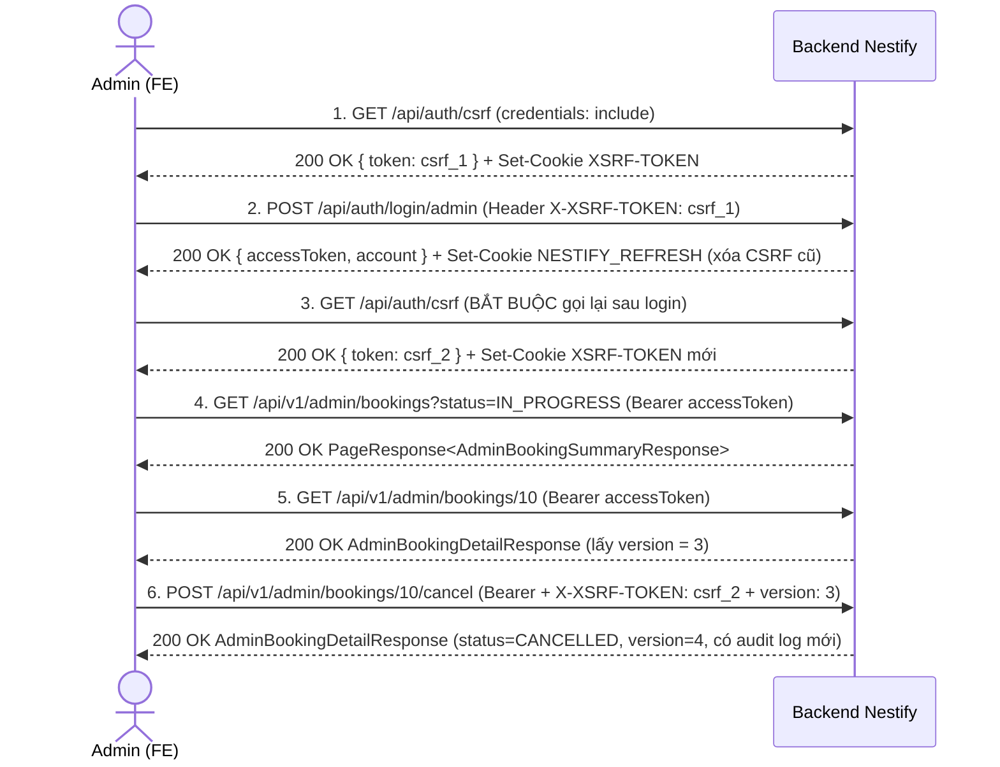

# Nestify — Tài Liệu Tích Hợp API (Handoff Frontend)

**Module:** Quản lý vòng đời đơn đặt dịch vụ — Vận hành Quản trị viên (Booking Lifecycle / Admin Operations)  
**Use Case:** UC31 — Quản trị viên theo dõi & can thiệp đơn đặt lịch (Admin Monitors & Intervenes in Bookings)  
**Phiên bản:** 1.0.0  
**Ngày cập nhật:** 21/11/2026  
**Người phụ trách backend:** Nguyễn Đình Thủy  
**Người nhận bàn giao frontend:** Minh  

---

## Mục lục

1. [Tổng quan](#1-tổng-quan)
2. [Xác thực & phân quyền](#2-xác-thực--phân-quyền)
3. [Quy ước chung](#3-quy-ước-chung)
4. [Danh sách API (UC 31)](#4-danh-sách-api-uc-31)
   - [4.1. Tra cứu danh sách đơn toàn hệ thống](#41-tra-cứu-danh-sách-đơn-toàn-hệ-thống--get-apiv1adminbookings)
   - [4.2. Xem chi tiết toàn diện đơn đặt lịch](#42-xem-chi-tiết-toàn-diện-đơn-đặt-lịch--get-apiv1adminbookingsid)
   - [4.3. Can thiệp hủy đơn cưỡng chế](#43-can-thiệp-hủy-đơn-cưỡng-chế--post-apiv1adminbookingsidcancel)
   - [4.4. Tạm giữ đối soát đơn đặt lịch](#44-tạm-giữ-đối-soát-đơn-đặt-lịch--post-apiv1adminbookingsidhold-settlement)
   - [4.5. Mở lại đối soát đơn đặt lịch](#45-mở-lại-đối-soát-đơn-đặt-lịch--post-apiv1adminbookingsidrelease-settlement)
5. [Luồng nghiệp vụ liên API](#5-luồng-nghiệp-vụ-liên-api)
6. [Data models & Enum](#6-data-models--enum)
7. [Lưu ý tích hợp cho Frontend](#7-lưu-ý-tích-hợp-cho-frontend)
8. [Điểm cần xác nhận](#8-điểm-cần-xác-nhận)
9. [Changelog](#9-changelog)

---

## 1. Tổng quan

### 1.1. Mục đích & Phạm vi
Tài liệu đặc tả toàn bộ API cho **UC 31 (Admin theo dõi & can thiệp đơn đặt lịch)** trên hệ thống Nestify, chia làm 2 nhóm:
- **Nhóm A — Theo dõi & Tra cứu (Monitoring):** Xem danh sách đơn toàn hệ thống (không bị giới hạn IDOR), lọc đa tiêu chí, phân trang, sắp xếp, và xem chi tiết toàn diện 360 độ của từng đơn (snapshot hợp đồng, khách hàng, địa chỉ, nhà cung cấp, dòng tiền, chấm dứt, đối soát, lịch sử trạng thái, giao dịch thanh toán, nhật ký kiểm toán admin).
- **Nhóm B — Can thiệp nghiệp vụ có kiểm soát (Intervention Actions):** Thực hiện qua các hành động cụ thể thay vì sửa trạng thái tùy ý:
  1. **Hủy cưỡng chế (`cancel`)**: Xử lý ngoại lệ khi NCC gặp sự cố bất khả kháng trong lúc đang thi công (`IN_PROGRESS` — MD05) hoặc hủy do lỗi hệ thống / vi phạm chính sách trước khi làm (`PENDING_PROVIDER`, `PENDING_DEPOSIT`, `CONFIRMED`).
  2. **Tạm giữ đối soát (`hold-settlement`)**: Đưa `settlementStatus` sang `ON_HOLD` khi phát sinh khiếu nại / sai lệch để chặn module chi trả (UC48) xuất tiền cho NCC.
  3. **Mở lại đối soát (`release-settlement`)**: Đưa `settlementStatus` từ `ON_HOLD` về `DRAFT` sau khi đã xử lý xong khiếu nại.

> Endpoint `POST /api/v1/admin/bookings/expire-overdue` nằm trong cùng `AdminBookingController` nhưng thuộc phạm vi **UC 51** — xem riêng tại `tai_lieu_api/UC51_HET_HAN_VA_NHA_LICH.md`.

### 1.2. Base URL theo môi trường
- **Local Development:** `http://localhost:8080`
- **Swagger UI (dev):** `http://localhost:8080/swagger-ui/index.html` *(tự động tắt khi chạy profile `prod`)*
- **Prefix khuyến nghị:** `/api/v1/admin/bookings` *(backend hỗ trợ thêm alias `/api/admin/bookings`)*

### 1.3. Định dạng dữ liệu
- **Content-Type:** `application/json;charset=UTF-8`
- **Encoding:** UTF-8
- **Ngày giờ:** ISO-8601 UTC (`YYYY-MM-DDTHH:mm:ssZ`, kiểu `Instant`)
- **Tiền tệ:** Số nguyên đồng Việt Nam (`number` / `Long`, VND) — không dùng số thực.

---

## 2. Xác thực & phân quyền

### 2.1. Cơ chế xác thực (theo `SecurityConfig.java` & UC27)
- **Tài khoản yêu cầu:** `ROLE_ADMIN` (`accountType = "ADMIN"`, `status = "ACTIVE"`).
- **Cách lấy Access Token:** Thực hiện luồng đăng nhập Admin tại `POST /api/auth/login/admin` (xem chi tiết tại `tai_lieu_api/UC27_DANG_NHAP_ADMIN.md`).
- **Thời hạn token (theo `application.yaml`):**
  - `accessToken`: mặc định `24h` (`.env.example`: `15m`) — FE đọc trường `expiresAt` trả về khi login/refresh.
  - `refreshToken`: tối đa `14d`, lưu trong cookie HttpOnly `NESTIFY_REFRESH`.
  - Làm mới token: `POST /api/auth/refresh` (cần cookie refresh + CSRF).

### 2.2. Bảng Role $\times$ Quyền & Yêu cầu CSRF

| Nhóm endpoint | Role được phép | `Authorization: Bearer` | Cookie + Header `X-XSRF-TOKEN` | Kiểm tra DB trạng thái `ACTIVE` |
| :--- | :---: | :---: | :---: | :---: |
| `GET /api/v1/admin/bookings`<br>`GET /api/v1/admin/bookings/{id}` | `ADMIN` | **Bắt buộc** | Không cần | Kiểm tra JWT Principal |
| `POST /api/v1/admin/bookings/{id}/cancel`<br>`POST /api/v1/admin/bookings/{id}/hold-settlement`<br>`POST /api/v1/admin/bookings/{id}/release-settlement` | `ADMIN` | **Bắt buộc** | **BẮT BUỘC** | **Bắt buộc** (`ACTIVE` trong DB) |

> [!IMPORTANT]
> **Bẫy CSRF rất hay gặp khi tích hợp Admin Write APIs:**  
> `SecurityConfig.java` (dòng 107–113) bắt buộc **cả Bearer JWT lẫn CSRF** cho mọi request `POST` dưới `/api/v1/admin/**` và `/api/admin/**`.  
> 1. Sau khi `POST /api/auth/login/admin` thành công, cookie CSRF cũ bị xóa $\rightarrow$ FE phải gọi lại `GET /api/auth/csrf` (kèm `credentials: 'include'` / `withCredentials: true`) để nhận cookie `XSRF-TOKEN` mới và trường `token` trong JSON.  
> 2. Gửi giá trị `token` từ JSON vào header `X-XSRF-TOKEN` (không đọc cookie bằng JS vì cookie `XSRF-TOKEN` là `HttpOnly` và token JSON đã được che XOR).

---

## 3. Quy ước chung

### 3.1. Cấu trúc Response thành công (`StandardResponse<T>`)
```json
{
  "success": true,
  "message": "Thông báo kết quả thành công",
  "data": { },
  "timestamp": "2026-11-21T08:42:26.959368300Z"
}
```

### 3.2. Cấu trúc Phân trang (`PageResponse<T>` nằm trong `data`)
```json
{
  "items": [ ],
  "page": 0,
  "size": 20,
  "totalElements": 45,
  "totalPages": 3
}
```
- `page`: chỉ số trang bắt đầu từ `0`. Nếu gửi `< 0` hoặc `null` $\rightarrow$ mặc định `0`.
- `size`: số phần tử/trang. Nếu `null` hoặc `<= 0` $\rightarrow$ mặc định `20`; tối đa `100` (vượt `100` backend tự giới hạn về `100`).
- `sortBy`: whitelist cố định gồm `createdAt`, `startsAt`, `totalAmountVnd`, `status`, `id`. Giá trị ngoài whitelist tự fallback về `createdAt`.
- `sortDir`: `ASC` hoặc `DESC` (không phân biệt hoa/thường; mặc định `DESC`).

### 3.3. Cấu trúc Response lỗi (`ApiError`)
```json
{
  "code": "VALIDATION_ERROR",
  "message": "Dữ liệu gửi lên không hợp lệ.",
  "fieldErrors": {
    "reason": "Lý do can thiệp phải từ 5 đến 500 ký tự"
  }
}
```

### 3.4. Bảng mã lỗi chung (từ `GlobalExceptionHandler.java` & `SecurityErrorHandler.java`)

| HTTP Status | Error Code | Khi nào xảy ra | FE nên xử lý thế nào |
| :---: | :--- | :--- | :--- |
| **400** | `VALIDATION_ERROR` | Thiếu field bắt buộc hoặc sai độ dài/định dạng (VD: `reason` < 5 hoặc > 500 ký tự, thiếu `reasonCode`) | Hiển thị lỗi trực tiếp dưới từng input dựa vào `fieldErrors` |
| **400** | `BUSINESS_ERROR` | Vi phạm luật nghiệp vụ (trạng thái đơn không hợp lệ, `reasonCode` sai ngữ cảnh, đơn đã hết hạn lazy, không ở `ON_HOLD`, đã có `settledAt`...) | Hiển thị Toast/Alert bằng `message`; tải lại chi tiết đơn nếu trạng thái đã đổi (VD: vừa `EXPIRED`) |
| **400** | `BAD_REQUEST` | JSON sai cú pháp hoặc truyền sai giá trị Enum | Kiểm tra lại payload / giá trị enum gửi đi |
| **401** | `AUTHENTICATION_REQUIRED` | Thiếu Bearer JWT, token hết hạn hoặc không hợp lệ | Thử gọi `POST /api/auth/refresh` tối đa 1 lần; nếu thất bại điều hướng về trang login Admin |
| **403** | `CSRF_INVALID` | Thiếu/sai cookie `XSRF-TOKEN` hoặc header `X-XSRF-TOKEN` trên `POST` | Gọi lại `GET /api/auth/csrf` rồi gửi lại request (không refresh access token) |
| **403** | `ACCESS_DENIED` | Không có role `ADMIN` (dùng token Customer/Provider) hoặc tài khoản Admin bị `SUSPENDED` trong DB | Thông báo không đủ quyền; không tự retry |
| **404** | `NOT_FOUND` | Không tìm thấy `bookingId` hoặc tài khoản Admin | Hiển thị trạng thái không tìm thấy và nút quay lại danh sách đơn |
| **409** | `DATA_CONFLICT` | Lệch `version` (Optimistic Locking — đơn vừa được thay đổi bởi người/tiến trình khác) | Thông báo dữ liệu đã cũ, tự động gọi lại `GET /api/v1/admin/bookings/{id}` để cập nhật `version` mới trước khi thao tác lại |

### 3.5. CORS & Headers
- **Allowed Origins mặc định:** `http://localhost:5173` (cấu hình qua biến `FRONTEND_ORIGINS`).
- **Headers cần gửi:** `Authorization: Bearer <accessToken>`, `Content-Type: application/json` (cho `POST`), `X-XSRF-TOKEN: <token>` (cho `POST`).

---

## 4. Danh sách API (UC 31)

| Method | Path *(Alias)* | Mô tả | Auth / Role | CSRF |
| :---: | :--- | :--- | :---: | :---: |
| **GET** | `/api/v1/admin/bookings` *(`/api/admin/bookings`)* | Tra cứu danh sách đơn toàn hệ thống (lọc động, phân trang, sắp xếp) | Bearer `ADMIN` | Không |
| **GET** | `/api/v1/admin/bookings/{id}` *(`/api/admin/bookings/{id}`)* | Xem chi tiết toàn diện 360° của 1 đơn đặt lịch | Bearer `ADMIN` | Không |
| **POST** | `/api/v1/admin/bookings/{id}/cancel` *(`/api/admin/bookings/{id}/cancel`)* | Can thiệp hủy đơn cưỡng chế (`PROVIDER_UNABLE_TO_CONTINUE` / `SYSTEM_CANCEL`) | Bearer `ADMIN` | **Có** |
| **POST** | `/api/v1/admin/bookings/{id}/hold-settlement` *(`/api/admin/bookings/{id}/hold-settlement`)* | Tạm giữ đối soát đơn (`settlementStatus -> ON_HOLD`) | Bearer `ADMIN` | **Có** |
| **POST** | `/api/v1/admin/bookings/{id}/release-settlement` *(`/api/admin/bookings/{id}/release-settlement`)* | Mở lại đối soát đơn (`ON_HOLD -> DRAFT`) | Bearer `ADMIN` | **Có** |

---

### 4.1. Tra cứu danh sách đơn toàn hệ thống `GET /api/v1/admin/bookings`

**Mô tả:** Lấy danh sách toàn bộ đơn đặt lịch trên hệ thống phục vụ màn hình quản trị đơn hàng của Admin, hỗ trợ lọc kết hợp nhiều tiêu chí, tìm kiếm gần đúng theo mã đơn, phân trang và sắp xếp.  
**Auth:** Bearer token — Role: `ADMIN`.  
**Nguồn:** `backend/src/main/java/com/homeservice/booking/controller/AdminBookingController.java` $\rightarrow$ `getBookings()`  
**Service / Spec:** `AdminBookingService.java` $\rightarrow$ `getBookings()`, `BookingSpecification.java` $\rightarrow$ `withFilter()`.

#### Query Parameters (`AdminBookingSearchFilter`)

| Tên | Kiểu | Bắt buộc | Mặc định | Mô tả |
| :--- | :--- | :---: | :---: | :--- |
| `status` | `BookingStatus` | Không | `null` | Lọc chính xác theo trạng thái đơn |
| `settlementStatus` | `SettlementStatus` | Không | `null` | Lọc chính xác theo trạng thái đối soát (`DRAFT`, `ON_HOLD`, `FINALIZED`) |
| `customerId` | `Long` | Không | `null` | Lọc theo ID tài khoản khách hàng |
| `providerId` | `Long` | Không | `null` | Lọc theo ID tài khoản nhà cung cấp (`provider.accountId`) |
| `serviceId` | `Long` | Không | `null` | Lọc theo ID dịch vụ |
| `bookingCode` | `String` | Không | `null` | Tìm kiếm gần đúng (`LIKE %keyword%`, không phân biệt hoa thường, tự `trim()`) theo mã đơn |
| `dateFilterType` | `DateFilterType` | Không | `CREATED_AT` | Trường thời gian áp dụng cho `from`/`to`: `CREATED_AT` (`createdAt`) hoặc `STARTS_AT` (`startsAt`) |
| `from` | `String` (ISO-8601) | Không | `null` | Mốc bắt đầu (`>= from`), định dạng `YYYY-MM-DDTHH:mm:ssZ` |
| `to` | `String` (ISO-8601) | Không | `null` | Mốc kết thúc (`<= to`), định dạng `YYYY-MM-DDTHH:mm:ssZ` |
| `page` | `Integer` | Không | `0` | Số trang (0-based; `< 0` tự về `0`) |
| `size` | `Integer` | Không | `20` | Kích thước trang (`1..100`; `> 100` tự cắt về `100`) |
| `sortBy` | `String` | Không | `createdAt` | Trường sắp xếp hợp lệ: `createdAt`, `startsAt`, `totalAmountVnd`, `status`, `id` |
| `sortDir` | `String` | Không | `DESC` | Chiều sắp xếp: `ASC` hoặc `DESC` |

#### Response thành công — `200 OK`
Bọc trong `StandardResponse<PageResponse<AdminBookingSummaryResponse>>`. Mỗi phần tử trong `data.items`:

| Field | Kiểu | Nullable | Mô tả |
| :--- | :--- | :---: | :--- |
| `id` | `Long` | Không | ID đơn đặt lịch |
| `bookingCode` | `String` | Không | Mã hiển thị đơn (VD: `BK-202611-005`) |
| `customer` | `Object` | Có | Tóm tắt khách hàng: `id`, `displayName`, `phone`, `email` |
| `provider` | `Object` | Có | Tóm tắt NCC: `id`, `businessName`, `phone`, `email` |
| `service` | `Object` | Có | Tóm tắt dịch vụ: `id`, `serviceTitleSnapshot`, `durationMinutesSnapshot` |
| `startsAt` | `Instant` | Không | Giờ hẹn bắt đầu (UTC) |
| `endsAt` | `Instant` | Không | Giờ hẹn kết thúc dự kiến (UTC) |
| `status` | `BookingStatus` | Không | Trạng thái hiện tại của đơn |
| `totalAmountVnd` | `Long` | Không | Tổng giá trị đơn (VND) |
| `depositAmountVnd` | `Long` | Không | Số tiền cọc (VND) |
| `balanceAmountVnd` | `Long` | Không | Số tiền phần còn lại (VND) |
| `settlementStatus` | `SettlementStatus` | Không | Trạng thái đối soát (`DRAFT`, `ON_HOLD`, `FINALIZED`) |
| `providerDueVnd` | `Long` | Có | Số tiền phải trả NCC (có giá trị khi đã chốt hoặc đã tính snapshot đối soát) |
| `version` | `Long` | Không | Phiên bản Optimistic Locking hiện tại |
| `createdAt` | `Instant` | Không | Thời điểm tạo đơn |

**Ví dụ Response:**
```json
{
  "success": true,
  "message": "Lấy danh sách đơn đặt lịch thành công",
  "data": {
    "items": [
      {
        "id": 5,
        "bookingCode": "BK-202611-005",
        "customer": {
          "id": 5,
          "displayName": "Trần Thị Mai",
          "phone": "0933445566",
          "email": "testcustomer@nestify.vn"
        },
        "provider": {
          "id": 3,
          "businessName": "Thợ Điện Lạnh Nestify",
          "phone": "0988776655",
          "email": "testprovider@nestify.vn"
        },
        "service": {
          "id": 4,
          "serviceTitleSnapshot": "Dọn dẹp nhà cửa theo giờ (Gói tiêu chuẩn 3 giờ)",
          "durationMinutesSnapshot": 180
        },
        "startsAt": "2026-11-13T10:11:44.926251Z",
        "endsAt": "2026-11-13T13:11:44.926251Z",
        "status": "COMPLETED",
        "totalAmountVnd": 240000,
        "depositAmountVnd": 72000,
        "balanceAmountVnd": 168000,
        "settlementStatus": "DRAFT",
        "providerDueVnd": 192000,
        "version": 2,
        "createdAt": "2026-11-12T14:11:44.926251Z"
      }
    ],
    "page": 0,
    "size": 20,
    "totalElements": 1,
    "totalPages": 1
  },
  "timestamp": "2026-11-21T08:45:00Z"
}
```

#### Response lỗi
| HTTP | Error code | Khi nào xảy ra | FE nên làm gì |
| :---: | :--- | :--- | :--- |
| `400` | `BAD_REQUEST` | Truyền sai kiểu enum (`status`, `settlementStatus`, `dateFilterType`) hoặc sai format ISO-8601 của `from`/`to` | Kiểm tra lại giá trị bộ lọc gửi lên |
| `401` | `AUTHENTICATION_REQUIRED` | Thiếu hoặc hết hạn Bearer token | Refresh token hoặc chuyển về màn hình đăng nhập |
| `403` | `ACCESS_DENIED` | Token không phải role `ADMIN` | Chặn truy cập khu vực quản trị |

#### Luồng xử lý
1. Kiểm tra quyền `ROLE_ADMIN` ở Security filter, `@PreAuthorize`, và `resolveAdminId()`.
2. Chuẩn hóa tham số phân trang (`page >= 0`, `1 <= size <= 100`) và kiểm tra `sortBy` theo whitelist.
3. Xây dựng `Specification` động từ các filter khác `null` và truy vấn kèm `@EntityGraph` (tránh N+1 query).
4. Map danh sách entity sang `AdminBookingSummaryResponse` và trả về `PageResponse`.

#### Lưu ý cho FE
- Debounce `300–500ms` cho ô tìm kiếm `bookingCode`.
- Luôn reset `page = 0` mỗi khi người dùng thay đổi bất kỳ bộ lọc nào.

#### Ví dụ cURL
```bash
curl -X GET "http://localhost:8080/api/v1/admin/bookings?status=COMPLETED&settlementStatus=ON_HOLD&bookingCode=BK-2026&dateFilterType=CREATED_AT&from=2026-11-01T00:00:00Z&to=2026-11-30T23:59:59Z&page=0&size=20&sortBy=createdAt&sortDir=DESC" \
  -H "Authorization: Bearer <admin_access_token>"
```

---

### 4.2. Xem chi tiết toàn diện đơn đặt lịch `GET /api/v1/admin/bookings/{id}`

**Mô tả:** Trả về hồ sơ 360 độ của 1 đơn đặt lịch cho màn hình Chi tiết đơn (Admin): thông tin hợp đồng snapshot, khách hàng, địa chỉ, nhà cung cấp, tiến độ, dòng tiền, thông tin hủy/hết hạn, trạng thái đối soát, timeline trạng thái, danh sách giao dịch thanh toán và nhật ký can thiệp Admin.  
**Auth:** Bearer token — Role: `ADMIN`.  
**Nguồn:** `backend/src/main/java/com/homeservice/booking/controller/AdminBookingController.java` $\rightarrow$ `getBookingDetail()`  
**Service / Mapper:** `AdminBookingService.java` $\rightarrow$ `getBookingDetail()`, `AdminBookingMapper.java` $\rightarrow$ `toDetailResponse()`.

#### Path Parameters
| Tên | Kiểu | Bắt buộc | Mô tả |
| :--- | :--- | :---: | :--- |
| `id` | `Long` | **Có** | ID của đơn đặt lịch |

#### Response thành công — `200 OK`
Bọc trong `StandardResponse<AdminBookingDetailResponse>`:

| Field | Kiểu | Nullable | Mô tả |
| :--- | :--- | :---: | :--- |
| `id` | `Long` | Không | ID đơn đặt lịch |
| `bookingCode` | `String` | Không | Mã hiển thị đơn |
| `clientRequestKey` | `UUID` | Không | Idempotency key khi khách tạo đơn |
| `version` | `Long` | Không | Phiên bản Optimistic Locking (FE giữ lại để gửi lên các API `POST` Nhóm B) |
| `createdAt`, `updatedAt` | `Instant` | Không | Thời điểm tạo và cập nhật gần nhất |
| `serviceId` | `Long` | Có | ID dịch vụ gốc |
| `serviceTitleSnapshot` | `String` | Không | Tên dịch vụ snapshot tại thời điểm đặt |
| `durationMinutesSnapshot` | `Integer` | Không | Thời lượng thi công (phút) snapshot |
| `customerNote` | `String` | Có | Ghi chú khách gửi khi đặt |
| `customer` | `CustomerProfileResponse` | Có | `id`, `displayName`, `email`, `phone`, `status` (`AccountStatus`) |
| `address` | `BookingAddressResponse` | Có | `addressId`, `recipientName`, `recipientPhone`, `addressLine`, `ward`, `city`, `addressInstructions` |
| `provider` | `ProviderProfileResponse` | Có | `id`, `businessName`, `displayName`, `email`, `phone`, `city`, `address`, `bankVerificationStatus` |
| `startsAt`, `endsAt` | `Instant` | Không | Khung giờ hẹn dịch vụ |
| `status` | `BookingStatus` | Không | Trạng thái hiện tại của đơn |
| `requestExpiresAt` | `Instant` | Không | Hạn NCC phản hồi đơn |
| `acceptedAt` | `Instant` | Có | Thời điểm NCC nhận đơn |
| `depositDueAt` | `Instant` | Có | Hạn giữ chỗ chờ khách nộp cọc |
| `startedAt` | `Instant` | Có | Thời điểm NCC bắt đầu thi công (giữ nguyên nếu bị hủy sau đó) |
| `completedAt` | `Instant` | Có | Thời điểm NCC hoàn tất công việc |
| `balanceDueAt` | `Instant` | Có | Hạn thanh toán 70% còn lại |
| `totalAmountVnd` | `Long` | Không | Tổng giá gói (VND) |
| `depositPercent` | `Integer` | Không | Tỷ lệ cọc snapshot (mặc định `30`) |
| `depositAmountVnd` | `Long` | Không | Số tiền cọc (VND) |
| `balanceAmountVnd` | `Long` | Không | Số tiền phần còn lại (VND) |
| `platformFeePercent` | `Integer` | Không | % hoa hồng sàn snapshot (mặc định `20`) |
| `cancelCutoffMinutes` | `Integer` | Không | Mốc hủy sớm/muộn (phút, mặc định `30`) |
| `earlyRefundPercent` | `Integer` | Không | % hoàn cọc khi khách hủy sớm (mặc định `50`) |
| `lateRefundPercent` | `Integer` | Không | % hoàn cọc khi khách hủy sát giờ (mặc định `0`) |
| `providerRefundPercent` | `Integer` | Không | % hoàn cọc khi NCC hủy/sự cố (mặc định `100`) |
| `systemRefundPercent` | `Integer` | Không | % hoàn cọc khi hệ thống/admin hủy (mặc định `100`) |
| `grossCollectedVnd` | `Long` | Có | Snapshot tổng tiền thực thu từ khách (`null` nếu chưa chốt/chưa thu) |
| `refundedVnd` | `Long` | Có | Snapshot tổng tiền thực đã hoàn qua cổng (`null` nếu chưa phát sinh) |
| `netRetainedVnd` | `Long` | Có | Tiền giữ lại ròng (`grossCollectedVnd - refundedVnd`) |
| `platformFeeVnd` | `Long` | Có | Hoa hồng Nestify được hưởng |
| `providerDueVnd` | `Long` | Có | Số tiền phải chi trả cho NCC |
| `termination` | `BookingTerminationResponse` | Có | `null` nếu đơn chưa kết thúc theo nhánh hủy/từ chối/hết hạn. Nếu có gồm: `terminationKind`, `terminationActorType`, `terminatedByAccountId`, `terminatedByDisplayName`, `terminationReasonCode`, `terminationReason`, `terminatedAt`, `refundPercent`, `estimatedRefundAmountVnd` (số tiền cần hoàn — tự động bằng `0` nếu đơn kết thúc trước khi cọc), `refundedAmountVnd` (số tiền thực tế đã hoàn, mặc định `0` nếu chưa giải ngân hoàn) |
| `settlement` | `BookingSettlementResponse` | Không | `settlementStatus`, `settlementNote`, `settledAt`, `settledByAdminId`, `settledByAdminName` |
| `statusHistory` | `List<BookingStatusHistoryResponse>` | Không | Sắp xếp **tăng dần** theo `createdAt`: `id`, `fromStatus`, `toStatus`, `actorType`, `actorAccountId`, `actorDisplayName`, `reasonCode`, `note`, `createdAt` |
| `paymentTransactions` | `List<PaymentTransactionSummaryResponse>` | Không | Sắp xếp **tăng dần** theo `createdAt`: `id`, `kind`, `processor`, `merchantReference`, `externalTransactionId`, `expectedAmountVnd`, `receivedAmountVnd`, `processingFeeVnd`, `status`, `allocationStatus`, `refundDueVnd`, `refundReason`, `gatewayPaidAt`, `succeededAt`, `failureReason`, `createdAt` |
| `adminAuditLogs` | `List<AdminAuditLogResponse>` | Không | Sắp xếp **giảm dần** theo `createdAt` (mới nhất lên đầu): `id`, `adminId`, `adminDisplayName`, `action`, `reason`, `changes` (**JSON Object** chứa `before`/`after`), `createdAt` |

**Ví dụ Response (đơn đã kết thúc ở `PENDING_PROVIDER` do quá hạn phản hồi — chưa nộp cọc):**
```json
{
  "success": true,
  "message": "Lấy chi tiết đơn đặt lịch thành công",
  "data": {
    "id": 1,
    "bookingCode": "BK-202611-001",
    "clientRequestKey": "a1b2c3d4-e5f6-4a1b-8c2d-3e4f5a6b7c01",
    "version": 1,
    "createdAt": "2026-11-14T14:11:44.926251Z",
    "updatedAt": "2026-11-15T00:28:00.121678Z",
    "serviceId": 1,
    "serviceTitleSnapshot": "Vệ sinh điều hòa treo tường (9.000 - 12.000 BTU)",
    "durationMinutesSnapshot": 60,
    "customerNote": null,
    "customer": {
      "id": 4,
      "displayName": "Nguyễn Văn Khách",
      "email": "customer@test.com",
      "phone": "0912345678",
      "status": "ACTIVE"
    },
    "address": {
      "addressId": 1,
      "recipientName": "Nguyễn Văn Khách",
      "recipientPhone": "0912345678",
      "addressLine": "Số 15 ngõ 102 Tạ Quang Bửu",
      "ward": "Bách Khoa",
      "city": "Hà Nội",
      "addressInstructions": "Đi vào ngõ 50m rẽ phải"
    },
    "provider": {
      "id": 2,
      "businessName": "Trung Tâm Điện Lạnh Bách Khoa",
      "displayName": "Trung Tâm Điện Lạnh Bách Khoa",
      "email": "provider@test.com",
      "phone": "0987654321",
      "city": "Hà Nội",
      "address": "Số 1 Đại Cồ Việt, Hai Bà Trưng, Hà Nội",
      "bankVerificationStatus": "VERIFIED"
    },
    "startsAt": "2026-11-16T14:11:44.926251Z",
    "endsAt": "2026-11-16T15:11:44.926251Z",
    "status": "EXPIRED",
    "requestExpiresAt": "2026-11-14T14:41:44.926251Z",
    "acceptedAt": null,
    "depositDueAt": null,
    "startedAt": null,
    "completedAt": null,
    "balanceDueAt": null,
    "totalAmountVnd": 200000,
    "depositPercent": 30,
    "depositAmountVnd": 60000,
    "balanceAmountVnd": 140000,
    "platformFeePercent": 20,
    "cancelCutoffMinutes": 30,
    "earlyRefundPercent": 50,
    "lateRefundPercent": 0,
    "providerRefundPercent": 100,
    "systemRefundPercent": 100,
    "grossCollectedVnd": null,
    "refundedVnd": null,
    "netRetainedVnd": null,
    "platformFeeVnd": null,
    "providerDueVnd": null,
    "termination": {
      "terminationKind": "EXPIRE",
      "terminationActorType": "SYSTEM",
      "terminatedByAccountId": null,
      "terminatedByDisplayName": null,
      "terminationReasonCode": "PROVIDER_RESPONSE_TIMEOUT",
      "terminationReason": "Quá hạn phản hồi của Nhà cung cấp (30 phút hoặc sát giờ hẹn)",
      "terminatedAt": "2026-11-15T00:28:00.000730Z",
      "refundPercent": 100,
      "estimatedRefundAmountVnd": 0,
      "refundedAmountVnd": 0
    },
    "settlement": {
      "settlementStatus": "DRAFT",
      "settlementNote": null,
      "settledAt": null,
      "settledByAdminId": null,
      "settledByAdminName": null
    },
    "statusHistory": [
      {
        "id": 1,
        "fromStatus": null,
        "toStatus": "PENDING_PROVIDER",
        "actorType": "CUSTOMER",
        "actorAccountId": 4,
        "actorDisplayName": "Nguyễn Văn Khách",
        "reasonCode": "INITIAL_REQUEST",
        "note": "Khách hàng tạo yêu cầu đặt dịch vụ",
        "createdAt": "2026-11-14T14:11:44.926251Z"
      },
      {
        "id": 17,
        "fromStatus": "PENDING_PROVIDER",
        "toStatus": "EXPIRED",
        "actorType": "SYSTEM",
        "actorAccountId": null,
        "actorDisplayName": null,
        "reasonCode": "PROVIDER_RESPONSE_TIMEOUT",
        "note": "Quá hạn phản hồi của Nhà cung cấp (30 phút hoặc sát giờ hẹn)",
        "createdAt": "2026-11-15T00:28:00.166770Z"
      }
    ],
    "paymentTransactions": [],
    "adminAuditLogs": []
  },
  "timestamp": "2026-11-21T08:46:00Z"
}
```

#### Response lỗi
| HTTP | Error code | Khi nào xảy ra | FE nên làm gì |
| :---: | :--- | :--- | :--- |
| `401` | `AUTHENTICATION_REQUIRED` | Thiếu hoặc hết hạn Bearer token | Refresh token hoặc về trang login |
| `403` | `ACCESS_DENIED` | Token không phải `ADMIN` | Thông báo không đủ quyền |
| `404` | `NOT_FOUND` | Không tìm thấy đơn theo `id` | Hiển thị màn hình không tìm thấy đơn |

#### Luồng xử lý
1. Kiểm tra quyền `ROLE_ADMIN`.
2. Tải đơn kèm các quan hệ qua `BookingRepository.findByIdWithDetails(id)` (1 query JOIN FETCH).
3. Tải song song 3 danh sách con: `statusHistory` (ASC), `paymentTransactions` (ASC), `adminAuditLogs` (DESC, entityType = `"BOOKING"`).
4. Tính `estimatedRefundAmountVnd` (bằng `0` nếu chưa từng nộp cọc) và parse `adminAuditLogs.changes` sang JSON Object thật.

#### Ví dụ cURL
```bash
curl -X GET "http://localhost:8080/api/v1/admin/bookings/1" \
  -H "Authorization: Bearer <admin_access_token>"
```

---

### 4.3. Can thiệp hủy đơn cưỡng chế `POST /api/v1/admin/bookings/{id}/cancel`

**Mô tả:** Admin thực hiện hủy đơn cưỡng chế trong 2 tình huống nghiệp vụ đặc biệt: (1) NCC gặp sự cố bất khả kháng khi đang thi công (`IN_PROGRESS` $\rightarrow$ `PROVIDER_UNABLE_TO_CONTINUE`, hoàn 100% cọc) hoặc (2) Hủy do lỗi hệ thống / vi phạm trước khi bắt đầu làm (`PENDING_PROVIDER`, `PENDING_DEPOSIT`, `CONFIRMED` $\rightarrow$ `SYSTEM_CANCEL`).  
**Auth:** Bearer token — Role: `ADMIN` (`ACTIVE` trong DB) + **Bắt buộc CSRF (`X-XSRF-TOKEN` + Cookie `XSRF-TOKEN`)**.  
**Nguồn:** `backend/src/main/java/com/homeservice/booking/controller/AdminBookingController.java` $\rightarrow$ `cancelBooking()`  
**Service:** `AdminBookingService.java` $\rightarrow$ `cancelBookingByAdmin()`.

#### Path Parameters
| Tên | Kiểu | Bắt buộc | Mô tả |
| :--- | :--- | :---: | :--- |
| `id` | `Long` | **Có** | ID đơn đặt lịch cần hủy |

#### Headers bắt buộc
- `Authorization: Bearer <admin_access_token>`
- `X-XSRF-TOKEN: <token_tu_GET_api_auth_csrf>` *(kèm cookie `XSRF-TOKEN`)*
- `Content-Type: application/json`

#### Request Body (`AdminCancelBookingRequest`)
| Field | Kiểu | Bắt buộc | Ràng buộc | Mô tả |
| :--- | :--- | :---: | :--- | :--- |
| `reasonCode` | `TerminationReason` | **Có** | `@NotNull`; **CHỈ chấp nhận** `PROVIDER_UNABLE_TO_CONTINUE` hoặc `SYSTEM_CANCEL` | Mã phân loại hành động hủy cưỡng chế |
| `reason` | `String` | **Có** | `@NotBlank`, độ dài sau `trim()` từ `5` đến `500` ký tự | Lý do giải trình bắt buộc |
| `version` | `Long` | Không *(khuyến nghị)* | Khớp `version` hiện tại của đơn | Chống ghi đè đồng thời (Optimistic Locking) |

**Ma trận hợp lệ giữa `status` hiện tại và `reasonCode`:**

| Trạng thái hiện tại của đơn | `PROVIDER_UNABLE_TO_CONTINUE` | `SYSTEM_CANCEL` |
| :--- | :---: | :---: |
| `PENDING_PROVIDER` *(chưa quá hạn)* | ❌ `400 BUSINESS_ERROR` | ✅ Hợp lệ (không hoàn cọc) |
| `PENDING_DEPOSIT` *(chưa quá hạn)* | ❌ `400 BUSINESS_ERROR` | ✅ Hợp lệ (nhả lịch, không hoàn cọc) |
| `CONFIRMED` | ❌ `400 BUSINESS_ERROR` | ✅ Hợp lệ (hoàn 100% cọc, nhả lịch) |
| `IN_PROGRESS` | ✅ Hợp lệ (MD05: hoàn 100% cọc, nhả lịch) | ❌ `400 BUSINESS_ERROR` |
| `COMPLETED` / `CANCELLED` / `REJECTED` / `EXPIRED` | ❌ `400 BUSINESS_ERROR` | ❌ `400 BUSINESS_ERROR` |

**Ví dụ Request (Hủy đơn đang `IN_PROGRESS` theo MD05):**
```json
{
  "reasonCode": "PROVIDER_UNABLE_TO_CONTINUE",
  "reason": "Thợ gặp sự cố phương tiện khi mang linh kiện thay thế, khách đồng ý hủy hoàn 100% cọc",
  "version": 3
}
```

#### Response thành công — `200 OK`
Trả về `StandardResponse<AdminBookingDetailResponse>` với dữ liệu mới nhất sau khi hủy (`status = "CANCELLED"`, `version` tăng `+1`, có object `termination`, có thêm bản ghi mới trong `statusHistory` và `adminAuditLogs`).

**Ví dụ Response (rút gọn các phần trọng tâm):**
```json
{
  "success": true,
  "message": "Can thiệp hủy đơn đặt lịch thành công",
  "data": {
    "id": 10,
    "bookingCode": "BK-202611-010",
    "version": 4,
    "status": "CANCELLED",
    "startedAt": "2026-11-21T02:00:00Z",
    "termination": {
      "terminationKind": "CANCEL",
      "terminationActorType": "ADMIN",
      "terminatedByAccountId": 1,
      "terminatedByDisplayName": "Quản Trị Viên Nestify",
      "terminationReasonCode": "PROVIDER_UNABLE_TO_CONTINUE",
      "terminationReason": "Thợ gặp sự cố phương tiện khi mang linh kiện thay thế, khách đồng ý hủy hoàn 100% cọc",
      "terminatedAt": "2026-11-21T08:10:00Z",
      "refundPercent": 100,
      "estimatedRefundAmountVnd": 150000,
      "refundedAmountVnd": 0
    },
    "adminAuditLogs": [
      {
        "id": 12,
        "adminId": 1,
        "adminDisplayName": "Quản Trị Viên Nestify",
        "action": "ADMIN_CANCEL_BOOKING",
        "reason": "Thợ gặp sự cố phương tiện khi mang linh kiện thay thế, khách đồng ý hủy hoàn 100% cọc",
        "changes": {
          "before": {
            "status": "IN_PROGRESS",
            "terminationKind": null,
            "terminationReasonCode": null,
            "refundPercent": null
          },
          "after": {
            "status": "CANCELLED",
            "terminationKind": "CANCEL",
            "terminationReasonCode": "PROVIDER_UNABLE_TO_CONTINUE",
            "refundPercent": 100,
            "refundDueVnd": 150000,
            "depositPaymentTransactionId": 42
          }
        },
        "createdAt": "2026-11-21T08:10:00Z"
      }
    ]
  },
  "timestamp": "2026-11-21T08:10:00.215Z"
}
```

#### Response lỗi
| HTTP | Error code | Khi nào xảy ra | FE nên làm gì |
| :---: | :--- | :--- | :--- |
| `400` | `VALIDATION_ERROR` | Thiếu `reasonCode` hoặc `reason` trống / `< 5` / `> 500` ký tự | Hiển thị lỗi theo `fieldErrors` trên form modal |
| `400` | `BUSINESS_ERROR` | `reasonCode` ngoài `{PROVIDER_UNABLE_TO_CONTINUE, SYSTEM_CANCEL}`; sai ma trận trạng thái; hủy đơn `COMPLETED`/`CANCELLED`/`REJECTED`/`EXPIRED`; hoặc đơn `PENDING_*` vừa quá hạn nên hệ thống tự chuyển sang `EXPIRED` | Hiển thị `message` và tải lại chi tiết đơn |
| `401` | `AUTHENTICATION_REQUIRED` | Token hết hạn / chưa đăng nhập | Refresh token hoặc chuyển login |
| `403` | `CSRF_INVALID` | Thiếu/sai CSRF token | Gọi lại `GET /api/auth/csrf` rồi gửi lại |
| `403` | `ACCESS_DENIED` | Không phải `ADMIN` hoặc tài khoản Admin bị `SUSPENDED` | Thông báo không đủ quyền |
| `404` | `NOT_FOUND` | Không tìm thấy `id` đơn hoặc tài khoản Admin | Thông báo không tìm thấy |
| `409` | `DATA_CONFLICT` | Lệch `version` | Tải lại chi tiết đơn và yêu cầu Admin xác nhận lại |

#### Luồng xử lý
1. Validate `reasonCode`, `reason` (`trim()`, 5..500 ký tự) và kiểm tra tài khoản Admin đang `ACTIVE` trong DB.
2. Khóa bi quan dòng `bookings` (`SELECT ... FOR UPDATE`), kiểm tra `version` (nếu có).
3. **Lazy Expiration Check:** Nếu đơn ở `PENDING_PROVIDER` quá `requestExpiresAt` hoặc `PENDING_DEPOSIT` quá `depositDueAt` $\rightarrow$ commit ngay trạng thái `EXPIRED` (`SYSTEM`) vào DB và trả về `400 BUSINESS_ERROR`.
4. Kiểm tra ma trận `status` $\times$ `reasonCode`.
5. Cập nhật đơn sang `CANCELLED` (bảo toàn mốc `acceptedAt`/`startedAt` nếu có), khóa `refundPercent` (`providerRefundPercent` hoặc `systemRefundPercent`, mặc định `100`). Lịch độc quyền của NCC tự động được giải phóng ngay.
6. Nếu đơn đang `CONFIRMED` hoặc `IN_PROGRESS`: cập nhật `refundDueVnd` và `refundReason = CANCEL_POLICY` trên giao dịch cọc hợp lệ (`DEPOSIT`, `SUCCEEDED`, `APPLIED` — không chạm vào giao dịch thu trùng `RETURN_REQUIRED`).
7. Ghi kiểm toán kép nguyên tử vào `booking_status_history` (`actorType = ADMIN`) và `admin_audit_logs` (`action = "ADMIN_CANCEL_BOOKING"`).

#### Lưu ý cho FE
- **Tự chọn sẵn `reasonCode` theo trạng thái đơn trên UI:**
  - Nếu `booking.status === 'IN_PROGRESS'` $\rightarrow$ chỉ hiển thị lựa chọn `PROVIDER_UNABLE_TO_CONTINUE`.
  - Nếu `booking.status` thuộc `['PENDING_PROVIDER', 'PENDING_DEPOSIT', 'CONFIRMED']` $\rightarrow$ chỉ hiển thị lựa chọn `SYSTEM_CANCEL`.
  - Ẩn/vô hiệu hóa nút Hủy cưỡng chế với các đơn `COMPLETED`, `CANCELLED`, `REJECTED`, `EXPIRED`.
- Dùng ngay `response.data` để cập nhật state màn hình chi tiết, không cần gọi thêm `GET /{id}`.

#### Ví dụ cURL
```bash
curl -X POST "http://localhost:8080/api/v1/admin/bookings/10/cancel" \
  -b cookies.txt \
  -H "Authorization: Bearer <admin_access_token>" \
  -H "X-XSRF-TOKEN: <csrf_token>" \
  -H "Content-Type: application/json" \
  -d '{
    "reasonCode": "PROVIDER_UNABLE_TO_CONTINUE",
    "reason": "Thợ gặp sự cố phương tiện khi mang linh kiện thay thế, khách đồng ý hủy hoàn 100% cọc",
    "version": 3
  }'
```

---

### 4.4. Tạm giữ đối soát đơn đặt lịch `POST /api/v1/admin/bookings/{id}/hold-settlement`

**Mô tả:** Đưa trạng thái đối soát của đơn (`settlementStatus`) sang `ON_HOLD` kèm ghi chú giải trình để chặn luồng chốt đối soát / xuất chi trả (UC48) cho NCC khi đang có khiếu nại hoặc sai lệch cần kiểm tra.  
**Auth:** Bearer token — Role: `ADMIN` (`ACTIVE` trong DB) + **Bắt buộc CSRF**.  
**Nguồn:** `backend/src/main/java/com/homeservice/booking/controller/AdminBookingController.java` $\rightarrow$ `holdSettlement()`  
**Service:** `AdminBookingService.java` $\rightarrow$ `holdSettlementByAdmin()`.

#### Path Parameters
| Tên | Kiểu | Bắt buộc | Mô tả |
| :--- | :--- | :---: | :--- |
| `id` | `Long` | **Có** | ID đơn đặt lịch |

#### Headers bắt buộc
- `Authorization: Bearer <admin_access_token>`
- `X-XSRF-TOKEN: <token_tu_GET_api_auth_csrf>` *(kèm cookie `XSRF-TOKEN`)*
- `Content-Type: application/json`

#### Request Body (`AdminHoldSettlementRequest`)
| Field | Kiểu | Bắt buộc | Ràng buộc | Mô tả |
| :--- | :--- | :---: | :--- | :--- |
| `reason` | `String` | **Có** | `@NotBlank`, độ dài sau `trim()` từ `5` đến `500` ký tự | Lý do tạm giữ đối soát (lưu vào cả `settlementNote` và `admin_audit_logs.reason`) |
| `version` | `Long` | Không *(khuyến nghị)* | Khớp `version` hiện tại của đơn | Optimistic Locking |

**Ví dụ Request:**
```json
{
  "reason": "Khách gửi khiếu nại chất lượng dịch vụ, tạm giữ đối soát chờ xác minh",
  "version": 0
}
```

#### Response thành công — `200 OK`
Trả về `StandardResponse<AdminBookingDetailResponse>` với `settlement.settlementStatus = "ON_HOLD"`, `settlement.settlementNote = reason`, `version` tăng `+1`, kèm bản ghi mới trong `statusHistory` (`reasonCode = "HOLD_SETTLEMENT"`) và `adminAuditLogs` (`action = "HOLD_SETTLEMENT"`).

**Ví dụ Response (trích xuất từ dữ liệu chạy thực tế):**
```json
{
  "success": true,
  "message": "Đã tạm giữ đối soát đơn đặt lịch thành công",
  "data": {
    "id": 5,
    "bookingCode": "BK-202611-005",
    "version": 1,
    "status": "COMPLETED",
    "grossCollectedVnd": 240000,
    "refundedVnd": 0,
    "netRetainedVnd": 240000,
    "platformFeeVnd": 48000,
    "providerDueVnd": 192000,
    "settlement": {
      "settlementStatus": "ON_HOLD",
      "settlementNote": "Khách gửi khiếu nại chất lượng dịch vụ, tạm giữ đối soát chờ xác minh",
      "settledAt": null,
      "settledByAdminId": null,
      "settledByAdminName": null
    },
    "adminAuditLogs": [
      {
        "id": 3,
        "adminId": 1,
        "adminDisplayName": "Quản Trị Viên Nestify",
        "action": "HOLD_SETTLEMENT",
        "reason": "Khách gửi khiếu nại chất lượng dịch vụ, tạm giữ đối soát chờ xác minh",
        "changes": {
          "before": {
            "settlementStatus": "DRAFT",
            "settlementNote": null,
            "settledAt": null,
            "settledByAdminId": null
          },
          "after": {
            "settlementStatus": "ON_HOLD",
            "settlementNote": "Khách gửi khiếu nại chất lượng dịch vụ, tạm giữ đối soát chờ xác minh",
            "settledAt": null,
            "settledByAdminId": null
          }
        },
        "createdAt": "2026-11-21T08:20:09.932799Z"
      }
    ]
  },
  "timestamp": "2026-11-21T08:20:10.050008Z"
}
```

#### Response lỗi
| HTTP | Error code | Khi nào xảy ra | FE nên làm gì |
| :---: | :--- | :--- | :--- |
| `400` | `VALIDATION_ERROR` | `reason` trống hoặc độ dài ngoài `5..500` ký tự | Báo lỗi dưới ô nhập lý do |
| `400` | `BUSINESS_ERROR` | Đơn không ở trạng thái `COMPLETED` hoặc `CANCELLED`; hoặc đơn đã ở `ON_HOLD` rồi | Hiển thị `message` và đồng bộ lại trạng thái đơn |
| `401` | `AUTHENTICATION_REQUIRED` | Token hết hạn | Refresh token / đăng nhập lại |
| `403` | `CSRF_INVALID` / `ACCESS_DENIED` | Thiếu CSRF hoặc không đủ quyền Admin ACTIVE | Lấy lại CSRF hoặc báo lỗi quyền |
| `404` | `NOT_FOUND` | Không tìm thấy `id` đơn | Quay về danh sách đơn |
| `409` | `DATA_CONFLICT` | Lệch `version` | Tải lại chi tiết đơn |

#### Luồng xử lý
1. Validate `reason` (`trim()`, 5..500) và xác minh tài khoản Admin `ACTIVE` trong DB.
2. Khóa bi quan đơn (`findByIdForUpdate`), kiểm tra `version`.
3. Kiểm tra `status ∈ {COMPLETED, CANCELLED}` và `settlementStatus != ON_HOLD`.
4. Chuyển `settlementStatus = ON_HOLD`, cập nhật `settlementNote = reason`; **không làm thay đổi** `status`, `settledAt`, `settledByAdmin` hay 5 cột tiền đối soát (đặc biệt khi chuyển ngoại lệ từ `FINALIZED -> ON_HOLD`).
5. Ghi kiểm toán kép vào `booking_status_history` (`fromStatus = toStatus = currentStatus`, `reasonCode = "HOLD_SETTLEMENT"`) và `admin_audit_logs` (`action = "HOLD_SETTLEMENT"`).

#### Lưu ý cho FE
- Chỉ bật nút **"Tạm giữ đối soát"** khi `(status === 'COMPLETED' || status === 'CANCELLED') && settlement.settlementStatus !== 'ON_HOLD'`.
- Nếu `settlement.settlementStatus === 'FINALIZED'`, nên hiển thị cảnh báo phụ trước khi xác nhận rằng đơn đã từng chốt đối soát và sau khi đưa vào `ON_HOLD` sẽ **không thể tự mở lại về `DRAFT`** bằng `release-settlement`.

#### Ví dụ cURL
```bash
curl -X POST "http://localhost:8080/api/v1/admin/bookings/5/hold-settlement" \
  -b cookies.txt \
  -H "Authorization: Bearer <admin_access_token>" \
  -H "X-XSRF-TOKEN: <csrf_token>" \
  -H "Content-Type: application/json" \
  -d '{
    "reason": "Khách gửi khiếu nại chất lượng dịch vụ, tạm giữ đối soát chờ xác minh",
    "version": 0
  }'
```

---

### 4.5. Mở lại đối soát đơn đặt lịch `POST /api/v1/admin/bookings/{id}/release-settlement`

**Mô tả:** Mở khóa trạng thái đối soát từ `ON_HOLD` về `DRAFT` sau khi khiếu nại/sai lệch đã được giải quyết xong, giúp đơn đủ điều kiện được chốt đối soát và chi trả ở UC48.  
**Auth:** Bearer token — Role: `ADMIN` (`ACTIVE` trong DB) + **Bắt buộc CSRF**.  
**Nguồn:** `backend/src/main/java/com/homeservice/booking/controller/AdminBookingController.java` $\rightarrow$ `releaseSettlement()`  
**Service:** `AdminBookingService.java` $\rightarrow$ `releaseSettlementByAdmin()`.

#### Path Parameters
| Tên | Kiểu | Bắt buộc | Mô tả |
| :--- | :--- | :---: | :--- |
| `id` | `Long` | **Có** | ID đơn đặt lịch |

#### Headers bắt buộc
- `Authorization: Bearer <admin_access_token>`
- `X-XSRF-TOKEN: <token_tu_GET_api_auth_csrf>` *(kèm cookie `XSRF-TOKEN`)*
- `Content-Type: application/json`

#### Request Body (`AdminReleaseSettlementRequest`)
| Field | Kiểu | Bắt buộc | Ràng buộc | Mô tả |
| :--- | :--- | :---: | :--- | :--- |
| `reason` | `String` | **Có** | `@NotBlank`, độ dài sau `trim()` từ `5` đến `500` ký tự | Lý do giải trình kết quả xử lý để mở lại đối soát |
| `version` | `Long` | Không *(khuyến nghị)* | Khớp `version` hiện tại của đơn | Optimistic Locking |

**Ví dụ Request:**
```json
{
  "reason": "Đã xử lý xong khiếu nại giữa hai bên, mở lại đối soát về DRAFT",
  "version": 1
}
```

#### Response thành công — `200 OK`
Trả về `StandardResponse<AdminBookingDetailResponse>` với `settlement.settlementStatus = "DRAFT"`, `settlement.settlementNote = reason`, `version` tăng `+1`, kèm bản ghi mới trong `statusHistory` (`reasonCode = "RELEASE_SETTLEMENT"`) và `adminAuditLogs` (`action = "RELEASE_SETTLEMENT"`).

**Ví dụ Response (trích xuất từ dữ liệu chạy thực tế):**
```json
{
  "success": true,
  "message": "Đã mở lại đối soát đơn đặt lịch thành công",
  "data": {
    "id": 5,
    "bookingCode": "BK-202611-005",
    "version": 2,
    "status": "COMPLETED",
    "settlement": {
      "settlementStatus": "DRAFT",
      "settlementNote": "Đã xử lý xong khiếu nại giữa hai bên, mở lại đối soát về DRAFT",
      "settledAt": null,
      "settledByAdminId": null,
      "settledByAdminName": null
    },
    "adminAuditLogs": [
      {
        "id": 4,
        "adminId": 1,
        "adminDisplayName": "Quản Trị Viên Nestify",
        "action": "RELEASE_SETTLEMENT",
        "reason": "Đã xử lý xong khiếu nại giữa hai bên, mở lại đối soát về DRAFT",
        "changes": {
          "before": {
            "settlementStatus": "ON_HOLD",
            "settlementNote": "Khách gửi khiếu nại chất lượng dịch vụ, tạm giữ đối soát chờ xác minh"
          },
          "after": {
            "settlementStatus": "DRAFT",
            "settlementNote": "Đã xử lý xong khiếu nại giữa hai bên, mở lại đối soát về DRAFT"
          }
        },
        "createdAt": "2026-11-21T08:42:26.678248800Z"
      }
    ]
  },
  "timestamp": "2026-11-21T08:42:26.959368300Z"
}
```

#### Response lỗi
| HTTP | Error code | Khi nào xảy ra | FE nên làm gì |
| :---: | :--- | :--- | :--- |
| `400` | `VALIDATION_ERROR` | `reason` trống hoặc ngoài `5..500` ký tự | Hiển thị lỗi validation trên modal |
| `400` | `BUSINESS_ERROR` | Đơn đang ở `DRAFT` hoặc `FINALIZED` (không phải `ON_HOLD`); hoặc đơn đang `ON_HOLD` nhưng **đã từng chốt trước đó (`settledAt != null`)** | Hiển thị `message` hướng dẫn xử lý qua luồng đối soát lại (UC48) |
| `401` | `AUTHENTICATION_REQUIRED` | Token hết hạn | Refresh token / đăng nhập lại |
| `403` | `CSRF_INVALID` / `ACCESS_DENIED` | Thiếu CSRF hoặc tài khoản không hợp lệ | Lấy lại CSRF hoặc báo lỗi quyền |
| `404` | `NOT_FOUND` | Không tìm thấy `id` đơn | Quay về danh sách |
| `409` | `DATA_CONFLICT` | Lệch `version` | Tải lại chi tiết đơn |

#### Luồng xử lý
1. Validate `reason` (`trim()`, 5..500) và xác minh tài khoản Admin `ACTIVE` trong DB.
2. Khóa bi quan đơn (`findByIdForUpdate`), kiểm tra `version`.
3. Kiểm tra `settlementStatus == ON_HOLD` và `settledAt == null`.
4. Cập nhật `settlementStatus = DRAFT`, `settlementNote = reason` (lý do tạm giữ cũ được lưu bất biến trong `admin_audit_logs.changes.before.settlementNote` và `booking_status_history`).
5. Ghi kiểm toán kép vào `booking_status_history` (`reasonCode = "RELEASE_SETTLEMENT"`) và `admin_audit_logs` (`action = "RELEASE_SETTLEMENT"`).

#### Lưu ý cho FE
- Chỉ hiển thị nút **"Mở lại đối soát"** khi `settlement.settlementStatus === 'ON_HOLD' && settlement.settledAt === null`.

#### Ví dụ cURL
```bash
curl -X POST "http://localhost:8080/api/v1/admin/bookings/5/release-settlement" \
  -b cookies.txt \
  -H "Authorization: Bearer <admin_access_token>" \
  -H "X-XSRF-TOKEN: <csrf_token>" \
  -H "Content-Type: application/json" \
  -d '{
    "reason": "Đã xử lý xong khiếu nại giữa hai bên, mở lại đối soát về DRAFT",
    "version": 1
  }'
```

---

## 5. Luồng nghiệp vụ liên API

### 5.1. Luồng đăng nhập Admin & thực hiện can thiệp (bao gồm CSRF)



### 5.2. Luồng xử lý khiếu nại sau hoàn thành (`hold-settlement` $\rightarrow$ `release-settlement`)
1. Admin lọc các đơn cần kiểm tra: `GET /api/v1/admin/bookings?status=COMPLETED`.
2. Mở chi tiết đơn: `GET /api/v1/admin/bookings/{id}` $\rightarrow$ kiểm tra `settlement.settlementStatus === "DRAFT"`, lấy `version`.
3. Gọi `POST /api/v1/admin/bookings/{id}/hold-settlement` với `reason` và `version` $\rightarrow$ đơn sang `ON_HOLD` (chặn chi trả UC48), nhận `version` mới.
4. Sau khi xử lý xong khiếu nại, gọi `POST /api/v1/admin/bookings/{id}/release-settlement` với `reason` và `version` mới $\rightarrow$ đơn về lại `DRAFT` để tiếp tục đối soát ở UC48.

---

## 6. Data models & Enum

### 6.1. `BookingStatus`
| Giá trị | Ý nghĩa |
| :--- | :--- |
| `PENDING_PROVIDER` | Khách vừa đặt, đang chờ NCC phản hồi (chưa giữ lịch, chưa cọc) |
| `PENDING_DEPOSIT` | NCC đã nhận đơn và đang giữ lịch độc quyền, chờ khách nộp cọc 30% |
| `CONFIRMED` | Khách đã nộp cọc thành công, chờ đến giờ hẹn |
| `IN_PROGRESS` | NCC đang thực hiện dịch vụ |
| `COMPLETED` | NCC đã hoàn thành công việc (chưa chắc đã thu đủ 70% còn lại) |
| `CANCELLED` | Đơn đã bị hủy (bởi Khách / NCC / Admin) |
| `REJECTED` | NCC đã từ chối đơn |
| `EXPIRED` | Đơn tự động hết hạn (quá hạn phản hồi hoặc quá hạn cọc) |

### 6.2. `SettlementStatus`
| Giá trị | Ý nghĩa |
| :--- | :--- |
| `DRAFT` | Chưa chốt đối soát; đủ điều kiện để UC48 chốt khi hoàn tất thu/hoàn |
| `ON_HOLD` | Đang tạm giữ đối soát (chặn chốt và chặn chi trả cho NCC) |
| `FINALIZED` | Đã chốt đối soát dứt điểm (đủ 5 số tiền, `settledAt`, `settledByAdmin`) |

### 6.3. `DateFilterType`
| Giá trị | Ý nghĩa |
| :--- | :--- |
| `CREATED_AT` | Lọc `from`/`to` theo thời điểm tạo đơn (`createdAt`) — mặc định |
| `STARTS_AT` | Lọc `from`/`to` theo giờ hẹn thực hiện dịch vụ (`startsAt`) |

### 6.4. `TerminationKind` & `TerminationReason`
- **`TerminationKind`:** `CANCEL` (hủy), `REJECT` (từ chối), `EXPIRE` (hết hạn).
- **`TerminationReason`:**
  - `CUSTOMER_CANCEL`: Khách hàng tự hủy
  - `PROVIDER_REJECT`: NCC từ chối đơn
  - `PROVIDER_CANCEL`: NCC hủy đơn đã nhận
  - `PROVIDER_UNABLE_TO_CONTINUE`: **Admin can thiệp hủy đơn đang `IN_PROGRESS` do NCC gặp sự cố (MD05)**
  - `PROVIDER_RESPONSE_TIMEOUT`: Quá hạn NCC phản hồi (UC51)
  - `DEPOSIT_TIMEOUT`: Quá hạn khách nộp cọc (UC51)
  - `SYSTEM_CANCEL`: **Admin/hệ thống hủy đơn trước khi làm do sự cố kỹ thuật hoặc vi phạm**

### 6.5. Các Enum phụ trong `AdminBookingDetailResponse`
- **`ActorType`:** `CUSTOMER`, `PROVIDER`, `ADMIN`, `SYSTEM`.
- **`AccountStatus`:** `PENDING_EMAIL`, `ACTIVE`, `SUSPENDED`.
- **`BankVerificationStatus`:** `NOT_PROVIDED`, `PENDING`, `VERIFIED`.
- **`PaymentKind`:** `DEPOSIT` (cọc 30%), `BALANCE` (phần còn lại 70%).
- **`PaymentStatus`:** `CREATED`, `PENDING`, `UNKNOWN`, `SUCCEEDED`, `FAILED`, `EXPIRED`.
- **`PaymentAllocationStatus`:** `UNRESOLVED`, `APPLIED`, `RETURN_REQUIRED`.
- **`RefundReason`:** `CANCEL_POLICY`, `DUPLICATE`, `AMOUNT_MISMATCH`, `LATE_AFTER_EXPIRY`, `INVALID_PHASE`.

### 6.6. Giá trị `adminAuditLogs[].action` trong UC 31
- `ADMIN_CANCEL_BOOKING`: Admin hủy đơn cưỡng chế.
- `HOLD_SETTLEMENT`: Admin tạm giữ đối soát.
- `RELEASE_SETTLEMENT`: Admin mở lại đối soát.

---

## 7. Lưu ý tích hợp cho Frontend

1. **Quản lý CSRF cho Admin:** Luôn cấu hình Axios/Fetch gửi `withCredentials: true` (`credentials: 'include'`). Tạo interceptor bắt `403` có `code === "CSRF_INVALID"` $\rightarrow$ gọi `GET /api/auth/csrf`, cập nhật `X-XSRF-TOKEN` rồi retry đúng 1 lần.
2. **Dùng chung 1 Modal can thiệp cho cả 3 hành động Nhóm B:** Cả 3 API đều nhận field `reason` (`5..500` ký tự sau `trim()`) và `version`, giúp FE tái sử dụng chung component form + validation client-side (`reason.trim().length >= 5 && reason.trim().length <= 500`).
3. **Hiển thị rõ trạng thái hoàn tiền ở khu vực `termination`:**
   - `estimatedRefundAmountVnd`: số tiền hệ thống cần hoàn cho khách (nghĩa vụ tài chính; tự động `= 0` nếu đơn kết thúc trước khi cọc).
   - `refundedAmountVnd`: số tiền thực tế đã hoàn thành công qua cổng thanh toán.
   - Nếu `estimatedRefundAmountVnd > 0 && refundedAmountVnd === 0` $\rightarrow$ hiển thị nhãn *"Chờ hoàn tiền"* (`estimatedRefundAmountVnd` VND).
4. **Render `adminAuditLogs[].changes`:** Backend trả về trực tiếp **JSON Object** (`changes.before` và `changes.after`), FE **không** gọi `JSON.parse(log.changes)`. Lưu ý thứ tự key trong object có thể thay đổi theo `JSONB` của PostgreSQL nên luôn đọc theo tên key cố định.
5. **Xử lý `409 DATA_CONFLICT`:** Luôn gửi kèm `version` mới nhất lấy từ `GET /{id}` (hoặc từ response của lần can thiệp trước). Khi gặp `409`, gọi lại `GET /{id}` để làm mới toàn bộ màn hình chi tiết.

---

## 8. Điểm cần xác nhận

1. **Khác biệt so với bản nháp thiết kế ban đầu (`docs/UC31_THIET_KE_VA_KE_HOACH.md`):**
   - Bản nháp cũ từng ghi tên field là `note` cho `hold-settlement` và chặn `FINALIZED`. **Code hiện tại** (`AdminHoldSettlementRequest.java`, `AdminReleaseSettlementRequest.java`, `AdminBookingService.java` dòng 277–399) dùng thống nhất `reason` cho cả 3 API can thiệp, cho phép `hold-settlement` trên `COMPLETED`/`CANCELLED` và cho phép ngoại lệ `FINALIZED -> ON_HOLD` (bảo toàn `settledAt`/`settledByAdmin`/5 cột tiền theo `docs/database-design-final.md` mục 7.1). Tài liệu này bám sát **100% theo code đang chạy**.
2. **Kiểm tra trạng thái `ACTIVE` của Admin trên `GET`:**
   - Hiện tại `POST` kiểm tra `AccountStatus.ACTIVE` trực tiếp trong DB (`AdminBookingService.loadActiveAdmin()`), còn `GET` kiểm tra qua JWT Principal (`AdminBookingController.resolveAdminId()`). Nếu nhóm yêu cầu chặn cả `GET` ngay lập tức khi Admin vừa bị `SUSPENDED` dù access JWT chưa hết hạn, cần bổ sung kiểm tra DB vào `GET`.

---

## 9. Changelog

| Phiên bản | Ngày | Nội dung |
| :---: | :---: | :--- |
| `1.0.0` | 21/11/2026 | Phát hành tài liệu API hoàn chỉnh UC 31 (Nhóm A Monitoring & Nhóm B Intervention Actions), xác minh theo source code backend và kết quả kiểm thử thực tế trên PostgreSQL. |
