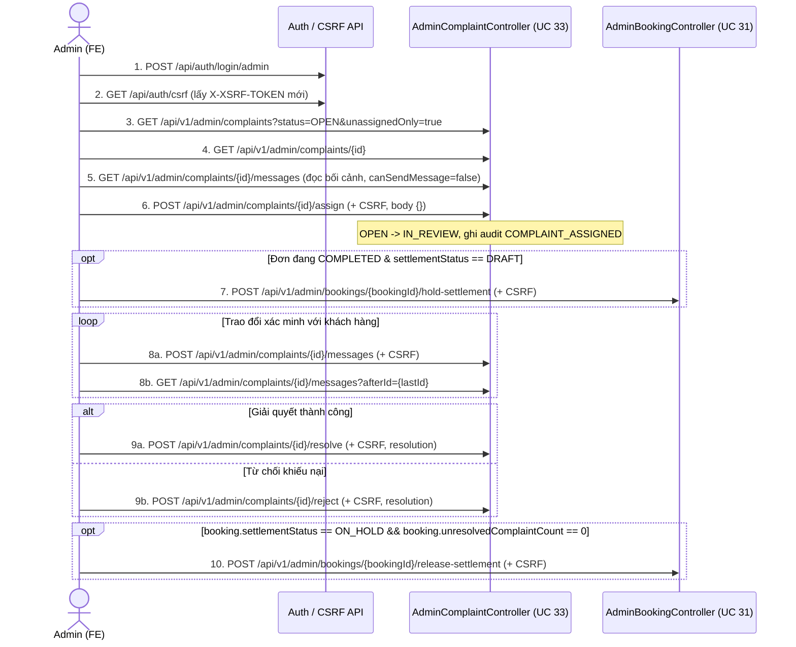

# Nestify — Tài Liệu Tích Hợp API (Handoff Frontend)

**Module:** Hỗ trợ & Khiếu nại — Vận hành Quản trị viên (Support & Complaints / Admin Operations)  
**Use Case:** UC33 — Quản trị viên tra cứu, tiếp nhận, trao đổi chat hỗ trợ và xử lý khiếu nại  
**Phiên bản:** 1.0.0  
**Ngày cập nhật:** 24/11/2026  
**Người phụ trách backend:** Nguyễn Đình Thủy  
**Người nhận bàn giao frontend:** Minh  

---

## Mục lục

1. [Tổng quan](#1-tổng-quan)
2. [Xác thực & phân quyền](#2-xác-thực--phân-quyền)
3. [Quy ước chung](#3-quy-ước-chung)
4. [Danh sách API (UC 33)](#4-danh-sách-api-uc-33)
   - [4.1. Tra cứu danh sách khiếu nại toàn hệ thống](#41-tra-cứu-danh-sách-khiếu-nại-toàn-hệ-thống--get-apiv1admincomplaints)
   - [4.2. Xem chi tiết toàn diện 360° một khiếu nại](#42-xem-chi-tiết-toàn-diện-360-một-khiếu-nại--get-apiv1admincomplaintsid)
   - [4.3. Tiếp nhận xử lý hoặc chuyển giao Admin phụ trách](#43-tiếp-nhận-xử-lý-hoặc-chuyển-giao-admin-phụ-trách--post-apiv1admincomplaintsidassign)
   - [4.4. Kết luận giải quyết khiếu nại](#44-kết-luận-giải-quyết-khiếu-nại--post-apiv1admincomplaintsidresolve)
   - [4.5. Từ chối khiếu nại](#45-từ-chối-khiếu-nại--post-apiv1admincomplaintsidreject)
   - [4.6. Lấy lịch sử tin nhắn hỗ trợ](#46-lấy-lịch-sử-tin-nhắn-hỗ-trợ--get-apiv1admincomplaintsidmessages)
   - [4.7. Gửi tin nhắn phản hồi hỗ trợ](#47-gửi-tin-nhắn-phản-hồi-hỗ-trợ--post-apiv1admincomplaintsidmessages)
5. [Luồng nghiệp vụ liên API](#5-luồng-nghiệp-vụ-liên-api)
6. [Data models & Enum](#6-data-models--enum)
7. [Lưu ý tích hợp cho Frontend](#7-lưu-ý-tích-hợp-cho-frontend)
8. [Điểm cần xác nhận](#8-điểm-cần-xác-nhận)
9. [Changelog](#9-changelog)

---

## 1. Tổng quan

### 1.1. Mục đích & Phạm vi
Tài liệu đặc tả trọn bộ **7 API phía Quản trị viên (`ADMIN`)** thuộc **UC 33** trên hệ thống Nestify, phục vụ màn hình quản trị xử lý yêu cầu hỗ trợ & khiếu nại từ khách hàng (phối hợp trực tiếp với 5 API phía Khách hàng tại `tai_lieu_api/UC39_KHACH_GUI_THEO_DOI_HO_TRO.md` và bộ can thiệp đơn hàng tại `tai_lieu_api/UC31_ADMIN_THEO_DOI_CAN_THIEP_DON.md`):

- **Tra cứu & Giám sát:** Xem toàn bộ khiếu nại trên hệ thống (lọc đa tiêu chí theo trạng thái, danh mục, Admin phụ trách, chưa có người nhận, khách hàng, đơn đặt lịch, từ khóa, khoảng thời gian) và xem chi tiết 360° kèm ngữ cảnh đơn đặt lịch (`settlementStatus`, `unresolvedComplaintCount`) và nhật ký kiểm toán `adminAuditLogs`.
- **Vòng đời xử lý chặt chẽ:**
  - `OPEN` $\rightarrow$ `IN_REVIEW` (tiếp nhận / phân công qua `/assign`).
  - `IN_REVIEW` $\rightarrow$ `IN_REVIEW` (chuyển giao Admin phụ trách khác `reassign` qua `/assign`, bắt buộc lý do, **giữ nguyên 100% lịch sử chat**).
  - `IN_REVIEW` $\rightarrow$ `RESOLVED` (kết luận giải quyết qua `/resolve`) hoặc `REJECTED` (từ chối qua `/reject`).
  - Không cho nhảy cóc `OPEN` $\rightarrow$ `RESOLVED`/`REJECTED`, và không cho mở lại khiếu nại đã đóng (`RESOLVED`/`REJECTED`).
- **Chat hỗ trợ (`conversations.type = SUPPORT`):** Bất kỳ Admin nào đều có thể **đọc** lịch sử tin nhắn để nắm bối cảnh; chỉ **đúng Admin đang phụ trách** khi khiếu nại ở trạng thái `IN_REVIEW` mới được **gửi** tin nhắn phản hồi.

> **Bất biến nghiệp vụ MD10 (Phương án B):**
> - Các thao tác `assign`, `resolve`, `reject` **không tự động** sửa `bookings.settlementStatus` và **không tự động** tạo giao dịch hoàn tiền (`refunds`).
> - Khi cần tạm giữ chi trả cho nhà cung cấp lúc xử lý khiếu nại hoặc mở lại đối soát sau khi đã đóng hết khiếu nại trên đơn (`booking.unresolvedComplaintCount === 0`), Admin thao tác chủ động qua UC 31 (`POST /api/v1/admin/bookings/{bookingId}/hold-settlement` và `/release-settlement`).

### 1.2. Base URL theo môi trường
- **Local Development:** `http://localhost:8080`
- **Swagger UI (dev):** `http://localhost:8080/swagger-ui/index.html` *(tự động tắt khi chạy profile `prod`)*
- **Prefix khuyến nghị:** `/api/v1/admin/complaints` *(backend hỗ trợ thêm alias `/api/admin/complaints`)*

### 1.3. Định dạng dữ liệu
- **Content-Type:** `application/json;charset=UTF-8`
- **Encoding:** UTF-8
- **Ngày giờ:** ISO-8601 UTC (`YYYY-MM-DDTHH:mm:ssZ`, kiểu `Instant`)
- **Tiền tệ:** Số nguyên đồng Việt Nam (`number` / `Long`, VND)

---

## 2. Xác thực & phân quyền

### 2.1. Cơ chế xác thực (theo `SecurityConfig.java` & UC27)
- **Role bắt buộc:** `ROLE_ADMIN` (`accountType = "ADMIN"`). Tài khoản `CUSTOMER` hoặc `PROVIDER` gọi vào nhận `403 ACCESS_DENIED`.
- **Cách lấy Access Token:** Đăng nhập Admin tại `POST /api/auth/login/admin` (xem `tai_lieu_api/UC27_DANG_NHAP_ADMIN.md`).
- **Thời hạn token (theo `application.yaml`):**
  - `accessToken`: mặc định `24h` (`.env.example`: `15m`) — FE đọc trường `expiresAt` từ response đăng nhập/refresh.
  - `refreshToken`: tối đa `14d` trong cookie HttpOnly `NESTIFY_REFRESH`.
  - Làm mới token: `POST /api/auth/refresh` (cần cookie refresh + CSRF).

### 2.2. Bảng Role × Quyền & Yêu cầu CSRF

| Nhóm endpoint | Role được phép | `Authorization: Bearer` | Cookie + Header `X-XSRF-TOKEN` | Kiểm tra DB `ACTIVE` & Phụ trách |
| :--- | :---: | :---: | :---: | :--- |
| `GET /api/v1/admin/complaints`<br>`GET /api/v1/admin/complaints/{id}`<br>`GET /api/v1/admin/complaints/{id}/messages` | `ADMIN` | **Bắt buộc** | Không cần | Mọi `ADMIN` đều xem được |
| `POST /api/v1/admin/complaints/{id}/assign` | `ADMIN` | **Bắt buộc** | **BẮT BUỘC** | Admin gọi & Admin mục tiêu đều phải `ADMIN` + `ACTIVE` trong DB |
| `POST /api/v1/admin/complaints/{id}/resolve`<br>`POST /api/v1/admin/complaints/{id}/reject`<br>`POST /api/v1/admin/complaints/{id}/messages` | `ADMIN` | **Bắt buộc** | **BẮT BUỘC** | Phải `ADMIN` + `ACTIVE` **VÀ** đúng là `assignedAdmin` của khiếu nại |

> **Cảnh báo CSRF bắt buộc cho các lệnh `POST` Admin:**  
> Theo `SecurityConfig.java` (dòng 107–113), mọi request ghi (`POST`) dưới `/api/v1/admin/**` và `/api/admin/**` bắt buộc gửi đồng thời **cả `Authorization: Bearer <accessToken>` lẫn CSRF**:
> 1. Gọi `GET /api/auth/csrf` kèm `withCredentials: true` (hoặc `credentials: 'include'`) sau khi đăng nhập Admin để lấy cookie `XSRF-TOKEN` mới và đọc chuỗi `token` trong JSON trả về.
> 2. Gắn giá trị `token` từ JSON vào header `X-XSRF-TOKEN` ở mọi lệnh `POST` (không tự đọc cookie `XSRF-TOKEN` bằng JS vì cookie được bảo vệ và token JSON đã qua bước che XOR).

---

## 3. Quy ước chung

### 3.1. Response thành công (`StandardResponse<T>`)
```json
{
  "success": true,
  "message": "Thông báo kết quả thành công",
  "data": { },
  "timestamp": "2026-11-24T09:15:00Z"
}
```

### 3.2. Phân trang danh sách (`PageResponse<T>` nằm trong `data`)
```json
{
  "items": [ ],
  "page": 0,
  "size": 20,
  "totalElements": 14,
  "totalPages": 1
}
```
- `page`: chỉ số trang 0-based (`null` hoặc `< 0` $\rightarrow$ mặc định `0`).
- `size`: mặc định `20`, tối đa `100` (truyền `> 100` backend tự giới hạn về `100`; `null` hoặc `<= 0` $\rightarrow$ `20`).
- `sortBy`: whitelist gồm `createdAt`, `updatedAt`, `status`, `id`. Truyền giá trị ngoài danh sách này tự fallback về `createdAt`.
- `sortDir`: `ASC` hoặc `DESC` (không phân biệt hoa/thường; mặc định `DESC`).

### 3.3. Response lỗi (`ApiError`)
```json
{
  "code": "VALIDATION_ERROR",
  "message": "Dữ liệu gửi lên không hợp lệ.",
  "fieldErrors": {
    "resolution": "Nội dung kết luận xử lý phải từ 5 đến 1000 ký tự"
  }
}
```

### 3.4. Bảng mã lỗi chung (từ `GlobalExceptionHandler.java` & `SecurityErrorHandler.java`)

| HTTP Status | Error Code | Khi nào xảy ra | FE nên xử lý thế nào |
| :---: | :--- | :--- | :--- |
| **400** | `VALIDATION_ERROR` | Sai ràng buộc Bean Validation (`@NotBlank`, `@Size`, sai định dạng query param) | Hiển thị lỗi tương ứng dưới từng input theo `fieldErrors` |
| **400** | `BUSINESS_ERROR` | Vi phạm quy tắc vòng đời (`OPEN` đòi resolve/reject/nhắn tin; đã đóng đòi sửa), chuỗi sau `trim()` không đủ độ dài, gán trùng chính Admin đang phụ trách, target không phải `ADMIN` `ACTIVE`, truyền đồng thời `beforeId` & `afterId`, `bookingId` tin nhắn không khớp | Hiển thị Toast/Alert nội dung `message` từ server |
| **401** | `AUTHENTICATION_REQUIRED` | Thiếu, sai hoặc hết hạn Access JWT | Thử refresh token 1 lần (`POST /api/auth/refresh`) hoặc đưa về màn hình đăng nhập Admin |
| **403** | `CSRF_INVALID` | Thiếu hoặc hết hạn `X-XSRF-TOKEN` / cookie `XSRF-TOKEN` trên request `POST` | Gọi lại `GET /api/auth/csrf` rồi retry request 1 lần |
| **403** | `ACCESS_DENIED` | Sai role (`CUSTOMER`/`PROVIDER`), tài khoản Admin bị `SUSPENDED`, hoặc gọi `/resolve`, `/reject`, `/messages` khi **không phải Admin đang phụ trách** | Hiển thị thông báo không có quyền; nếu do khác người phụ trách thì gợi ý dùng luồng **Chuyển giao (`assign`)** trước |
| **404** | `NOT_FOUND` | Không tìm thấy `complaintId`, `targetAdminId`, `conversation` hoặc `bookingId` | Hiển thị trạng thái không tìm thấy / tải lại danh sách |

---

## 4. Danh sách API (UC 33)

| Method | Path *(Alias)* | Mô tả | Auth / CSRF | HTTP |
| :---: | :--- | :--- | :---: | :---: |
| **GET** | `/api/v1/admin/complaints` *(`/api/admin/complaints`)* | Tra cứu danh sách khiếu nại toàn hệ thống | Bearer `ADMIN` | `200` |
| **GET** | `/api/v1/admin/complaints/{id}` *(`/api/admin/complaints/{id}`)* | Xem chi tiết 360° một khiếu nại | Bearer `ADMIN` | `200` |
| **POST** | `/api/v1/admin/complaints/{id}/assign` *(`/api/admin/complaints/{id}/assign`)* | Tiếp nhận mới (`OPEN` $\rightarrow$ `IN_REVIEW`) hoặc chuyển giao Admin (`reassign`) | Bearer `ADMIN` + **CSRF** | `200` |
| **POST** | `/api/v1/admin/complaints/{id}/resolve` *(`/api/admin/complaints/{id}/resolve`)* | Kết luận giải quyết khiếu nại (`IN_REVIEW` $\rightarrow$ `RESOLVED`) | Bearer `ADMIN` + **CSRF** | `200` |
| **POST** | `/api/v1/admin/complaints/{id}/reject` *(`/api/admin/complaints/{id}/reject`)* | Từ chối khiếu nại (`IN_REVIEW` $\rightarrow$ `REJECTED`) | Bearer `ADMIN` + **CSRF** | `200` |
| **GET** | `/api/v1/admin/complaints/{id}/messages` *(`/api/admin/complaints/{id}/messages`)* | Lấy lịch sử tin nhắn hỗ trợ (cursor `beforeId` / polling `afterId`) | Bearer `ADMIN` | `200` |
| **POST** | `/api/v1/admin/complaints/{id}/messages` *(`/api/admin/complaints/{id}/messages`)* | Admin phụ trách gửi tin nhắn phản hồi (`IN_REVIEW`) | Bearer `ADMIN` + **CSRF** | `201` |

---

### 4.1. Tra cứu danh sách khiếu nại toàn hệ thống `GET /api/v1/admin/complaints`

**Mô tả:** Hiển thị bảng danh sách toàn bộ yêu cầu hỗ trợ & khiếu nại trên màn hình Quản trị viên, hỗ trợ lọc động nhiều tiêu chí, sắp xếp an toàn theo whitelist và phân trang.  
**Auth:** Bearer token — Role: `ADMIN`.  
**Nguồn:** `backend/src/main/java/com/homeservice/support/controller/AdminComplaintController.java` $\rightarrow$ `getComplaints()`

**Query params (`AdminComplaintSearchFilter`)**

| Tên | Kiểu | Bắt buộc | Mặc định | Mô tả |
| :--- | :--- | :---: | :---: | :--- |
| `status` | `ComplaintStatus` | Không | `null` | Lọc theo trạng thái: `OPEN`, `IN_REVIEW`, `RESOLVED`, `REJECTED` |
| `category` | `ComplaintCategory` | Không | `null` | Lọc theo danh mục: `PAYMENT`, `SERVICE`, `OTHER` |
| `assignedAdminId` | `Long` | Không | `null` | Lọc các khiếu nại do 1 Admin cụ thể phụ trách *(bị bỏ qua nếu `unassignedOnly=true`)* |
| `unassignedOnly` | `Boolean` | Không | `null` (`false`) | Nếu `true`: chỉ lấy các khiếu nại chưa có Admin tiếp nhận (`assignedAdmin == null`) |
| `customerId` | `Long` | Không | `null` | Lọc theo ID tài khoản khách hàng |
| `bookingId` | `Long` | Không | `null` | Lọc tất cả khiếu nại gắn với 1 đơn đặt lịch cụ thể |
| `keyword` | `String` | Không | `null` | Tìm gần đúng không phân biệt hoa/thường trên `subject` hoặc `booking.bookingCode` *(dùng LEFT JOIN nên vẫn khớp các ticket hỗ trợ chung có `booking = null`)* |
| `from` | `Instant` (ISO-8601) | Không | `null` | Lọc `createdAt >= from` (VD: `2026-11-01T00:00:00Z`) |
| `to` | `Instant` (ISO-8601) | Không | `null` | Lọc `createdAt <= to` (VD: `2026-11-30T23:59:59Z`) |
| `page` | `Integer` | Không | `0` | Số trang (0-based; `< 0` tự về `0`) |
| `size` | `Integer` | Không | `20` | Kích thước trang (tối đa `100`) |
| `sortBy` | `String` | Không | `createdAt` | Whitelist: `createdAt`, `updatedAt`, `status`, `id` |
| `sortDir` | `String` | Không | `DESC` | `ASC` hoặc `DESC` |

**Response thành công** — `200 OK` (`StandardResponse<PageResponse<AdminComplaintSummaryResponse>>`)

| Field (trong `data.items[]`) | Kiểu | Nullable | Mô tả |
| :--- | :--- | :---: | :--- |
| `id` | `number` | Không | ID khiếu nại |
| `category` | `string` | Không | `PAYMENT` \| `SERVICE` \| `OTHER` |
| `subject` | `string` | Không | Tiêu đề ngắn của khiếu nại |
| `status` | `string` | Không | `OPEN` \| `IN_REVIEW` \| `RESOLVED` \| `REJECTED` |
| `customer` | `object` | Có | Thông tin khách hàng (`id`, `displayName`, `email`, `phone`) |
| `booking` | `object` | **Có** | `null` nếu là hỗ trợ chung; nếu gắn đơn gồm `id`, `bookingCode`, `status`, `settlementStatus` |
| `assignedAdmin` | `object` | **Có** | `null` nếu chưa có người tiếp nhận; nếu có gồm `id`, `displayName`, `email` |
| `conversationId` | `number` | Có | ID phòng chat `SUPPORT` đi kèm |
| `lastMessagePreview` | `string` | Có | Xem trước tin nhắn gần nhất (cắt gọn tối đa 120 ký tự; nếu chưa có tin nhắn thì lấy `description`) |
| `lastMessageAt` | `string` (ISO-8601) | Có | Mốc thời gian tin nhắn / hoạt động cuối cùng |
| `resolvedAt` | `string` (ISO-8601) | **Có** | Thời điểm chốt `RESOLVED`/`REJECTED` (`null` nếu chưa đóng) |
| `createdAt` | `string` (ISO-8601) | Không | Thời điểm khách tạo yêu cầu |
| `updatedAt` | `string` (ISO-8601) | Không | Thời điểm cập nhật gần nhất |

Ví dụ:
```json
{
  "success": true,
  "message": "Lấy danh sách khiếu nại thành công",
  "data": {
    "items": [
      {
        "id": 3,
        "category": "SERVICE",
        "subject": "Điều hòa Inverter vẫn yếu lạnh sau khi nạp gas bổ sung",
        "status": "IN_REVIEW",
        "customer": {
          "id": 4,
          "displayName": "Nguyễn Văn Khách",
          "email": "customer@test.com",
          "phone": "0912345678"
        },
        "booking": {
          "id": 12,
          "bookingCode": "BK-202611-107",
          "status": "COMPLETED",
          "settlementStatus": "ON_HOLD"
        },
        "assignedAdmin": {
          "id": 1,
          "displayName": "Quản Trị Viên Nestify",
          "email": "admin@nestify.vn"
        },
        "conversationId": 4,
        "lastMessagePreview": "Chào anh Khách, Quản Trị Viên Nestify đã tiếp nhận hồ sơ và tạm giữ đối soát đơn BK-202611-107...",
        "lastMessageAt": "2026-11-24T03:36:00Z",
        "resolvedAt": null,
        "createdAt": "2026-11-23T21:36:00Z",
        "updatedAt": "2026-11-24T03:36:00Z"
      }
    ],
    "page": 0,
    "size": 20,
    "totalElements": 4,
    "totalPages": 1
  },
  "timestamp": "2026-11-24T09:15:00Z"
}
```

**Response lỗi**

| HTTP | Error code | Khi nào xảy ra | FE nên làm gì |
| :---: | :--- | :--- | :--- |
| `400` | `BAD_REQUEST` / `VALIDATION_ERROR` | Truyền sai giá trị enum `status`/`category` hoặc sai định dạng ISO-8601 cho `from`/`to` | Chỉ gửi đúng enum và định dạng `toISOString()` |
| `401` | `AUTHENTICATION_REQUIRED` | Thiếu hoặc hết hạn JWT | Refresh token hoặc chuyển về trang login Admin |
| `403` | `ACCESS_DENIED` | Gọi bằng token `CUSTOMER`/`PROVIDER` | Chặn truy cập khu vực Admin |

**Luồng xử lý**
1. Chuẩn hóa tham số phân trang (`page >= 0`, `size <= 100`) và whitelist `sortBy`.
2. Xây dựng truy vấn động qua `ComplaintSpecification.forAdmin(filter)` (ưu tiên `unassignedOnly=true` trước `assignedAdminId`, tìm `keyword` bằng `LEFT JOIN booking`).
3. Nạp batch `conversations` và tin nhắn mới nhất (`findLatestByConversationIdIn`) để tránh truy vấn N+1.
4. Ánh xạ sang `PageResponse<AdminComplaintSummaryResponse>`.

**Lưu ý cho FE:** Khi lọc tab *"Chờ tiếp nhận"*, chỉ cần gửi `?status=OPEN&unassignedOnly=true`. Khi lọc tab *"Của tôi"*, gửi `?assignedAdminId=<currentAdminId>&status=IN_REVIEW`.

**Ví dụ cURL:**
```bash
curl -X GET "http://localhost:8080/api/v1/admin/complaints?status=IN_REVIEW&keyword=BK-202611&page=0&size=20&sortBy=updatedAt&sortDir=DESC" \
  -H "Authorization: Bearer <ADMIN_ACCESS_TOKEN>"
```

---

### 4.2. Xem chi tiết toàn diện 360° một khiếu nại `GET /api/v1/admin/complaints/{id}`

**Mô tả:** Trả về toàn bộ thông tin khiếu nại, hồ sơ khách hàng, Admin phụ trách, ngữ cảnh đơn đặt lịch (kèm trạng thái đối soát và số khiếu nại chưa đóng trên cùng đơn), cờ quyền chat `canCurrentAdminReply` và lịch sử `adminAuditLogs`.  
**Auth:** Bearer token — Role: `ADMIN`.  
**Nguồn:** `backend/src/main/java/com/homeservice/support/controller/AdminComplaintController.java` $\rightarrow$ `getComplaintDetail()`

**Path params**

| Tên | Kiểu | Bắt buộc | Mô tả |
| :--- | :--- | :---: | :--- |
| `id` | `Long` | **Có** | ID của khiếu nại |

**Response thành công** — `200 OK` (`StandardResponse<AdminComplaintDetailResponse>`)

| Field (trong `data`) | Kiểu | Nullable | Mô tả |
| :--- | :--- | :---: | :--- |
| `id` | `number` | Không | ID khiếu nại |
| `category` | `string` | Không | `PAYMENT` \| `SERVICE` \| `OTHER` |
| `subject` | `string` | Không | Tiêu đề yêu cầu |
| `description` | `string` | Không | Nội dung mô tả ban đầu của khách |
| `status` | `string` | Không | `OPEN` \| `IN_REVIEW` \| `RESOLVED` \| `REJECTED` |
| `resolution` | `string` | **Có** | Kết luận giải quyết hoặc lý do từ chối (`null` khi chưa đóng) |
| `resolvedAt` | `string` (ISO-8601) | **Có** | Thời điểm chốt đóng (`null` khi chưa đóng) |
| `createdAt` | `string` (ISO-8601) | Không | Thời điểm tạo |
| `updatedAt` | `string` (ISO-8601) | Không | Thời điểm cập nhật cuối |
| `customer` | `object` | Có | `id`, `displayName`, `email`, `phone`, `status` (`AccountStatus`) |
| `assignedAdmin` | `object` | **Có** | `id`, `displayName`, `email` (`null` nếu đang `OPEN` chưa nhận) |
| `booking` | `object` | **Có** | `null` nếu hỗ trợ chung; ngược lại gồm `id`, `bookingCode`, `serviceTitleSnapshot`, `status`, `totalAmountVnd`, `providerDueVnd`, `settlementStatus`, `settlementNote`, `unresolvedComplaintCount` |
| `conversationId` | `number` | Có | ID phòng chat `SUPPORT` |
| `lastMessageAt` | `string` (ISO-8601) | Có | Thời điểm cập nhật phòng chat gần nhất |
| `canCurrentAdminReply` | `boolean` | Không | `true` **chỉ khi** `status == "IN_REVIEW"` **VÀ** `assignedAdmin.id == currentAdminId` |
| `adminAuditLogs` | `array` | Không | Danh sách nhật ký kiểm toán của khiếu nại (mới nhất $\rightarrow$ cũ nhất); trường `changes` là **JSON Object thật** (`before`/`after`) |

Ví dụ:
```json
{
  "success": true,
  "message": "Lấy chi tiết khiếu nại thành công",
  "data": {
    "id": 3,
    "category": "SERVICE",
    "subject": "Điều hòa Inverter vẫn yếu lạnh sau khi nạp gas bổ sung",
    "description": "Hôm qua thợ đã đến nạp gas cho đơn BK-202611-107 nhưng bật 20 độ vẫn chỉ mát nhẹ.",
    "status": "IN_REVIEW",
    "resolution": null,
    "resolvedAt": null,
    "createdAt": "2026-11-23T21:36:00Z",
    "updatedAt": "2026-11-24T03:36:00Z",
    "customer": {
      "id": 4,
      "displayName": "Nguyễn Văn Khách",
      "email": "customer@test.com",
      "phone": "0912345678",
      "status": "ACTIVE"
    },
    "assignedAdmin": {
      "id": 1,
      "displayName": "Quản Trị Viên Nestify",
      "email": "admin@nestify.vn"
    },
    "booking": {
      "id": 12,
      "bookingCode": "BK-202611-107",
      "serviceTitleSnapshot": "Bảo dưỡng & Nạp gas bổ sung điều hòa Inverter",
      "status": "COMPLETED",
      "totalAmountVnd": 350000,
      "providerDueVnd": 280000,
      "settlementStatus": "ON_HOLD",
      "settlementNote": "Tạm giữ đối soát chờ xử lý khiếu nại bảo hành nạp gas từ khách hàng.",
      "unresolvedComplaintCount": 1
    },
    "conversationId": 4,
    "lastMessageAt": "2026-11-24T03:36:00Z",
    "canCurrentAdminReply": true,
    "adminAuditLogs": [
      {
        "id": 6,
        "adminId": 1,
        "adminDisplayName": "Quản Trị Viên Nestify",
        "action": "COMPLAINT_ASSIGNED",
        "reason": "Tiếp nhận xử lý khiếu nại bảo hành dịch vụ",
        "changes": {
          "before": {
            "status": "OPEN",
            "assignedAdminId": null
          },
          "after": {
            "status": "IN_REVIEW",
            "assignedAdminId": 1
          }
        },
        "createdAt": "2026-11-24T01:36:00Z"
      }
    ]
  },
  "timestamp": "2026-11-24T09:16:00Z"
}
```

**Response lỗi**

| HTTP | Error code | Khi nào xảy ra | FE nên làm gì |
| :---: | :--- | :--- | :--- |
| `401` | `AUTHENTICATION_REQUIRED` | Thiếu hoặc hết hạn JWT | Refresh token hoặc đăng nhập lại |
| `403` | `ACCESS_DENIED` | Sai role (`CUSTOMER`/`PROVIDER`) | Từ chối truy cập |
| `404` | `NOT_FOUND` | Không tìm thấy khiếu nại theo `id` | Hiển thị trang không tìm thấy & nút quay lại danh sách |

**Luồng xử lý**
1. Tải chi tiết khiếu nại kèm `customer`, `assignedAdmin`, `booking` (`findByIdWithDetails`).
2. Tra `conversation` theo `complaintId`.
3. Nếu có `booking`: đếm `unresolvedComplaintCount` (`status IN (OPEN, IN_REVIEW)`) trên đơn đó phục vụ liên kết đối soát (MD10 / UC31).
4. Truy vấn `admin_audit_logs` (`entityType = "COMPLAINT"`, sắp `createdAt DESC`) và parse `changes` sang JSON Object thật.

**Lưu ý cho FE:**
- Dùng `canCurrentAdminReply` để bật/tắt khung nhập chat **và** hai nút **"Giải quyết"** / **"Từ chối"**.
- Khi `booking != null` và `booking.settlementStatus === "DRAFT"`, có thể gắn nút shortcut điều hướng hoặc gọi UC 31 `hold-settlement` để tạm giữ tiền chi trả cho NCC trong thời gian xử lý.

**Ví dụ cURL:**
```bash
curl -X GET "http://localhost:8080/api/v1/admin/complaints/3" \
  -H "Authorization: Bearer <ADMIN_ACCESS_TOKEN>"
```

---

### 4.3. Tiếp nhận xử lý hoặc chuyển giao Admin phụ trách `POST /api/v1/admin/complaints/{id}/assign`

**Mô tả:**
- Khi khiếu nại đang **`OPEN`**: tiếp nhận xử lý (`OPEN` $\rightarrow$ `IN_REVIEW`), gán cho chính Admin đang gọi (nếu không truyền `targetAdminId`) hoặc phân công cho một Admin `ACTIVE` khác.
- Khi khiếu nại đang **`IN_REVIEW`**: chuyển giao quyền phụ trách sang một Admin `ACTIVE` khác (`reassign`), **bắt buộc nhập lý do** và giữ nguyên toàn bộ lịch sử tin nhắn cũ.

**Auth:** Bearer token — Role: `ADMIN` (`ACTIVE` trong DB) + **Bắt buộc CSRF**.  
**Nguồn:** `backend/src/main/java/com/homeservice/support/controller/AdminComplaintController.java` $\rightarrow$ `assignComplaint()`

**Path params**

| Tên | Kiểu | Bắt buộc | Mô tả |
| :--- | :--- | :---: | :--- |
| `id` | `Long` | **Có** | ID khiếu nại cần tiếp nhận / chuyển giao |

**Headers bắt buộc**
- `Authorization: Bearer <ADMIN_ACCESS_TOKEN>`
- `X-XSRF-TOKEN: <CSRF_TOKEN_FROM_GET_API_AUTH_CSRF>` *(kèm cookie `XSRF-TOKEN`)*

**Request body (`AdminAssignComplaintRequest` — `application/json`, tùy chọn — có thể gửi body rỗng hoặc `{}` để Admin tự tiếp nhận khiếu nại `OPEN`)**

| Field | Kiểu | Bắt buộc | Ràng buộc | Mô tả |
| :--- | :--- | :---: | :--- | :--- |
| `targetAdminId` | `Long` | Không | Nếu `null`: mặc định gán cho chính Admin đang gọi API. Nếu truyền: phải là tài khoản `ADMIN` đang `ACTIVE`. | ID Admin được phân công phụ trách |
| `reason` | `String` | **Có điều kiện** | • Khi `OPEN` $\rightarrow$ `IN_REVIEW`: tùy chọn (`<= 500` ký tự sau `trim()`).<br>• Khi `IN_REVIEW` $\rightarrow$ `IN_REVIEW` (**reassign**): **BẮT BUỘC `5..500` ký tự sau `trim()`**. | Lý do tiếp nhận / chuyển giao (lưu vào `admin_audit_logs.reason`) |

Ví dụ 1 — Admin tự tiếp nhận ticket `OPEN` (body rỗng `{}` hoặc bỏ hẳn body):
```json
{}
```

Ví dụ 2 — Chuyển giao ticket `IN_REVIEW` sang Admin khác (`reassign`):
```json
{
  "targetAdminId": 6,
  "reason": "Chuyển giao ca trực tối cho Admin 2 tiếp tục đối soát giao dịch."
}
```

**Response thành công** — `200 OK` (`StandardResponse<AdminComplaintDetailResponse>`)
Trả về toàn bộ đối tượng `AdminComplaintDetailResponse` mới nhất (schema giống mục [4.2](#42-xem-chi-tiết-toàn-diện-360-một-khiếu-nại--get-apiv1admincomplaintsid)), bao gồm `status: "IN_REVIEW"`, `assignedAdmin` mới, cờ `canCurrentAdminReply` đã cập nhật và bản ghi audit mới nhất (`COMPLAINT_ASSIGNED` hoặc `COMPLAINT_REASSIGNED`) ở đầu mảng `adminAuditLogs`.

Ví dụ:
```json
{
  "success": true,
  "message": "Phân công xử lý khiếu nại thành công",
  "data": {
    "id": 3,
    "category": "SERVICE",
    "subject": "Điều hòa Inverter vẫn yếu lạnh sau khi nạp gas bổ sung",
    "status": "IN_REVIEW",
    "assignedAdmin": {
      "id": 6,
      "displayName": "Trần Minh Quản Trị",
      "email": "admin2@nestify.vn"
    },
    "canCurrentAdminReply": false,
    "adminAuditLogs": [
      {
        "id": 9,
        "adminId": 1,
        "adminDisplayName": "Quản Trị Viên Nestify",
        "action": "COMPLAINT_REASSIGNED",
        "reason": "Chuyển giao ca trực tối cho Admin 2 tiếp tục đối soát giao dịch.",
        "changes": {
          "before": {
            "status": "IN_REVIEW",
            "assignedAdminId": 1
          },
          "after": {
            "status": "IN_REVIEW",
            "assignedAdminId": 6
          }
        },
        "createdAt": "2026-11-24T09:20:00Z"
      }
    ]
  },
  "timestamp": "2026-11-24T09:20:00Z"
}
```

**Response lỗi**

| HTTP | Error code | Khi nào xảy ra | FE nên làm gì |
| :---: | :--- | :--- | :--- |
| `400` | `VALIDATION_ERROR` | `reason` vượt quá 500 ký tự | Hiển thị lỗi dưới ô nhập lý do |
| `400` | `BUSINESS_ERROR` | Khiếu nại đã đóng (`RESOLVED`/`REJECTED`); chuyển giao thiếu lý do hoặc lý do `< 5` ký tự sau `trim()`; gán trùng chính Admin đang phụ trách; `targetAdminId` không phải `ADMIN` hoặc bị khóa | Hiển thị Toast theo `message` |
| `401` | `AUTHENTICATION_REQUIRED` | Thiếu / hết hạn JWT | Refresh token hoặc đăng nhập lại |
| `403` | `CSRF_INVALID` | Thiếu hoặc sai `X-XSRF-TOKEN` | Gọi `GET /api/auth/csrf` rồi thử lại |
| `403` | `ACCESS_DENIED` | Sai role hoặc tài khoản Admin thao tác bị `SUSPENDED` | Đăng xuất / thông báo không có quyền |
| `404` | `NOT_FOUND` | Không tìm thấy `complaintId` hoặc `targetAdminId` | Thông báo không tìm thấy |

**Luồng xử lý**
1. Kiểm tra Admin đang gọi API (`ACTIVE`, `ADMIN`) và Admin mục tiêu (`ACTIVE`, `ADMIN`).
2. Khóa bi quan dòng `complaints` (`FOR UPDATE`) chống 2 Admin bấm nhận cùng lúc.
3. Chặn nếu trạng thái đã là `RESOLVED`/`REJECTED`.
4. Nếu `OPEN` $\rightarrow$ chuyển `IN_REVIEW`, gán `assignedAdmin`, ghi audit `COMPLAINT_ASSIGNED`. Nếu `IN_REVIEW` $\rightarrow$ chặn gán trùng, bắt buộc `reason` (`5..500`), đổi `assignedAdmin` (giữ nguyên `conversations` và `messages`), ghi audit `COMPLAINT_REASSIGNED`.
5. Không tác động `bookings.settlementStatus`; nạp lại chi tiết 360° trả về.

**Lưu ý cho FE:** Sau khi gọi `reassign` sang Admin khác thành công, response sẽ trả `canCurrentAdminReply: false` — FE cập nhật thẳng state trang chi tiết từ `data` để khóa khung chat & các nút đóng khiếu nại ngay lập tức mà không cần gọi lại `GET /{id}`.

**Ví dụ cURL:**
```bash
curl -X POST "http://localhost:8080/api/v1/admin/complaints/2/assign" \
  -H "Authorization: Bearer <ADMIN_ACCESS_TOKEN>" \
  -H "X-XSRF-TOKEN: <CSRF_TOKEN>" \
  -H "Content-Type: application/json" \
  -b "XSRF-TOKEN=<CSRF_COOKIE_VALUE>" \
  -d '{"reason":"Tiếp nhận xử lý khiếu nại chất lượng dịch vụ"}'
```

---

### 4.4. Kết luận giải quyết khiếu nại `POST /api/v1/admin/complaints/{id}/resolve`

**Mô tả:** Admin đang phụ trách chốt kết quả **đã giải quyết** cho khiếu nại (`IN_REVIEW` $\rightarrow$ `RESOLVED`), lưu nội dung kết luận (`resolution`), thời điểm chốt (`resolvedAt`), ghi nhật ký kiểm toán và khóa luồng gửi tin nhắn mới từ cả hai phía.  
**Auth:** Bearer token — Role: `ADMIN` (`ACTIVE` và **phải là `assignedAdmin`**) + **Bắt buộc CSRF**.  
**Nguồn:** `backend/src/main/java/com/homeservice/support/controller/AdminComplaintController.java` $\rightarrow$ `resolveComplaint()`

**Path params**

| Tên | Kiểu | Bắt buộc | Mô tả |
| :--- | :--- | :---: | :--- |
| `id` | `Long` | **Có** | ID khiếu nại đang `IN_REVIEW` |

**Headers bắt buộc**
- `Authorization: Bearer <ADMIN_ACCESS_TOKEN>`
- `X-XSRF-TOKEN: <CSRF_TOKEN_FROM_GET_API_AUTH_CSRF>` *(kèm cookie `XSRF-TOKEN`)*

**Request body (`AdminCloseComplaintRequest` — `application/json`)**

| Field | Kiểu | Bắt buộc | Ràng buộc | Mô tả |
| :--- | :--- | :---: | :--- | :--- |
| `resolution` | `String` | **Có** | `@NotBlank`, `5..1000` ký tự sau `trim()` | Kết luận giải quyết chi tiết (hiển thị cho cả Admin và Khách hàng ở UC 39) |

Ví dụ:
```json
{
  "resolution": "Thợ Trung Tâm Điện Lạnh Bách Khoa đã quay lại bảo hành nạp gas miễn phí, khách hàng xác nhận điều hòa hoạt động ổn định."
}
```

**Response thành công** — `200 OK` (`StandardResponse<AdminComplaintDetailResponse>`)
Trả về `AdminComplaintDetailResponse` mới nhất với:
- `status: "RESOLVED"`
- `resolution`: nội dung đã `trim()`
- `resolvedAt`: mốc UTC hoàn tất
- `canCurrentAdminReply: false`
- `booking.unresolvedComplaintCount`: đã tự động giảm đi 1 (nếu về `0` và `booking.settlementStatus == "ON_HOLD"`, FE có thể gợi ý Admin mở lại đối soát qua UC 31)
- `adminAuditLogs[0]`: bản ghi `COMPLAINT_RESOLVED`

Ví dụ:
```json
{
  "success": true,
  "message": "Kết luận giải quyết khiếu nại thành công",
  "data": {
    "id": 3,
    "category": "SERVICE",
    "subject": "Điều hòa Inverter vẫn yếu lạnh sau khi nạp gas bổ sung",
    "status": "RESOLVED",
    "resolution": "Thợ Trung Tâm Điện Lạnh Bách Khoa đã quay lại bảo hành nạp gas miễn phí, khách hàng xác nhận điều hòa hoạt động ổn định.",
    "resolvedAt": "2026-11-24T09:25:00Z",
    "booking": {
      "id": 12,
      "bookingCode": "BK-202611-107",
      "serviceTitleSnapshot": "Bảo dưỡng & Nạp gas bổ sung điều hòa Inverter",
      "status": "COMPLETED",
      "totalAmountVnd": 350000,
      "providerDueVnd": 280000,
      "settlementStatus": "ON_HOLD",
      "settlementNote": "Tạm giữ đối soát chờ xử lý khiếu nại bảo hành nạp gas từ khách hàng.",
      "unresolvedComplaintCount": 0
    },
    "canCurrentAdminReply": false,
    "adminAuditLogs": [
      {
        "id": 10,
        "adminId": 1,
        "adminDisplayName": "Quản Trị Viên Nestify",
        "action": "COMPLAINT_RESOLVED",
        "reason": "Thợ Trung Tâm Điện Lạnh Bách Khoa đã quay lại bảo hành nạp gas miễn phí, khách hàng xác nhận điều hòa hoạt động ổn định.",
        "changes": {
          "before": {
            "status": "IN_REVIEW",
            "resolution": null,
            "resolvedAt": null,
            "assignedAdminId": 1
          },
          "after": {
            "status": "RESOLVED",
            "resolution": "Thợ Trung Tâm Điện Lạnh Bách Khoa đã quay lại bảo hành nạp gas miễn phí, khách hàng xác nhận điều hòa hoạt động ổn định.",
            "resolvedAt": "2026-11-24T09:25:00Z",
            "assignedAdminId": 1
          }
        },
        "createdAt": "2026-11-24T09:25:00Z"
      }
    ]
  },
  "timestamp": "2026-11-24T09:25:00Z"
}
```

**Response lỗi**

| HTTP | Error code | Khi nào xảy ra | FE nên làm gì |
| :---: | :--- | :--- | :--- |
| `400` | `VALIDATION_ERROR` | `resolution` trống, `< 5` hoặc `> 1000` ký tự | Hiển thị lỗi trực tiếp dưới textarea kết luận |
| `400` | `BUSINESS_ERROR` | `resolution` sau `trim()` `< 5` ký tự; khiếu nại còn ở `OPEN` (chưa `assign`); khiếu nại đã đóng (`RESOLVED`/`REJECTED`) | Hiển thị Toast theo `message` |
| `401` | `AUTHENTICATION_REQUIRED` | Thiếu / hết hạn JWT | Refresh token hoặc đăng nhập lại |
| `403` | `CSRF_INVALID` | Thiếu / sai `X-XSRF-TOKEN` | Lấy lại CSRF token rồi thử lại |
| `403` | `ACCESS_DENIED` | Không phải Admin đang phụ trách (`assignedAdmin`), sai role hoặc Admin bị `SUSPENDED` | Nhắc Admin chuyển giao phân công (`assign`) trước nếu muốn tiếp quản |
| `404` | `NOT_FOUND` | Không tìm thấy `complaintId` | Thông báo không tìm thấy |

**Luồng xử lý**
1. Validate & `trim()` `resolution` (`5..1000` ký tự); xác minh Admin gọi đang `ADMIN` + `ACTIVE`.
2. Khóa bi quan `complaints` (`FOR UPDATE`).
3. Kiểm tra `status == IN_REVIEW` và `assignedAdmin.id == currentAdminId`.
4. Cập nhật `status = RESOLVED`, `resolution`, `resolvedAt = now`, `updatedAt = now`; ghi `admin_audit_logs` (`COMPLAINT_RESOLVED`) trong cùng transaction.
5. Giữ nguyên `bookings.settlementStatus` (MD10 Phương án B); nạp lại chi tiết 360° kèm `unresolvedComplaintCount` mới nhất.

**Lưu ý cho FE:** Nếu response trả về `booking?.settlementStatus === "ON_HOLD"` và `booking?.unresolvedComplaintCount === 0`, nên hiển thị banner/modal gợi ý: *"Đơn đặt lịch này không còn khiếu nại đang mở. Bạn có muốn mở lại đối soát ngay không?"* dẫn sang UC 31 `release-settlement`.

**Ví dụ cURL:**
```bash
curl -X POST "http://localhost:8080/api/v1/admin/complaints/3/resolve" \
  -H "Authorization: Bearer <ADMIN_ACCESS_TOKEN>" \
  -H "X-XSRF-TOKEN: <CSRF_TOKEN>" \
  -H "Content-Type: application/json" \
  -b "XSRF-TOKEN=<CSRF_COOKIE_VALUE>" \
  -d '{"resolution":"Thợ đã bảo hành miễn phí, khách xác nhận hài lòng."}'
```

---

### 4.5. Từ chối khiếu nại `POST /api/v1/admin/complaints/{id}/reject`

**Mô tả:** Admin đang phụ trách chốt kết quả **từ chối** khiếu nại (`IN_REVIEW` $\rightarrow$ `REJECTED`) khi yêu cầu không đủ căn cứ hoặc ngoài chính sách bảo hành; lưu rõ lý do từ chối vào `resolution`, ghi nhật ký kiểm toán và khóa gửi thêm tin nhắn.  
**Auth:** Bearer token — Role: `ADMIN` (`ACTIVE` và **phải là `assignedAdmin`**) + **Bắt buộc CSRF**.  
**Nguồn:** `backend/src/main/java/com/homeservice/support/controller/AdminComplaintController.java` $\rightarrow$ `rejectComplaint()`

**Path params**

| Tên | Kiểu | Bắt buộc | Mô tả |
| :--- | :--- | :---: | :--- |
| `id` | `Long` | **Có** | ID khiếu nại đang `IN_REVIEW` |

**Headers bắt buộc**
- `Authorization: Bearer <ADMIN_ACCESS_TOKEN>`
- `X-XSRF-TOKEN: <CSRF_TOKEN_FROM_GET_API_AUTH_CSRF>` *(kèm cookie `XSRF-TOKEN`)*

**Request body (`AdminCloseComplaintRequest` — `application/json`)**

| Field | Kiểu | Bắt buộc | Ràng buộc | Mô tả |
| :--- | :--- | :---: | :--- | :--- |
| `resolution` | `String` | **Có** | `@NotBlank`, `5..1000` ký tự sau `trim()` | Lý do từ chối chi tiết (hiển thị cho khách hàng ở UC 39) |

Ví dụ:
```json
{
  "resolution": "Đối soát sao kê VNPay chỉ ghi nhận 1 giao dịch thành công duy nhất, không phát sinh thu tiền trùng."
}
```

**Response thành công** — `200 OK` (`StandardResponse<AdminComplaintDetailResponse>`)
Cùng cấu trúc `AdminComplaintDetailResponse` như mục [4.2](#42-xem-chi-tiết-toàn-diện-360-một-khiếu-nại--get-apiv1admincomplaintsid), với `status: "REJECTED"`, `canCurrentAdminReply: false`, `adminAuditLogs[0].action: "COMPLAINT_REJECTED"` và `booking.unresolvedComplaintCount` đã cập nhật.

Ví dụ:
```json
{
  "success": true,
  "message": "Từ chối khiếu nại thành công",
  "data": {
    "id": 3,
    "category": "PAYMENT",
    "subject": "Bị trừ cọc hai lần qua VNPay",
    "status": "REJECTED",
    "resolution": "Đối soát sao kê VNPay chỉ ghi nhận 1 giao dịch thành công duy nhất, không phát sinh thu tiền trùng.",
    "resolvedAt": "2026-11-24T09:28:00Z",
    "canCurrentAdminReply": false,
    "adminAuditLogs": [
      {
        "id": 11,
        "adminId": 1,
        "adminDisplayName": "Quản Trị Viên Nestify",
        "action": "COMPLAINT_REJECTED",
        "reason": "Đối soát sao kê VNPay chỉ ghi nhận 1 giao dịch thành công duy nhất, không phát sinh thu tiền trùng.",
        "changes": {
          "before": {
            "status": "IN_REVIEW",
            "resolution": null,
            "resolvedAt": null,
            "assignedAdminId": 1
          },
          "after": {
            "status": "REJECTED",
            "resolution": "Đối soát sao kê VNPay chỉ ghi nhận 1 giao dịch thành công duy nhất, không phát sinh thu tiền trùng.",
            "resolvedAt": "2026-11-24T09:28:00Z",
            "assignedAdminId": 1
          }
        },
        "createdAt": "2026-11-24T09:28:00Z"
      }
    ]
  },
  "timestamp": "2026-11-24T09:28:00Z"
}
```

**Response lỗi**

| HTTP | Error code | Khi nào xảy ra | FE nên làm gì |
| :---: | :--- | :--- | :--- |
| `400` | `VALIDATION_ERROR` | `resolution` trống, `< 5` hoặc `> 1000` ký tự | Hiển thị lỗi trực tiếp dưới ô nhập lý do từ chối |
| `400` | `BUSINESS_ERROR` | Lý do sau `trim()` `< 5` ký tự; khiếu nại còn ở `OPEN`; khiếu nại đã đóng (`RESOLVED`/`REJECTED`) | Hiển thị Toast theo `message` |
| `401` | `AUTHENTICATION_REQUIRED` | Thiếu / hết hạn JWT | Refresh token hoặc đăng nhập lại |
| `403` | `CSRF_INVALID` | Thiếu / sai `X-XSRF-TOKEN` | Lấy lại CSRF token rồi thử lại |
| `403` | `ACCESS_DENIED` | Không phải Admin đang phụ trách, sai role hoặc Admin bị `SUSPENDED` | Thông báo không có quyền |
| `404` | `NOT_FOUND` | Không tìm thấy `complaintId` | Thông báo không tìm thấy |

**Luồng xử lý:** Tương tự `/resolve` (dùng chung lõi `closeComplaintByAdmin`), đặt `status = REJECTED`, ghi `admin_audit_logs` với `action = "COMPLAINT_REJECTED"` và giữ nguyên `bookings.settlementStatus`.

**Lưu ý cho FE:** Tương tự `/resolve`, nên hiện hộp thoại xác nhận trước khi bấm **Từ chối** vì trạng thái `REJECTED` là trạng thái cuối không thể mở lại.

**Ví dụ cURL:**
```bash
curl -X POST "http://localhost:8080/api/v1/admin/complaints/3/reject" \
  -H "Authorization: Bearer <ADMIN_ACCESS_TOKEN>" \
  -H "X-XSRF-TOKEN: <CSRF_TOKEN>" \
  -H "Content-Type: application/json" \
  -b "XSRF-TOKEN=<CSRF_COOKIE_VALUE>" \
  -d '{"resolution":"Yêu cầu vượt quá thời hạn bảo hành dịch vụ theo quy định."}'
```

---

### 4.6. Lấy lịch sử tin nhắn hỗ trợ `GET /api/v1/admin/complaints/{id}/messages`

**Mô tả:** Tải lịch sử tin nhắn trong cuộc trò chuyện hỗ trợ (`SUPPORT`) của một khiếu nại theo cơ chế phân trang cursor (`beforeId` tải tin cũ hơn khi cuộn lên) và polling (`afterId` lấy tin mới hơn). Bất kỳ Admin nào đều được xem (kể cả khi `OPEN` hoặc đã đóng).  
**Auth:** Bearer token — Role: `ADMIN`.  
**Nguồn:** `backend/src/main/java/com/homeservice/support/controller/AdminComplaintController.java` $\rightarrow$ `getComplaintMessages()`

**Path params**

| Tên | Kiểu | Bắt buộc | Mô tả |
| :--- | :--- | :---: | :--- |
| `id` | `Long` | **Có** | ID khiếu nại |

**Query params**

| Tên | Kiểu | Bắt buộc | Mặc định | Mô tả |
| :--- | :--- | :---: | :---: | :--- |
| `beforeId` | `Long` | Không | `null` | Tải tối đa `limit` tin nhắn cũ hơn (`id < beforeId`). Dùng cho nút *"Tải thêm tin nhắn cũ"*. |
| `afterId` | `Long` | Không | `null` | Lấy tối đa `limit` tin nhắn mới hơn (`id > afterId`). Dùng cho polling định kỳ. |
| `limit` | `Integer` | Không | `30` | Số lượng tin nhắn tối đa trả về (`1..100`, vượt `100` tự giới hạn về `100`). |

> **Ràng buộc:** Không được truyền đồng thời cả `beforeId` và `afterId` trong cùng 1 request (vi phạm trả `400 BUSINESS_ERROR`). Nếu bỏ trống cả hai, API trả `limit` tin nhắn mới nhất.

**Response thành công** — `200 OK` (`StandardResponse<MessagePageResponse>`)

| Field (trong `data`) | Kiểu | Nullable | Mô tả |
| :--- | :--- | :---: | :--- |
| `conversationId` | `number` | Không | ID cuộc trò chuyện `SUPPORT` |
| `complaintId` | `number` | Không | ID khiếu nại |
| `canSendMessage` | `boolean` | Không | `true` **chỉ khi** `status == "IN_REVIEW"` **VÀ** `assignedAdmin.id == currentAdminId` |
| `hasMore` | `boolean` | Không | Còn tin nhắn cũ hơn (khi tải mặc định/`beforeId`) hoặc còn tin mới hơn (khi polling `afterId`) |
| `nextBeforeId` | `number` | **Có** | Giá trị truyền vào `beforeId` ở lần tải ngược kế tiếp (`null` khi `hasMore = false` hoặc đang ở mode `afterId`) |
| `lastMessageId` | `number` | **Có** | ID tin nhắn mới nhất để làm mốc `afterId` cho vòng polling kế tiếp |
| `items` | `array` | Không | Danh sách `MessageResponse`, **luôn sắp xếp tăng dần theo `id` (`ASC`)** để render thẳng từ trên xuống dưới |

Các trường trong `data.items[]` (`MessageResponse`):

| Field | Kiểu | Nullable | Mô tả |
| :--- | :--- | :---: | :--- |
| `id` | `number` | Không | ID tin nhắn |
| `conversationId` | `number` | Không | ID cuộc trò chuyện |
| `senderId` | `number` | Không | ID tài khoản người gửi |
| `senderType` | `string` | Không | `CUSTOMER` \| `ADMIN` *(dùng để căn lề trái/phải bong bóng chat)* |
| `senderDisplayName` | `string` | Có | Tên hiển thị người gửi |
| `bookingId` | `number` | **Có** | ID đơn đặt lịch gắn ngữ cảnh với tin nhắn (nếu có) |
| `body` | `string` | Không | Nội dung văn bản tin nhắn |
| `readAt` | `string` (ISO-8601) | **Có** | Thời điểm đã đọc (`null` ở P1 do chưa bật API `/read`) |
| `createdAt` | `string` (ISO-8601) | Không | Thời điểm gửi tin nhắn |

Ví dụ:
```json
{
  "success": true,
  "message": "Lấy lịch sử tin nhắn hỗ trợ thành công",
  "data": {
    "conversationId": 4,
    "complaintId": 3,
    "canSendMessage": true,
    "hasMore": false,
    "nextBeforeId": null,
    "lastMessageId": 7,
    "items": [
      {
        "id": 6,
        "conversationId": 4,
        "senderId": 4,
        "senderType": "CUSTOMER",
        "senderDisplayName": "Nguyễn Văn Khách",
        "bookingId": 12,
        "body": "Hôm qua thợ đã đến nạp gas cho đơn BK-202611-107 nhưng bật 20 độ vẫn chỉ mát nhẹ.",
        "readAt": null,
        "createdAt": "2026-11-23T21:36:00Z"
      },
      {
        "id": 7,
        "conversationId": 4,
        "senderId": 1,
        "senderType": "ADMIN",
        "senderDisplayName": "Quản Trị Viên Nestify",
        "bookingId": 12,
        "body": "Chào anh Khách, Quản Trị Viên Nestify đã tiếp nhận hồ sơ và tạm giữ đối soát đơn BK-202611-107.",
        "readAt": null,
        "createdAt": "2026-11-24T03:36:00Z"
      }
    ]
  },
  "timestamp": "2026-11-24T09:30:00Z"
}
```

**Response lỗi**

| HTTP | Error code | Khi nào xảy ra | FE nên làm gì |
| :---: | :--- | :--- | :--- |
| `400` | `BUSINESS_ERROR` | Truyền đồng thời cả `beforeId` và `afterId` | Tách rõ luồng cuộn lên (`beforeId`) và polling (`afterId`) |
| `401` | `AUTHENTICATION_REQUIRED` | Thiếu / hết hạn JWT | Refresh token hoặc đăng nhập lại |
| `403` | `ACCESS_DENIED` | Sai role (`CUSTOMER`/`PROVIDER`) | Từ chối truy cập |
| `404` | `NOT_FOUND` | Không tìm thấy `complaintId` hoặc không có `conversation` tương ứng | Hiển thị trạng thái không tìm thấy |

**Luồng xử lý**
1. Kiểm tra không truyền trùng `beforeId` & `afterId`.
2. Tải `Complaint` và `Conversation` theo `complaintId`.
3. Tính `canSendMessage = (status == IN_REVIEW && assignedAdmin?.id == currentAdminId)`.
4. Truy vấn `limit + 1` bản ghi để tính `hasMore`, đảo chiều về `id ASC` cho mode mặc định / `beforeId`, trả `MessagePageResponse`.

**Lưu ý cho FE:**
- Khi poll với `?afterId=<lastMessageId>`: nếu không có tin mới, `items` trả về `[]` và `lastMessageId` giữ nguyên bằng `afterId` đã gửi — FE chỉ cần append các phần tử trong `items` (dedupe theo `id`) vào cuối danh sách.
- Nếu `canSendMessage === false`, FE vẫn hiển thị đầy đủ lịch sử tin nhắn ở chế độ chỉ đọc và hiển thị banner giải thích (chưa tiếp nhận / Admin khác đang phụ trách / khiếu nại đã đóng).

**Ví dụ cURL:**
```bash
# Lần đầu mở phòng chat
curl -X GET "http://localhost:8080/api/v1/admin/complaints/3/messages?limit=30" \
  -H "Authorization: Bearer <ADMIN_ACCESS_TOKEN>"

# Polling tin nhắn mới định kỳ
curl -X GET "http://localhost:8080/api/v1/admin/complaints/3/messages?afterId=7&limit=30" \
  -H "Authorization: Bearer <ADMIN_ACCESS_TOKEN>"
```

---

### 4.7. Gửi tin nhắn phản hồi hỗ trợ `POST /api/v1/admin/complaints/{id}/messages`

**Mô tả:** Admin đang phụ trách gửi một tin nhắn văn bản phản hồi khách hàng trong phòng chat hỗ trợ của khiếu nại đang ở trạng thái `IN_REVIEW`.  
**Auth:** Bearer token — Role: `ADMIN` (`ACTIVE` và **phải là `assignedAdmin`**) + **Bắt buộc CSRF**.  
**Nguồn:** `backend/src/main/java/com/homeservice/support/controller/AdminComplaintController.java` $\rightarrow$ `sendComplaintMessage()`

**Path params**

| Tên | Kiểu | Bắt buộc | Mô tả |
| :--- | :--- | :---: | :--- |
| `id` | `Long` | **Có** | ID khiếu nại đang `IN_REVIEW` |

**Headers bắt buộc**
- `Authorization: Bearer <ADMIN_ACCESS_TOKEN>`
- `X-XSRF-TOKEN: <CSRF_TOKEN_FROM_GET_API_AUTH_CSRF>` *(kèm cookie `XSRF-TOKEN`)*

**Request body (`SendMessageRequest` — `application/json`)**

| Field | Kiểu | Bắt buộc | Ràng buộc | Mô tả |
| :--- | :--- | :---: | :--- | :--- |
| `body` | `String` | **Có** | `@NotBlank`, `1..2000` ký tự sau `trim()` | Nội dung tin nhắn phản hồi |
| `bookingId` | `Long` | Không | • Nếu bỏ trống (`null`): tự động kế thừa `complaint.booking.id` (nếu có).<br>• Nếu khiếu nại đã gắn đơn: bắt buộc trùng `complaint.booking.id`.<br>• Nếu khiếu nại hỗ trợ chung (`booking == null`): đơn đính kèm phải tồn tại và thuộc đúng khách hàng của khiếu nại. | Ngữ cảnh đơn đặt lịch đính kèm tin nhắn (thường để `null` hoặc không truyền) |

Ví dụ:
```json
{
  "body": "Chào anh Khách, bên em đã chốt lịch với thợ quay lại kiểm tra áp suất gas miễn phí vào 9h00 sáng mai ạ."
}
```

**Response thành công** — `201 Created` (`StandardResponse<MessageResponse>`)

| Field (trong `data`) | Kiểu | Nullable | Mô tả |
| :--- | :--- | :---: | :--- |
| `id` | `number` | Không | ID tin nhắn vừa tạo |
| `conversationId` | `number` | Không | ID cuộc trò chuyện `SUPPORT` |
| `senderId` | `number` | Không | ID Admin vừa gửi |
| `senderType` | `string` | Không | `"ADMIN"` |
| `senderDisplayName` | `string` | Có | Tên hiển thị Admin |
| `bookingId` | `number` | **Có** | ID đơn đặt lịch gắn với tin nhắn (`null` nếu hỗ trợ chung không đính kèm) |
| `body` | `string` | Không | Nội dung tin nhắn đã `trim()` |
| `readAt` | `string` (ISO-8601) | **Có** | Luôn `null` khi mới tạo |
| `createdAt` | `string` (ISO-8601) | Không | Thời điểm gửi (UTC) |

Ví dụ:
```json
{
  "success": true,
  "message": "Gửi tin nhắn phản hồi thành công",
  "data": {
    "id": 105,
    "conversationId": 4,
    "senderId": 1,
    "senderType": "ADMIN",
    "senderDisplayName": "Quản Trị Viên Nestify",
    "bookingId": 12,
    "body": "Chào anh Khách, bên em đã chốt lịch với thợ quay lại kiểm tra áp suất gas miễn phí vào 9h00 sáng mai ạ.",
    "readAt": null,
    "createdAt": "2026-11-24T09:32:10Z"
  },
  "timestamp": "2026-11-24T09:32:10Z"
}
```

**Response lỗi**

| HTTP | Error code | Khi nào xảy ra | FE nên làm gì |
| :---: | :--- | :--- | :--- |
| `400` | `VALIDATION_ERROR` | `body` rỗng/toàn khoảng trắng hoặc `> 2000` ký tự | Chặn submit ở client, hiển thị bộ đếm ký tự `0/2000` |
| `400` | `BUSINESS_ERROR` | Khiếu nại đang `OPEN` (chưa `assign`); khiếu nại đã đóng (`RESOLVED`/`REJECTED`); `bookingId` không khớp đơn của khiếu nại hoặc không thuộc khách hàng của khiếu nại | Hiển thị Toast theo `message`; nếu ticket vừa bị đóng hãy refresh chi tiết khiếu nại |
| `401` | `AUTHENTICATION_REQUIRED` | Thiếu / hết hạn JWT | Refresh token hoặc đăng nhập lại |
| `403` | `CSRF_INVALID` | Thiếu / sai `X-XSRF-TOKEN` | Gọi `GET /api/auth/csrf` rồi retry |
| `403` | `ACCESS_DENIED` | Admin không phải người đang phụ trách (VD: vừa bị chuyển giao sang Admin khác), sai role hoặc Admin bị `SUSPENDED` | Khóa ô nhập chat và tải lại chi tiết khiếu nại |
| `404` | `NOT_FOUND` | Không tìm thấy `complaintId`, `conversation` hoặc `bookingId` đính kèm | Thông báo không tìm thấy |

**Luồng xử lý**
1. Validate & `trim()` `body` (`1..2000` ký tự); xác minh Admin thao tác đang `ADMIN` + `ACTIVE`.
2. Khóa bi quan dòng `complaints` (`FOR UPDATE`) chống xung đột với `reassign`/`resolve`/`reject` đồng thời.
3. Kiểm tra bắt buộc `status == IN_REVIEW` và `assignedAdmin.id == currentAdminId`.
4. Xác thực ngữ cảnh `bookingId` (`resolveMessageBookingForAdmin`).
5. Lưu bản ghi `messages`, cập nhật `conversations.updated_at = now` và `complaints.updated_at = now`, trả về `201 Created`.

**Lưu ý cho FE:** Sau khi nhận `201 Created`, append ngay `data` vào cuối khung chat và cập nhật `lastMessageId = Math.max(lastMessageId ?? 0, data.id)` để vòng polling tiếp theo không nhận trùng tin vừa gửi.

**Ví dụ cURL:**
```bash
curl -X POST "http://localhost:8080/api/v1/admin/complaints/3/messages" \
  -H "Authorization: Bearer <ADMIN_ACCESS_TOKEN>" \
  -H "X-XSRF-TOKEN: <CSRF_TOKEN>" \
  -H "Content-Type: application/json" \
  -b "XSRF-TOKEN=<CSRF_COOKIE_VALUE>" \
  -d '{"body":"Chào anh Khách, bên em đã chốt lịch bảo hành vào 9h00 sáng mai ạ."}'
```

---

## 5. Luồng nghiệp vụ liên API

### 5.1. Vòng đời chuẩn xử lý một khiếu nại gắn đơn hàng (kết hợp UC 33 & UC 31)



### 5.2. Luồng chuyển giao ca trực (`reassign`)
1. Admin A (hoặc Admin B muốn nhận tiếp quản) mở chi tiết khiếu nại `IN_REVIEW` (`GET /api/v1/admin/complaints/{id}`).
2. Gọi `POST /api/v1/admin/complaints/{id}/assign` (kèm CSRF) với `{ "targetAdminId": <adminBId>, "reason": "<lý do 5..500 ký tự>" }`.
3. Toàn bộ lịch sử tin nhắn cũ được giữ nguyên; quyền chat & quyền `resolve`/`reject` tự động chuyển từ Admin A (`canCurrentAdminReply: false`) sang Admin B (`canCurrentAdminReply: true`).

---

## 6. Data models & Enum

### 6.1. `ComplaintStatus`
| Giá trị | Ý nghĩa | Hành động hợp lệ tiếp theo |
| :--- | :--- | :--- |
| `OPEN` | Khách mới tạo, chưa có Admin tiếp nhận | `POST /{id}/assign` (`OPEN` $\rightarrow$ `IN_REVIEW`) |
| `IN_REVIEW` | Đang được `assignedAdmin` xử lý & trao đổi | `POST /{id}/assign` (`reassign`), `POST /{id}/messages`, `POST /{id}/resolve`, `POST /{id}/reject` |
| `RESOLVED` | Đã giải quyết (trạng thái cuối) | Chỉ đọc (`GET`), khóa chat & khóa mọi thao tác sửa |
| `REJECTED` | Đã từ chối (trạng thái cuối) | Chỉ đọc (`GET`), khóa chat & khóa mọi thao tác sửa |

### 6.2. `ComplaintCategory`
| Giá trị | Ý nghĩa |
| :--- | :--- |
| `PAYMENT` | Khiếu nại thanh toán, cọc 30%, thanh toán 70%, hoàn tiền, biên lai |
| `SERVICE` | Khiếu nại chất lượng dịch vụ, bảo hành, thái độ / trễ hẹn của NCC |
| `OTHER` | Yêu cầu hỗ trợ chung, thắc mắc chính sách, tài khoản |

### 6.3. Các giá trị `adminAuditLogs[].action` trong UC 33
| Giá trị `action` | Khi nào phát sinh | Cấu trúc `changes` (JSON Object) |
| :--- | :--- | :--- |
| `COMPLAINT_ASSIGNED` | Tiếp nhận mới `OPEN` $\rightarrow$ `IN_REVIEW` | `{"before":{"status":"OPEN","assignedAdminId":null},"after":{"status":"IN_REVIEW","assignedAdminId":1}}` |
| `COMPLAINT_REASSIGNED` | Chuyển giao `IN_REVIEW` sang Admin khác | `{"before":{"status":"IN_REVIEW","assignedAdminId":1},"after":{"status":"IN_REVIEW","assignedAdminId":6}}` |
| `COMPLAINT_RESOLVED` | Chốt giải quyết `IN_REVIEW` $\rightarrow$ `RESOLVED` | `{"before":{"status":"IN_REVIEW","resolution":null,"resolvedAt":null,"assignedAdminId":1},"after":{"status":"RESOLVED","resolution":"...","resolvedAt":"...","assignedAdminId":1}}` |
| `COMPLAINT_REJECTED` | Chốt từ chối `IN_REVIEW` $\rightarrow$ `REJECTED` | Tương tự `COMPLAINT_RESOLVED` với `after.status = "REJECTED"` |

### 6.4. Enum liên quan từ các module khác
- `AccountStatus`: `PENDING_EMAIL`, `ACTIVE`, `SUSPENDED`
- `AccountType` (`senderType`): `CUSTOMER`, `PROVIDER`, `ADMIN`
- `SettlementStatus` (`booking.settlementStatus`): `DRAFT`, `ON_HOLD`, `FINALIZED`
- `BookingStatus` (`booking.status`): `PENDING_PROVIDER`, `PENDING_DEPOSIT`, `CONFIRMED`, `IN_PROGRESS`, `COMPLETED`, `CANCELLED`, `REJECTED`, `EXPIRED`

---

## 7. Lưu ý tích hợp cho Frontend

1. **Quản lý CSRF cho các lệnh `POST` Admin:** Tái sử dụng cùng interceptor Axios đã dùng cho UC 31 (đảm bảo `withCredentials: true`, luôn gắn `X-XSRF-TOKEN` từ `GET /api/auth/csrf`, và tự gọi lại `/api/auth/csrf` + retry 1 lần nếu nhận `403 CSRF_INVALID`).
2. **Hiển thị nút thao tác theo quyền thực tế:**
   - Khi `status === "OPEN"`: hiển thị nút **"Tiếp nhận xử lý"** (gọi `POST /{id}/assign` với `{}`), ẩn/disable ô nhập chat và nút Giải quyết/Từ chối.
   - Khi `status === "IN_REVIEW"` và `canCurrentAdminReply === true`: mở ô nhập chat + nút **"Chuyển giao"** + nút **"Giải quyết"** + nút **"Từ chối"**.
   - Khi `status === "IN_REVIEW"` và `canCurrentAdminReply === false`: hiển thị banner *"Khiếu nại đang do `<assignedAdmin.displayName>` phụ trách"*, disable khung chat & nút đóng, và hiển thị nút **"Tiếp quản / Chuyển giao"** (mở modal nhập lý do tối thiểu 5 ký tự rồi gọi `POST /{id}/assign`).
   - Khi `status === "RESOLVED"` hoặc `"REJECTED"`: hiển thị thẻ kết luận (`resolution` + `resolvedAt`), khóa hoàn toàn ô nhập chat và các nút hành động.
3. **Polling khung chat tiết kiệm tài nguyên:**
   - Chỉ bật polling `GET /{id}/messages?afterId=<lastMessageId>` mỗi **4–5 giây** khi người dùng đang mở màn hình chi tiết khiếu nại và `status` là `OPEN` hoặc `IN_REVIEW`.
   - Dừng polling ngay khi rời trang (`useEffect` cleanup), khi tab trình duyệt ẩn (`document.hidden`), hoặc ngay khi trạng thái chuyển sang `RESOLVED`/`REJECTED`.
   - Luôn chống trùng tin nhắn theo `id` khi kết hợp `POST /{id}/messages` và `GET /{id}/messages?afterId=...`.
4. **Render `adminAuditLogs[].changes`:** Trường `changes` đã được backend parse sang JSON Object thật (không còn bị escape chuỗi), FE có thể đọc trực tiếp `log.changes.before.status`, `log.changes.after.assignedAdminId`, v.v.
5. **Liên kết đối soát đơn hàng (MD10):** Trong khung thông tin đơn `booking` bên phải màn hình chi tiết khiếu nại, hiển thị badge `settlementStatus` và bộ đếm `unresolvedComplaintCount` để Admin quyết định tạm giữ (`hold-settlement`) hoặc mở lại đối soát (`release-settlement`) bên UC 31 đúng thời điểm.

---

## 8. Điểm cần xác nhận

1. **Không có endpoint `/messages/read` và `unreadFromCustomerCount` trong đợt P1:** Theo thống nhất phạm vi P1 (đã bỏ 2 API `/messages/read` ở cả UC 39 và UC 33), cột `messages.read_at` hiện giữ `null` cho các tin nhắn mới tạo và response không trả trường đếm chưa đọc (`AdminComplaintSummaryResponse.java`, `AdminComplaintDetailResponse.java`). Nếu đợt P2 cần badge số tin chưa đọc cùng WebSocket, backend sẽ bổ sung sau.
2. **Thông báo lỗi `403 ACCESS_DENIED` mang message chung từ Security layer:** Mọi `AccessDeniedException` ném từ `ComplaintService.java` (dòng 537) và `SupportChatService.java` (dòng 215) đều được `SecurityErrorHandler.java` (dòng 44) chuyển thành HTTP `403` với `code: "ACCESS_DENIED"` và `message: "Bạn không có quyền thực hiện thao tác này."`. FE cần dựa vào cờ `canCurrentAdminReply` / `canSendMessage` trên UI để chủ động giải thích lý do thay vì phụ thuộc vào `message` trả về từ lỗi `403`.
3. **⚠️ Cần xác nhận nguồn danh sách Admin cho modal Chuyển giao (`reassign`):** API `POST /api/v1/admin/complaints/{id}/assign` nhận `targetAdminId` (nếu bỏ trống sẽ tự gán cho chính Admin đang đăng nhập — phù hợp luồng *"Tôi tiếp quản ticket này"*). Nếu màn hình Admin cần dropdown chọn phân công cho một Admin thứ ba bất kỳ, cần xác nhận endpoint tra cứu danh sách tài khoản `ADMIN` (`ACTIVE`) với module quản lý tài khoản Admin.

---

## 9. Changelog

| Phiên bản | Ngày | Thay đổi |
| :---: | :---: | :--- |
| `1.0.0` | `24/11/2026` | Khởi tạo đặc tả hoàn chỉnh 7/7 API UC 33 (Tra cứu, Chi tiết 360°, Tiếp nhận/Chuyển giao, Giải quyết, Từ chối, Lịch sử & Gửi tin nhắn hỗ trợ phía Admin) đối chiếu 100% với mã nguồn thực tế và 79/79 test pass. |
