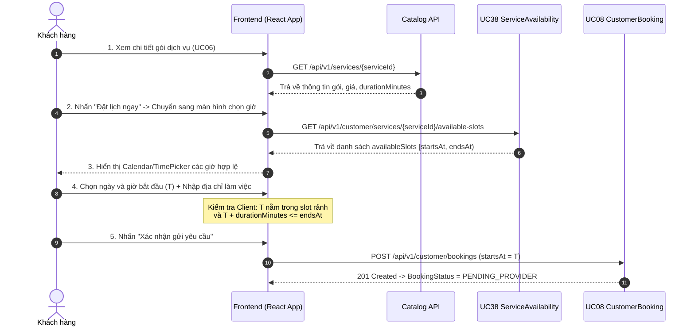

# Nestify — API Documentation (Handoff Frontend)
**Module:** Danh mục dịch vụ & Đặt lịch (Catalog & Booking)  
**Use Case:** UC 38 — Xem lịch rảnh và giá của Nhà Cung Cấp  
**Phiên bản:** 1.0.0  
**Ngày cập nhật:** 08/11/2026  
**Người phụ trách backend:** Nguyễn Đình Thủy  

---

## 1. Tổng quan

Tài liệu này đặc tả chi tiết endpoint API cho chức năng **Xem lịch rảnh và giá của dịch vụ (UC 38)**. API này phục vụ trực tiếp cho màn hình chọn ngày giờ của Khách hàng trước khi gửi yêu cầu đặt lịch (UC 08).

### 1.1. Mục đích nghiệp vụ
- Trả lời câu hỏi của khách hàng: *"Với gói dịch vụ này (thời lượng $X$ phút) của thợ này, những khoảng thời gian nào trong tuần tới tôi có thể đặt lịch?"*
- Tự động áp dụng ràng buộc **Lead-time tối thiểu 60 phút** (MD01) và loại trừ toàn bộ các booking đang chiếm lịch độc quyền của NCC (`CONFIRMED`, `IN_PROGRESS`, `PENDING_DEPOSIT` còn hạn nộp cọc).
- Chỉ trả về các khoảng thời gian rảnh thực tế **đủ dài để thực hiện dịch vụ** ($\ge \text{durationMinutes}$).

### 1.2. Môi trường & Base URL
- **Local Dev:** `http://localhost:8080`
- **Production (dự kiến):** `https://api.nestify.vn`
- **URI Prefix:** `/api/v1/customer/services` *(Hỗ trợ dual-path ngắn `/api/customer/services`)*

### 1.3. Định dạng dữ liệu
- **Content-Type:** `application/json;charset=UTF-8`
- **Mã hóa ký tự:** UTF-8
- **Định dạng thời gian:** Chuẩn ISO-8601 UTC (`YYYY-MM-DDTHH:mm:ssZ`)
- **Đơn vị tiền tệ:** Số nguyên đồng VND (`Long` / `number`), không có số thập phân.
- **Quy ước khoảng thời gian (Interval Convention):** Nửa mở bên phải $[startsAt, endsAt)$.
  - Giờ bắt đầu tính cả biên (`startsAt <= t`), giờ kết thúc không tính biên (`t < endsAt`).
  - Khách có thể chọn thời điểm bắt đầu $T$ bất kỳ sao cho:
    $$startsAt \le T \le endsAt - durationMinutes$$

---

## 2. Xác thực & Phân quyền (Authentication & Security)

- **Cơ chế:** JWT Access Token gửi qua Authorization Header:
  ```http
  Authorization: Bearer <accessToken>
  ```
- **Vai trò bắt buộc:** **`ROLE_CUSTOMER`** (theo ràng buộc C01: Khách hàng phải đăng nhập mới xem được dịch vụ và đặt lịch).
- **Hành vi khi thiếu/sai quyền:**
  - Chưa đăng nhập hoặc token hết hạn: `401 Unauthorized` (`AUTHENTICATION_REQUIRED`).
  - Đăng nhập với tài khoản PROVIDER hoặc ADMIN: `403 Forbidden` (`ACCESS_DENIED`).

---

## 3. Quy ước chung

### 3.1. Cấu trúc Response thành công chuẩn
Mọi kết quả thành công đều được bao bọc trong đối tượng `StandardResponse<T>`:
```json
{
  "success": true,
  "message": "Lấy danh sách lịch rảnh thành công",
  "data": { ... },
  "timestamp": "2026-11-08T03:00:00.000000Z"
}
```

### 3.2. Cấu trúc Response lỗi chuẩn
Khi có lỗi, hệ thống trả về mã lỗi `ApiError`:
```json
{
  "code": "BUSINESS_ERROR",
  "message": "Dịch vụ hiện không khả dụng để đặt lịch",
  "fieldErrors": {}
}
```

### 3.3. Bảng mã lỗi chung
| HTTP Status | Error Code | Ý nghĩa | Hành vi FE nên xử lý |
| :--- | :--- | :--- | :--- |
| **400 Bad Request** | `BUSINESS_ERROR` | Vi phạm quy tắc nghiệp vụ (`from >= to`, khoảng tra cứu > 28 ngày, dịch vụ chưa PUBLISHED, NCC bị ẩn/khóa, danh mục tạm khóa) | Hiển thị Toast/Alert thông báo `message` cho khách. |
| **401 Unauthorized** | `AUTHENTICATION_REQUIRED` | Chưa đăng nhập hoặc Access Token hết hạn | Gọi refresh token hoặc chuyển hướng về trang `/login` kèm callback URL. |
| **403 Forbidden** | `ACCESS_DENIED` | Tài khoản không có vai trò `CUSTOMER` | Chặn truy cập và thông báo tài khoản thợ/admin không được đặt dịch vụ này. |
| **404 Not Found** | `NOT_FOUND` | Không tìm thấy dịch vụ theo `serviceId` | Hiển thị trang 404 hoặc thông báo dịch vụ không tồn tại và quay về danh sách. |

---

## 4. Danh Sách API Chi Tiết

| Method | Endpoint | Mô tả | Quyền truy cập |
| :--- | :--- | :--- | :--- |
| `GET` | `/api/v1/customer/services/{serviceId}/available-slots` | Lấy danh sách khoảng rảnh khả dụng của một dịch vụ | `ROLE_CUSTOMER` |

---

### 4.1. Lấy danh sách lịch rảnh của dịch vụ `GET /api/v1/customer/services/{serviceId}/available-slots`

**Mô tả:** Lấy thông tin tóm tắt dịch vụ, NCC và danh sách các khoảng thời gian rảnh hợp lệ mà khách hàng có thể chọn để đặt lịch.  
**Auth:** Bearer Token — vai trò: `ROLE_CUSTOMER`.  
**Nguồn Backend:** [`CustomerServiceAvailabilityController.java`](file:///d:/20261/congngheweb/home-service/backend/src/main/java/com/homeservice/catalog/controller/CustomerServiceAvailabilityController.java) $\rightarrow$ `getAvailableSlots()`.

#### Path Parameters
| Tên tham số | Kiểu dữ liệu | Bắt buộc | Mô tả |
| :--- | :--- | :--- | :--- |
| `serviceId` | `Long` | ✅ Bắt buộc | ID của dịch vụ cần tra cứu (ví dụ: `2`). |

#### Query Parameters
| Tên tham số | Kiểu dữ liệu | Bắt buộc | Giá trị mặc định | Mô tả |
| :--- | :--- | :--- | :--- | :--- |
| `from` | `String` (ISO-8601) | ⚪ Tùy chọn | `now + 60 phút` | Thời điểm bắt đầu tra cứu. Nếu không truyền, hệ thống tự động gán là `now + 60 phút` (theo lead-time tối thiểu MD01). |
| `to` | `String` (ISO-8601) | ⚪ Tùy chọn | `now + 7 ngày` | Thời điểm kết thúc tra cứu. Nếu không truyền, mặc định là 1 tuần kể từ hiện tại. Tối đa không quá 28 ngày tính từ `from`. |

#### Headers
| Header | Bắt buộc | Giá trị |
| :--- | :--- | :--- |
| `Authorization` | ✅ Bắt buộc | `Bearer <access_token>` |
| `Accept` | ⚪ Khuyến nghị | `application/json` |

#### Request Body
*Không có (GET method).*

---

#### Response thành công — `200 OK`
| Tên trường | Kiểu dữ liệu | Nullable | Mô tả |
| :--- | :--- | :--- | :--- |
| `serviceId` | `Long` | Không | ID của dịch vụ. |
| `serviceTitle` | `String` | Không | Tiêu đề / Tên gói dịch vụ. |
| `durationMinutes` | `Integer` | Không | Thời lượng thực hiện dịch vụ (tính bằng phút). **Quan trọng:** Dùng để validate giờ kết thúc khi khách chọn giờ bắt đầu. |
| `basePriceVnd` | `Long` | Không | Đơn giá gốc của dịch vụ (VND). |
| `provider` | `Object` | Không | Thông tin tóm tắt NCC (bảo mật, không tiết lộ tài khoản ngân hàng). |
| `provider.providerId` | `Long` | Không | ID tài khoản của Nhà cung cấp. |
| `provider.businessName` | `String` | Không | Tên hiển thị / tên cơ sở kinh doanh của NCC. |
| `provider.city` | `String` | Không | Thành phố hoạt động của NCC (ví dụ: `Hà Nội`). |
| `provider.logoUrl` | `String` | Có | URL ảnh đại diện / logo của NCC (hoặc `null` nếu chưa có). |
| `availableSlots` | `Array<AvailableSlotRange>` | Không | Danh sách các khoảng lịch rảnh khả dụng, đã sắp xếp tăng dần theo `startsAt`. Nếu không có lịch nào phù hợp, trả về mảng rỗng `[]`. |
| `availableSlots[].startsAt` | `String` (ISO-8601) | Không | Mốc thời gian bắt đầu khả dụng sớm nhất của khoảng rảnh. |
| `availableSlots[].endsAt` | `String` (ISO-8601) | Không | Mốc thời gian kết thúc của khoảng rảnh (theo quy ước $[startsAt, endsAt)$). |

##### Ví dụ Response thành công (`200 OK`):
```json
{
  "success": true,
  "message": "Lấy danh sách lịch rảnh thành công",
  "data": {
    "serviceId": 2,
    "serviceTitle": "Nạp bổ sung gas điều hòa R32 / R410A",
    "durationMinutes": 45,
    "basePriceVnd": 450000,
    "provider": {
      "providerId": 2,
      "businessName": "Trung Tâm Điện Lạnh Bách Khoa",
      "city": "Hà Nội",
      "logoUrl": "https://cdn.nestify.vn/logos/bachkhoa.png"
    },
    "availableSlots": [
      {
        "startsAt": "2026-11-09T01:00:00Z",
        "endsAt": "2026-11-09T05:00:00Z"
      },
      {
        "startsAt": "2026-11-09T06:30:00Z",
        "endsAt": "2026-11-09T11:00:00Z"
      },
      {
        "startsAt": "2026-11-10T01:30:00Z",
        "endsAt": "2026-11-10T10:30:00Z"
      }
    ]
  },
  "timestamp": "2026-11-08T03:00:00.000000Z"
}
```

---

#### Response lỗi thường gặp
| HTTP Status | Error Code | Khi nào xảy ra | FE nên làm gì |
| :--- | :--- | :--- | :--- |
| **401 Unauthorized** | `AUTHENTICATION_REQUIRED` | Không gửi header Authorization hoặc token hết hạn | Lưu URL hiện tại vào redirect query param, gọi refresh hoặc chuyển về `/login`. |
| **403 Forbidden** | `ACCESS_DENIED` | Token là tài khoản thợ (`ROLE_PROVIDER`) hoặc admin (`ROLE_ADMIN`) | Hiển thị cảnh báo: *"Chỉ tài khoản khách hàng mới có thể xem lịch và đặt dịch vụ này."* |
| **404 Not Found** | `NOT_FOUND` | `serviceId` không tồn tại trong hệ thống | Hiển thị thông báo *"Dịch vụ không tồn tại hoặc đã bị xóa"* và chuyển về trang danh sách dịch vụ. |
| **400 Bad Request** | `BUSINESS_ERROR` | Dịch vụ ở trạng thái `DRAFT` hoặc `ARCHIVED` | Thông báo: *"Dịch vụ hiện không khả dụng để đặt lịch."* |
| **400 Bad Request** | `BUSINESS_ERROR` | Danh mục dịch vụ đang bị vô hiệu hóa (`is_active = false`) | Thông báo: *"Danh mục dịch vụ này đang tạm bảo trì."* |
| **400 Bad Request** | `BUSINESS_ERROR` | Thợ đang bị tạm ẩn (`is_visible = false`) hoặc tài khoản bị khóa | Thông báo: *"Nhà cung cấp hiện đang tạm ngưng nhận dịch vụ."* |
| **400 Bad Request** | `BUSINESS_ERROR` | `from >= to` hoặc khoảng cách lớn hơn 28 ngày | Báo lỗi trên DatePicker: *"Khoảng thời gian tra cứu tối đa là 28 ngày."* |

##### Ví dụ Response lỗi (400 Bad Request):
```json
{
  "code": "BUSINESS_ERROR",
  "message": "Khoảng thời gian tra cứu tối đa là 28 ngày",
  "fieldErrors": {}
}
```

---

#### Luồng xử lý chi tiết phía Backend
1. **Validate tham số:** Kiểm tra `serviceId` khác null. Tự động điền `from = now + 60m` và `to = now + 7 days` nếu không truyền. Kiểm tra `from < to` và `to - from <= 28 ngày`.
2. **Kiểm tra trạng thái nghiệp vụ:**
   - Dịch vụ phải `status == PUBLISHED`.
   - Danh mục cha/con phải `isActive == true`.
   - NCC phải `isVisible == true`, tài khoản NCC `status == ACTIVE`, `mustChangePassword == false`.
3. **Áp dụng Lead-time (MD01):** Tính `earliestAllowedStart = now + 60 phút`. Nếu `from < earliestAllowedStart`, tự động nâng mốc tìm kiếm `searchFrom = earliestAllowedStart`. Nếu `searchFrom >= to`, trả về `availableSlots: []`.
4. **Truy vấn giao thoa & Thuật toán cắt biên:**
   - Lấy các slot `AVAILABLE` của thợ giao nhau với `[searchFrom, to)`.
   - Lấy các booking đang chiếm lịch giao nhau với `[searchFrom, to)` (`CONFIRMED`, `IN_PROGRESS`, `PENDING_DEPOSIT` còn hạn cọc).
   - Thu gọn (clamp) các biên tràn ra ngoài `[searchFrom, to]`.
   - Lấy slot rảnh trừ đi các khoảng booking.
5. **Lọc theo thời lượng dịch vụ:** Loại bỏ các khoảng rảnh con có độ dài $< \text{durationMinutes}$.
6. **Đóng gói trả về:** Đính kèm tóm tắt dịch vụ, giá tiền, thông tin thợ và danh sách khoảng rảnh đã sắp xếp.

---

#### Ví dụ cURL

##### 1. Gọi mặc định (Hệ thống tự lấy 1 tuần tới):
```bash
curl --location 'http://localhost:8080/api/v1/customer/services/2/available-slots' \
--header 'Authorization: Bearer <customer_access_token>' \
--header 'Accept: application/json'
```

##### 2. Gọi tùy chỉnh khoảng thời gian:
```bash
curl --location 'http://localhost:8080/api/v1/customer/services/2/available-slots?from=2026-11-10T00:00:00Z&to=2026-11-17T23:59:59Z' \
--header 'Authorization: Bearer <customer_access_token>' \
--header 'Accept: application/json'
```

---

## 5. Luồng Nghiệp Vụ Liên API (User Journey)

Dưới đây là vị trí của **UC 38** trong toàn bộ hành trình đặt dịch vụ từ phía Khách hàng:



---

## 6. Data Models & TypeScript Interfaces

Frontend có thể copy các interface TypeScript dưới đây vào thư mục `src/types/` hoặc `src/api/catalog.ts` để sử dụng trực tiếp:

```typescript
/**
 * Đại diện cho một khoảng thời gian khả dụng để khách đặt lịch.
 * Quy ước: [startsAt, endsAt) — Giờ kết thúc không tính biên.
 */
export interface AvailableSlotRange {
  /** Thời điểm bắt đầu sớm nhất của khoảng rảnh (ISO-8601 UTC) */
  startsAt: string;
  /** Thời điểm kết thúc của khoảng rảnh (ISO-8601 UTC) */
  endsAt: string;
}

/**
 * Thông tin tóm tắt về Nhà Cung Cấp hiển thị trong trang đặt lịch.
 */
export interface ProviderSummary {
  providerId: number;
  businessName: string;
  city: string;
  logoUrl: string | null;
}

/**
 * Response trả về từ API UC38
 */
export interface ServiceAvailableSlotsResponse {
  serviceId: number;
  serviceTitle: string;
  /** Thời lượng dịch vụ (tính bằng phút) */
  durationMinutes: number;
  /** Giá dịch vụ (VNĐ) */
  basePriceVnd: number;
  provider: ProviderSummary;
  /** Danh sách các khoảng rảnh khả dụng */
  availableSlots: AvailableSlotRange[];
}

/**
 * Wrapper Response chuẩn của Nestify
 */
export interface StandardResponse<T> {
  success: boolean;
  message: string;
  data: T;
  timestamp: string;
}
```

---

## 7. Hướng Dẫn Tích Hợp Cho Frontend (Frontend UI/UX Guidelines)

### 7.1. Cách phân chia và render các mốc giờ (Time Slot Chips)
API trả về **khoảng thời gian liên tục** $[startsAt, endsAt)$ thay vì từng mốc nhỏ 15–30 phút để tránh payload quá nặng. Frontend nên tự sinh ra các mốc giờ bấm chọn (Slot Chips) theo công thức sau:

```typescript
/**
 * Hàm sinh danh sách các mốc giờ bắt đầu khả dụng từ availableSlots
 * @param availableSlots Danh sách khoảng rảnh từ API
 * @param durationMinutes Thời lượng dịch vụ (phút)
 * @param stepMinutes Bước nhảy hiển thị (khuyến nghị 30 phút)
 */
export function generateSelectableStartTimes(
  availableSlots: AvailableSlotRange[],
  durationMinutes: number,
  stepMinutes: number = 30
): Date[] {
  const selectableTimes: Date[] = [];

  for (const slot of availableSlots) {
    const slotStart = new Date(slot.startsAt);
    const slotEnd = new Date(slot.endsAt);

    let current = new Date(slotStart);

    // Thời điểm bắt đầu T phải thỏa mãn: T + durationMinutes <= slotEnd
    while (current.getTime() + durationMinutes * 60 * 1000 <= slotEnd.getTime()) {
      selectableTimes.push(new Date(current));
      // Tăng thêm bước nhảy (ví dụ mỗi 30 phút một mốc)
      current = new Date(current.getTime() + stepMinutes * 60 * 1000);
    }
  }

  return selectableTimes;
}
```

### 7.2. Xử lý múi giờ (Timezone & UTC)
- **Backend lưu trữ và trả về toàn bộ theo chuẩn UTC ISO-8601** (kết thúc bằng chữ `Z`, ví dụ `2026-11-09T01:00:00Z`).
- Giờ Việt Nam là **UTC+7** (tức `01:00:00Z` là `08:00:00` sáng giờ Hà Nội).
- Khi hiển thị lên giao diện cho người dùng, Frontend dùng `date-fns`, `dayjs` hoặc `Intl.DateTimeFormat` với timezone local của trình duyệt để hiển thị đúng giờ Việt Nam.

### 7.3. Khi mảng `availableSlots` trả về rỗng `[]`
Khi `availableSlots` là mảng rỗng `[]`:
- Hiển thị thông báo trạng thái trống (Empty State) thân thiện:
  > *"Rất tiếc, thợ hiện đã kín lịch trong tuần này. Vui lòng chọn tuần tiếp theo hoặc tham khảo các thợ khác cùng danh mục."*
- Cung cấp nút chuyển nhanh: *"Xem tuần kế tiếp $\rightarrow$"* (FE tăng `from` và `to` thêm 7 ngày rồi gọi lại API).

---

## 8. Điểm cần xác nhận (Notes & Confirmations)

- Không có mâu thuẫn giữa code và tài liệu. Toàn bộ logic đã được xác minh qua 19 Unit Tests (`ServiceAvailabilityServiceTest`) và 7 Auth Tests (`CustomerServiceAvailabilityControllerAuthTest`).

---

## 9. Changelog

| Phiên bản | Ngày | Tác giả | Nội dung thay đổi |
| :--- | :--- | :--- | :--- |
| **1.0.0** | 08/11/2026 | Nguyễn Đình Thủy | Khởi tạo tài liệu API UC38, hỗ trợ giá trị mặc định cho `from` (`now + 60m`) và `to` (`now + 7 days`). |
