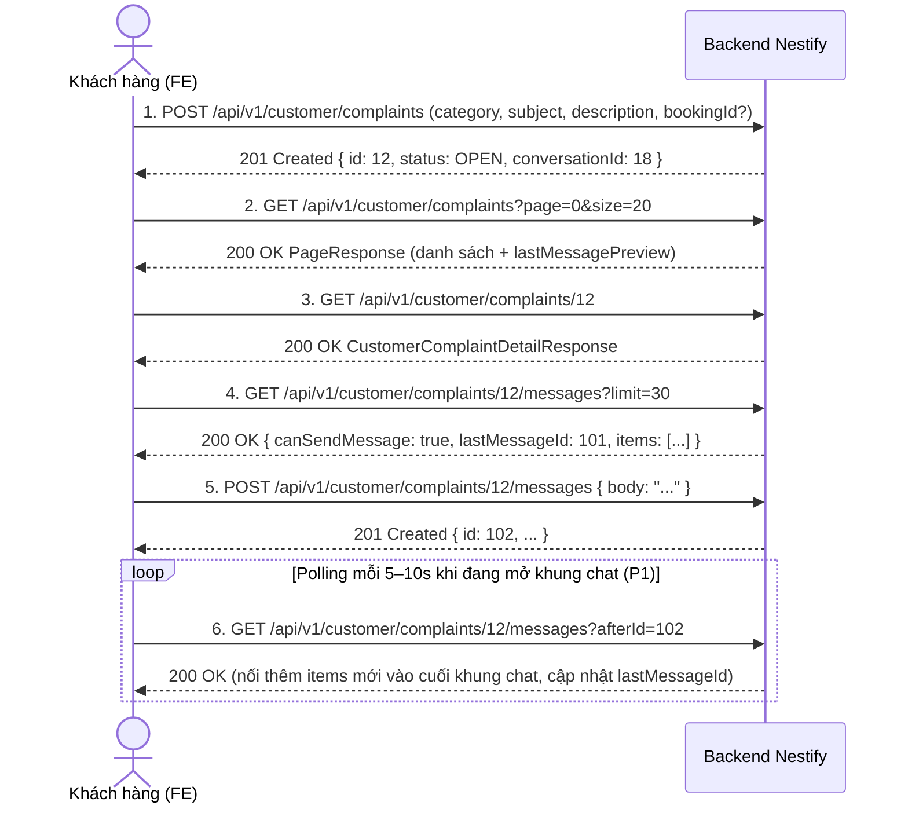

# Nestify — Tài Liệu Tích Hợp API (Handoff Frontend)

**Module:** Hỗ trợ & Khiếu nại — Phía Khách hàng (Support & Complaints)  
**Use Case:** UC39 — Khách hàng gửi, theo dõi yêu cầu hỗ trợ / khiếu nại và trao đổi chat hỗ trợ  
**Phiên bản:** 1.0.0  
**Ngày cập nhật:** 21/11/2026  
**Người phụ trách backend:** Nguyễn Đình Thủy  
**Người nhận bàn giao frontend:** TLam  

---

## Mục lục

1. [Tổng quan](#1-tổng-quan)
2. [Xác thực & phân quyền](#2-xác-thực--phân-quyền)
3. [Quy ước chung](#3-quy-ước-chung)
4. [Danh sách API (UC 39)](#4-danh-sách-api-uc-39)
   - [4.1. Tạo yêu cầu hỗ trợ / khiếu nại mới](#41-tạo-yêu-cầu-hỗ-trợ--khiếu-nại-mới--post-apiv1customercomplaints)
   - [4.2. Danh sách yêu cầu hỗ trợ của khách](#42-danh-sách-yêu-cầu-hỗ-trợ-của-khách--get-apiv1customercomplaints)
   - [4.3. Chi tiết yêu cầu hỗ trợ của khách](#43-chi-tiết-yêu-cầu-hỗ-trợ-của-khách--get-apiv1customercomplaintsid)
   - [4.4. Lấy lịch sử tin nhắn hỗ trợ](#44-lấy-lịch-sử-tin-nhắn-hỗ-trợ--get-apiv1customercomplaintsidmessages)
   - [4.5. Gửi tin nhắn hỗ trợ](#45-gửi-tin-nhắn-hỗ-trợ--post-apiv1customercomplaintsidmessages)
5. [Luồng nghiệp vụ liên API](#5-luồng-nghiệp-vụ-liên-api)
6. [Data models & Enum](#6-data-models--enum)
7. [Lưu ý tích hợp cho Frontend](#7-lưu-ý-tích-hợp-cho-frontend)
8. [Điểm cần xác nhận](#8-điểm-cần-xác-nhận)
9. [Changelog](#9-changelog)

---

## 1. Tổng quan

### 1.1. Mục đích & Phạm vi
Tài liệu đặc tả 5 API phía **Khách hàng** thuộc **UC 39** cho phép khách hàng:
- Tạo yêu cầu hỗ trợ chung (`bookingId = null`) hoặc khiếu nại gắn với một đơn đặt lịch của chính mình (`bookingId != null`) — bao gồm cả trường hợp hủy đúng/sau giờ hẹn (MD05), khiếu nại chất lượng dịch vụ sau `COMPLETED`, hoặc thắc mắc thanh toán/hoàn tiền.
- Theo dõi danh sách và chi tiết các yêu cầu hỗ trợ của bản thân (có lọc theo trạng thái, danh mục, mã đơn và phân trang).
- Đọc lịch sử và trao đổi tin nhắn văn bản nhiều lượt với Admin phụ trách trong cuộc trò chuyện hỗ trợ (`conversations.type = SUPPORT`) đi kèm từng yêu cầu.

> **Lưu ý nghiệp vụ quan trọng:**
> - Khách hàng có đơn nợ thanh toán 70% quá hạn (MD09) **vẫn được phép** gửi yêu cầu hỗ trợ (không bị chặn như khi đặt đơn mới).
> - Khi khách tạo yêu cầu thành công, hệ thống **tự động** khởi tạo 1 cuộc trò chuyện hỗ trợ (`conversationId`) và tạo sẵn tin nhắn đầu tiên có nội dung bằng `description` — FE không cần gọi thêm API tạo phòng chat hay gửi tin nhắn đầu tiên.
> - Đợt P1 cung cấp **REST API** (kèm cursor `beforeId` và polling `afterId`); chưa bật API đánh dấu đã đọc `/read` và WebSocket realtime (sẽ mở rộng ở P2).

### 1.2. Base URL theo môi trường
- **Local Development:** `http://localhost:8080`
- **Swagger UI (dev):** `http://localhost:8080/swagger-ui/index.html`
- **Prefix khuyến nghị:** `/api/v1/customer/complaints` *(backend hỗ trợ thêm alias `/api/customer/complaints`)*

### 1.3. Định dạng dữ liệu
- **Content-Type:** `application/json;charset=UTF-8`
- **Ngày giờ:** ISO-8601 UTC (`YYYY-MM-DDTHH:mm:ssZ`, kiểu `Instant`)
- **Encoding:** UTF-8

---

## 2. Xác thực & phân quyền

- **Cơ chế:** Access JWT gửi qua header `Authorization: Bearer <accessToken>` (lấy từ `POST /api/auth/login`, xem `tai_lieu_api/UC01_02_03_35_AUTH_KHACH_HANG.md`).
- **Role bắt buộc:** `ROLE_CUSTOMER` (`accountType = "CUSTOMER"`). Tài khoản `PROVIDER` hoặc `ADMIN` gọi vào sẽ nhận `403 ACCESS_DENIED`.
- **CSRF:** **Không bắt buộc** khi request gửi kèm header `Authorization: Bearer <accessToken>` (theo `SecurityConfig.java` dòng 115).
- **Chống IDOR tuyệt đối:** Mọi API đều kiểm tra quyền sở hữu `complaint.customer.id == currentCustomerId` (và `booking.customer.id == currentCustomerId` nếu có `bookingId`).
- **Trạng thái tài khoản:** Các API ghi (`POST`) kiểm tra `AccountStatus.ACTIVE` trực tiếp trong DB; tài khoản bị `SUSPENDED` hoặc `PENDING_EMAIL` nhận `400 BUSINESS_ERROR`.

---

## 3. Quy ước chung

### 3.1. Response thành công (`StandardResponse<T>`)
```json
{
  "success": true,
  "message": "Thông báo kết quả thành công",
  "data": { },
  "timestamp": "2026-11-21T10:30:00Z"
}
```

### 3.2. Phân trang danh sách (`PageResponse<T>` nằm trong `data`)
```json
{
  "items": [ ],
  "page": 0,
  "size": 20,
  "totalElements": 3,
  "totalPages": 1
}
```
- `page`: 0-based (`< 0` hoặc `null` $\rightarrow$ mặc định `0`).
- `size`: mặc định `20`, tối đa `50` (truyền `> 50` tự giới hạn về `50`).
- Sắp xếp mặc định cố định: `updatedAt DESC, id DESC` (ticket mới cập nhật hoặc vừa có tin nhắn mới nổi lên đầu).

### 3.3. Response lỗi (`ApiError`)
```json
{
  "code": "VALIDATION_ERROR",
  "message": "Dữ liệu gửi lên không hợp lệ.",
  "fieldErrors": {
    "subject": "Tiêu đề yêu cầu phải từ 5 đến 200 ký tự"
  }
}
```

### 3.4. Bảng mã lỗi chung (từ `GlobalExceptionHandler.java` & `SecurityErrorHandler.java`)
| HTTP Status | Error Code | Khi nào xảy ra | FE nên xử lý thế nào |
| :---: | :--- | :--- | :--- |
| **400** | `VALIDATION_ERROR` | Thiếu field bắt buộc hoặc sai độ dài (`subject`, `description`, `body`) | Hiển thị lỗi trực tiếp dưới input tương ứng theo `fieldErrors` |
| **400** | `BUSINESS_ERROR` | Chuỗi sau `trim()` không đạt độ dài tối thiểu; gửi tin khi yêu cầu đã đóng (`RESOLVED`/`REJECTED`); truyền cả `beforeId` và `afterId`; `bookingId` tin nhắn không khớp đơn của khiếu nại; tài khoản chưa `ACTIVE` | Hiển thị Toast/Alert theo `message` |
| **401** | `AUTHENTICATION_REQUIRED` | Thiếu hoặc hết hạn Bearer JWT | Gọi `POST /api/auth/refresh` tối đa 1 lần hoặc chuyển về trang đăng nhập |
| **403** | `ACCESS_DENIED` | Sai role (`PROVIDER`/`ADMIN`) hoặc truy cập IDOR vào đơn / khiếu nại / hội thoại của khách khác | Thông báo không có quyền truy cập và điều hướng về danh sách hỗ trợ của mình |
| **404** | `NOT_FOUND` | Không tìm thấy `complaintId` hoặc `bookingId` | Hiển thị trạng thái không tìm thấy |
| **409** | `DATA_CONFLICT` | Đã tồn tại 1 yêu cầu hỗ trợ **đang mở (`OPEN` / `IN_REVIEW`)** cùng `category` trên cùng `bookingId` | Thông báo và gợi ý khách mở lại yêu cầu đang xử lý để nhắn bổ sung |

---

## 4. Danh sách API (UC 39)

| Method | Path *(Alias)* | Mô tả | Auth / Role | HTTP |
| :---: | :--- | :--- | :---: | :---: |
| **POST** | `/api/v1/customer/complaints` *(`/api/customer/complaints`)* | Tạo yêu cầu hỗ trợ / khiếu nại mới | Bearer `CUSTOMER` | `201` |
| **GET** | `/api/v1/customer/complaints` *(`/api/customer/complaints`)* | Lấy danh sách yêu cầu hỗ trợ của chính khách | Bearer `CUSTOMER` | `200` |
| **GET** | `/api/v1/customer/complaints/{id}` *(`/api/customer/complaints/{id}`)* | Xem chi tiết 1 yêu cầu hỗ trợ của chính khách | Bearer `CUSTOMER` | `200` |
| **GET** | `/api/v1/customer/complaints/{id}/messages` *(`/api/customer/complaints/{id}/messages`)* | Lấy lịch sử tin nhắn hỗ trợ (cursor `beforeId` / polling `afterId`) | Bearer `CUSTOMER` | `200` |
| **POST** | `/api/v1/customer/complaints/{id}/messages` *(`/api/customer/complaints/{id}/messages`)* | Gửi tin nhắn hỗ trợ mới (`OPEN` / `IN_REVIEW`) | Bearer `CUSTOMER` | `201` |

---

### 4.1. Tạo yêu cầu hỗ trợ / khiếu nại mới `POST /api/v1/customer/complaints`

**Mô tả:** Khách hàng tạo mới 1 yêu cầu hỗ trợ chung hoặc khiếu nại gắn đơn đặt lịch của chính mình; hệ thống đồng thời tạo phòng chat hỗ trợ (`SUPPORT`) và tin nhắn đầu tiên.  
**Auth:** Bearer token — Role: `CUSTOMER` (`ACTIVE`).  
**Nguồn:** `backend/src/main/java/com/homeservice/support/controller/CustomerComplaintController.java` $\rightarrow$ `createComplaint()`  
**Service:** `ComplaintService.java` $\rightarrow$ `createComplaintByCustomer()`.

#### Request Body (`CreateComplaintRequest`, `application/json`)
| Field | Kiểu | Bắt buộc | Ràng buộc | Mô tả |
| :--- | :--- | :---: | :--- | :--- |
| `category` | `ComplaintCategory` | **Có** | `@NotNull`; `PAYMENT`, `SERVICE`, `OTHER` | Phân loại vấn đề |
| `bookingId` | `Long` | Không | Nếu có: phải là ID đơn của chính khách hàng | ID đơn liên quan (`null` = hỗ trợ chung) |
| `subject` | `String` | **Có** | `@NotBlank`, `5..200` ký tự (tính sau `trim()`) | Tiêu đề ngắn gọn của vấn đề |
| `description` | `String` | **Có** | `@NotBlank`, `10..2000` ký tự (tính sau `trim()`) | Mô tả chi tiết ban đầu (đồng thời lưu thành tin nhắn đầu tiên) |

**Ví dụ Request:**
```json
{
  "category": "SERVICE",
  "bookingId": 5,
  "subject": "Điều hòa vẫn chảy nước sau khi vệ sinh",
  "description": "Sau khi thợ hoàn thành vệ sinh lúc 13h, đến 15h điều hòa bị nhỏ nước liên tục xuống tường. Nhờ Nestify hỗ trợ kiểm tra bảo hành."
}
```

#### Response thành công — `201 Created` (`StandardResponse<CustomerComplaintDetailResponse>`)
| Field | Kiểu | Nullable | Mô tả |
| :--- | :--- | :---: | :--- |
| `id` | `Long` | Không | ID yêu cầu hỗ trợ vừa tạo |
| `category` | `ComplaintCategory` | Không | Danh mục hỗ trợ (`PAYMENT`, `SERVICE`, `OTHER`) |
| `subject` | `String` | Không | Tiêu đề đã chuẩn hóa (`trim()`) |
| `description` | `String` | Không | Nội dung mô tả ban đầu |
| `status` | `ComplaintStatus` | Không | Luôn khởi tạo là `OPEN` |
| `resolution` | `String` | Có | Kết luận cuối của Admin (`null` khi mới tạo) |
| `resolvedAt` | `Instant` | Có | Thời điểm đóng yêu cầu (`null` khi mới tạo) |
| `booking` | `BookingSummary` | Có | `null` nếu hỗ trợ chung; nếu gắn đơn gồm: `id`, `bookingCode`, `serviceTitleSnapshot`, `status` |
| `assignedAdminName` | `String` | Có | Tên hiển thị Admin đang phụ trách (`null` khi đang `OPEN`) |
| `conversationId` | `Long` | Có | ID cuộc trò chuyện hỗ trợ (`SUPPORT`) đi kèm |
| `lastMessageAt` | `Instant` | Có | Thời điểm tin nhắn gần nhất |
| `createdAt`, `updatedAt` | `Instant` | Không | Thời điểm tạo và cập nhật gần nhất |

**Ví dụ Response:**
```json
{
  "success": true,
  "message": "Gửi yêu cầu hỗ trợ thành công",
  "data": {
    "id": 12,
    "category": "SERVICE",
    "subject": "Điều hòa vẫn chảy nước sau khi vệ sinh",
    "description": "Sau khi thợ hoàn thành vệ sinh lúc 13h, đến 15h điều hòa bị nhỏ nước liên tục xuống tường. Nhờ Nestify hỗ trợ kiểm tra bảo hành.",
    "status": "OPEN",
    "resolution": null,
    "resolvedAt": null,
    "booking": {
      "id": 5,
      "bookingCode": "BK-202611-005",
      "serviceTitleSnapshot": "Dọn dẹp nhà cửa theo giờ (Gói tiêu chuẩn 3 giờ)",
      "status": "COMPLETED"
    },
    "assignedAdminName": null,
    "conversationId": 18,
    "lastMessageAt": "2026-11-21T10:30:00Z",
    "createdAt": "2026-11-21T10:30:00Z",
    "updatedAt": "2026-11-21T10:30:00Z"
  },
  "timestamp": "2026-11-21T10:30:00.120Z"
}
```

#### Response lỗi
| HTTP | Error code | Khi nào xảy ra | FE nên làm gì |
| :---: | :--- | :--- | :--- |
| `400` | `VALIDATION_ERROR` | Thiếu `category` hoặc `subject`/`description` sai độ dài | Highlight lỗi từng trường trên form |
| `400` | `BUSINESS_ERROR` | Chuỗi sau `trim()` quá ngắn hoặc tài khoản khách chưa `ACTIVE` | Hiển thị thông báo lỗi |
| `401` | `AUTHENTICATION_REQUIRED` | Chưa đăng nhập / token hết hạn | Refresh token hoặc đăng nhập lại |
| `403` | `ACCESS_DENIED` | Sai role hoặc `bookingId` thuộc khách hàng khác | Thông báo không có quyền |
| `404` | `NOT_FOUND` | Không tìm thấy `bookingId` | Kiểm tra lại đơn đã chọn |
| `409` | `DATA_CONFLICT` | Đã có khiếu nại `OPEN`/`IN_REVIEW` cùng `category` trên cùng `bookingId` | Gợi ý khách mở lại yêu cầu đang mở để nhắn tin bổ sung |

#### Luồng xử lý
1. Validate `category`, `subject` (5..200 sau `trim()`), `description` (10..2000 sau `trim()`).
2. Xác minh tài khoản khách đang `ACTIVE` (cho phép cả khách đang nợ 70% quá hạn theo MD09).
3. Nếu `bookingId != null`: khóa bi quan đơn, kiểm tra quyền sở hữu IDOR và kiểm tra chưa có khiếu nại `OPEN`/`IN_REVIEW` cùng `category` trên đơn đó.
4. Trong cùng 1 transaction: lưu `Complaint (OPEN)` $\rightarrow$ lưu `Conversation (type = SUPPORT, complaint_id)` $\rightarrow$ lưu `Message` đầu tiên (`body = description`).
5. Không tự động thay đổi `bookings.settlement_status`.

#### Ví dụ cURL
```bash
curl -X POST "http://localhost:8080/api/v1/customer/complaints" \
  -H "Authorization: Bearer <customer_access_token>" \
  -H "Content-Type: application/json" \
  -d '{
    "category": "SERVICE",
    "bookingId": 5,
    "subject": "Điều hòa vẫn chảy nước sau khi vệ sinh",
    "description": "Sau khi thợ hoàn thành vệ sinh lúc 13h, đến 15h điều hòa bị nhỏ nước liên tục xuống tường."
  }'
```

---

### 4.2. Danh sách yêu cầu hỗ trợ của khách `GET /api/v1/customer/complaints`

**Mô tả:** Lấy danh sách các yêu cầu hỗ trợ / khiếu nại thuộc chính khách hàng đang đăng nhập, hỗ trợ lọc động và phân trang.  
**Auth:** Bearer token — Role: `CUSTOMER`.  
**Nguồn:** `backend/src/main/java/com/homeservice/support/controller/CustomerComplaintController.java` $\rightarrow$ `getMyComplaints()`  
**Service:** `ComplaintService.java` $\rightarrow$ `getCustomerComplaints()`.

#### Query Parameters (`CustomerComplaintFilter`)
| Tên | Kiểu | Bắt buộc | Mặc định | Mô tả |
| :--- | :--- | :---: | :---: | :--- |
| `status` | `ComplaintStatus` | Không | `null` | Lọc theo trạng thái (`OPEN`, `IN_REVIEW`, `RESOLVED`, `REJECTED`) |
| `category` | `ComplaintCategory` | Không | `null` | Lọc theo danh mục (`PAYMENT`, `SERVICE`, `OTHER`) |
| `bookingId` | `Long` | Không | `null` | Lọc các yêu cầu gắn với 1 đơn cụ thể |
| `page` | `Integer` | Không | `0` | Chỉ số trang 0-based |
| `size` | `Integer` | Không | `20` | Kích thước trang (`1..50`) |

#### Response thành công — `200 OK` (`StandardResponse<PageResponse<CustomerComplaintSummaryResponse>>`)
Mỗi phần tử trong `data.items`:

| Field | Kiểu | Nullable | Mô tả |
| :--- | :--- | :---: | :--- |
| `id` | `Long` | Không | ID yêu cầu hỗ trợ |
| `category` | `ComplaintCategory` | Không | Danh mục |
| `subject` | `String` | Không | Tiêu đề |
| `status` | `ComplaintStatus` | Không | Trạng thái hiện tại |
| `bookingId` | `Long` | Có | ID đơn liên quan (`null` nếu hỗ trợ chung) |
| `bookingCode` | `String` | Có | Mã hiển thị đơn (`null` nếu hỗ trợ chung) |
| `assignedAdminName` | `String` | Có | Tên Admin phụ trách (`null` nếu chưa phân công) |
| `conversationId` | `Long` | Có | ID cuộc trò chuyện hỗ trợ |
| `lastMessagePreview` | `String` | Có | Đoạn trích tin nhắn mới nhất trong cuộc trò chuyện (cắt gọn tối đa 120 ký tự) |
| `lastMessageAt` | `Instant` | Có | Thời điểm tin nhắn mới nhất |
| `createdAt`, `updatedAt` | `Instant` | Không | Mốc thời gian tạo & cập nhật gần nhất |

**Ví dụ Response:**
```json
{
  "success": true,
  "message": "Lấy danh sách yêu cầu hỗ trợ thành công",
  "data": {
    "items": [
      {
        "id": 12,
        "category": "SERVICE",
        "subject": "Điều hòa vẫn chảy nước sau khi vệ sinh",
        "status": "IN_REVIEW",
        "bookingId": 5,
        "bookingCode": "BK-202611-005",
        "assignedAdminName": "Quản Trị Viên Nestify",
        "conversationId": 18,
        "lastMessagePreview": "Chào bạn, Nestify đã tiếp nhận hồ sơ và đang liên hệ thợ bảo hành.",
        "lastMessageAt": "2026-11-21T10:36:12Z",
        "createdAt": "2026-11-21T10:30:00Z",
        "updatedAt": "2026-11-21T10:36:12Z"
      }
    ],
    "page": 0,
    "size": 20,
    "totalElements": 1,
    "totalPages": 1
  },
  "timestamp": "2026-11-21T10:40:00Z"
}
```

#### Response lỗi
| HTTP | Error code | Khi nào xảy ra | FE nên làm gì |
| :---: | :--- | :--- | :--- |
| `400` | `BAD_REQUEST` | Truyền sai giá trị enum `status` / `category` | Kiểm tra lại tham số lọc |
| `401` | `AUTHENTICATION_REQUIRED` | Thiếu hoặc hết hạn token | Refresh token / đăng nhập lại |
| `403` | `ACCESS_DENIED` | Sai role | Chặn truy cập |

#### Luồng xử lý
1. Ép cứng điều kiện lọc `customer.id == currentCustomerId` (cô lập hoàn toàn dữ liệu giữa các khách hàng).
2. Lọc theo `status`, `category`, `bookingId`, sắp xếp theo `updatedAt DESC, id DESC`.
3. Nạp batch `conversations` và tin nhắn mới nhất của từng cuộc trò chuyện để điền `lastMessagePreview` & `lastMessageAt`.

#### Ví dụ cURL
```bash
curl -X GET "http://localhost:8080/api/v1/customer/complaints?status=OPEN&category=SERVICE&page=0&size=20" \
  -H "Authorization: Bearer <customer_access_token>"
```

---

### 4.3. Chi tiết yêu cầu hỗ trợ của khách `GET /api/v1/customer/complaints/{id}`

**Mô tả:** Xem thông tin chi tiết 1 yêu cầu hỗ trợ / khiếu nại của chính khách hàng (gồm kết luận `resolution` khi đã đóng, đơn liên quan và `conversationId`).  
**Auth:** Bearer token — Role: `CUSTOMER` (chính chủ).  
**Nguồn:** `backend/src/main/java/com/homeservice/support/controller/CustomerComplaintController.java` $\rightarrow$ `getMyComplaintDetail()`  
**Service:** `ComplaintService.java` $\rightarrow$ `getCustomerComplaintDetail()`.

#### Path Parameters
| Tên | Kiểu | Bắt buộc | Mô tả |
| :--- | :--- | :---: | :--- |
| `id` | `Long` | **Có** | ID yêu cầu hỗ trợ |

#### Response thành công — `200 OK`
Cấu trúc giống mục 4.1 (`StandardResponse<CustomerComplaintDetailResponse>`).

#### Response lỗi
| HTTP | Error code | Khi nào xảy ra | FE nên làm gì |
| :---: | :--- | :--- | :--- |
| `401` | `AUTHENTICATION_REQUIRED` | Thiếu hoặc hết hạn token | Refresh token / đăng nhập lại |
| `403` | `ACCESS_DENIED` | Yêu cầu hỗ trợ thuộc khách hàng khác (IDOR) hoặc sai role | Thông báo không có quyền xem |
| `404` | `NOT_FOUND` | Không tìm thấy yêu cầu theo `id` | Điều hướng về danh sách hỗ trợ |

#### Luồng xử lý
1. Truy vấn chi tiết khiếu nại (`findByIdWithDetails`).
2. Kiểm tra quyền sở hữu `complaint.customer.id == currentCustomerId`.
3. Lấy `Conversation` tương ứng theo `complaintId` và map sang `CustomerComplaintDetailResponse`.

#### Ví dụ cURL
```bash
curl -X GET "http://localhost:8080/api/v1/customer/complaints/12" \
  -H "Authorization: Bearer <customer_access_token>"
```

---

### 4.4. Lấy lịch sử tin nhắn hỗ trợ `GET /api/v1/customer/complaints/{id}/messages`

**Mô tả:** Lấy danh sách tin nhắn trao đổi giữa Khách hàng và Admin trong cuộc trò chuyện hỗ trợ gắn với khiếu nại, hỗ trợ phân trang ngược theo cursor `beforeId` (kéo lên xem tin cũ) và polling tiến lên theo `afterId` (lấy tin mới).  
**Auth:** Bearer token — Role: `CUSTOMER` (chính chủ).  
**Nguồn:** `backend/src/main/java/com/homeservice/support/controller/CustomerComplaintController.java` $\rightarrow$ `getMyComplaintMessages()`  
**Service:** `SupportChatService.java` $\rightarrow$ `getCustomerMessages()`.

#### Path Parameters
| Tên | Kiểu | Bắt buộc | Mô tả |
| :--- | :--- | :---: | :--- |
| `id` | `Long` | **Có** | ID yêu cầu hỗ trợ |

#### Query Parameters
| Tên | Kiểu | Bắt buộc | Mặc định | Mô tả |
| :--- | :--- | :---: | :---: | :--- |
| `beforeId` | `Long` | Không | `null` | Tải các tin nhắn cũ hơn (`id < beforeId`). Dùng giá trị `nextBeforeId` từ lần gọi trước. |
| `afterId` | `Long` | Không | `null` | Polling lấy các tin nhắn mới hơn (`id > afterId`). Dùng giá trị `lastMessageId` từ lần gọi trước. **Không truyền đồng thời với `beforeId`.** |
| `limit` | `Integer` | Không | `30` | Số tin nhắn tối đa mỗi trang (`1..100`) |

#### Response thành công — `200 OK` (`StandardResponse<MessagePageResponse>`)
| Field | Kiểu | Nullable | Mô tả |
| :--- | :--- | :---: | :--- |
| `conversationId` | `Long` | Không | ID cuộc trò chuyện hỗ trợ |
| `complaintId` | `Long` | Không | ID yêu cầu hỗ trợ |
| `canSendMessage` | `Boolean` | Không | `true` khi yêu cầu đang `OPEN`/`IN_REVIEW`; `false` khi đã `RESOLVED`/`REJECTED` (FE dùng để ẩn/khóa ô nhập chat) |
| `hasMore` | `Boolean` | Không | Còn tin nhắn cũ hơn (ở chế độ mặc định/`beforeId`) hoặc còn tin mới hơn (ở chế độ `afterId`) hay không |
| `nextBeforeId` | `Long` | Có | Cursor để gọi tiếp `?beforeId=...` khi `hasMore = true` (`null` nếu đã hết tin cũ hoặc đang dùng `afterId`) |
| `lastMessageId` | `Long` | Có | ID tin nhắn lớn nhất hiện có để FE dùng gọi polling `?afterId=...` |
| `items` | `List<MessageResponse>` | Không | Danh sách tin nhắn **luôn sắp xếp tăng dần theo `id` (`ASC`)**: `id`, `conversationId`, `senderId`, `senderType` (`CUSTOMER`/`ADMIN`), `senderDisplayName`, `bookingId`, `body`, `readAt`, `createdAt` |

**Ví dụ Response:**
```json
{
  "success": true,
  "message": "Lấy lịch sử tin nhắn hỗ trợ thành công",
  "data": {
    "conversationId": 18,
    "complaintId": 12,
    "canSendMessage": true,
    "hasMore": false,
    "nextBeforeId": null,
    "lastMessageId": 102,
    "items": [
      {
        "id": 101,
        "conversationId": 18,
        "senderId": 5,
        "senderType": "CUSTOMER",
        "senderDisplayName": "Trần Thị Mai",
        "bookingId": 5,
        "body": "Sau khi thợ hoàn thành vệ sinh lúc 13h, đến 15h điều hòa bị nhỏ nước liên tục xuống tường.",
        "readAt": null,
        "createdAt": "2026-11-21T10:30:00Z"
      },
      {
        "id": 102,
        "conversationId": 18,
        "senderId": 1,
        "senderType": "ADMIN",
        "senderDisplayName": "Quản Trị Viên Nestify",
        "bookingId": 5,
        "body": "Chào bạn, Nestify đã tiếp nhận hồ sơ và đang liên hệ thợ bảo hành.",
        "readAt": null,
        "createdAt": "2026-11-21T10:36:12Z"
      }
    ]
  },
  "timestamp": "2026-11-21T10:40:00Z"
}
```

#### Response lỗi
| HTTP | Error code | Khi nào xảy ra | FE nên làm gì |
| :---: | :--- | :--- | :--- |
| `400` | `BUSINESS_ERROR` | Truyền đồng thời cả `beforeId` và `afterId` | Chỉ gửi 1 trong 2 tham số mỗi request |
| `401` | `AUTHENTICATION_REQUIRED` | Hết hạn token | Refresh token / đăng nhập lại |
| `403` | `ACCESS_DENIED` | Khiếu nại thuộc khách khác (IDOR) | Chặn truy cập |
| `404` | `NOT_FOUND` | Không tìm thấy khiếu nại hoặc cuộc trò chuyện | Thông báo không tìm thấy |

#### Luồng xử lý
1. Kiểm tra không đồng thời truyền `beforeId` và `afterId`.
2. Tải khiếu nại & kiểm tra IDOR `complaint.customer.id == currentCustomerId`.
3. Truy vấn tối đa `limit + 1` bản ghi theo nhánh (`afterId` $\rightarrow$ `id > afterId ASC`; `beforeId` $\rightarrow$ `id < beforeId DESC` rồi đảo lại `ASC`; mặc định $\rightarrow$ mới nhất `DESC` rồi đảo lại `ASC`).
4. Tính `hasMore`, `nextBeforeId`, `lastMessageId`, `canSendMessage` và trả về.

#### Ví dụ cURL
```bash
# Tải 30 tin nhắn mới nhất
curl -X GET "http://localhost:8080/api/v1/customer/complaints/12/messages?limit=30" \
  -H "Authorization: Bearer <customer_access_token>"

# Kéo lên tải tin cũ hơn
curl -X GET "http://localhost:8080/api/v1/customer/complaints/12/messages?beforeId=101&limit=30" \
  -H "Authorization: Bearer <customer_access_token>"

# Polling tin nhắn mới
curl -X GET "http://localhost:8080/api/v1/customer/complaints/12/messages?afterId=102&limit=30" \
  -H "Authorization: Bearer <customer_access_token>"
```

---

### 4.5. Gửi tin nhắn hỗ trợ `POST /api/v1/customer/complaints/{id}/messages`

**Mô tả:** Khách hàng gửi thêm tin nhắn văn bản trong cuộc trò chuyện hỗ trợ của yêu cầu đang mở (`OPEN` hoặc `IN_REVIEW`).  
**Auth:** Bearer token — Role: `CUSTOMER` (chính chủ, `ACTIVE`).  
**Nguồn:** `backend/src/main/java/com/homeservice/support/controller/CustomerComplaintController.java` $\rightarrow$ `sendMyComplaintMessage()`  
**Service:** `SupportChatService.java` $\rightarrow$ `sendCustomerMessage()`.

#### Path Parameters
| Tên | Kiểu | Bắt buộc | Mô tả |
| :--- | :--- | :---: | :--- |
| `id` | `Long` | **Có** | ID yêu cầu hỗ trợ |

#### Request Body (`SendMessageRequest`, `application/json`)
| Field | Kiểu | Bắt buộc | Ràng buộc | Mô tả |
| :--- | :--- | :---: | :--- | :--- |
| `body` | `String` | **Có** | `@NotBlank`, `1..2000` ký tự sau `trim()` | Nội dung tin nhắn văn bản |
| `bookingId` | `Long` | Không | Nếu không gửi: tự kế thừa đơn của khiếu nại. Nếu gửi: phải khớp `complaint.booking.id` (với khiếu nại gắn đơn) hoặc thuộc chính khách (với hỗ trợ chung) | ID đơn đính kèm ngữ cảnh tin nhắn |

**Ví dụ Request:**
```json
{
  "body": "Cảm ơn Admin, tôi có mặt ở nhà từ 18h hôm nay để thợ qua kiểm tra bảo hành."
}
```

#### Response thành công — `201 Created` (`StandardResponse<MessageResponse>`)
```json
{
  "success": true,
  "message": "Gửi tin nhắn hỗ trợ thành công",
  "data": {
    "id": 103,
    "conversationId": 18,
    "senderId": 5,
    "senderType": "CUSTOMER",
    "senderDisplayName": "Trần Thị Mai",
    "bookingId": 5,
    "body": "Cảm ơn Admin, tôi có mặt ở nhà từ 18h hôm nay để thợ qua kiểm tra bảo hành.",
    "readAt": null,
    "createdAt": "2026-11-21T10:42:15Z"
  },
  "timestamp": "2026-11-21T10:42:15.050Z"
}
```

#### Response lỗi
| HTTP | Error code | Khi nào xảy ra | FE nên làm gì |
| :---: | :--- | :--- | :--- |
| `400` | `VALIDATION_ERROR` | `body` rỗng hoặc `> 2000` ký tự | Không cho gửi tin rỗng / báo vượt quá ký tự |
| `400` | `BUSINESS_ERROR` | Khiếu nại đã đóng (`RESOLVED`/`REJECTED`); `bookingId` không khớp đơn của khiếu nại; tài khoản chưa `ACTIVE` | Thông báo và tải lại chi tiết khiếu nại để khóa khung chat |
| `401` | `AUTHENTICATION_REQUIRED` | Hết hạn token | Refresh token / đăng nhập lại |
| `403` | `ACCESS_DENIED` | Khiếu nại (hoặc `bookingId` đính kèm) thuộc khách khác | Báo không có quyền |
| `404` | `NOT_FOUND` | Không tìm thấy khiếu nại, hội thoại hoặc đơn đính kèm | Thông báo không tìm thấy |

#### Luồng xử lý
1. Validate `body` (`trim()`, `1..2000` ký tự) và xác minh khách đang `ACTIVE`.
2. Khóa bi quan dòng `complaints` (`findByIdForUpdate`) để chống race condition nếu Admin vừa đóng khiếu nại cùng lúc.
3. Kiểm tra IDOR và kiểm tra `status ∈ {OPEN, IN_REVIEW}`.
4. Xác thực `bookingId` ngữ cảnh (nếu có), lưu `Message`, và cập nhật `conversation.updatedAt = now`, `complaint.updatedAt = now`.

#### Ví dụ cURL
```bash
curl -X POST "http://localhost:8080/api/v1/customer/complaints/12/messages" \
  -H "Authorization: Bearer <customer_access_token>" \
  -H "Content-Type: application/json" \
  -d '{
    "body": "Cảm ơn Admin, tôi có mặt ở nhà từ 18h hôm nay để thợ qua kiểm tra bảo hành."
  }'
```

---

## 5. Luồng nghiệp vụ liên API



---

## 6. Data models & Enum

### `ComplaintCategory`
| Giá trị | Nhãn gợi ý hiển thị UI |
| :--- | :--- |
| `PAYMENT` | Thanh toán & Hoàn tiền |
| `SERVICE` | Chất lượng dịch vụ / Lịch hẹn |
| `OTHER` | Hỗ trợ khác |

### `ComplaintStatus`
| Giá trị | Ý nghĩa | Khách được gửi tin? |
| :--- | :--- | :---: |
| `OPEN` | Đã gửi, đang chờ Quản trị viên tiếp nhận | Có |
| `IN_REVIEW` | Đã có Quản trị viên phụ trách đang xử lý | Có |
| `RESOLVED` | Đã giải quyết (có `resolution` và `resolvedAt`) | Không |
| `REJECTED` | Bị từ chối (có `resolution` và `resolvedAt`) | Không |

### `AccountType` (trong `MessageResponse.senderType`)
- `CUSTOMER`: Tin nhắn của chính Khách hàng (hiển thị bên phải).
- `ADMIN`: Tin nhắn phản hồi từ Quản trị viên hỗ trợ (hiển thị bên trái).

---

## 7. Lưu ý tích hợp cho Frontend

1. **Không gửi trùng tin nhắn đầu tiên:** `POST /api/v1/customer/complaints` đã tự tạo tin nhắn đầu tiên với nội dung `description`. Khi điều hướng sang màn hình chi tiết + khung chat, FE chỉ cần gọi `GET /{id}/messages` là sẽ thấy ngay tin nhắn đầu tiên.
2. **Xử lý trạng thái khung chat theo `canSendMessage`:** Luôn đọc cờ `canSendMessage` trong `GET /{id}/messages` (hoặc `status ∈ {OPEN, IN_REVIEW}`). Khi `canSendMessage === false`, ẩn/khóa ô nhập tin nhắn và hiển thị khung kết luận `resolution` của Admin.
3. **Polling nhẹ ở P1:** Khi khách đang mở màn hình chat của ticket còn mở, dùng `setInterval` (5–10 giây) gọi `GET /{id}/messages?afterId=<lastMessageId>` và dừng polling ngay khi rời trang hoặc khi `canSendMessage === false`. Chú ý khử trùng lặp theo `message.id` nếu khách vừa `POST` gửi tin ngay lúc timer polling chạy.
4. **Kéo lên tải tin cũ (Infinite Scroll Up):** Khi `hasMore === true` và người dùng cuộn lên đầu khung chat, gọi `GET /{id}/messages?beforeId=<nextBeforeId>&limit=30` rồi prepend vào đầu danh sách tin nhắn.
5. **Xử lý `409 DATA_CONFLICT` khi tạo khiếu nại:** Nếu khách bấm tạo khiếu nại cùng danh mục trên 1 đơn đang có ticket mở, hiển thị thông báo rõ ràng kèm nút chuyển sang danh sách lọc theo `bookingId` (`GET /api/v1/customer/complaints?bookingId={bookingId}`) để khách mở đúng ticket đó nhắn bổ sung.

---

## 8. Điểm cần xác nhận

1. **Phạm vi API đánh dấu đã đọc (`read_at`):** Đợt P1 chủ động bỏ API `POST /messages/read` để giữ luồng gọn nhẹ (do đó trường `readAt` trong `MessageResponse` hiện luôn là `null`). Nếu ở giai đoạn sau cần hiển thị badge "Chưa đọc / Đã xem", backend sẽ bổ sung lại endpoint đánh dấu đã đọc mà không làm vỡ schema `MessageResponse` hiện tại.
2. **Đính kèm ảnh / file trong khiếu nại:** Theo `docs/database-design-final.md` Bảng 20, bản đầu `messages` chỉ hỗ trợ tin nhắn văn bản (`TEXT`). Nếu muốn gửi ảnh minh chứng, cần mở rộng thêm bảng/cột đính kèm ở giai đoạn sau.

---

## 9. Changelog

| Phiên bản | Ngày | Nội dung |
| :---: | :---: | :--- |
| `1.0.0` | 21/11/2026 | Phát hành tài liệu API hoàn chỉnh UC 39 (5 endpoints phía Khách hàng: tạo, danh sách, chi tiết, lịch sử tin nhắn cursor/polling, gửi tin nhắn hỗ trợ), đối chiếu 100% theo source code và bộ test tự động. |
