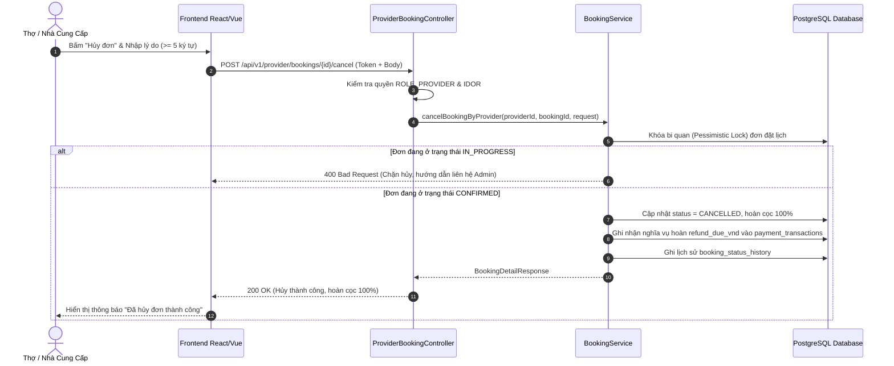

# Nestify — Tài Liệu Tích Hợp API (Handoff Frontend)
**Module:** Quản lý vòng đời đơn đặt dịch vụ (Booking Lifecycle)  
**Use Case:** UC41 — Nhà cung cấp hủy đơn đã nhận (Provider Cancel Accepted Booking)  
**Phiên bản:** 1.0.0  
**Ngày cập nhật:** 14/11/2026  
**Người phụ trách backend:** Nguyễn Đình Thủy  

---

## 1. Tổng Quan

Tài liệu này đặc tả chi tiết endpoint API cho chức năng **Nhà cung cấp (NCC) hủy đơn đặt lịch đã nhận (UC41)** của hệ thống Nestify:
* **Hủy đơn đặt lịch đã nhận:** Cho phép NCC chủ động hủy đơn khi đơn đang ở trạng thái `PENDING_DEPOSIT` (đang chờ khách cọc) hoặc `CONFIRMED` (đã cọc tiền).
* **Chính sách tài chính & Hoàn tiền (MD05):**
  * Khách hàng được **hoàn trả 100% tiền cọc hợp lệ** đã thanh toán (`provider_refund_percent = 100%`).
  * Hệ thống tự động ghi nhận nghĩa vụ hoàn tiền `payment_transactions.refund_due_vnd` với lý do `CANCEL_POLICY`.
  * Nhà cung cấp nhận **0đ** tiền thù lao (`provider_due_vnd = 0`).
* **Chặn hủy khi đang thi công:**
  * Nếu đơn đã chuyển sang trạng thái `IN_PROGRESS`, NCC **không thể** tự ý hủy trên ứng dụng/web (báo lỗi `400 Bad Request`).
  * Trường hợp gặp sự cố bất khả kháng khi đang làm việc, NCC phải liên hệ Admin để can thiệp hỗ trợ.
* **Xử lý trễ thời hạn giữ chỗ (Lazy Check / UC51):**
  * Nếu đơn `PENDING_DEPOSIT` đã quá thời hạn thanh toán cọc (`depositDueAt`), hệ thống tự động chuyển đơn sang `EXPIRED` (`DEPOSIT_TIMEOUT`, actor `SYSTEM`) thay vì ghi nhận NCC hủy đơn.

### 1.1. Base URL & Môi trường
* **Local Development:** `http://localhost:8080`
* **Staging:** `https://staging-api.nestify.vn`
* **Production:** `https://api.nestify.vn`

### 1.2. Định dạng dữ liệu
* **Content-Type:** `application/json;charset=UTF-8`
* **Mã hóa ký tự:** UTF-8
* **Định dạng thời gian:** ISO-8601 UTC (`YYYY-MM-DDTHH:mm:ssZ`)
* **Đơn vị tiền tệ:** Số nguyên đồng Việt Nam (`BIGINT`, VND)

---

## 2. Xác Thực & Phân Quyền (Authentication & Authorization)

* **Cơ chế xác thực:** JWT Bearer Token (Stateless).
* **Header bắt buộc:**
  ```http
  Authorization: Bearer <accessToken>
  ```
* **Vai trò bắt buộc:** **`ROLE_PROVIDER`** (phân quyền 3 lớp):
  1. Lớp 1: `SecurityConfig` URL pattern matcher `/api/v1/provider/**` $\rightarrow$ `hasRole('PROVIDER')`.
  2. Lớp 2: Controller `resolveProviderAccountId()` kiểm tra danh tính và bắt buộc `AccountType.PROVIDER`.
  3. Lớp 3: Service nghiệp vụ kiểm tra quyền sở hữu IDOR (`booking.providerId == currentProviderId`).
* **CSRF:** Request nghiệp vụ gửi qua Bearer Token **không bắt buộc mã CSRF**.

---

## 3. Quy Ước Chung (Common Conventions)

### 3.1. Cấu trúc Response thành công (`StandardResponse<T>`)
```json
{
  "success": true,
  "message": "Nhà cung cấp đã hủy đơn đặt lịch thành công",
  "data": { ... },
  "timestamp": "2026-11-14T14:35:00Z"
}
```

### 3.2. Cấu trúc Response lỗi (`ApiError`)
```json
{
  "code": "MÃ_LỖI",
  "message": "Thông báo lỗi chi tiết hiển thị cho người dùng",
  "fieldErrors": {
    "tênField": "Lý do không hợp lệ"
  }
}
```

### 3.3. Bảng mã lỗi API UC41
| HTTP Status | Error Code | Khi nào xảy ra | Frontend nên xử lý thế nào |
| :--- | :--- | :--- | :--- |
| **400 Bad Request** | `VALIDATION_ERROR` | Lý do hủy `reason` để trống hoặc ít hơn 5 ký tự | Báo đỏ viền input và hiển thị text lỗi validation |
| **400 Bad Request** | `BUSINESS_ERROR` | Đơn đang ở `IN_PROGRESS` (đang làm dở) | Hiển thị modal: "Dịch vụ đang thực hiện, vui lòng liên hệ Admin để xử lý sự cố." |
| **400 Bad Request** | `BUSINESS_ERROR` | Đơn đang ở `PENDING_PROVIDER` (chưa nhận đơn) | Điều hướng sang API Từ chối đơn (`reject`) |
| **400 Bad Request** | `BUSINESS_ERROR` | Đơn đã ở trạng thái kết thúc (`COMPLETED`, `CANCELLED`, `REJECTED`, `EXPIRED`) | Hiển thị Toast thông báo trạng thái hiện tại và tải lại trang |
| **401 Unauthorized** | `AUTHENTICATION_REQUIRED` | Chưa đăng nhập hoặc token hết hạn | Kích hoạt refresh token hoặc điều hướng sang trang login |
| **403 Forbidden** | `ACCESS_DENIED` | Tài khoản không có vai trò `PROVIDER` hoặc không phải chủ đơn (IDOR) | Thông báo "Bạn không có quyền thao tác trên đơn này" |
| **404 Not Found** | `NOT_FOUND` | Không tìm thấy mã đơn `bookingId` | Hiển thị thông báo không tìm thấy và quay về danh sách đơn |
| **409 Conflict** | `DATA_CONFLICT` | Sai lệch `version` (đơn bị cập nhật bởi người khác) | Thông báo "Đơn vừa được cập nhật, vui lòng tải lại trang" |

---

## 4. Chi Tiết Endpoint API UC41

### 4.1. NCC Hủy Đơn Đã Nhận `POST /api/v1/provider/bookings/{bookingId}/cancel`

**Mô tả:** Nhà cung cấp chủ động hủy đơn đặt lịch mà mình đã tiếp nhận trước đó (`PENDING_DEPOSIT` hoặc `CONFIRMED`).  
**Auth:** Bearer Token — Role: `ROLE_PROVIDER` (Chính chủ đơn).  
**Nguồn:** `src/main/java/com/homeservice/booking/controller/ProviderBookingController.java` $\rightarrow$ `cancelBooking()`.  

#### Path Parameters
| Tên | Kiểu | Bắt buộc | Mô tả |
| :--- | :--- | :---: | :--- |
| `bookingId` | Long | **Có** | ID của đơn đặt dịch vụ (ví dụ: `3`) |

#### Request Body (`application/json`)
| Field | Kiểu | Bắt buộc | Ràng buộc | Mô tả |
| :--- | :--- | :---: | :--- | :--- |
| `reason` | `String` | **Có** | `@NotBlank`, từ 5 đến 500 ký tự | Lý do NCC hủy đơn |
| `version` | `Long` | Không | $\ge 0$ | Version để kích hoạt Khóa lạc quan (Optimistic Locking) |

**Ví dụ Request:**
```json
{
  "reason": "Thợ gặp sự cố phương tiện di chuyển, không thể phục vụ khách hàng đúng hẹn",
  "version": 0
}
```

#### Response Thành Công — `200 OK`
| Field | Kiểu | Nullable | Mô tả |
| :--- | :--- | :---: | :--- |
| `id` | Long | Không | ID của đơn đặt lịch |
| `bookingCode` | String | Không | Mã hiển thị của đơn (ví dụ: `BK-202611-003`) |
| `status` | String | Không | Trạng thái mới: `CANCELLED` |
| `terminationKind` | String | Không | Loại kết thúc: `CANCEL` |
| `terminationActorType` | String | Không | Bên hủy: `PROVIDER` |
| `terminationReasonCode` | String | Không | Mã lý do: `PROVIDER_CANCEL` |
| `terminationReason` | String | Không | Diễn giải lý do hủy |
| `terminatedAt` | Instant | Không | Thời điểm hủy (ISO-8601 UTC) |
| `refundPercent` | Integer | Không | Tỷ lệ hoàn cọc cho khách: `100` (%) |
| `estimatedRefundAmountVnd` | Long | Có | Số tiền hoàn cọc dự kiến (VND) |
| `version` | Long | Không | Phiên bản mới sau khi cập nhật (version tăng thêm 1) |

**Ví dụ Response:**
```json
{
  "success": true,
  "message": "Nhà cung cấp đã hủy đơn đặt lịch thành công",
  "data": {
    "id": 3,
    "version": 1,
    "bookingCode": "BK-202611-003",
    "clientRequestKey": "a1b2c3d4-e5f6-4a1b-8c2d-3e4f5a6b7c03",
    "customerId": 5,
    "customerName": "Trần Thị Mai",
    "providerId": 2,
    "providerName": "Trung Tâm Điện Lạnh Bách Khoa",
    "serviceId": 1,
    "serviceTitle": "Vệ sinh điều hòa treo tường (9.000 - 12.000 BTU)",
    "durationMinutes": 60,
    "startsAt": "2026-11-15T09:00:00Z",
    "endsAt": "2026-11-15T10:00:00Z",
    "status": "CANCELLED",
    "totalAmountVnd": 200000,
    "depositPercent": 30,
    "depositAmountVnd": 60000,
    "balanceAmountVnd": 140000,
    "platformFeePercent": 20,
    "terminationKind": "CANCEL",
    "terminationActorType": "PROVIDER",
    "terminatedByAccountId": 2,
    "terminationReasonCode": "PROVIDER_CANCEL",
    "terminationReason": "Thợ gặp sự cố phương tiện di chuyển, không thể phục vụ khách hàng đúng hẹn",
    "terminatedAt": "2026-11-14T14:36:00Z",
    "refundPercent": 100,
    "estimatedRefundAmountVnd": 60000,
    "createdAt": "2026-11-14T13:30:00Z"
  },
  "timestamp": "2026-11-14T14:36:00Z"
}
```

#### Response Lỗi
```json
{
  "code": "VALIDATION_ERROR",
  "message": "Dữ liệu gửi lên không hợp lệ.",
  "fieldErrors": {
    "reason": "Lý do hủy đơn phải từ 5 đến 500 ký tự"
  }
}
```

#### Luồng Xử Lý Backend (Processing Logic)
1. **Xác thực & Phân quyền:**
   - Trích xuất `currentAccountId` từ Authentication Principal.
   - Xác minh `Account.accountType == PROVIDER`.
2. **Kiểm tra đơn & Quyền sở hữu (IDOR Check):**
   - Tìm kiếm đơn theo `bookingId`.
   - Kiểm tra `booking.provider.account.id == currentAccountId`. Nếu khác $\rightarrow$ Ném `403 ACCESS_DENIED`.
3. **Kiểm tra Optimistic Locking:**
   - Nếu client gửi `version` khác `booking.version` $\rightarrow$ Ném `409 DATA_CONFLICT`.
4. **Kiểm tra trạng thái & Áp dụng quy tắc hoàn:**
   - **Nhánh `IN_PROGRESS`:** Bị chặn. Ném `400 BUSINESS_ERROR` ("Dịch vụ đang thực hiện (IN_PROGRESS), nhà cung cấp không thể tự hủy đơn...").
   - **Nhánh `PENDING_PROVIDER`:** Bị chặn. Ném `400 BUSINESS_ERROR` ("Đơn chưa được chấp nhận, vui lòng dùng chức năng từ chối đơn.").
   - **Nhánh `CONFIRMED`:**
     - `refundPercent = 100%`, `refundDueVnd = booking.depositAmountVnd`.
     - Tìm giao dịch `DEPOSIT` (loại tiền gửi) và cập nhật: `refund_due_vnd = booking.depositAmountVnd`, `refund_reason = CANCEL_POLICY`.
   - **Nhánh `PENDING_DEPOSIT`:**
     - Kiểm tra Lazy Expiration: Nếu `now > depositDueAt` $\rightarrow$ Đơn hết hạn giữ cọc, chuyển sang `EXPIRED` (`DEPOSIT_TIMEOUT`, actor `SYSTEM`).
     - Nếu còn trong hạn: `refundPercent = 100%`, `refundDueVnd = 0`.
5. **Cập nhật Database nguyên tử trong Transaction:**
   - Cập nhật bảng `bookings`: `status = CANCELLED`, `termination_kind = CANCEL`, `termination_actor_type = PROVIDER`, `termination_reason_code = PROVIDER_CANCEL`, `termination_reason = request.reason`, `terminated_at = now`, `customer_refund_percent = 100`, `refund_amount_vnd = refundDueVnd`.
   - Thêm bản ghi vào `booking_status_history`: ghi nhận `from_status`, `to_status = CANCELLED`, `actor_type = PROVIDER`, `actor_account_id = currentAccountId`.

#### Ví dụ cURL
```bash
curl --location --request POST 'http://localhost:8080/api/v1/provider/bookings/3/cancel' \
--header 'Content-Type: application/json' \
--header 'Authorization: Bearer <PROVIDER_ACCESS_TOKEN>' \
--data-raw '{
    "reason": "Thợ gặp sự cố phương tiện di chuyển, không thể phục vụ đúng hẹn",
    "version": 0
}'
```

---

## 5. Lưu Ý Tích Hợp Dành Cho Frontend (Frontend Guidelines)

1. **Hiển thị Form hủy đơn:**
   * Chỉ hiển thị nút **"Hủy đơn"** khi đơn ở trạng thái `PENDING_DEPOSIT` hoặc `CONFIRMED`.
   * Khi đơn ở trạng thái `IN_PROGRESS`, ẩn hoặc disable nút Hủy, thay bằng nút **"Báo cáo sự cố / Hỗ trợ"** (gọi hotline hoặc chat Admin).
   * Trường lý do hủy bắt buộc nhập tối thiểu 5 ký tự. Frontend nên validate trước khi submit:
     ```typescript
     if (!reason || reason.trim().length < 5) {
       setError("Lý do hủy đơn phải có ít nhất 5 ký tự.");
       return;
     }
     ```
2. **Cảnh báo trước khi bấm Xác nhận hủy:**
   * Hiển thị Modal xác nhận với nội dung:
     > *"Bạn có chắc chắn muốn hủy đơn này? Hành động này sẽ hoàn trả 100% tiền cọc cho khách hàng và không thể hoàn tác."*
3. **Cập nhật giao diện sau khi Hủy thành công:**
   * Hiển thị badge trạng thái màu đỏ: `ĐÃ HỦY (Bởi Nhà Cung Cấp)`.
   * Cập nhật lại lịch rảnh (khung giờ của đơn bị hủy sẽ được mở lại cho khách khác đặt nếu NCC chưa chặn `BLOCKED`).

---

## 6. Sơ Đồ Tuần Tự (Sequence Diagram — UC41)


