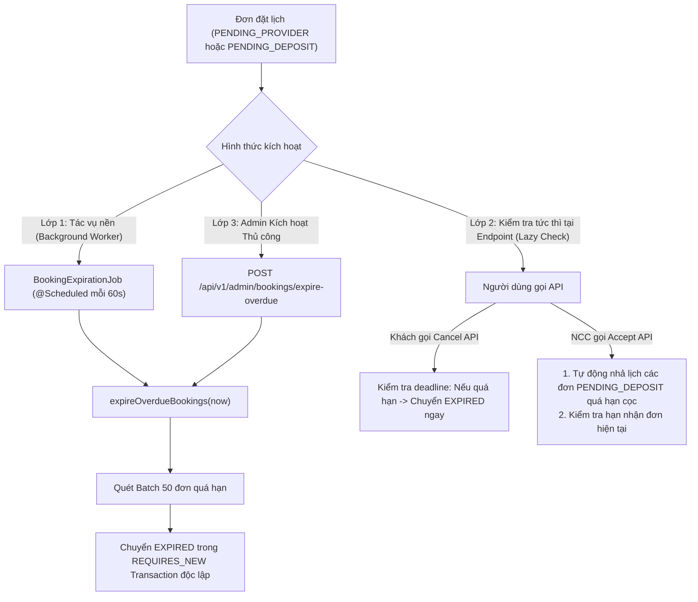
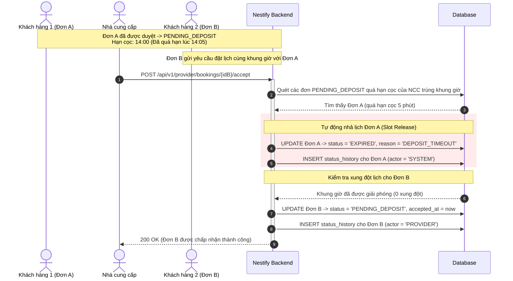

# Nestify — Tài Liệu Tích Hợp API & Vận Hành Hệ Thống (Handoff Frontend & Backend)
**Module:** Quản lý vòng đời đơn & Tự động hết hạn (Booking Lifecycle & Expiration)  
**Use Case:** UC51 — Hết hạn yêu cầu / giữ lịch và kiểm tra deadline ngay tại endpoint (Overdue Expiration & Hold Slot Release)  
**Phiên bản:** 1.0.0  
**Ngày cập nhật:** 05/11/2026  
**Người phụ trách backend:** Nguyễn Đình Thủy  

---

## 1. Tổng Quan Nghiệp Vụ

Tài liệu này đặc tả toàn bộ cơ chế **Hết hạn yêu cầu / giữ lịch và giải phóng ca làm việc (UC51)** trong hệ thống Nestify:

### 1.1. Hai loại Deadline cốt lõi trong hệ thống
1. **Quá hạn tiếp nhận đơn (`PENDING_PROVIDER`):**
   - Hạn chót: `request_expires_at` (mặc định 30 phút kể từ lúc khách tạo đơn, hoặc rút ngắn nếu đơn đặt sát giờ hẹn theo quy tắc `MD01`).
   - Xử lý: Khi `now >= request_expires_at`, đơn tự động chuyển trạng thái sang **`EXPIRED`**.
   - Phân loại kết thúc: `termination_kind = EXPIRE`, `termination_reason_code = PROVIDER_RESPONSE_TIMEOUT`, `actor_type = SYSTEM`.
   - **Chính sách:** Không tính lỗi khách hủy, không phạt khách.
2. **Quá hạn thanh toán tiền cọc 30% (`PENDING_DEPOSIT`):**
   - Hạn chót: `deposit_due_at` (mặc định 15 phút kể từ lúc Nhà cung cấp chấp nhận đơn, hoặc sát giờ hẹn theo `MD01`).
   - Xử lý: Khi `now >= deposit_due_at`, đơn tự động chuyển trạng thái sang **`EXPIRED`**.
   - Phân loại kết thúc: `termination_kind = EXPIRE`, `termination_reason_code = DEPOSIT_TIMEOUT`, `actor_type = SYSTEM`.
   - **Tác động:** Tự động giải phóng (nhả) khung giờ làm việc độc quyền của Nhà cung cấp để các khách hàng khác có thể đặt lịch.

---

### 1.2. Cơ chế thực thi song hành hai lớp (Dual-Layer Enforcement)

Hệ thống kết hợp 02 cơ chế vận hành song song để đảm bảo tính kịp thời và tính toàn vẹn dữ liệu tuyệt đối:



1. **Lớp 1 — Tác vụ nền định kỳ (`BookingExpirationJob`):**
   - Quét cơ sở dữ liệu định kỳ mỗi **60 giây** (`cron = 0 * * * * *`).
   - Xử lý từng bản ghi trong Transaction độc lập (`REQUIRES_NEW`), đảm bảo lỗi trên 1 đơn không làm sập toàn bộ batch.
2. **Lớp 2 — Kiểm tra tức thì tại Endpoint (Endpoint Lazy Check):**
   - Áp dụng ngay khi người dùng gọi API nghiệp vụ (Khách hủy đơn, Thợ duyệt/từ chối đơn).
   - Đảm bảo tính thời gian thực 0ms: Nếu vừa bước qua thời hạn dù tác vụ nền chưa tới lượt chạy, hệ thống vẫn nhận biết chính xác trạng thái hết hạn và nhả lịch ngay lập tức.
3. **Lớp 3 — Trigger thủ công dành cho Quản trị viên (`AdminBookingController`):**
   - Endpoint dành riêng cho Quản trị viên kích hoạt quét tức thì khi cần bảo trì, đối soát dữ liệu hoặc kiểm thử.

---

## 2. Thông Tin Môi Trường & Xác Thực

- **Base URL:**
  - Local / Dev: `http://localhost:8080`
  - Production (dự kiến): `https://api.nestify.vn`
- **Định dạng dữ liệu:** `application/json;charset=UTF-8`
- **Định dạng thời gian:** ISO-8601 UTC (`YYYY-MM-DDTHH:mm:ssZ`)
- **Cơ chế xác thực:** JWT Bearer Token qua header `Authorization: Bearer <accessToken>`.

---

## 3. Chi Tiết Endpoint Quản Trị Viên: Kích Hoạt Quét Hết Hạn Thủ Công

Endpoint cho phép Quản trị viên (Admin) hoặc hệ thống vận hành chủ động kích hoạt quét và kết thúc các đơn quá hạn ngay lập tức mà không cần chờ nhịp cron kế tiếp.

### 3.1. Thông tin Endpoint
- **Phương thức:** `POST`
- **URI Path chính:** `/api/v1/admin/bookings/expire-overdue`
- **URI Path Alias:** `/api/admin/bookings/expire-overdue`
- **Phân quyền bắt buộc:** **`ROLE_ADMIN`**
- **CSRF:** Không bắt buộc khi dùng JWT Bearer Token.

### 3.2. Headers
| Header | Bắt buộc | Giá trị mẫu | Mô tả |
| :--- | :---: | :--- | :--- |
| `Authorization` | **Có** | `Bearer eyJhbGciOiJIUzI1NiIsIn...` | Access Token của tài khoản Quản trị viên |
| `Content-Type` | Không | `application/json` | Không yêu cầu body |

### 3.3. Request Body
*Không có request body (để trống).*

### 3.4. Cấu trúc Response thành công (200 OK)
```json
{
  "success": true,
  "message": "Thực hiện quét và hết hạn các đơn đặt lịch quá hạn thành công",
  "data": {
    "providerExpiredCount": 2,
    "depositExpiredCount": 3,
    "totalExpiredCount": 5,
    "totalErrors": 0
  },
  "timestamp": "2026-11-05T15:30:00Z"
}
```

### 3.5. Chi tiết các trường dữ liệu Response (`data`)
| Trường | Kiểu | Mô tả |
| :--- | :---: | :--- |
| `providerExpiredCount` | `int` | Số lượng đơn `PENDING_PROVIDER` đã quá hạn phản hồi của Thợ và được chuyển sang `EXPIRED`. |
| `depositExpiredCount` | `int` | Số lượng đơn `PENDING_DEPOSIT` đã quá hạn cọc và được chuyển sang `EXPIRED` (đã nhả lịch). |
| `totalExpiredCount` | `int` | Tổng số đơn đã được tự động xử lý hết hạn (`providerExpiredCount + depositExpiredCount`). |
| `totalErrors` | `int` | Số lượng đơn gặp lỗi ngoại lệ trong quá trình cập nhật (nếu có, không ảnh hưởng đơn khác). |

---

## 4. Bảng Mã Lỗi & Xử Lý Ngoại Lệ

| HTTP Status | Error Code | Nguyên nhân | Hướng xử lý khuyến nghị |
| :--- | :--- | :--- | :--- |
| **401 Unauthorized** | `AUTHENTICATION_REQUIRED` | Chưa gửi header `Authorization` hoặc token không hợp lệ / hết hạn. | Điều hướng Quản trị viên về trang đăng nhập `/admin/login`. |
| **403 Forbidden** | `ACCESS_DENIED` | Tài khoản đăng nhập không có quyền `ROLE_ADMIN` (ví dụ tài khoản `CUSTOMER` hoặc `PROVIDER`). | Hiển thị thông báo: "Bạn không có quyền thực hiện tác vụ quản trị này." |
| **400 Bad Request** | `BUSINESS_ERROR` | Khi Khách hoặc NCC thao tác trên đơn đã quá hạn deadline. | Thông báo đơn đã hết hạn và tải lại dữ liệu mới nhất. |

---

## 5. Quy Tắc Chuyển Trạng Thái & Lịch Sử Đơn (`booking_status_history`)

Khi một đơn đặt lịch bị chuyển sang `EXPIRED`, cơ sở dữ liệu được cập nhật tự động các trường sau:

### 5.1. Bảng `bookings`
- `status`: Chuyển sang `'EXPIRED'`.
- `termination_kind`: Chuyển sang `'EXPIRE'`.
- `termination_actor_type`: Chuyển sang `'SYSTEM'`.
- `terminated_by_account_id`: `NULL` (do hệ thống thực hiện).
- `termination_reason_code`:
  - `'PROVIDER_RESPONSE_TIMEOUT'` (nếu quá hạn nhận việc).
  - `'DEPOSIT_TIMEOUT'` (nếu quá hạn nộp tiền cọc).
- `termination_reason`: Ghi rõ lý do tiếng Việt (ví dụ: *"Quá hạn phản hồi của Nhà cung cấp (30 phút hoặc sát giờ hẹn)"*).
- `terminated_at`: Thời điểm thực tế hết hạn (`Instant.now()`).
- `refund_percent`: `100%` (không trừ tiền cọc do lỗi hệ thống/thời gian).

### 5.2. Bảng `booking_status_history`
Mỗi lần hết hạn đều ghi thêm 01 bản ghi lịch sử kiểm toán:
```sql
INSERT INTO booking_status_history (
    booking_id, from_status, to_status, actor_type, actor_account_id, reason_code, note, created_at
) VALUES (
    :bookingId, :oldStatus, 'EXPIRED', 'SYSTEM', NULL, :reasonCode, :note, :now
);
```

---

## 6. Sơ Đồ Kịch Bản Cạnh Tranh Giữ Lịch (Hold Slot Release)

Kịch bản đơn cũ giữ chỗ quá hạn nộp cọc bị nhả lịch khi có đơn mới cạnh tranh cùng khung giờ:



---

## 7. Mã Mẫu cURL Kiểm Thử Thực Tế (Copy & Run)

### Bước 1: Đăng nhập tài khoản Quản trị viên (Lấy Access Token)
```bash
curl -X POST http://localhost:8080/api/v1/auth/login \
  -H "Content-Type: application/json" \
  -d '{
    "email": "admin@nestify.vn",
    "password": "AdminPassword123!"
  }'
```
*Trích xuất `accessToken` từ trường `data.accessToken` trong JSON phản hồi.*

---

### Bước 2: Kích hoạt quét hết hạn thủ công (Admin On-Demand Trigger)
```bash
curl -X POST http://localhost:8080/api/v1/admin/bookings/expire-overdue \
  -H "Authorization: Bearer <ADMIN_ACCESS_TOKEN>" \
  -H "Content-Type: application/json"
```

**Kết quả mẫu trả về:**
```json
{
  "success": true,
  "message": "Thực hiện quét và hết hạn các đơn đặt lịch quá hạn thành công",
  "data": {
    "providerExpiredCount": 1,
    "depositExpiredCount": 2,
    "totalExpiredCount": 3,
    "totalErrors": 0
  },
  "timestamp": "2026-11-05T15:45:00Z"
}
```

---

### Bước 3: Kiểm tra chi tiết đơn sau khi bị hết hạn
```bash
curl -X GET http://localhost:8080/api/v1/bookings/101 \
  -H "Authorization: Bearer <CUSTOMER_HOAC_PROVIDER_ACCESS_TOKEN>"
```

**Kết quả mẫu xác nhận:**
```json
{
  "success": true,
  "data": {
    "id": 101,
    "bookingCode": "BK-20261105-00101",
    "status": "EXPIRED",
    "requestExpiresAt": "2026-11-05T15:00:00Z",
    "depositDueAt": null,
    "totalAmountVnd": 450000,
    "depositAmountVnd": 135000
  }
}
```

---

### Bước 4: Kiểm tra Lazy Check khi Khách thao tác trên đơn quá hạn
```bash
curl -X POST http://localhost:8080/api/v1/customer/bookings/101/cancel \
  -H "Authorization: Bearer <CUSTOMER_ACCESS_TOKEN>" \
  -H "Content-Type: application/json" \
  -d '{
    "version": 0,
    "reason": "Khách đổi ý hủy đơn"
  }'
```

**Kết quả phản hồi (400 Bad Request — Chặn hủy và xác nhận đơn đã kết thúc):**
```json
{
  "code": "BOOKING_CANNOT_BE_CANCELLED",
  "message": "Đơn đặt lịch đã quá hạn phản hồi của Nhà cung cấp và đã kết thúc (EXPIRED).",
  "fieldErrors": {}
}
```

---

## 8. Hướng Dẫn Tích Hợp Giao Diện Frontend (React / TypeScript)

### 8.1. Service Gọi API Quản Trị
```typescript
import axios from 'axios';

export interface BookingExpirationResult {
  providerExpiredCount: number;
  depositExpiredCount: number;
  totalExpiredCount: number;
  totalErrors: number;
}

export interface StandardResponse<T> {
  success: boolean;
  message: string;
  data: T;
  timestamp: string;
}

/**
 * Kích hoạt quét và hết hạn đơn đặt lịch quá hạn (Chỉ dành cho Admin).
 */
export async function triggerBookingExpiration(adminAccessToken: string): Promise<BookingExpirationResult> {
  const response = await axios.post<StandardResponse<BookingExpirationResult>>(
    '/api/v1/admin/bookings/expire-overdue',
    {},
    {
      headers: {
        Authorization: `Bearer ${adminAccessToken}`,
      },
    }
  );
  return response.data.data;
}
```

### 8.2. Component Đếm Ngược Deadline Cho Khách & Thợ (`BookingCountdownBadge`)
```tsx
import React, { useState, useEffect } from 'react';

interface CountdownProps {
  status: 'PENDING_PROVIDER' | 'PENDING_DEPOSIT' | string;
  requestExpiresAt?: string | null;
  depositDueAt?: string | null;
  onExpired?: () => void;
}

export const BookingCountdownBadge: React.FC<CountdownProps> = ({
  status,
  requestExpiresAt,
  depositDueAt,
  onExpired,
}) => {
  const deadlineStr = status === 'PENDING_PROVIDER' ? requestExpiresAt : depositDueAt;
  const [timeLeftSeconds, setTimeLeftSeconds] = useState<number>(0);

  useEffect(() => {
    if (!deadlineStr) return;

    const deadline = new Date(deadlineStr).getTime();

    const updateTimer = () => {
      const remaining = Math.max(0, Math.floor((deadline - Date.now()) / 1000));
      setTimeLeftSeconds(remaining);
      if (remaining === 0 && onExpired) {
        onExpired();
      }
    };

    updateTimer();
    const interval = setInterval(updateTimer, 1000);
    return () => clearInterval(interval);
  }, [deadlineStr, onExpired]);

  if (!deadlineStr) return null;

  if (timeLeftSeconds <= 0) {
    return <span className="badge bg-secondary">Đã hết hạn</span>;
  }

  const minutes = Math.floor(timeLeftSeconds / 60);
  const seconds = timeLeftSeconds % 60;

  return (
    <span className={`badge ${timeLeftSeconds < 300 ? 'bg-danger' : 'bg-warning text-dark'}`}>
      Thời gian còn lại: {minutes}:{seconds < 10 ? `0${seconds}` : seconds}
    </span>
  );
};
```
